<div align="center">

<picture>
  <source media="(prefers-color-scheme: dark)" srcset="docs/assets/banner-dark.png">
  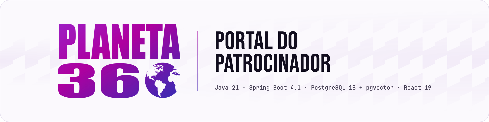
</picture>

**[Tour](#tour) · [Getting started](#getting-started) · [Usage](#usage) · [How it works](#how-it-works) · [Português](README.pt-BR.md)**

<a href="LICENSE"></a>


<br><br>

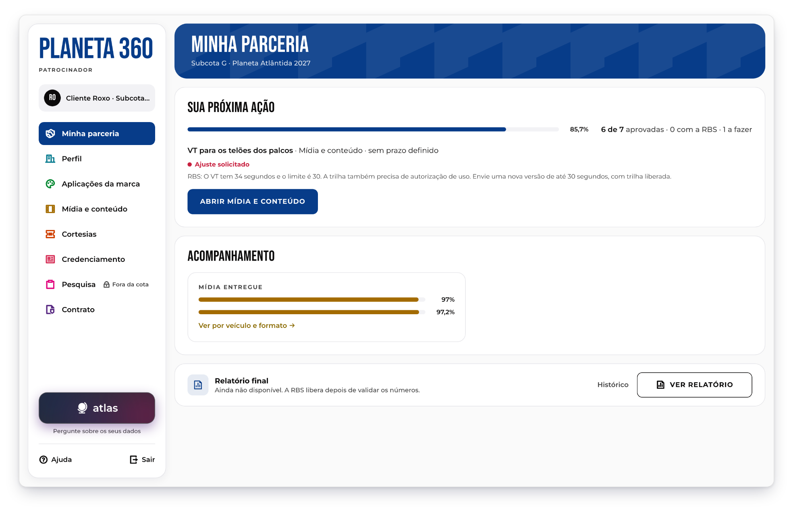

</div>

## A sponsor portal where each brand follows its own festival partnership.

Planeta 360 is the sponsor portal of a music festival. Every brand sees only its own partnership: what it has to deliver, what the organizer approved or sent back, how much of the contracted media has aired, and the final report. The organizer's team registers partnerships, reviews materials, imports the spreadsheets that broadcasters and agencies send, and builds the report from that base instead of assembling it by hand. Atlas, the built-in assistant, answers questions about each brand's numbers and the event documents, and cites where every number came from.

> [!NOTE]
> Built by a student team for Desafio GC 2026, a challenge set by RBS around the Planeta Atlântida festival. It is not an official RBS product. All brands, people and documents in the demo data are fictitious, and the interface is in Brazilian Portuguese.

## Features

- **One partnership per brand** - a sponsor sees only its own data; another brand's partnership answers 404, and the API tests check it.
- **Deliveries with history** - files, text or links, with versions, approval or a request for changes, and a history the database will not let anyone edit.
- **Import with provenance** - drop a broadcaster's spreadsheet, check each number against the cell it came from, then confirm what enters the base.
- **Media base** - contracted vs. delivered per brand, outlet, format and month, with .xlsx and CSV export.
- **Report from the base** - 6 sections and 17 indicators, validated and released by the organizer; missing data shows as unavailable, with the reason.
- **Atlas assistant** - an optional LLM chat that answers with the portal's numbers and cited documents; the server checks every number's origin before it reaches the screen.

## Tour

The animations below come from the project's demo walkthrough, recorded on fictitious data.

### For sponsors

<p align="center">
  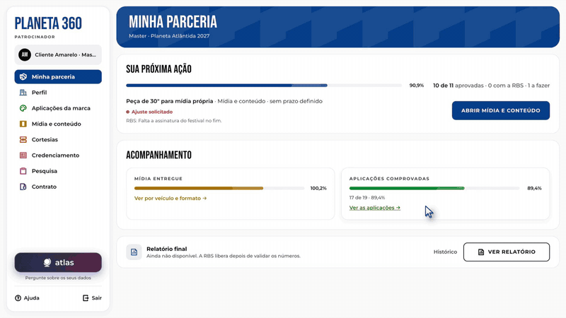
  <br><sub><b>Minha parceria</b> points to the next action, and the brand sends a new version of a video the organizer sent back.</sub>
</p>

<p align="center">
  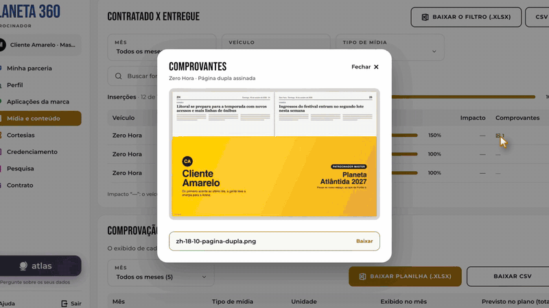
  <br><sub>In <b>Aplicações da marca</b>, the portal reads the agency's count sheet and shows the cell behind each number before anything is saved.</sub>
</p>

### For the organizer

<p align="center">
  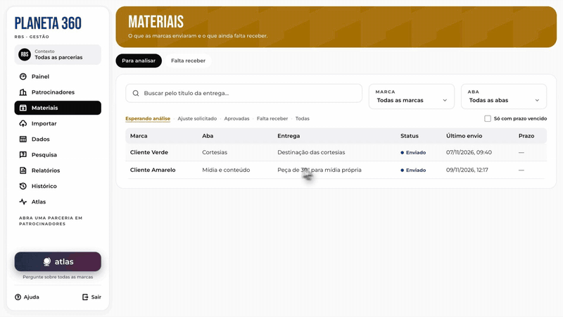
  <br><sub><b>Materiais</b> lists what the brands sent; the organizer opens the new version and approves it.</sub>
</p>

<p align="center">
  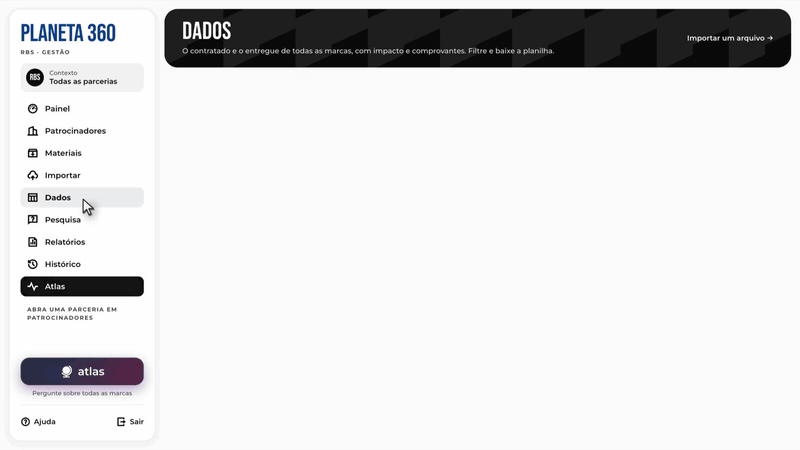
  <br><sub><b>Dados</b> holds the media of every brand, with filters and export; then the edition survey and the post-event reports. The import is in <a href="#usage">Usage</a>.</sub>
</p>

### Atlas

<p align="center">
  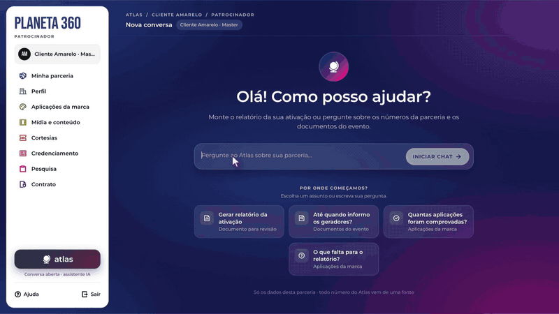
  <br><sub>A brand asks about its credentials. The answer cites the commercial plan, and the chip opens the PDF on the cited page with the passage highlighted.</sub>
</p>

<p align="center">
  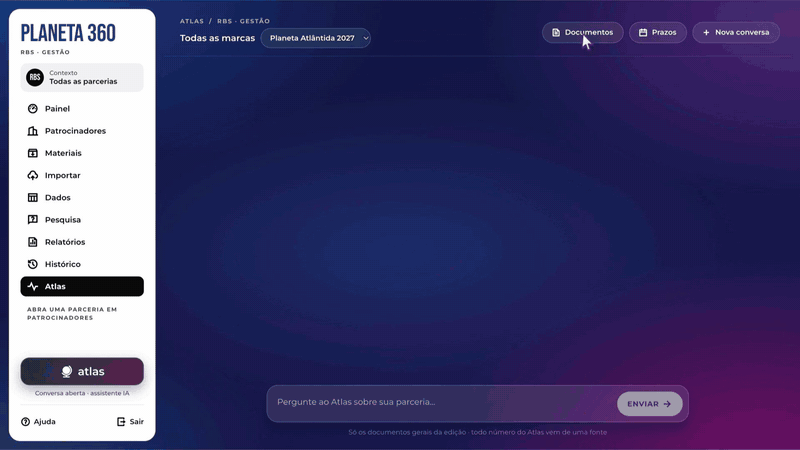
  <br><sub>The organizer checks the documents Atlas reads and asks about one brand's delivery in November.</sub>
</p>

> [!NOTE]
> The Atlas answers in these two animations were scripted for the demo video, so no model was called. With a model connected, the same screens show its answer as it streams.

## Getting started

> [!NOTE]
> You need JDK 21 or newer, Node.js 24 LTS (22.22+ works), and PostgreSQL 15 or newer (18 recommended) with [pgvector](https://github.com/pgvector/pgvector) 0.8.0+. Maven is not needed: the repository ships the Maven Wrapper. Ports 5432, 8080 and 5173 must be free.

Create the database role and databases once, in `psql` as a PostgreSQL superuser:

```sql
CREATE ROLE portal LOGIN PASSWORD 'portal';
CREATE DATABASE portal OWNER portal;
CREATE DATABASE portal_teste OWNER portal;
```

Then clone and prepare pgvector (macOS and Linux; it installs pgvector with Homebrew if needed and creates the `atlas_ro` role):

```bash
git clone https://github.com/PHMFG/planeta-360.git
cd planeta-360
scripts/preparar-banco-atlas.sh
```

Start the API with the demo data, in one terminal:

```bash
cd backend
./mvnw spring-boot:run -Dspring-boot.run.profiles=dev
```

It is ready when the log shows `Started PortalApplication`. Flyway creates the tables and loads three fictitious sponsors. Then start the web app in another terminal:

```bash
cd frontend
npm install
npm run dev
```

Open http://localhost:5173. Vite forwards `/api` to the API on port 8080, so both run as one site.

> [!IMPORTANT]
> The API refuses to start without pgvector and the `atlas_ro` role in the database. Run `scripts/preparar-banco-atlas.sh` again whenever you create a new database. On Windows, install pgvector by hand and run the script's SQL in `psql`.

<details>
<summary><b>Optional: turn on Atlas</b></summary>
<br>

Without these variables the portal and the tests work normally, but Atlas does not answer. Keys go in environment variables or in `backend/config/segredos.local.properties` (copy `segredos.exemplo.properties`; Git ignores the local file).

| Variable | What it enables |
| --- | --- |
| `ATLAS_LLM=openai`, `OPENCODE_API_KEY` | The chat, through any OpenAI-compatible endpoint (`ATLAS_LLM_BASE_URL`, `ATLAS_LLM_MODELO`; DeepSeek V4.1 Flash on OpenCode Go by default) |
| `ATLAS_EMBEDDINGS=gemini`, `GEMINI_API_KEY` | Semantic search over the event documents. Without it, search is text only |
| `ATLAS_JEV`, `TYPESAFE_API_KEY` | A classifier that checks intent and answers at six decision points. Optional |

The full list, with defaults, is in [`docs/arquitetura.md`](docs/arquitetura.md) and [`docs/api.md`](docs/api.md) (in Portuguese).

</details>

Tests:

```bash
cd backend && ./mvnw test
cd frontend && npm run build && npm run lint
```

The backend suite (about 3,700 tests) uses the `portal_teste` database and drops it on every run; set `PORTAL_BD_TESTE_URL` to use another one. It needs no API key.

## Usage

Every demo account uses the password `senha123`. The portal picks the profile from the account.

| Account | Profile |
| --- | --- |
| `marketing@roxo.example` | Sponsor, Cliente Roxo (Subcota G) |
| `marketing@amarelo.example` | Sponsor, Cliente Amarelo (Master) |
| `b2b@rbs.example` | Organizer team, all partnerships |

1. Sign in as `marketing@roxo.example`. **Minha parceria** shows the next action: the stage video in **Ajuste solicitado**, with the organizer's note.
2. In **Mídia e conteúdo**, drop a PDF, image or video on the upload area and send it. It becomes a new version with author, date and status **Enviado**.
3. Still as Roxo, open http://localhost:5173/parceria/2, the Amarelo partnership. The screen says **Parceria não encontrada** and the API answers 404.
4. Sign in as `b2b@rbs.example`. In **Importar**, drop [`backend/src/test/resources/importacao/corpus/tv-novembro.xlsx`](backend/src/test/resources/importacao/corpus/tv-novembro.xlsx), a fictitious TV delivery sheet. The import reads it without any model: 9 rows wait in **Para revisar** and 6 passages are set aside as not understood. Click the pin next to a value to open the cell it came from, then **Aceitar as 9** and **Confirmar**.
5. In **Materiais**, approve the Roxo upload, and in **Relatórios** generate, validate and release the Roxo report. Back as Roxo, it opens in **Relatório**.

<p align="center">
  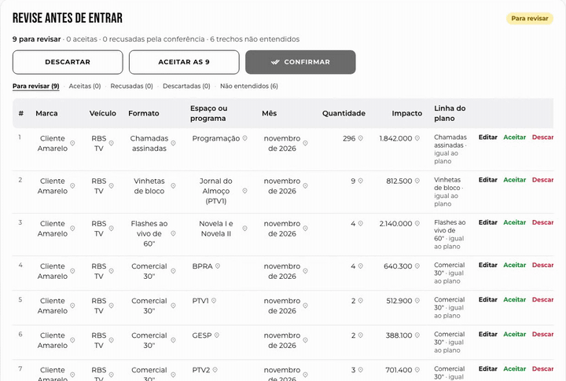
</p>

## Screens

<details>
<summary><b>Import review, quota change, media, Atlas documents and mobile</b></summary>
<br>

<p align="center">
  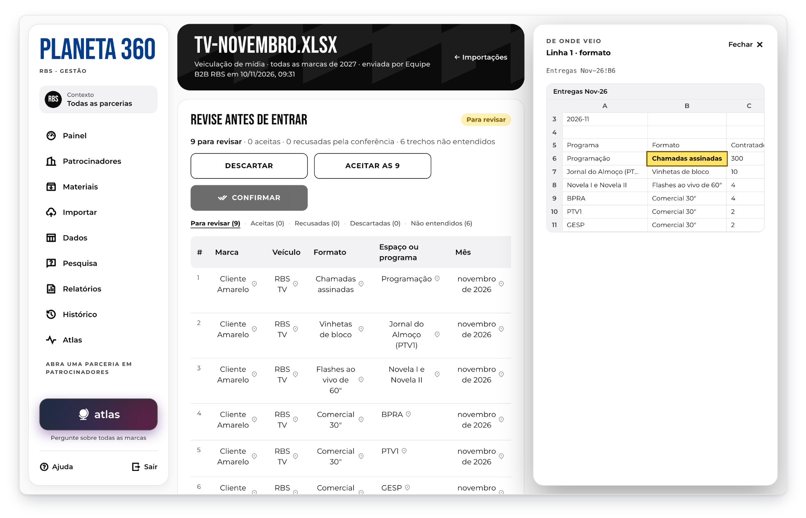<br>
  <em>Every imported number keeps the cell it came from.</em>
</p>

<p align="center">
  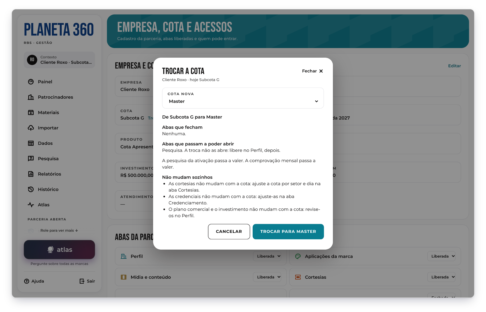<br>
  <em>Changing a brand's quota shows the impact before it happens.</em>
</p>

<p align="center">
  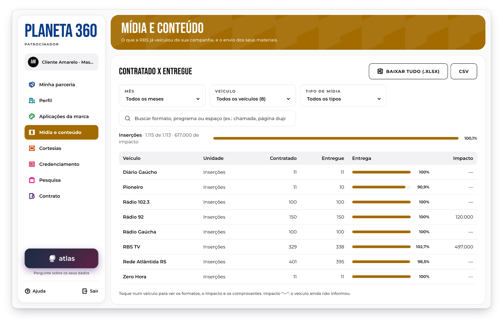<br>
  <em>A Master sponsor follows contracted vs. delivered media by outlet.</em>
</p>

<p align="center">
  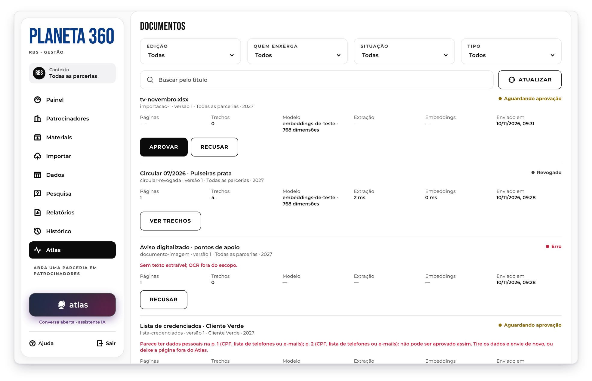<br>
  <em>Documents that seem to hold personal data cannot be approved for Atlas.</em>
</p>

<p align="center">
  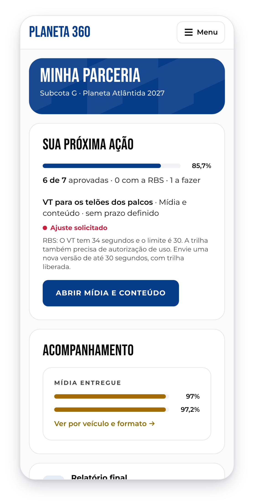<br>
  <em>On a phone, the menu moves into a drawer.</em>
</p>

</details>

## How it works

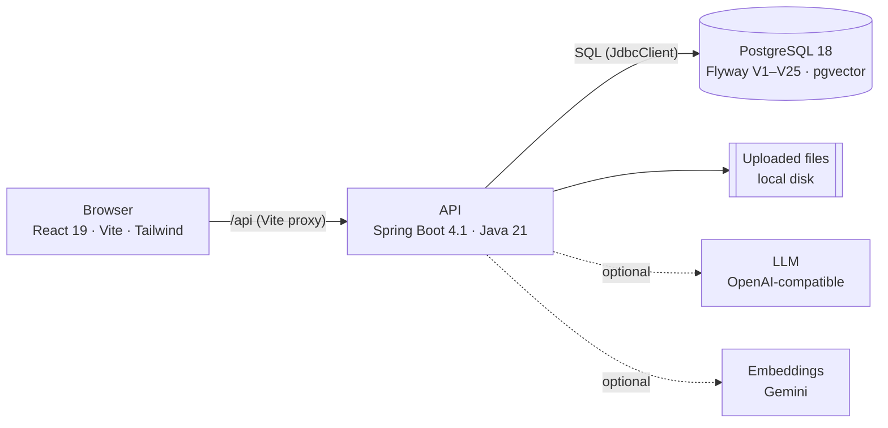

The browser and the API share one origin, with a session cookie and a CSRF token instead of a bearer token. Rules that must always hold, such as the immutable history, the report status order or the courtesy-ticket limits, live in PostgreSQL triggers; rules that depend on who is calling (profile, partnership, tab) live in the API; the web app only repeats them to guide the screen. Repositories use hand-written SQL with no ORM, and the media and report figures come from views and functions in the database. The design is described in [`docs/arquitetura.md`](docs/arquitetura.md), the API contract in [`docs/api.md`](docs/api.md) and the schema in [`docs/banco.md`](docs/banco.md), all in Portuguese.

### Inside Atlas

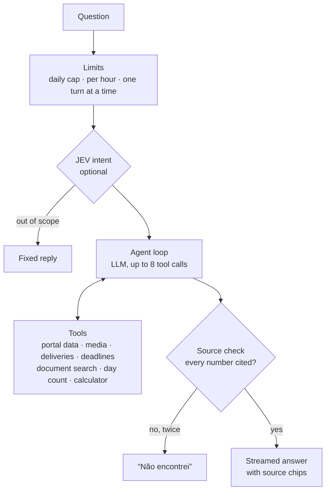

- **The model never brings its own numbers.** Each tool returns numbered sources: `T#` for a document passage, `R#` for a portal record, `C#` for a calculation or a day count. Before a sentence reaches the screen, the server checks that every number and date in it is in a source cited in that sentence, in a calculation of the turn or in what the person wrote. A failed check asks for one rewrite; a second failure becomes a fixed "not found".
- **Arithmetic is code.** `contar_dias` counts days with `java.time` and the holidays; `calcular` runs a sandboxed JEXL expression whose variables must each have an origin.
- **Search is hybrid and isolated.** Documents are split by page, embedded with Gemini and stored in pgvector. A query mixes vector and full-text results (reciprocal rank fusion) under a read-only `atlas_ro` role, and row-level security limits it to the edition, quota and partnership of the conversation. A document that seems to hold personal data cannot be approved.
- **The brand's conversation has no partnership argument.** The partnership comes from the session, so a brand cannot ask about another one. The organizer has its own conversation over the whole edition.
- **Guard rails.** Daily and hourly limits per partnership and per person, circuit breakers for the model, JEV and Gemini, and a per-turn trace (steps, timings, tokens, cost) in the diagnostics. The model's reasoning stays on the server; the screen shows only a short summary that passes the same checks.
- **Reports by placeholder.** When Atlas drafts the activation report, the model writes text with placeholders and the server fills in every number, with its origin under the report's sources.

Details, with every tool and limit, are in sections 5 and 6 of [`docs/arquitetura.md`](docs/arquitetura.md).

## Roadmap

- [x] Sponsor portal: seven tabs, deliveries in file, text or link, versions and history
- [x] Organizer tools: partnerships, tabs and quotas, materials queue, CSV loads and history
- [x] Import with provenance, media base and typed survey questions
- [x] Report from the base, with the post-event annex
- [x] Atlas: chat with cited sources, report drafting and per-turn diagnostics
- [ ] Automatic activation e-mail and password recovery (today the organizer passes the code on)
- [ ] Login rate limiting and a `Secure` session cookie behind HTTPS
- [ ] Audio in the import
- [ ] Open Staff integration (today a link to the external site)
- [ ] Native PDF export of the report (today through the browser's print)
- [ ] Docker image and public deployment

## License and credits

MIT. See [LICENSE](LICENSE). Built by the Desafio GC 2026 team; the original repository is [Gabriela-Mattos-18/planeta-360](https://github.com/Gabriela-Mattos-18/planeta-360).

| Component | Use | License |
| --- | --- | --- |
| [Spring Boot](https://spring.io/projects/spring-boot) and [Spring AI](https://spring.io/projects/spring-ai) | API, security, LLM client | Apache-2.0 |
| [Flyway](https://github.com/flyway/flyway) | Database migrations | Apache-2.0 |
| [PostgreSQL](https://www.postgresql.org) and [pgvector](https://github.com/pgvector/pgvector) | Database and vector search | PostgreSQL License |
| [Apache POI](https://poi.apache.org), [PDFBox](https://pdfbox.apache.org), Commons CSV and JEXL | Reading spreadsheets, Office files and PDFs | Apache-2.0 |
| [Bucket4j](https://github.com/bucket4j/bucket4j) and [Resilience4j](https://github.com/resilience4j/resilience4j) | Rate limits and circuit breakers | Apache-2.0 |
| [React](https://react.dev), [React Router](https://reactrouter.com), [Vite](https://vite.dev) and [Tailwind CSS](https://tailwindcss.com) | Web app | MIT |
| [react-pdf](https://github.com/wojtekmaj/react-pdf) and [pdf.js](https://github.com/mozilla/pdf.js) | PDF viewer | MIT and Apache-2.0 |
| [Remix Icon](https://github.com/Remix-Design/RemixIcon) | Interface icons | Remix Icon License v1.0 |
| [Bebas Neue](https://fonts.google.com/specimen/Bebas+Neue) and [Montserrat](https://fonts.google.com/specimen/Montserrat) | Interface fonts | SIL OFL 1.1 |
| [JetBrains Mono](https://github.com/JetBrains/JetBrainsMono) | Stack line in the banner | SIL OFL 1.1 |

Remix Icon 4.9 ships under its own license, which allows use inside apps and documentation but not as a logo. The optional AI providers (OpenCode Go and the Gemini API) have their own terms; send them fictitious data only. Planeta Atlântida and RBS are trademarks of their owners: the festival emblem on the login screen is not covered by this project's license and does not appear in these images.
