<div align="center">

<picture>
  <source media="(prefers-color-scheme: dark)" srcset="docs/assets/banner-dark.png">
  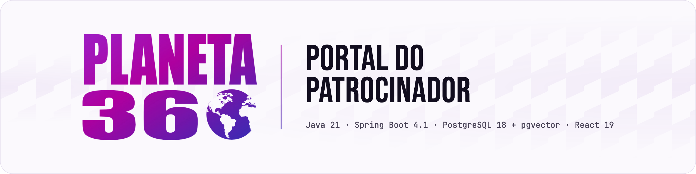
</picture>

**[Tour](#tour-pelas-telas) · [Como começar](#como-começar) · [Uso](#uso) · [Como funciona](#como-funciona) · [English](README.md)**

<a href="LICENSE"></a>


<br><br>

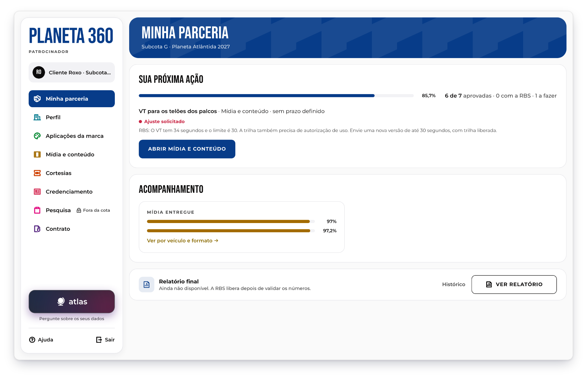

</div>

## Um portal em que cada marca patrocinadora acompanha a própria parceria com o festival.

O Planeta 360 é o portal dos patrocinadores de um festival de música. Cada marca vê só a própria parceria: o que precisa entregar, o que a organização aprovou ou devolveu, quanto da mídia contratada já foi ao ar e o relatório final. A equipe da organização cadastra as parcerias, analisa os materiais, importa as planilhas que veículos e agências mandam e gera o relatório a partir dessa base, sem montagem manual. O Atlas, o assistente do portal, responde sobre os números de cada marca e os documentos do evento, e diz de onde veio cada número.

> [!NOTE]
> Feito por uma equipe de estudantes para o Desafio GC 2026, um desafio proposto pela RBS em torno do festival Planeta Atlântida. Não é um produto oficial da RBS. As marcas, pessoas e documentos da amostra são fictícios, e a interface está em português.

## Recursos

- **Uma parceria por marca** - o patrocinador vê só os próprios dados; a parceria de outra marca responde 404, e os testes da API conferem isso.
- **Entregas com histórico** - arquivo, texto ou link, com versões, aprovação ou pedido de ajuste e um histórico que o banco não deixa ninguém editar.
- **Importação com origem** - arraste a planilha de um veículo, confira cada número na célula de onde ele veio e confirme o que entra na base.
- **Base de mídia** - contratado x entregue por marca, veículo, formato e mês, com exportação em .xlsx e CSV.
- **Relatório a partir da base** - 6 seções e 17 indicadores, validado e liberado pela organização; sem dado, o indicador aparece como indisponível, com o motivo.
- **Atlas, o assistente** - um chat opcional com modelo de linguagem que responde com os números do portal e documentos citados; o servidor confere a origem de cada número antes de ele chegar à tela.

## Tour pelas telas

As animações abaixo vêm do vídeo de demonstração do projeto, gravado com dados fictícios.

### Para a marca

<p align="center">
  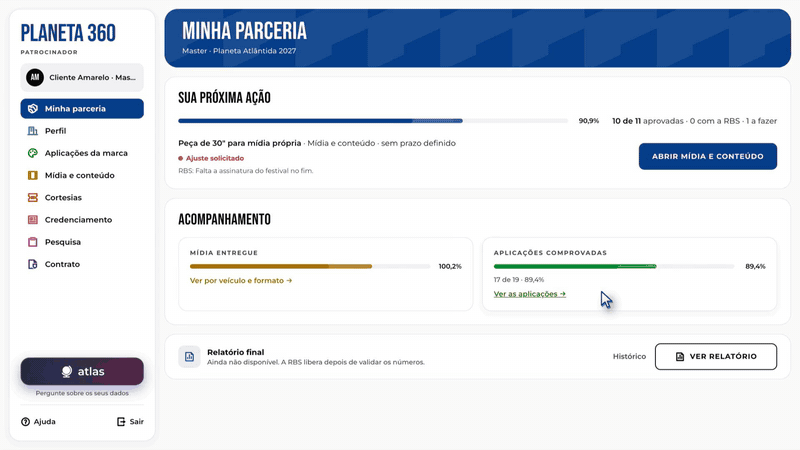
  <br><sub><b>Minha parceria</b> aponta a próxima ação, e a marca envia uma nova versão do vídeo que a organização devolveu.</sub>
</p>

<p align="center">
  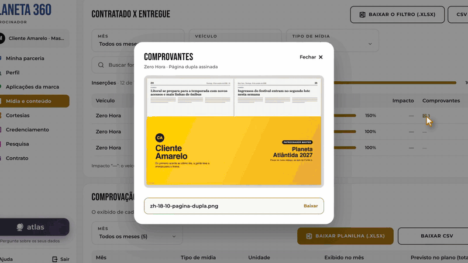
  <br><sub>Em <b>Aplicações da marca</b>, o portal lê a planilha de contagem da agência e mostra a célula de cada número antes de salvar.</sub>
</p>

### Para a organização

<p align="center">
  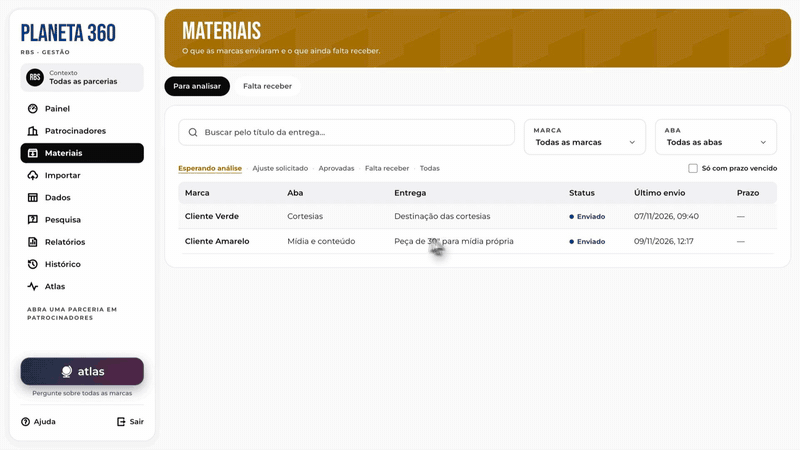
  <br><sub><b>Materiais</b> lista o que as marcas enviaram; a organização abre a nova versão e aprova.</sub>
</p>

<p align="center">
  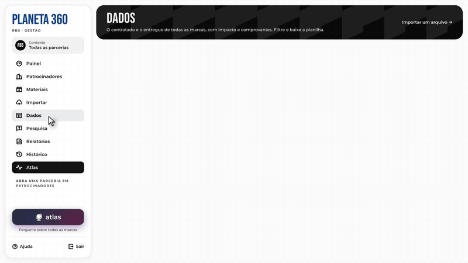
  <br><sub><b>Dados</b> reúne a mídia de todas as marcas, com filtros e exportação; depois vêm a pesquisa da edição e os relatórios pós-evento. A importação está em <a href="#uso">Uso</a>.</sub>
</p>

### Atlas

<p align="center">
  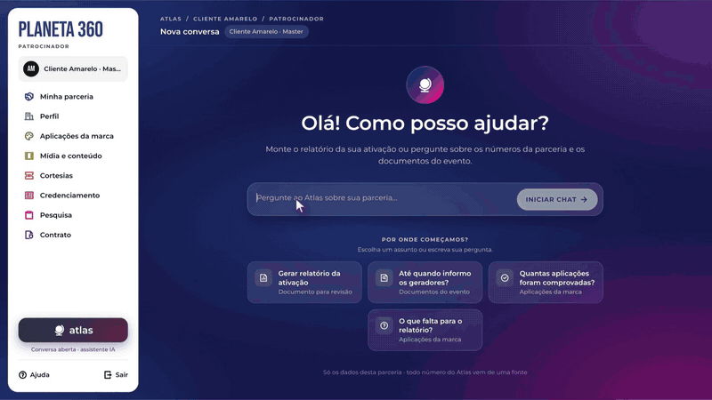
  <br><sub>A marca pergunta das credenciais. A resposta cita o plano comercial, e o chip abre o PDF na página citada, com o trecho destacado.</sub>
</p>

<p align="center">
  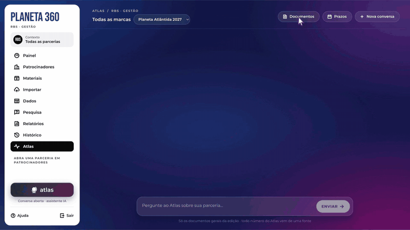
  <br><sub>A organização confere os documentos que o Atlas lê e pergunta sobre a entrega de uma marca em novembro.</sub>
</p>

> [!NOTE]
> As respostas do Atlas nestas duas animações foram roteirizadas para o vídeo de demonstração, então nenhum modelo foi chamado. Com um modelo ligado, as mesmas telas mostram a resposta dele enquanto ela chega.

## Como começar

> [!NOTE]
> Você precisa do JDK 21 ou mais novo, do Node.js 24 LTS (o 22.22+ funciona) e do PostgreSQL 15 ou mais novo (o 18 é o recomendado), com o [pgvector](https://github.com/pgvector/pgvector) 0.8.0+. Não precisa de Maven: o repositório traz o Maven Wrapper. As portas 5432, 8080 e 5173 precisam estar livres.

Crie o usuário e os bancos uma vez só, no `psql`, como superusuário do PostgreSQL:

```sql
CREATE ROLE portal LOGIN PASSWORD 'portal';
CREATE DATABASE portal OWNER portal;
CREATE DATABASE portal_teste OWNER portal;
```

Depois clone o repositório e prepare o pgvector (macOS e Linux; o script instala o pgvector pelo Homebrew, se precisar, e cria o papel `atlas_ro`):

```bash
git clone https://github.com/PHMFG/planeta-360.git
cd planeta-360
scripts/preparar-banco-atlas.sh
```

Suba a API com a amostra de demonstração, num terminal:

```bash
cd backend
./mvnw spring-boot:run -Dspring-boot.run.profiles=dev
```

Ela está pronta quando o log mostra `Started PortalApplication`. O Flyway cria as tabelas e carrega três patrocinadores fictícios. Depois suba o front em outro terminal:

```bash
cd frontend
npm install
npm run dev
```

Abra http://localhost:5173. O Vite repassa `/api` para a API na porta 8080, então os dois funcionam como um site só.

> [!IMPORTANT]
> A API não sobe sem o pgvector e o papel `atlas_ro` no banco. Rode o `scripts/preparar-banco-atlas.sh` de novo sempre que criar um banco. No Windows, instale o pgvector à mão e rode no `psql` o SQL do script.

<details>
<summary><b>Opcional: ligar o Atlas</b></summary>
<br>

Sem estas variáveis, o portal e os testes funcionam normalmente, mas o Atlas não responde. As chaves vão em variáveis de ambiente ou em `backend/config/segredos.local.properties` (copie o `segredos.exemplo.properties`; o Git ignora o arquivo local).

| Variável | O que liga |
| --- | --- |
| `ATLAS_LLM=openai`, `OPENCODE_API_KEY` | O chat, por qualquer serviço compatível com a API da OpenAI (`ATLAS_LLM_BASE_URL`, `ATLAS_LLM_MODELO`; por padrão, o DeepSeek V4.1 Flash no OpenCode Go) |
| `ATLAS_EMBEDDINGS=gemini`, `GEMINI_API_KEY` | A busca por significado nos documentos do evento. Sem ela, a busca é só textual |
| `ATLAS_JEV`, `TYPESAFE_API_KEY` | Um classificador que confere intenção e respostas em seis pontos de decisão. Opcional |

A lista completa, com os padrões, está em [`docs/arquitetura.md`](docs/arquitetura.md) e [`docs/api.md`](docs/api.md).

</details>

Testes:

```bash
cd backend && ./mvnw test
cd frontend && npm run build && npm run lint
```

A suíte do back (cerca de 3.700 testes) usa o banco `portal_teste` e o apaga a cada execução; para usar outro, informe `PORTAL_BD_TESTE_URL`. Ela não pede chave nenhuma.

## Uso

Todas as contas de demonstração usam a senha `senha123`. O portal detecta o perfil pela conta.

| Conta | Perfil |
| --- | --- |
| `marketing@roxo.example` | Patrocinador, Cliente Roxo (Subcota G) |
| `marketing@amarelo.example` | Patrocinador, Cliente Amarelo (Master) |
| `b2b@rbs.example` | Equipe da organização, todas as parcerias |

1. Entre como `marketing@roxo.example`. **Minha parceria** mostra a próxima ação: o VT dos telões em **Ajuste solicitado**, com o recado da organização.
2. Em **Mídia e conteúdo**, solte um PDF, uma imagem ou um vídeo na área de envio e envie. O arquivo vira uma nova versão, com autor, data e status **Enviado**.
3. Ainda como Roxo, abra http://localhost:5173/parceria/2, a parceria do Amarelo. A tela diz **Parceria não encontrada** e a API responde 404.
4. Entre como `b2b@rbs.example`. Em **Importar**, arraste o [`backend/src/test/resources/importacao/corpus/tv-novembro.xlsx`](backend/src/test/resources/importacao/corpus/tv-novembro.xlsx), uma planilha fictícia de entregas da TV. A importação lê o arquivo sem modelo nenhum: 9 linhas esperam em **Para revisar** e 6 trechos ficam de lado, como não entendidos. Toque no alfinete ao lado de um valor para abrir a célula de onde ele veio e depois em **Aceitar as 9** e **Confirmar**.
5. Em **Materiais**, aprove o envio do Roxo e, em **Relatórios**, gere, valide e disponibilize o relatório do Roxo. De volta como Roxo, ele abre em **Relatório**.

<p align="center">
  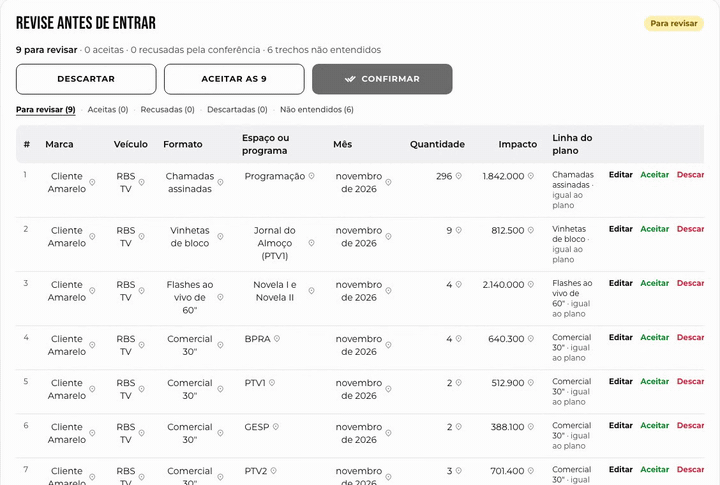
</p>

## Telas

<details>
<summary><b>Revisão da importação, troca de cota, mídia, documentos do Atlas e celular</b></summary>
<br>

<p align="center">
  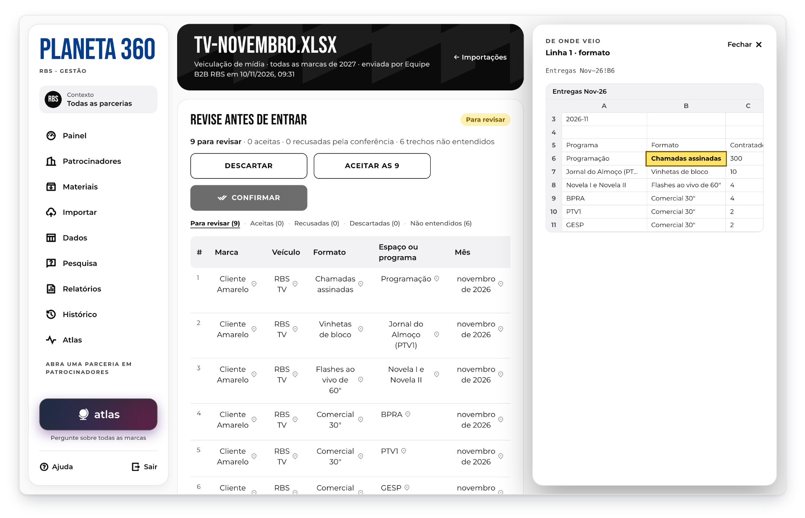<br>
  <em>Cada número importado guarda a célula de onde veio.</em>
</p>

<p align="center">
  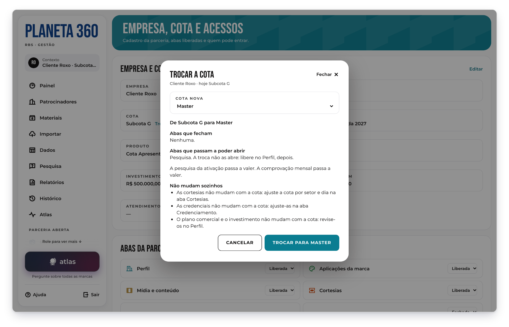<br>
  <em>A troca de cota mostra o impacto antes de acontecer.</em>
</p>

<p align="center">
  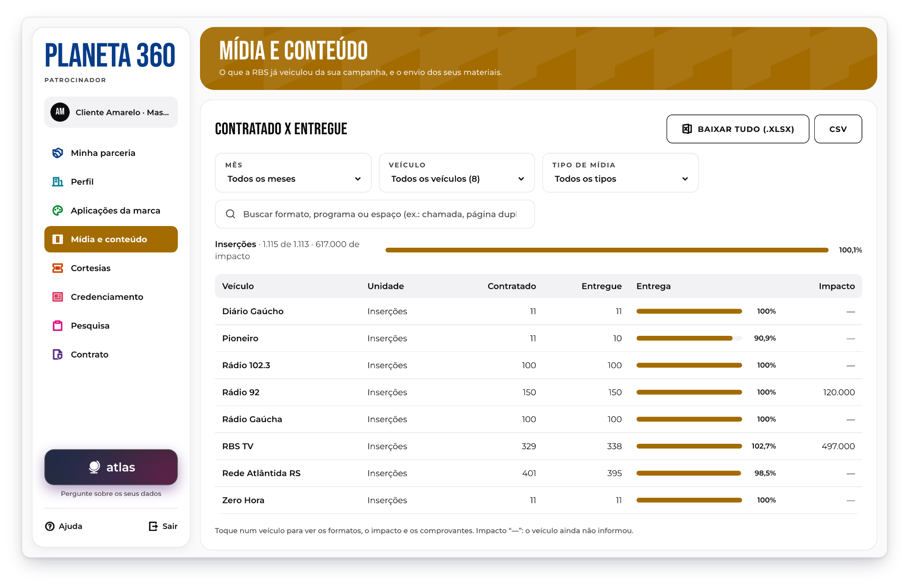<br>
  <em>A marca Master acompanha a mídia contratada e a entregue por veículo.</em>
</p>

<p align="center">
  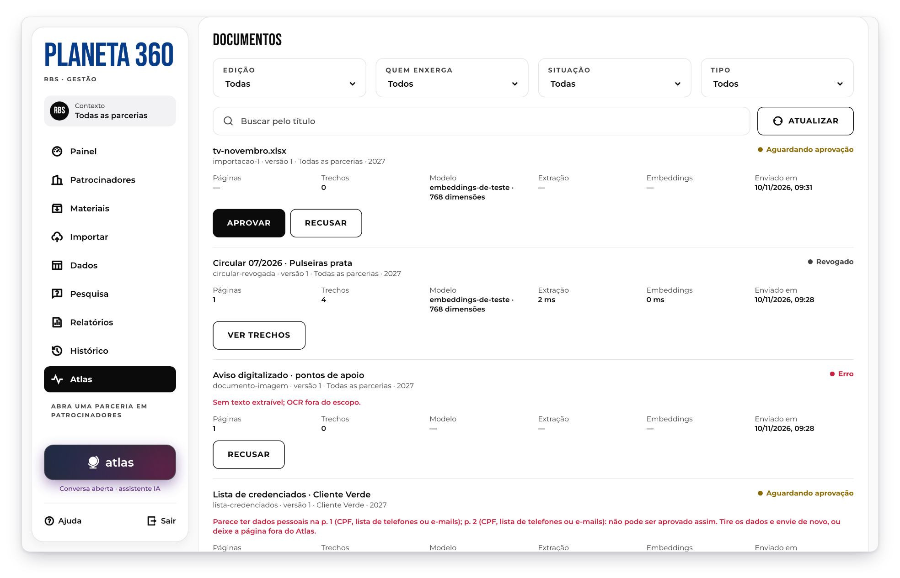<br>
  <em>Documento que parece ter dados pessoais não pode ser aprovado para o Atlas.</em>
</p>

<p align="center">
  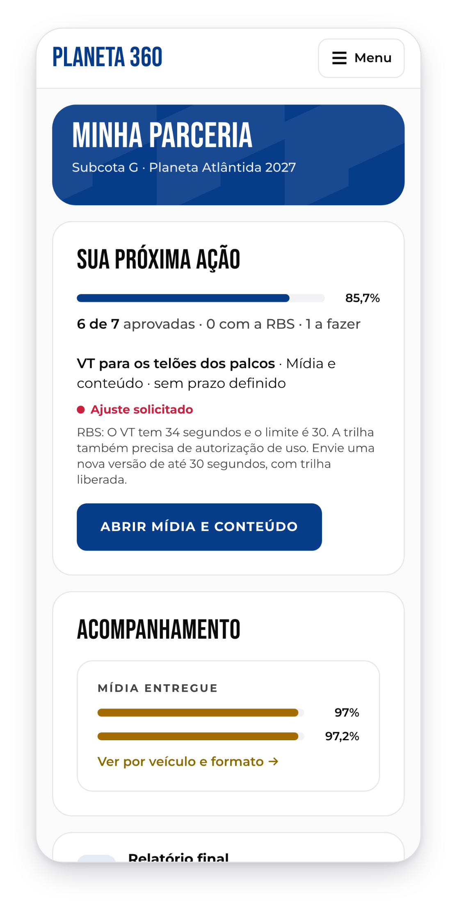<br>
  <em>No celular, o menu vira uma gaveta.</em>
</p>

</details>

## Como funciona

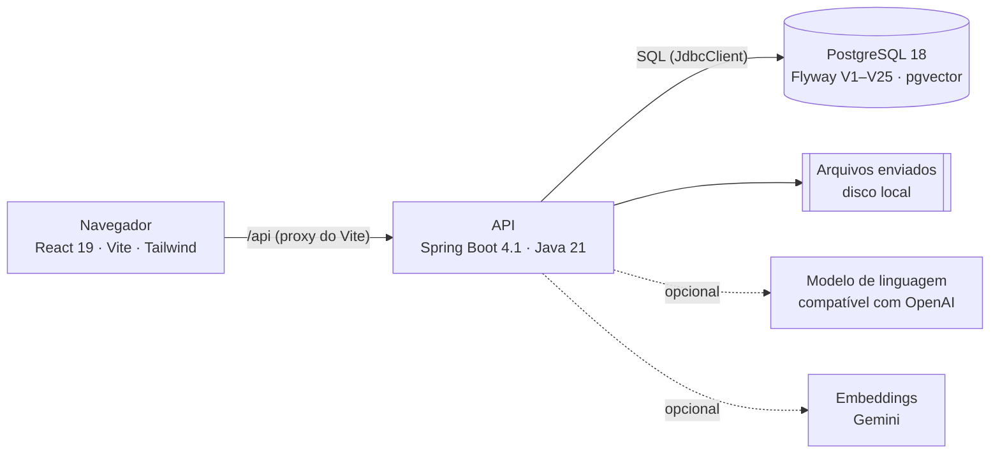

O navegador e a API ficam na mesma origem, com cookie de sessão e token CSRF, sem token de portador. As regras que precisam valer sempre, como o histórico imutável, a ordem de status do relatório ou o limite de cortesias, são gatilhos no PostgreSQL; as que dependem de quem chama (perfil, parceria, aba) ficam na API; o front só as repete para guiar a tela. Os repositórios usam SQL escrito à mão, sem ORM, e os números de mídia e do relatório vêm de visões e funções do banco. A arquitetura está em [`docs/arquitetura.md`](docs/arquitetura.md), o contrato da API em [`docs/api.md`](docs/api.md) e o banco em [`docs/banco.md`](docs/banco.md).

### Por dentro do Atlas

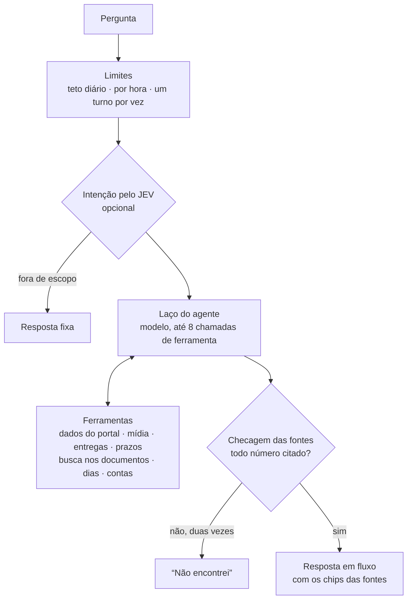

- **O modelo nunca traz número próprio.** Cada ferramenta devolve fontes numeradas: `T#` para um trecho de documento, `R#` para um registro do portal, `C#` para uma conta ou contagem de dias. Antes de uma frase chegar à tela, o servidor confere que cada número e cada data dela estão numa fonte citada na mesma frase, numa conta do turno ou no que a pessoa escreveu. Reprovada, a frase volta para uma nova redação; na segunda vez, vira um "não encontrei" fixo.
- **Conta é código.** O `contar_dias` conta os dias com `java.time` e os feriados; o `calcular` roda uma expressão JEXL isolada, em que cada variável precisa ter origem.
- **A busca é híbrida e isolada.** Os documentos são divididos por página, viram embeddings no Gemini e ficam no pgvector. A consulta junta a lista vetorial e a textual (fusão por posição) com o papel só de leitura `atlas_ro`, e a segurança por linha a limita à edição, à cota e à parceria da conversa. Documento que parece ter dado pessoal não pode ser aprovado.
- **A conversa da marca não recebe parceria como argumento.** A parceria vem da sessão, então uma marca não consegue perguntar de outra. A organização tem a conversa própria, sobre a edição inteira.
- **Proteções.** Limites diários e por hora, por parceria e por pessoa; disjuntores para o modelo, o JEV e o Gemini; e um traço de cada turno (etapas, tempos, tokens, custo) no diagnóstico. O raciocínio do modelo não sai do servidor: a tela mostra só um resumo curto, que passa pelas mesmas checagens.
- **Relatório por marcador.** Quando o Atlas monta o relatório da ativação, o modelo escreve o texto com marcadores e o servidor põe cada número, com a origem nas fontes do relatório.

Os detalhes, com cada ferramenta e cada limite, estão nas seções 5 e 6 da [`docs/arquitetura.md`](docs/arquitetura.md).

## Roadmap

- [x] Portal da marca: sete abas, entregas em arquivo, texto ou link, versões e histórico
- [x] Gestão da organização: parcerias, abas e cotas, fila de materiais, cargas em CSV e histórico
- [x] Importação com origem, base de mídia e perguntas de pesquisa com tipo
- [x] Relatório a partir da base, com o anexo de pós-venda
- [x] Atlas: chat com fontes citadas, montagem do relatório e diagnóstico de cada turno
- [ ] E-mail automático do código de ativação e recuperação de senha (hoje a organização repassa o código)
- [ ] Limite de tentativas de login e cookie de sessão `Secure` atrás de HTTPS
- [ ] Áudio na importação
- [ ] Integração com o Open Staff (hoje, um link para o site externo)
- [ ] Exportação nativa do relatório em PDF (hoje, pela impressão do navegador)
- [ ] Imagem Docker e implantação pública

## Licença e créditos

MIT. Veja a [LICENSE](LICENSE). Feito pela equipe do Desafio GC 2026; o repositório original é o [Gabriela-Mattos-18/planeta-360](https://github.com/Gabriela-Mattos-18/planeta-360).

| Componente | Uso | Licença |
| --- | --- | --- |
| [Spring Boot](https://spring.io/projects/spring-boot) e [Spring AI](https://spring.io/projects/spring-ai) | API, segurança, cliente do modelo | Apache-2.0 |
| [Flyway](https://github.com/flyway/flyway) | Migrações do banco | Apache-2.0 |
| [PostgreSQL](https://www.postgresql.org) e [pgvector](https://github.com/pgvector/pgvector) | Banco e busca vetorial | PostgreSQL License |
| [Apache POI](https://poi.apache.org), [PDFBox](https://pdfbox.apache.org), Commons CSV e JEXL | Leitura de planilhas, arquivos do Office e PDFs | Apache-2.0 |
| [Bucket4j](https://github.com/bucket4j/bucket4j) e [Resilience4j](https://github.com/resilience4j/resilience4j) | Limites de uso e disjuntores | Apache-2.0 |
| [React](https://react.dev), [React Router](https://reactrouter.com), [Vite](https://vite.dev) e [Tailwind CSS](https://tailwindcss.com) | Front | MIT |
| [react-pdf](https://github.com/wojtekmaj/react-pdf) e [pdf.js](https://github.com/mozilla/pdf.js) | Visualizador de PDF | MIT e Apache-2.0 |
| [Remix Icon](https://github.com/Remix-Design/RemixIcon) | Ícones da interface | Remix Icon License v1.0 |
| [Bebas Neue](https://fonts.google.com/specimen/Bebas+Neue) e [Montserrat](https://fonts.google.com/specimen/Montserrat) | Fontes da interface | SIL OFL 1.1 |
| [JetBrains Mono](https://github.com/JetBrains/JetBrainsMono) | Linha da stack no banner | SIL OFL 1.1 |

O Remix Icon 4.9 tem licença própria, que permite o uso dentro de aplicativos e documentação, mas não como logo. Os provedores de IA opcionais (OpenCode Go e a API do Gemini) têm termos próprios; mande para eles só dados fictícios. Planeta Atlântida e RBS são marcas dos seus donos: o emblema do festival na tela de login não está coberto pela licença deste projeto e não aparece nestas imagens.
