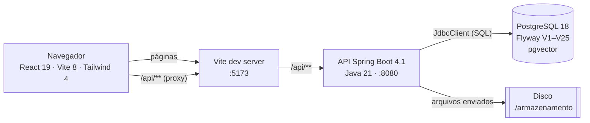
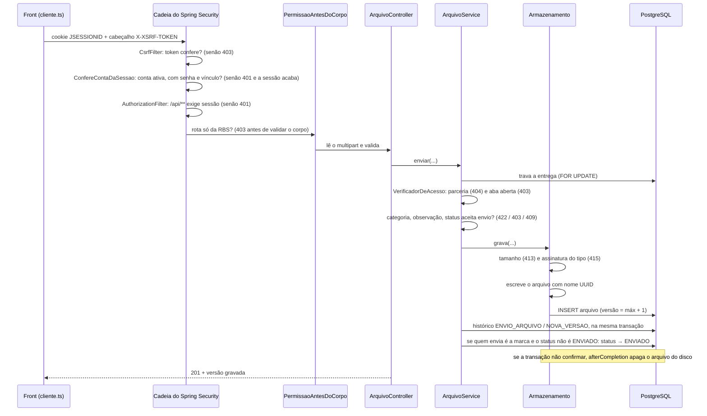
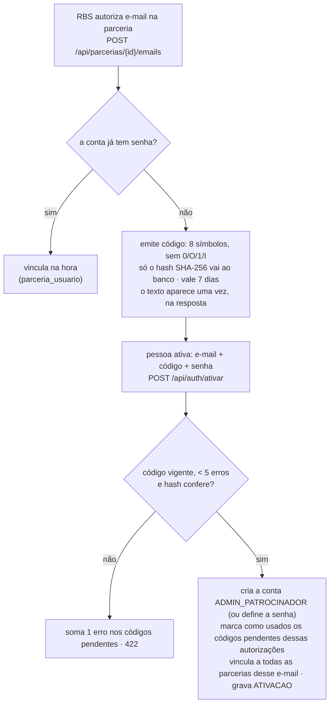
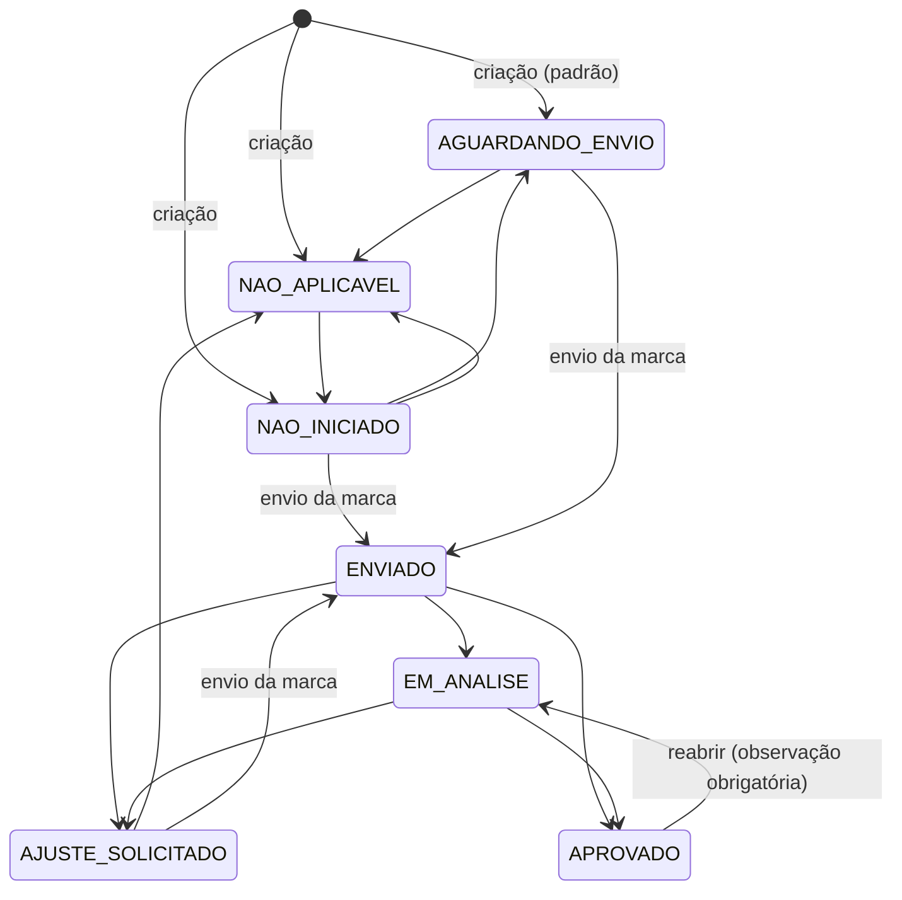
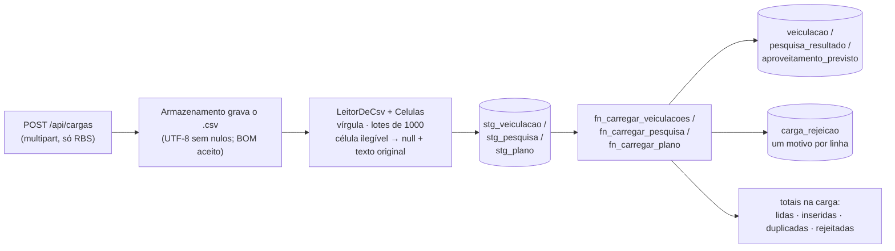
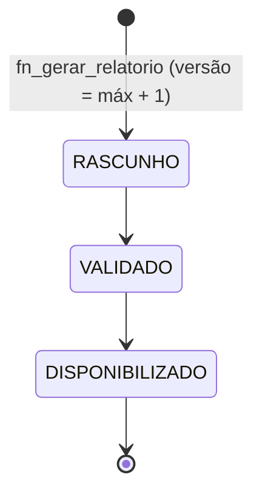

# Arquitetura do Planeta 360 · Portal do Patrocinador

Como o sistema é montado, por onde passa uma requisição e onde mora cada regra. **O retrato é do HEAD da branch `atlas-entrada` em 06/11/2026**, o commit `d1fc760` (o anterior ao que traz este documento). Ela parte da `main` de 05/11/2026 (merge `8982a43` do [PR 5](https://github.com/Gabriela-Mattos-18/planeta-360-portal-patrocinador/pull/5), que trouxe a `requisitos-rbs`) e está 142 commits à frente dela (141 fora o merge `7694b40` de `origin/main`), com o que a RBS pediu na reunião de 05/11: a importação pelo Atlas, a base de mídia, a pesquisa com tipos de resposta, o selo "novo", o Atlas da RBS sobre todas as marcas e o acabamento da interface e as correções da revisão de 06/11 (V25). O último commit que mexeu no back é o `e6e8d61`; o merge e os sete commits seguintes só mexem no front. O código é a referência: quando este texto e o código discordarem, vale o código.

Neste commit: 123 operações no contrato, em 120 linhas numeradas (1 a 117, 112b, 119 e 120; a 118 não existe): 122 mapeadas nos controllers, mais o logout do Spring Security (as 4 rotas de debug da chave, só no perfil `dev`, ficam fora dessa conta); 38 controllers (126 mapeamentos: 67 `GET`, 35 `POST`, 5 `PUT`, 14 `PATCH` e 5 `DELETE`, contando os 4 de debug); migrações V1 a V25; 55 tabelas, 9 visões, 39 gatilhos e 9 funções; 3.745 testes no backend (247 classes, 0 falhas); e 129 testes no Playwright em 16 arquivos (106 em `frontend/e2e/` e 23 de unidade em `frontend/e2e/unidade/`; 6 deles usam o modelo de verdade, e o ensaio da demonstração fica pulado sem `E2E_DEMO`). A seção 13 diz de onde veio cada número.

As marcas "M2" a "M8" dizem em que marco do plano do Atlas cada peça entrou, e as "X42" apontam para a seção E de `docs/atlas/controle/divergencias.md` (local, fora do Git). As marcas "R5.4", "R6.d3" e parecidas são os IDs da matriz do plano dos requisitos da RBS (`docs/atlas/final/plano-final-requisitos-rbs.md`, seção 3, local), e os desvios "X1" a "X20" desse plano estão em `docs/atlas/final/controle/divergencias.md` (local). Nas partes da importação, da base de mídia e da pesquisa, "E1" a "E17" (entrada), "M1" a "M7" (base de mídia, **não** os marcos do Atlas), "P1" a "P6" (pesquisa), "S1" a "S3", "U1" a "U17" e "AC1" a "AC5" (o Atlas consulta a mídia) são os IDs do plano da base da RBS (`docs/atlas/extracao/plano-implementacao.md`, local), e os desvios "Y1" a "Y16" estão em `docs/atlas/extracao/controle/divergencias.md` (local). O que está em aberto fica nas seções 11 e 12.

As seções 1 a 13 descrevem o HEAD inteiro, o que veio da `main` e o que a branch acrescentou; a seção 14 só guarda os retratos anteriores.

Complementa, sem repetir, o [README](../README.md) (como rodar), a [doc da API](api.md) (contrato de cada rota) e a [doc do banco](banco.md) (tabelas e regras em detalhe).

Abreviações de caminho usadas abaixo:

| Abreviação | Caminho real |
| --- | --- |
| `portal/` | `backend/src/main/java/br/com/rbs/portal/` |
| `migration/` | `backend/src/main/resources/db/migration/` |
| `front/` | `frontend/src/` |

---

## 1. Em uma página

O portal tem dois públicos. A **RBS** (perfil `ADMIN_RBS`) cadastra as parcerias, autoriza e-mails, analisa materiais, carrega planilhas e gera relatórios; configura cada parceria (abas liberadas, fechadas ou ocultas, cota, investimento, plano comercial, cortesias, credenciais, contrato e pós-venda), abre a pesquisa da edição e mantém os prazos e os documentos do Atlas; importa arquivos pelo Atlas (planilha, Word, PowerPoint, PDF, imagem ou conversa colada), consulta a base de mídia de todas as marcas e, nos perfis `dev` e `demo`, também conversa com o Atlas sobre os documentos, a mídia e as entregas de todas as marcas (M8). A **marca patrocinadora** (perfil `ADMIN_PATROCINADOR`) vê só a própria parceria: envia materiais (em arquivo, texto ou link), o documento de ingressos, o MIV e a logo, destina as cortesias que a RBS deu, informa quem assina o contrato, propõe perguntas de pesquisa (as Master), lê o relatório quando ele é liberado, consulta o contratado × entregue da própria mídia, lê a planilha da agência pelo Atlas, vê o selo "novo" nas abas que mudaram desde a última visita e conversa com o Atlas.

São três peças, numa mesma origem:



Três decisões dão forma a todo o resto:

1. **A regra mora onde não dá para contorná-la.** O que precisa valer sempre (histórico imutável, ordem de status do relatório, limite de cortesias, vínculo só com e-mail autorizado, texto, link e pós-venda publicados que nunca mudam) é gatilho no PostgreSQL. O que depende de quem chama (perfil, parceria, aba) fica na API. O front só repete as regras para guiar a tela e nunca é a barreira.
2. **SQL explícito, sem ORM.** Os repositórios usam `JdbcClient` com SQL escrito à mão e recursos do PostgreSQL (`FOR UPDATE`, `ON CONFLICT`, `LATERAL`, `RETURNING`). A carga em lote usa `JdbcTemplate`, em `CargaRepositorio`, com `batchUpdate`. Só `UsuarioRepositorio` usa Spring Data JDBC. Os cálculos de consolidação e de relatório estão em visões e funções do banco, não em Java.
3. **Sessão por cookie, não token.** Login JSON cria uma sessão HTTP (`JSESSIONID`, HttpOnly) e o CSRF segue o padrão SPA do Spring Security (cookie `XSRF-TOKEN` legível, cabeçalho `X-XSRF-TOKEN`). Como front e API ficam na mesma origem (pelo proxy do Vite), não há CORS configurado.

---

## 2. Stack e execução

| Camada | Tecnologia (versão declarada) | Onde ver |
| --- | --- | --- |
| API | Spring Boot 4.1.2 (webmvc, security, validation, data-jdbc, flyway), Java 21, commons-csv 1.14.1, Spring AI 2.0.2 (OpenAI compatível; desligado por padrão, `ATLAS_LLM=none`), PDFBox 3.0.8 (M3), Apache Commons JEXL 3.7.1 (M5, o `calcular`), Bucket4j 8.21.0 (`bucket4j_jdk17-core`, os limites por usuário) e Resilience4j 2.4.0 (só o módulo do disjuntor, sem o starter do Spring), os dois do M8; e o Apache POI 5.5.1 (`poi` e `poi-ooxml`), que lê `.xlsx`, `.xls`, `.docx` e `.pptx` na importação e, nos testes, lê o `.xlsx` gerado e fabrica `.doc`, `.xls` e `.ppt` | `backend/pom.xml` |
| Banco | PostgreSQL 18 com pgvector 0.8.7 (schema `extensoes`, pelo `scripts/preparar-banco-atlas.sh`) e `unaccent`, migrações Flyway | `migration/` |
| Front | React 19.3, react-router 8.5, Vite 8.3, Tailwind 4.3, TypeScript 6.0, oxlint, react-pdf 11.0.0 (com pdfjs-dist 6.3.289) e, nos testes, Playwright 1.64.1 com `@axe-core/playwright` 4.11 | `frontend/package.json` |

**Perfis Spring** (`backend/src/main/resources/application.yml`):

| Perfil | Banco | Migrações | Extras |
| --- | --- | --- | --- |
| (nenhum) | `portal` | só `db/migration` | — |
| `dev` | `portal` | `db/migration` + `db/dev` (amostra) | `ArquivosDaAmostra` gera no disco os arquivos que a amostra cita; `DocumentosDaAmostra` (M3) sobe o kit de 13 documentos, de forma idempotente, e com `ATLAS_EMBEDDINGS=none` só avisa; `PrazosDaAmostra` (M5) cadastra logo depois os 16 prazos do manual e dos planos; `atlas.relatorio.ligado` (as chaves do modo do Atlas são lidas pelo bean `ModoDoAtlas`) (M6), `atlas.diagnostico.ligado` e `.marca`, `atlas.rbs.ligado` (M8), `atlas.debug.chaves` e `atlas.debug.ferramentas` ligados; os sete pontos do JEV com o modo e o limiar (M7 e o `arquivo_destino`, em "O JEV nos pontos de decisão") |
| `demo` (M8) | `portal` (o `application.yml` pede um banco descartável) | `db/migration` + `db/dev` | O perfil da apresentação. Sobe como o `dev`: `ArquivosDaAmostra`, `DocumentosDaAmostra` e o mesmo arquivo de segredos, com o relatório, o diagnóstico (inclusive o da marca) e o Atlas da RBS ligados e os mesmos pontos do JEV do `dev`. **Sem** as rotas de debug da chave (404) e sem a caixa de debug das ferramentas: o valor é fixo, não lê variável de ambiente. Como subir: `SPRING_PROFILES_ACTIVE=demo`, ou `ATLAS_PERFIL=demo scripts/atlas-dev.sh start` |
| `test` | `portal_teste` | `db/migration` + `db/dev` | `flyway.clean()` antes da suíte; arquivos em `./target/armazenamento-teste`; LLM desligado (`none`), `atlas.relatorio.ligado=true`, debug desligado e `hikari.minimum-idle: 1`; embeddings `teste` e `atlas.ingestao.sincrona=true`, com o `KitDeDocumentosDeTeste` (M3); JEV sem modo (`none`; as classes do JEV usam um provedor roteirizado e escolhem o modo de cada ponto); diagnóstico e Atlas da RBS desligados (cada classe que os usa os liga); limites por usuário altos e `atlas.disjuntores.ligado=false`, porque o balde e o disjuntor ficam na memória e o contexto do Spring é compartilhado (M8); `portal.importacao.sincrona=true` (a leitura da importação termina antes de o `POST` voltar, para o teste ler a prévia) |
| `avaliacao` (só em `src/test/resources`) | `portal_teste` ou `PORTAL_BD_TESTE_URL` | como o `test` | Testes `@Tag("avaliacao")`, fora do `./mvnw test`: embeddings `gemini`, o JEV em `sombra` por padrão (`ATLAS_JEV`) e chaves do arquivo de segredos. Comando: `./mvnw test -Dgroups=avaliacao -Dtestes.excluidos=` |

Chaves e diagnóstico (M0 e M2): nos perfis `dev` e `demo`, a API importa `config/segredos.local.properties` (fora do Git), relativo à pasta em que sobe. Variáveis novas: `TYPESAFE_API_KEY`, `GEMINI_API_KEY`, `ATLAS_EMBEDDINGS` (`gemini`, `teste` só em banco descartável, ou `none`; vale de verdade desde o M3), `ATLAS_GEMINI_BASE_URL` (`https://generativelanguage.googleapis.com`), `ATLAS_JEV` (o modo de todos os pontos do JEV, `none`, `sombra` ou `ativo`; vale de verdade desde o M7), `ATLAS_JEV_MODELO` (`jev-1.14.0`), `ATLAS_JEV_BASE_URL` (`https://api.typesafe.ai`), `ATLAS_DIAGNOSTICO`, `ATLAS_DIAGNOSTICO_MARCA` (`true` nos perfis `dev` e `demo`, `false` no padrão e no `test`) e `ATLAS_PRECO_*` (reserva do custo, quando a resposta do provedor não traz o preço de lista).

Variáveis do banco: `PORTAL_BD_URL`, `PORTAL_BD_USUARIO`, `PORTAL_BD_SENHA` (padrão `portal`/`portal`) e `PORTAL_BD_TESTE_URL`. Do Atlas, com o padrão entre parênteses: `ATLAS_LLM` (`none`), `OPENCODE_API_KEY` (vazia), `ATLAS_LLM_BASE_URL`, `ATLAS_LLM_MODELO` (`deepseek-v4.1-flash`), `ATLAS_RACIOCINIO` (`true`), `ATLAS_PRAZO_DO_RESUMO` (`PT15S`), `ATLAS_TETO_DIARIO` (`200`), `ATLAS_RELATORIO` (`false`; `true` nos perfis dev e demo, desde o M6) e `ATLAS_DEBUG_FERRAMENTAS` (`false`; `true` no perfil dev, sempre `false` no demo). Do M8: `ATLAS_RBS` (`false`; `true` nos perfis dev e demo), `ATLAS_RBS_TETO_DIARIO` (`200`), `ATLAS_LIMITE_MENSAGENS_POR_HORA` (`20`), `ATLAS_LIMITE_RELATORIOS_POR_DIA` (`3`), `ATLAS_LIMITE_DOCUMENTOS_POR_HORA` (`120`), `ATLAS_LIMITE_BUSCAS_DE_TESTE_POR_HORA` (`60`) e `ATLAS_DISJUNTORES` (`true`). Nos perfis dev e demo, `ATLAS_JEV_INTENCAO`, `ATLAS_JEV_CARTAO`, `ATLAS_JEV_FONTES`, `ATLAS_JEV_RESPOSTA`, `ATLAS_JEV_COERENCIA`, `ATLAS_JEV_LACUNAS` e `ATLAS_JEV_ARQUIVO_DESTINO` trocam o modo de um ponto (os padrões estão em "O JEV nos pontos de decisão"). Só como propriedade, `atlas.feriados.pontos-facultativos` (`false`) põe Carnaval e Corpus Christi entre os dias não úteis do `contar_dias`. A propriedade `portal.importacao.sincrona` (`false`; `true` no `test`) faz a leitura da importação terminar no callback do commit. Multipart: 20 MB por arquivo, 21 MB por requisição. Sessão: 8 h sem uso, `HttpOnly`, `SameSite=Lax`. JSON: `spring.jackson.deserialization.accept-float-as-int` é falso, então um decimal num campo inteiro vira 422, e não é cortado em silêncio.

Comandos (detalhes no README):

```bash
cd backend && ./mvnw spring-boot:run -Dspring-boot.run.profiles=dev
```

```bash
cd frontend && npm install && npm run dev
```

---

## 3. Organização do código

### Backend: um pacote por domínio

São 17 pacotes de primeiro nível em `portal/` (contados no disco), mais os subpacotes do `atlas`:

| Pacote | Responsabilidade |
| --- | --- |
| `acesso` | Login, sessão, ativação do primeiro acesso, conferência da conta a cada requisição |
| `parceria` | Eventos, parcerias, abas da parceria (liberada, fechada ou oculta), e-mails autorizados e a troca de cota (`TrocaDeCotaController`, `TrocaDeCotaService` e `TrocaDeCotaDtos`: rotas 102 e 104); o atendimento da marca (`atendimento_nome` e `atendimento_email`, V19), que a RBS preenche pelo `PATCH` da rota 10 (`""` limpa o campo) e que vem nas rotas 4 e 9 |
| `materiais` | Entregas, versões (arquivo, texto ou link), download, consulta ao histórico; os espaços de documento da marca (`EspacosController`, `EspacosService` e `EspacosDaMarca`: plano comercial, formulário e solicitações de ingressos, MIV e logo, rotas 69 a 73) e o texto ou link enviado numa entrega (`ConteudoController`, `ConteudoDaEntregaService`, `LinksDeMidiaService` e `HostDoLink`: rotas 86 e 87) |
| `consolidacao` | Cargas de CSV (veiculação, pesquisa e plano comercial), consolidação previsto × exibido, painel da RBS; a comprovação mensal da mídia (`ComprovacaoMensal*`: rotas 88 a 91, com `?mes=AAAA-MM` nas 89 e 90); e a base de mídia, com filtros e exportação, sobre a `vw_midia_detalhe` (`ConsultaDeMidia*`: rotas 105 e 106, da parceria, e `ConsultaDaRbsController`: rotas 107 e 108, da edição) |
| `pesquisa` | Perguntas da marca (tipo e limite), decisão da RBS (rotas 23 a 25), o perfil demográfico e as respostas de texto (`PerfilDaPesquisa*`: rota 119); a abertura da pesquisa da edição e a fila das perguntas (`PesquisaAbertura*`: rotas 92 a 95) |
| `importacao` | O Atlas de entrada (seção 6, "O Atlas de entrada"; rotas 109 a 117): `ImportacaoController` (109 a 116, com a 112b) e `ImportacaoDaMarcaController` (117, a planilha da agência pela marca), `ImportacaoService`, `ImportacaoRepositorio`, `ImportacaoDtos` e a `FilaDeImportacao` (executor `atlas-importacao-`). Três interfaces dão uma peça por formato e por destino: `LeitorDeConteudo`, `ExtratorDeLinhas` e `DestinoDeGravacao`. `leitores/`: planilha pelo POI com limites contra zip bomb, CSV, texto, Word, PowerPoint, PDF e imagem (a visão do modelo transcreve). `extracao/`: `MapeadorTabular` (o modelo só mapeia colunas), `ExtratorLivre` (propõe as linhas pela ferramenta `propor_linhas`, com a origem de cada valor conferida no código), `ConferenciaDaExtracao`, `CasadorDoPlano` e `SugestorDeDestino`. `destinos/`: veiculação, comprovante, plano, números da edição, pesquisa, dados da ativação e só consulta. A sugestão do destino vem do cabeçalho reconhecido em código, senão do modelo, e o JEV `arquivo_destino` só registra (sombra, V24). Cada arquivo também vira documento do alcance, com o localizador de cada trecho |
| `visita` | A última visita de cada pessoa a cada aba e o selo "novo" (`VisitaController`, `VisitaService`, `VisitaRepositorio` e `VisitaDtos`: rota 120, S3) |
| `relatorio` | Geração, validação, disponibilização e exportação do relatório; o anexo de pós-venda e os números da edição (`PosVenda*`: rotas 96 a 101) |
| `aplicacoes` | Aba Aplicações: o plano de aplicações de marca linha a linha e o anexo das fotos de comprovação (rotas 37 e 38) |
| `dados` | Catálogo de campos e dados informados pela marca, com autor, data e origem (rotas 39 a 41), e o envio da planilha da agência (rota 66, M6, em `DadoInformadoArquivoController`); o `DadoInformadoService` serve a aba, o Atlas e a rota 66 |
| `contrato` | R5.7, rotas 74 a 76: quem assina pela marca (o signatário) e o contrato final assinado, com versões: `ContratoController`, `ContratoService`, `ContratoRepositorio` e `ContratoDtos` |
| `cortesias` | R5.4, rotas 80 a 85: a cota por setor e dia que a RBS grava, o prazo de destinação da edição e a destinação pela marca: `CortesiaController`, `CortesiaService`, `CortesiaRepositorio` e `CortesiaDtos` |
| `credenciamento` | R5.5, rotas 77 a 79: as credenciais por setor e beneficiário de cada parceria, o endereço do Open Staff e o período de cadastro da edição: `CredenciamentoController`, `CredenciamentoService`, `CredenciamentoRepositorio` e `CredenciamentoDtos` |
| `atlas` | O Atlas: conversa (rotas 42 a 45), loop do agente, provedor do LLM e `atlas/diagnostico/` (M2: `Traco`, `RegistroDoTraco`, `TracoRepositorio`, rotas 49 a 53, `ProvedoresService`). Com `atlas.relatorio.ligado=true`: cartão de perguntas, relatório de trabalho (rotas 46 a 48 e o descarte, 65, em `AtlasRelatorioController`) e plano B sem modelo. Subpacotes: `loop` (inclui o `PromptsDoAtlas`, M6, o `DescarteDeRelatorios`, pelo tempo parado e pela rota 65, e a `VagasDoTeto`, M8, a reserva de vaga dos tetos diários), `ferramentas`, `provedor` (o `ProvedorDeLlm` ganhou `leImagem()` e o record `Imagem`: o provedor compatível com a OpenAI manda a imagem como `image_url`, para a leitura de imagem da importação), `relatorio` (o relatório do Atlas, a consulta e o `ContaDoChat`, a conta do `calcular` como o chat a guarda), `contexto`, `debug` e `embeddings` (M3: `ProvedorDeEmbeddings`, com Gemini, teste e desligado). Desde o M7, `jev`; desde o M8, `limites`, `disjuntor` e, na raiz, `AtlasDaRbsController` e `AtlasDaRbsService` (linhas abaixo) |
| `documentos` | M3: rotas 54 a 58 e, no M4, as 59 e 60 (o visualizador), todas no `DocumentoController`; `ExtratorDeTexto` (PDFBox e TXT), `DivisorDeTrechos`, `DetectorDeDadosPessoais` (que diz a página e o tipo de cada suspeita; o `analisarConversa`, da importação, marca até um telefone ou e-mail isolado), `IngestaoService` (fila na memória), `KitDeDocumentos` e `CarregadorDoKit` (o kit fictício), `DocumentosDaAmostra`; M5: `PrazosDaAmostra`; requisitos da RBS: `PaginasForaDoAtlas` e a rota 103 (as páginas que ficam fora do índice) |
| `prazos` | M5: os prazos da edição, da cota e da parceria (rotas 62 a 64, só da RBS): `PrazoController`, `PrazoService`, `PrazoRepositorio`, `PrazoDtos`. Quem os lê é a ferramenta `consultar_prazos` |
| `atlas/busca`, `atlas/checagem`, `atlas/ferramentas` | M4: `BuscaHibrida` e `ContextoDeRls` (busca como `atlas_ro`), `ConsultaAosDocumentos` (o caminho comum do modelo e da rota 61), `BuscaDeTeste*` (rota 61); `ChecagemDeFontes`, `NormalizadorDeNumeros`, `Frases`, `FontesDoTurno`; `RegistroDeFerramentas` (por `EstadoDaConversa`), `Ferramenta` (duas fases), `BuscarDocumentos` |
| `atlas/ferramentas` (M5) | `listar_entregas`, `consultar_midia` (o SQL em `MidiaDoPortal`), `consultar_cota` e `consultar_prazos` (o SQL em `RegistrosDoPortal`, o formato em `ResultadoDeRegistros`); `contar_dias` (com `Feriados`); `calcular`, com o `ScriptDeConta` (a lista de tokens e a conferência por significado) e o `MotorDeContas` (JEXL travado, com `funcoes/FuncoesDeConta`); `pedido_de_relatorio` e `gerar_modelo`, as respostas diretas (os modelos em `ModelosEmBranco`) |
| `atlas/jev` (M7) | O JEV nos sete pontos de decisão (o sétimo, `arquivo_destino`, roda na leitura da importação, fora de uma conversa): `ServicoDoJev` (os pontos, o registro e o orçamento do turno), `ClienteJev` (a implementação de `ProvedorDeJev`; os testes usam um roteiro), `ConfiguracaoDoJev` com `ModoDoJev` e `PontoDoJev` (o modo e o limiar de cada ponto), `PerguntasDoJev` (lê `resources/atlas/jev/perguntas.json`), `MascaraDoJev` (o que sai do `state`), `JevDoTurno` (o que o JEV guarda durante um turno) e `JevIndisponivelException`. Em `atlas/relatorio`, `SelosDoRelatorio`; em `atlas/loop`, o `LoopDoAgente` chama o serviço |
| `atlas/limites` e `atlas/disjuntor` (M8) | `LimitesPorUsuario` (quatro baldes do Bucket4j na memória: mensagens por hora, relatórios por dia do modelo, aberturas de documento por hora e buscas de teste por hora); `DisjuntoresDosProvedores` (um `DisjuntorDoProvedor`, sobre o Resilience4j, para o modelo, o JEV e o Gemini) e `DisjuntorAbertoException`. Em `atlas/provedor`, o `ProvedorComDisjuntor` embrulha o modelo de linguagem |
| `AtlasDaRbsController` e `AtlasDaRbsService` (M8) | O Atlas da RBS: as rotas 67 e 68 (abrir e listar a conversa da RBS por edição, sem parceria). A mensagem e a leitura dessa conversa passam pelas rotas 44 e 45 do `AtlasService`; o diagnóstico, pela 49, do `DiagnosticoController`, que confere o dono com `AtlasService.conversaDoDono`. Em `atlas/loop`, o `TetoDaRbs` (que reserva vaga pela `VagasDoTeto`, como o `TetoDiario`); o `AtlasContextoFabrica.paraARbs` monta o contexto sem parceria; a `Ferramenta` tem `daRbs()` e `definicaoDaRbs()`; o prompt é `resources/atlas/prompts/rbs.txt` |
| `comum` | Segurança, verificação de acesso, erros, histórico, armazenamento, CSV, datas; a leitura do Office antigo (`Ole2Diretorio`) e o gravador de `.xlsx` (`PlanilhaXlsx`); o `Armazenamento` grava também o arquivo da importação (`gravarImportacao`, no conjunto `Aceitos.IMPORTACOES`), a cópia dele como documento (`gravarDocumentoImportado`) e o comprovante com a origem (`gravarComObservacao`) |

Cada domínio segue o mesmo molde (`comum` é a exceção, por ser transversal): `XxxController` (HTTP) → `XxxService` (regra e permissão, em geral `@Transactional`; o login não é, de propósito) → `XxxRepositorio` (SQL) e `XxxDtos` (records de entrada e saída). Os domínios, as classes de negócio e os comentários são em português; os sufixos de camada e alguns nomes técnicos (`AuthController`, `UsuarioDetailsService`, `ProvedorSpringAi`) seguem o Spring. Comentários usam etiquetas como `[PERMISSAO]`, `[UPLOAD]`, `[CARGA]` e `[PENDENTE]` (decisão ainda aberta com a RBS).

### Frontend

| Pasta | Conteúdo |
| --- | --- |
| `front/api/` | Cliente HTTP (`cliente.ts`), um módulo por área (`acesso`, `parcerias`, `materiais`, `espacos`, `resultados`, `aplicacoes`, `comprovacao`, `dados`, `cortesias`, `credenciamento`, `contrato`, `posvenda`, `atlas`, `diagnostico`, `documentos`, `prazos`, `importacao`, `midia`, `novidades` e o temporário `debug`, cujas rotas nenhuma tela chama mais), os tipos (`tipos.ts`) e o hook `useDados`. O `resultados.ts` cobre a pesquisa, as cargas, a consolidação, o painel e os relatórios (rotas 23 a 36) e a abertura da pesquisa (rotas 92 a 95) |
| `front/sessao/` | `Sessao.tsx`: contexto do usuário logado e `RotaProtegida` |
| `front/atlas/` | A janela do Atlas (Figma AT00 a AT06): `PaginaAtlas` (tela inicial, conversa e modo documento com o chat no painel à direita), `Inicio`, `Conversa`, `Compositor`, `CartaoSolicitacao`, `CartaoDocumento`, `CaixaDoAtlas` (sem uso desde que Minha parceria perdeu o cartão do Atlas), `AoVivo` (a resposta enquanto chega), `Raciocinio` (a caixa do resumo do raciocínio), `FerramentaDebug` (a caixa do debug das ferramentas) e `Elementos` (orbe, chips, mensagens, painel). Com `relatorioDisponivel` falso, os botões do relatório aparecem desabilitados, com "em breve", e o modo documento não abre; o código continua |
| `front/atlas/Diagnostico.tsx` e `front/paginas/rbs/Atlas.tsx` | M2: a gaveta com o traço do turno e a página `/rbs/atlas` (as abas Turnos e Provedores ficam atrás do link Diagnóstico; as outras vêm abaixo). `front/api/diagnostico.ts` fala com as rotas 49 a 53. Desde o M7, a gaveta mostra o que cada etapa do JEV decidiu (ação, modo, limiar, escolha, confiança, selos, cada item) e a aba Provedores, o modo e o limiar dos sete pontos e o estado do disjuntor de cada provedor |
| `front/paginas/rbs/AtlasConversa.tsx` | M8: a aba Conversa de `/rbs/atlas` (`?aba=conversa`, a aba padrão), o Atlas da RBS, em tela inteira como a janela da marca (seção 8, "O Atlas da RBS em tela inteira"). Escolhe a edição, lista as conversas da pessoa (rota 68) e reaproveita a `AreaDaConversa`, o `Visualizador` e o fluxo da janela da marca, com `parceria` nulo: sem "Montar relatório", sem cartão e sem pedido de relatório. Com o Atlas da RBS desligado na API (404 nas rotas 67 e 68), a aba avisa que ele está desligado. A resposta de uma edição que a pessoa já deixou é ignorada |
| `front/paginas/rbs/AtlasDocumentos.tsx` e `front/api/documentos.ts` | M3: a aba Documentos de `/rbs/atlas` (`?aba=documentos`): envio, lista com o estado da indexação, as ações que a API devolve em `acoes` e os trechos. Busca de novo ao voltar à aba do navegador ou no botão Atualizar; não é em tempo real |
| `front/atlas/Fontes.tsx`, `Visualizador.tsx`, `citacoes.ts`, `destaque.ts`, e `front/paginas/rbs/AtlasBuscaDeTeste.tsx` | M4: o chip e a lista de fontes, o painel do documento (react-pdf, carregado só na primeira fonte), as funções puras do destaque, com teste em `frontend/e2e/unidade/`, e a aba Busca de teste (`?aba=busca`). Desde o M5 o chip de um `[R#]` abre o documento de origem quando o registro veio de um (um prazo do manual, na página dele), e o de um `[C#]` fica parado: a conta tem o "Como calculei" |
| `front/atlas/ComoCalculei.tsx`, `CartaoModelo.tsx`, `CartaoPedidoDeRelatorio.tsx` | M5: o "Como calculei" (a conta e a origem de cada número, fechado até a pessoa abrir; a origem que é documento abre pelo mesmo chip da resposta), o modelo em branco (prévia, copiar e baixar: o `.md` é gerado no navegador) e o pedido de outro relatório (os chips de modelo só preenchem o campo, e quem envia é a pessoa). A conta aparece depois do texto que a usa (`naOrdemDeLeitura`, em `Conversa.tsx`) |
| `front/atlas/BotaoDescartar.tsx` | M6: descarta o relatório em montagem (rota 65), com confirmação, porque o cartão aberto é cancelado junto. Aparece na janela do Atlas e na página do relatório, só para o dono dele |
| `front/paginas/rbs/AtlasPrazos.tsx` e `front/api/prazos.ts` | M5: a aba Prazos de `/rbs/atlas` (`?aba=prazos`): lista, cadastro e desativação (rotas 62 a 64) |
| `front/componentes/relatorio/Blocos.tsx`, `front/paginas/parceria/RelatorioAtlas.tsx` | M6: a galeria do relatório mostra as fotos de verdade (`FotoDaGaleria` baixa pela rota 18, até 4 por vez e uma vez por foto), e a impressão espera as fotos (até 8 s) antes de abrir; sem isso a foto a caminho sairia em branco no A4 |
| `front/paginas/parceria/Aplicacoes.tsx` e `front/api/dados.ts` | M6: a planilha da agência (campo `ARQUIVO`, rota 66, `enviarArquivoDoCampo`) fica fora do formulário de números, com o botão de baixar a vigente |
| `frontend/e2e/`, `ferramentas/`, `scripts/`, `.github/` | Fora do `src`: Playwright (M1; nos requisitos da RBS também `requisitos-rbs.spec.ts`, `figma-06.spec.ts`, `interface.spec.ts`, `layout.spec.ts`, `movimento.spec.ts` e a `matriz.tsv`, descritos em "Testes"), avaliador de conversas e documentos fictícios (M1; o `ferramentas/documentos-ficticios/entrada/gerar-entrada.mjs`, com as fontes em `entrada/fonte/`, gera o corpus fictício da importação em `backend/src/test/resources/importacao/corpus/`), e `preparar-banco-atlas.sh`, `fumaca-provedores.sh` e `atlas-dev.sh` (M0 e M1; o `atlas-dev.sh` aceita `ATLAS_PERFIL=demo`). M7: `ferramentas/avaliacao-atlas/jev/` (`calibrar-jev.mjs`, que lê o mesmo `perguntas.json` do servidor, `preparar-rotulos.mjs` e os rótulos de cada ponto). M8: `scripts/conferir-segredos.sh` (procura o valor das chaves e os formatos de chave no Git, nos logs, em `target/` e nas tabelas do Atlas, sem imprimir nenhum valor). CI: `.github/workflows/ci.yml`, com o job `back` (pgvector 0.8.7-pg18, `scripts/preparar-banco-atlas.sh` e `./mvnw -B test`) e o job `front` (`npm ci`, build e lint); o e2e fica fora |
| `front/componentes/relatorio/` | Renderizador do relatório do Atlas: catálogo fechado de blocos e as regras de impressão em A4. Desde o M7, o item de uma grade leva o `selo` do servidor ("acima do previsto" ou "abaixo do previsto") |
| `front/paginas/` | `acesso/` (login, ativação), `parceria/` (área da marca, também aberta pela RBS; as oito seções têm tela própria: `Perfil`, `Aplicacoes`, `Midia`, `Cortesias`, `Credenciamento`, `Pesquisa` e `Contrato`, com o `VisualizadorDeContrato` carregado à parte, e a `ImportacaoDaAgencia`, a leitura da planilha da agência em Aplicações; a `PaginaAba` genérica fica de reserva), `rbs/` (gestão: Painel, Patrocinadores, Materiais (a `Fila`), Importar, Importação, Dados, Cargas, Pesquisa, Relatórios, Histórico e o Atlas) |
| `front/componentes/` | Peças visuais e `secoes.ts`, a fonte única das oito seções da parceria. Dos requisitos da RBS: `DocumentosDoPerfil` (plano comercial e compra de ingressos), `MateriaisDaMarca` (MIV e logo), `PostsELinks`, `ComprovacaoMensal`, `PosVenda`, `NumerosDaEdicao`, `DireitosPorContrato`, `TrocaDeCota`, `AbaFechada` (os quatro estados da aba), `CabecalhoSecao` e `LinkExterno`, o único componente que abre um endereço de fora. Da base da RBS: `BaseDeMidia` (a base de mídia filtrada, nas telas Mídia e Dados), `navegador/` (o navegador de arquivos da Mídia), `Faq` (a Ajuda da marca), `LeituraDoAtlas` (a orbe e as etapas enquanto o Atlas lê um arquivo), `Toast` (a confirmação curta) e `movimento.ts` (movimento reduzido e contagem até um número) |
| `front/estilos/` | `tema.css`: tokens do Tailwind 4 (`@theme`) e a cor por seção (`data-secao`). `movimento.css`: durações e curvas como tokens, as animações de entrada e o bloco `prefers-reduced-motion` |
| `front/util/` | `formatar.ts`: formatos pt-BR de número e data (fuso de São Paulo) e `origemParaLer`, que tira a notação interna `pct(a, b)` da origem de uma conta nas referências do relatório. `csv.ts` gera no navegador o CSV de Materiais, no formato das exportações da API, e `texto.ts` tem o `normalizar` da busca do navegador de arquivos |

---

## 4. O caminho de uma requisição

Exemplo: a marca envia uma nova versão de material (`POST /api/entregas/{id}/arquivos`).



Pontos que valem para toda rota:

- **Duas camadas de permissão.** `PermissaoAntesDoCorpo` (`portal/comum/`) é um interceptor em `/api/**` que confere quem pode chamar a rota antes da conversão e da validação do corpo (`HEAD` conta como `GET`), para que quem não pode usar a rota receba 403 (ou 404) e não um 422. Em multipart há uma exceção: o Spring separa as partes antes dos interceptores, então um arquivo acima do limite dá 413 antes do 403. Ele classifica as rotas em três conjuntos, um mapa e três constantes de rota única. `ROTAS_SO_DA_RBS` (64 entradas: as 60 exclusivas da RBS do contrato, 34 de antes, 20 das rotas 69 a 104 e 6 das rotas 107 a 110 e 115, e as 4 de debug; as rotas 67 e 68 do Atlas da RBS entraram no M8). As rotas 111 a 114, a 112b e a 116 são da RBS e da marca nas importações dela, e quem as confere é o service. `ROTAS_SO_DO_PATROCINADOR` (4: abrir e listar as conversas da parceria, rotas 42 e 43, o cartão de perguntas, 46, e o descarte do relatório, 65; a 46 e a 65 só existem com `atlas.relatorio.ligado=true`). `ROTAS_DA_CONVERSA_DO_ATLAS` (3: mensagem, leitura e diagnóstico, rotas 44, 45 e 49; M8, em "Segurança e acesso"). E as rotas das duas pontas com corpo em que a parceria (404) e a aba (403) vêm antes de o corpo ser lido, para a marca de outra parceria ou com a aba fechada não aprender nada sobre o formato dele: o `PUT` do signatário (75) e a destinação e a edição de cortesias (83 e 84) e a planilha da agência pela marca (117), no mapa `ROTAS_DA_ABA_ANTES_DO_CORPO`; o `PUT` das perguntas de pesquisa (rota 24, onde a RBS recebe 403), na constante `ENVIO_DAS_PERGUNTAS`; o envio de texto ou link (86, constante `ENVIO_DE_CONTEUDO`), cujo `{id}` é o da entrega (`AcessoAEntregas.exigirAntesDoCorpo` tira dela a parceria e a aba); e o `GET` dos espaços (71, constante `ESPACOS_DA_PARCERIA`), em que um `?aba=` inválido só perde para o 404. Um teste (`PermissaoAntesDoCorpoTest`) exige que toda rota mapeada esteja classificada, e a matriz `RotasDosRequisitosDaRbsAcessoTest` confere as rotas 69 a 104 (sem sessão, sem CSRF, marca em rota da RBS, marca de outra parceria, aba fechada ou oculta, parceria encerrada). As rotas 105 a 120 não têm matriz: cada uma tem os testes do seu domínio (`ConsultaDeMidiaTest`, `ImportacaoTest`, `PesquisaPerfilTest`, `VisitaTest`). Depois, os services conferem de novo com `VerificadorDeAcesso`.
- **Isolamento por 404.** Parceria alheia responde 404 com a mesma frase de parceria inexistente, para não confirmar que ela existe. Aba fechada responde 403 com uma de duas frases: "ainda não foi liberada" ou "não faz parte da cota". A aba oculta responde como a fechada ("ainda não foi liberada").
- **Nada de cache de permissão.** O vínculo é relido a cada requisição, então revogar um e-mail vale na chamada seguinte.
- **Erro sempre no mesmo formato.** `TratadorDeErros` + `Problemas` devolvem `ProblemDetail` (`type`, `title`, `status`, `detail`, `instance` e `campos` no 422). Mapa: 401 sem sessão · 403 sem permissão ou CSRF · 404 inexistente ou alheio (também id que não é número) · 409 conflito ou violação do banco (SQLSTATE 23: a frase do gatilho `rn_*` ou da regra conhecida; senão, uma frase genérica por tipo de restrição; o log guarda só o SQLSTATE e o nome da restrição, nunca a mensagem do PostgreSQL, que cita os valores da linha) e, nas rotas novas que gravam numa parceria `ENCERRADA`, a frase de parceria encerrada · 413 tamanho · 415 tipo · 422 dados inválidos, também quando o JSON é válido e um campo tem o tipo ou o tamanho errado (decimal num inteiro, texto num número, inteiro que não cabe em 64 bits), com o caminho do campo em `campos`, e a parte `arquivo` com 0 bytes · 429 limite de uso do Atlas (o teto diário, por parceria ou, na conversa da RBS, por pessoa, e o limite de mensagens por hora de cada usuário, com quanto falta; e, nas rotas 59 e 61, o limite por hora de aberturas de documento e de buscas de teste) · 400 JSON quebrado ou vazio, e filtros da URL malformados · 503 chat do Atlas sem modelo de linguagem · 500 genérico, com log.

---

## 5. Segurança e acesso

### Sessão e CSRF

| Rota | Quem | O que faz |
| --- | --- | --- |
| `GET /api/auth/csrf` | público | Devolve `{cabecalho, token}` e grava o cookie `XSRF-TOKEN` |
| `POST /api/auth/login` | público | Autentica (BCrypt) e recusa conta sem acesso vigente com a mesma frase de senha errada; troca o id da sessão quando já havia uma (contra fixação); grava `LOGIN` ou `LOGIN_FALHOU` |
| `POST /api/auth/ativar` | público | Primeiro acesso com código; responde 204 e **não** abre sessão |
| `GET /api/auth/eu` | logado | Relê o usuário e as parcerias dele, com o `vinculo` de quem está logado (`MARCA` ou `AGENCIA`) e as abas de cada uma (`liberada`, `incluidaNaCota` e `visivel`) |
| `POST /api/auth/logout` | logado | Não tem controller: é o logout do Spring Security. `RegistraLogout` grava `LOGOUT`; os cookies `JSESSIONID` e `XSRF-TOKEN` são apagados; 204 |

O front lê `XSRF-TOKEN` do `document.cookie` e manda `X-XSRF-TOKEN` em todo método diferente de GET. Se o cookie ainda não existe, chama `/api/auth/csrf` antes. O Spring só cria o cookie quando o token é usado: na rota `/csrf` ou no primeiro POST/PUT/PATCH/DELETE.

`ConfereContaDaSessao` (`portal/acesso/`) é um filtro posto antes do `AuthorizationFilter`. Em toda requisição autenticada fora das rotas públicas, ele confere se a conta continua ativa, com senha e (sendo da marca) com algum vínculo. Se não, invalida a sessão e responde 401 "Sua sessão terminou. Entre de novo.". Anônimo em qualquer rota protegida, dentro ou fora de `/api/**`, recebe 401 pelo mesmo ponto de entrada (`RespostasDeSeguranca`). Fora das rotas conhecidas, o `SegurancaConfig` fecha tudo com `.anyRequest().denyAll()`: quem está logado recebe 403.

### Do e-mail autorizado à conta ativa



Revogar (`DELETE .../emails/{emailId}`) não apaga a linha: preenche `revogado_em`. O gatilho `rn_email_revogado` remove o vínculo dessa parceria e invalida códigos pendentes. Autorizar de novo: e-mail ativo dá 409; revogado é reautorizado (e o vínculo volta, se a conta já existe); pendente ganha outro código. O gatilho `rn_email_autorizado_imutavel` recusa trocar a parceria ou o e-mail de uma autorização.

### Abas e cotas

Cada parceria tem uma cota (`MASTER`, `SUBCOTA_G` ou `SUBCOTA`) e sete abas (`PERFIL`, `APLICACOES`, `MIDIA`, `CORTESIAS`, `CREDENCIAMENTO`, `PESQUISA`, `CONTRATO`). Ao criar a parceria, o gatilho `rn_parceria_abas_padrao` cria as 7 linhas de `parceria_aba`, todas visíveis, e marca como liberadas só as abas que `cota_tipo_aba` inclui para a cota. A carga inicial dá todas as abas a todas as cotas, menos `PESQUISA`, que é só da Master (`[PENDENTE]`: a confirmar com a RBS, na V3).

**Os estados de uma aba** (R6.a). A linha de `parceria_aba` tem duas colunas, `liberada` e `visivel`, e a aba está **aberta** quando `liberada AND visivel`. A RBS escolhe entre três estados no Perfil (rota 10, `abas[].liberada` e `abas[].visivel`): **Liberada** (os dois verdadeiros); **Fechada** (`liberada` falso e `visivel` verdadeiro: a marca vê o item do menu com o cadeado, e a tela explica o motivo); **Oculta** (`visivel` falso, com a `liberada` guardada como estava; a resposta da API mostra `liberada` falso porque devolve `liberada AND visivel`: a marca não vê o item no menu, e quem chega pela URL ou pela API recebe o mesmo 403 de aba fechada). A aba oculta também some do Atlas: `listar_entregas` responde como se a aba não tivesse entregas, sem dizer que ela existe, e o `consultar_cota` a deixa de fora. Há ainda um estado só de tela, **fora da cota** (`incluidaNaCota` falso): a aba nunca abre, porque a RBS só consegue liberar uma aba que a cota inclui (senão 422; fechar e ocultar valem para qualquer aba). Cada aba que muda grava uma linha `LIBERACAO_ABA` no histórico (`liberada`, `fechada` ou `oculta`). Para a marca, aba fechada significa 403 na rota da aba e entregas dessa aba escondidas na listagem geral; a RBS passa por qualquer aba e as vê todas. No front, `AbaFechada.tsx` distingue `LIBERADA`, `FORA_DA_COTA`, `FECHADA` e `OCULTA` (`estadoDaAba`) para escolher o texto do aviso, e o `Menu.tsx` esconde a aba oculta da marca e mostra as outras com o estado escrito ao lado do cadeado.

### Troca de cota (R6.d3)

A cota não se edita pelo `PATCH`: a RBS a troca depois do cadastro, vendo antes a prévia do impacto (`GET /api/parcerias/{id}/cota/previa?para=`, rota 104, que não grava nada) e confirmando pela rota 102. O `TrocaDeCotaService` faz exatamente o que a prévia disse, numa transação, com a linha da parceria travada: grava a cota nova, **fecha** as abas liberadas que ela não inclui (a oculta continua oculta), **não abre** nenhuma (as que a cota nova passa a incluir, a RBS abre pelo Perfil) e **não mexe** em entregas, cortesias, credenciais, plano comercial, investimento, perguntas e resultados da pesquisa, e-mails nem no evento; a tela avisa o que a RBS precisa ajustar nas abas. Com relatório `DISPONIBILIZADO`, a troca exige `ciente: true` (senão 409), porque a tela do relatório mostra a cota viva. Nada guarda a cota antiga: o Atlas (documentos e prazos do escopo `COTA`, `consultar_cota`), o relatório novo, os faltantes e a conferência de aba leem a cota da parceria a cada chamada, então a troca vale na leitura seguinte (no Atlas, no turno seguinte). O histórico ganha um `EDICAO` (`cota`, com os nomes) e um `LIBERACAO_ABA` por aba que fechou. A lista das três cotas que o front oferece é fixa (`TrocaDeCota.tsx`): não existe rota para listá-las (X18, em `docs/atlas/final/controle/divergencias.md`, local, fora do Git).

### Parceria encerrada

Uma parceria com situação `ENCERRADA` recusa escrita (409) nas rotas que gravam numa parceria e nasceram nos requisitos da RBS: o plano e o formulário de ingressos (70 e 73), o envio aos espaços (72), o signatário e o contrato (75 e 76), a grade de credenciais (78), a cota de cortesias e as destinações (81, 83, 84 e 85), o texto ou link da entrega (86), o pós-venda (97 e 99), a troca de cota (102) e a planilha da agência pela marca (117); cada service confere. As rotas da edição ou do documento (79, 82, 93, 94, 101 e 103) e as da importação da RBS (109, 113 e 115) não olham a situação de uma parceria, e a leitura continua valendo. As rotas de antes (como o envio de arquivo da rota 17) não conferem a situação (seção 11).

### A conversa do Atlas: a marca e a RBS (M8)

Uma conversa é de uma parceria (a da marca) ou de um evento (a da RBS, sem parceria; `atlas_conversa.parceria_id` nulo e `evento_id` preenchido, V15). Quem entra nela é decidido em duas camadas:

- **Antes do corpo.** As rotas 44, 45 e 49 estão em `ROTAS_DA_CONVERSA_DO_ATLAS`. A marca passa. A RBS só passa com `atlas.rbs.ligado=true` e se a conversa não é de uma parceria (`VerificadorDeAcesso.conversaDoAtlasEDeParceria`; uma conversa que não existe também passa, e o service responde 404). Fora disso ela recebe o 403 de sempre, sem dizer se a conversa existe. As rotas 67 e 68 são da RBS (403 para a marca, antes de tudo) e ficam sempre mapeadas: com o Atlas da RBS desligado, a RBS recebe 404 do service.
- **No service.** `AtlasService.conversaDoDono` separa os dois lados. Para a marca, a conversa sem parceria é como a que não existe (404 com a mesma frase). Para a RBS, a conversa de parceria dá 403, a de outra pessoa da RBS dá 404 e só a dela passa. O que a RBS enxerga são as conversas da própria pessoa em cada edição (cada pedido da rota 67 abre uma nova, e a 68 lista até 20): ela nunca lê a conversa de uma marca, e a marca nunca lê a da RBS.

O isolamento dos documentos fica no escopo da busca. Desde a T5 (AC2), o contexto da RBS busca na edição inteira (`Escopo.todaAEdicao`): a RLS é por cota e parceria e não representa "todas", então essa busca roda com o papel do portal, sempre com o filtro de edição, indexado e ativo no `WHERE`, e só o `paraARbs` (que exige o perfil RBS) monta esse escopo; a junta com `parceria` para o nome da marca nos trechos só entra nele. A busca da marca continua como `atlas_ro`, com a RLS. O `RegistroDeFerramentas` só roda as ferramentas que se declaram `daRbs()`.

---

## 6. Os domínios

### Parcerias (`portal/parceria/`)

- A RBS lista todas as parcerias; a marca lista só as que tem vínculo. Filtros: `eventoId`, `situacao`, `q`.
- Criar é só da RBS e valida em duas etapas antes de gravar: formato (`@Valid`, 422 com `campos`) e regras de negócio (422 com todos os `campos` de regra). Depois grava: patrocinador novo ou existente, evento, cota, valor e base juntos, e-mails. Nome de patrocinador repetido (normalizado) ou segunda parceria da marca na mesma edição dão 409.
- `ParceriaEdicaoService` cuida só do `PATCH`: trava a linha, aplica os campos não nulos e grava um histórico por campo e por aba alterada (as abas, nos três estados da seção 5). A RBS edita também o investimento e a base (juntos; R6.d1), e a marca não. O evento não se edita, e a cota só muda pela troca com prévia (seção 5). Valor e base não podem ser limpos, porque nulo significa "não muda". O atendimento da marca (`atendimentoNome` e `atendimentoEmail`) é a exceção: `""` limpa o campo, e o histórico diz qual campo mudou, sem o valor.
- O login e o `GET /api/auth/eu` trazem, em cada parceria, o `vinculo` de quem está logado (`MARCA` ou `AGENCIA`, de `parceria_usuario`; o menu diz "Agência do patrocinador") o `visivel` de cada aba e o atendimento da marca (`atendimentoNome` e `atendimentoEmail`, nulos até a RBS preencher; o FAQ da marca os mostra). A rota 6 devolve, por edição, o endereço do Open Staff, o período de cadastro e o prazo de destinação das cortesias.

### Materiais (`portal/materiais/`)

Uma **entrega** pertence a uma parceria e a uma aba. Cada envio cria uma **versão**: um arquivo (`arquivo`), um texto ou um link (`entrega_conteudo`), numeradas numa sequência só por entrega. A entrega comum tem `papel` nulo; `DOCUMENTO_INGRESSOS`, `MIV` e `LOGO` marcam as entregas que são o espaço de um envio (abaixo).

Transições que a RBS pode fazer (`EntregaService.TRANSICOES`, repetida em `front/api/materiais.ts`). Fora isso, só a criação (que escolhe o status inicial) e o envio da marca mexem no status:



- O banco só restringe os sete valores (CHECK): a máquina de estados é da API. Transição fora da tabela dá 409. Pedir ajuste exige observação. A marca só envia com a entrega em `NAO_INICIADO`, `AGUARDANDO_ENVIO`, `AJUSTE_SOLICITADO` ou `ENVIADO` (`ArquivoService.ACEITAM_ENVIO`); nos outros status, 409.
- O envio da RBS (retorno, parecer) não muda o status. Algumas categorias de arquivo são só da RBS (403 para a marca); o `CONTRATO` saiu das da marca (R5.7.b), e o contrato assinado entra pela rota 76.
- **Armazenamento** (`portal/comum/Armazenamento.java`): o arquivo vai para `<pasta>/parcerias/<parceriaId>/<uuid>.<ext>`, ou `geral/` quando não tem parceria. O nome original e o SHA-256 ficam só no banco. O tipo é conferido por extensão e por assinatura: `%PDF`, PNG, JPEG `FF D8 FF`, ZIP `PK\x03\x04`/`PK\x05\x06` (também para DOCX, XLSX e PPTX), MP4 `ftyp`, MP3 `ID3` ou quadro de áudio, o Office antigo (`.doc`, `.xls` e `.ppt`) pela assinatura do contêiner OLE2 (`D0 CF 11 E0 A1 B1 1A E1`) e CSV em UTF-8 válido sem byte nulo (na importação, o CSV e o TXT valem em qualquer codificação sem byte nulo: o leitor decodifica UTF-8 ou Latin-1). A categoria `IMPORTACAO` (V21) guarda o arquivo de uma importação, e a rota 17 a recusa. O MIME gravado vem do enum `TipoDeArquivo`, não do navegador. A parte `arquivo` com nome e 0 bytes dá 422 com `campos.arquivo`.
- **Office antigo** (R4.1): além da assinatura, o `Ole2Diretorio` lê só o diretório do contêiner (os nomes dos storages e streams), sem abrir o documento, a planilha nem os slides e sem descompactar nada, e recusa (415) o que tem projeto VBA, com a frase de macro; contêiner malformado também dá 415. A leitura é limitada (2.048 setores da tabela de alocação, 64 da DIFAT, 1.024 setores e 4.096 entradas do diretório) e não segue laço: um diretório circular para na primeira volta. O XLM (a macro antiga do Excel) e a macro do PowerPoint não aparecem no diretório e não são detectados, e a macro dentro de `.docx`, `.xlsx` e `.pptx` não é conferida (seção 11).
- **Download** (`GET /api/arquivos/{id}`): `Content-Disposition: attachment` com `filename` ASCII e `filename*` UTF-8, mais `X-Content-Type-Options: nosniff`. Arquivo geral é só da RBS; PDF de relatório só sai depois de disponibilizado. Grava `DOWNLOAD`.

### Espaços de documento e plano comercial (`portal/materiais/`, rotas 69 a 73)

- **Plano comercial** (R5.1.b): um arquivo avulso da parceria (`entrega_id` nulo; categoria `PLANO_COMERCIAL`, aba `PERFIL`) que a RBS envia com versões (rota 70). A versão é a maior mais 1, calculada com a linha da parceria travada (`FOR UPDATE`), então dois envios juntos viram v2 e v3; por baixo, o índice `uq_arquivo_versao_avulso` (V16) impede a repetição. Não é entrega e não conta como pendente. A marca o lê (rota 69) com o Perfil aberto e baixa cada versão pela rota 18.
- **Compra de ingressos** (R5.1.c): a RBS publica o formulário em branco (rota 73, categoria `FORMULARIO_INGRESSOS`, versionado como o plano), e cada envio da marca (rota 72, papel `DOCUMENTO_INGRESSOS`) cria uma entrega nova, "Solicitação de ingressos N", em `ENVIADO`, com a situação própria: a RBS decide pela rota 19 sem mexer nas outras, e a marca pode enviar outra depois de uma aprovada.
- **MIV e logo** (R5.2.a): uma entrega por parceria para cada um (`papel` `MIV` ou `LOGO`, índice `uq_entrega_papel`), criada no primeiro envio por `INSERT ... ON CONFLICT DO NOTHING` seguido de `SELECT ... FOR UPDATE`, o que faz dois primeiros envios juntos virarem v1 e v2. A marca envia versão nova em qualquer status, inclusive depois de aprovado (a entrega volta a `ENVIADO`); o envio da RBS é o retorno dela e não muda o status. Formatos: PNG, JPG, PDF e ZIP; `.svg` e `.ai` só dentro de um `.zip`, porque um SVG solto pode carregar script.
- Papel, aba e categoria são fixos (`EspacosDaMarca`: o documento de ingressos é do Perfil, o MIV e a logo, de Aplicações), e a categoria do corpo é ignorada; criar uma entrega com papel (rota 15) exige a aba do papel. A rota 71 devolve o formulário, as solicitações, o MIV e a logo, e com `?aba=PERFIL` ou `?aba=APLICACOES` só a parte daquela aba. Estas rotas não usam `consumes` de multipart, para o 403 e o 404 virem antes de qualquer conferência do corpo. Estas rotas não têm `PATCH` nem `DELETE`: ninguém edita nem apaga uma versão enviada, só envia outra (R5.3.c).

### Texto e link numa entrega (`portal/materiais/`, rotas 86 e 87)

- **Envio** (R5.3.a, rota 86): um `TEXTO` (de 1 a 5.000 caracteres, normalizado em NFC, sem controle além do tab e da quebra de linha) ou um `LINK` (`http` ou `https` com host, até 500 caracteres), com título (até 160) e observação (até 500) opcionais, vira uma versão nova da entrega, na tabela `entrega_conteudo`. Valem as regras da rota 17: a marca só com a aba da entrega aberta e a entrega esperando material, a RBS em qualquer status, e o envio da marca leva o status a `ENVIADO`. Não há rota para editar nem apagar, e o gatilho `rn_entrega_conteudo_imutavel` recusa `UPDATE` e `DELETE`: corrigir é enviar de novo. O texto não vai ao histórico (só o tipo e a versão; do link vai o domínio), ao Atlas nem ao relatório: é dado, nunca instrução.
- **A regra do endereço** é uma só, a do `HostDoLink`: `http` ou `https` com host, sem `usuario@` antes do host, sem espaço, controle nem bidi, até 500 caracteres; o `@` depois do host vale (o TikTok usa `/@usuario`). É a mesma do CHECK `ck_conteudo_url`, conferida antes de gravar (422) e de novo ao listar, porque `veiculacao.link`, o link que vem da carga, não tem CHECK: um endereço inválido que esteja no banco nunca sai pela API. O servidor nunca abre o endereço.
- **Posts e links** (R4.3 e R5.3.b, rota 87): junta os links da veiculação carregada pela RBS (`CARGA`) e os enviados como conteúdo nas entregas da aba Mídia (`ENVIO`), do mais recente ao mais antigo (até 1.000 de cada origem), para o cartão da Mídia. A marca precisa da aba `MIDIA` aberta. O `LinksDeMidiaService.daParceria` serve também o anexo de pós-venda. No front, o `LinkExterno` é o único componente que abre um endereço de fora: só `http(s)`, em aba nova (`target="_blank"` com `rel="noopener noreferrer"`), com o domínio à vista; qualquer outro endereço vira texto.

### Histórico (`portal/comum/HistoricoService.java`, consulta em `portal/materiais/`)

Toda ação relevante grava uma linha em `historico` na mesma transação da mudança (login, falha de login e logout são a exceção, de propósito). São 18 ações possíveis (`AcaoHistorico` = CHECK `ck_historico_acao`). O gatilho `rn_historico_imutavel` recusa `UPDATE` e `DELETE`. A consulta é paginada (50 por página, máximo 200) e ordenada do mais novo para o mais antigo. A marca não vê ações internas (`LOGIN`, `LOGIN_FALHOU`, `LOGOUT`, `GERACAO_RELATORIO`, `VALIDACAO`), as linhas das entidades `documento` e `prazo`, nem IP e User-Agent; as linhas sem parceria (a abertura da pesquisa, os números da edição, o pós-venda, o credenciamento da edição e as importações da edição ou de uma cota) também não chegam a ela, porque a rota 20 filtra pela parceria. A entidade `importacao` grava `CRIACAO` (ao criar e ao confirmar), `ALTERACAO_STATUS` (ao descartar) e `EDICAO` (ao retirar); a marca vê as da parceria dela. Os acessos também ficam fora do histórico da parceria (rota 20) para a RBS, que os vê só no geral (rota 21). O CSV geral da RBS tem 13 colunas e limite de 50.000 linhas.

### Cargas de CSV e consolidação (`portal/consolidacao/`)

O trabalho é dividido entre Java (formato) e banco (regra):



- **Java** confere o arquivo: colunas obrigatórias (com dica se o separador for `;`), tamanho de texto por coluna, CSV malformado ou vazio. Erro de arquivo dá 422, 413 ou 415 e desfaz tudo, inclusive o arquivo no disco.
- **Células** (`Celulas.java`): data ISO 8601 com hora (sem fuso vale Brasília); decimal só com ponto e arredondado a 2 casas. `20/11/2026`, `2026-11-20` sem hora e `1,5` viram nulos e a linha é rejeitada no banco. Na veiculação, `exibido_em`, `impacto` e `mes` (AAAA-MM) são colunas opcionais: a `fn_carregar_veiculacoes` (V20) exige a exibição **ou** o mês, e o impacto ilegível vira rejeição.
- **Banco** faz o vínculo (patrocinador por nome ou alias, parceria da edição, linha do plano), a validação de negócio e a deduplicação. Linha ruim não derruba a carga: vai para `carga_rejeicao` e a carga é confirmada.
- **Idempotência**: a função trava a carga e, se `processada_em` já existe, devolve os totais gravados. Um reenvio é uma carga nova: a chave natural (`uq_veiculacao`, `uq_pesquisa_resultado`) com `ON CONFLICT DO NOTHING` faz as linhas válidas que já estão na base contarem como duplicadas, e a primeira versão de uma linha prevalece. As rejeitadas são avaliadas de novo: continuam rejeitadas se nada mudou, e entram se agora forem válidas (por exemplo, a marca ganhou parceria na edição).
- **Consolidação** (`GET /api/parcerias/{id}/consolidacao`): previsto × exibido por unidade, veículo e linha do plano, mais aplicações, entregas, cortesias e faltantes. Vem das visões `vw_*` e é lida em `REPEATABLE READ`. Para a marca, com a aba fechada, a mídia sai com as listas vazias, e aplicações e cortesias saem com os totais nulos (nunca zero). O resumo de entregas conta só as entregas de abas abertas (as mesmas da lista de entregas), e dos faltantes ela vê só `ENTREGA_PENDENTE` e `PESQUISA_SEM_PERGUNTAS`. A listagem `GET /api/parcerias` usa o mesmo resumo filtrado; o SQL fica em `portal/comum/EntregasDaMarca.java`, e a RBS lê `vw_entregas_resumo`, com todas as abas. `GET /api/painel` é o resumo da RBS (entregas por status, atrasos, relatórios, última carga, até 20 pendências).

### Comprovação mensal (`portal/consolidacao/`, rotas 88 a 91)

- **O quadro** (R3.2): mês × tipo de mídia × unidade, com o exibido a partir da veiculação que a RBS carregou. `exibido` é a soma de `veiculacao.quantidade` por mês, no horário de Brasília; `previsto` é o do plano inteiro para aquele tipo e unidade, repetido em cada mês (o plano não divide o previsto por mês); unidades diferentes (`INSERCAO`, `CPM`) nunca se somam, e a soma dos meses de uma unidade bate com a consolidação (rota 29). É calculada na hora, a cada chamada: não há "mês fechado". Sai em JSON (88), `.xlsx` (89) e `.csv` (90) (as duas últimas aceitam `?mes=AAAA-MM`; fora desse formato, 422 em `campos.mes`), e a RBS baixa o lote da edição, um `.xlsx` com uma aba por parceria Master ativa (91).
- **Quem pode** (R3.3): a RBS, e a marca só se for Master. A marca precisa ser da parceria (404), ter a aba `MIDIA` aberta (403) e ser da cota Master (403 com a frase "A comprovação mensal é das cotas Master."; a aba é conferida antes da cota). O lote é só da RBS (403 antes de tudo). Cada arquivo baixado grava `DOWNLOAD` na entidade `comprovacao_mensal`.
- **O `.xlsx`** é gravado pelo `PlanilhaXlsx` (OOXML mínimo, sem biblioteca): nunca escreve fórmula, todo texto vai como `inlineStr`, e o que começa com `=`, `+`, `-`, `@`, tab ou retorno de carro ganha o apóstrofo de `Csv.neutralizar`, para a planilha não virar vetor se alguém a salvar de novo em CSV. O Apache POI não grava planilha: nos testes só lê o arquivo gerado (em produção ele serve à leitura da importação). A planilha não foi aberta à mão no Excel nem no LibreOffice (seção 11).

### A base de mídia (`portal/consolidacao/`, rotas 105 a 108, V20)

- **Quem pode e o que filtra** (M3 e M7). A rota 105 devolve a mídia de uma parceria: a marca precisa ser da parceria (404) e ter a aba `MIDIA` aberta (403), e a RBS lê qualquer uma. Os filtros são `mes` (AAAA-MM), `veiculo`, `formato`, `tipoMidia` e `unidade`. O recorte por mês é das cotas Master e da RBS; para as outras cotas é 422 ("O recorte por mês é das cotas Master.") e a resposta não traz os meses. A RBS lê a edição inteira pela 107, com a marca em cada linha e os filtros `parceriaId` e `cota`. As 106 e 108 são a mesma consulta em `.xlsx` e `.csv` (a 108, com a coluna Marca primeiro) e gravam `DOWNLOAD` na entidade `midia`.
- **O que vem.** Uma linha por linha do plano de mídia (e por mês, quando há o recorte), com o previsto da linha inteira (o plano não divide o previsto por mês), o exibido, o percentual cortado na 1ª casa, o impacto, os comprovantes e os links. Os totais são por unidade (`INSERCAO`, `CPM` e `APLICACAO`), e unidades diferentes nunca se somam.
- **Onde mora.** A visão `vw_midia_detalhe` (V20) e as colunas novas de `veiculacao`: `impacto` (opcional), `periodo` (`EXIBICAO`, uma exibição com data e hora, ou `MES`, o total do mês) e `mes_referencia`. O gatilho `rn_veiculacao_periodo` impede o total do mês e as exibições da mesma linha do plano no mesmo mês; a carga e a importação transformam o conflito em rejeição, sem derrubar o arquivo.
- **No Atlas.** A `consultar_midia` lê as mesmas linhas pelo `MidiaDoPortal`. A rota 105 filtra o veículo por igualdade (recebe o nome exato do seletor); a ferramenta, por texto contido.

### O Atlas de entrada: a importação (`portal/importacao/`, rotas 109 a 117, V21)

- **Entrada.** A RBS (rota 109) envia `.xlsx`, `.xls`, `.csv`, `.docx`, `.pptx`, `.pdf`, `.txt`, `.png`, `.jpg` ou `.jpeg` (até 20 MB), ou cola um texto (até 100.000 caracteres, que vira um `.txt`), e diz a edição e o alcance: a edição inteira, uma cota ou uma parceria. A marca, com a aba `APLICACOES` aberta, envia a planilha da agência (rota 117): origem `MARCA`, alcance `PARCERIA` e destino fixo `DADOS_ATIVACAO`. A importação nasce `LENDO` (202), e a `FilaDeImportacao` a lê num executor próprio (`atlas-importacao-`, 2 threads). A fila é da memória: na subida, o `LENDO` que sobrou de uma queda vira `ERRO`. `.doc` e `.ppt` entram no envio, mas nenhum leitor os lê, e a importação vai a `ERRO` (seção 11).
- **Leitura** (`leitores/`). Planilha pelo POI, sem avaliar fórmula e com limites contra zip bomb (proporção mínima de compressão de 0,01, 20 MB por entrada, 20 abas e 50.000 células por aba); CSV em UTF-8 ou Latin-1; texto, com a exportação do WhatsApp lida como "mensagem N"; Word, PowerPoint e PDF, com o localizador de cada pedaço ("parágrafo N", "slide N", "página N, linha L"); imagem e PDF escaneado pela visão do modelo, que transcreve (até 50 páginas), e a extração segue sobre a transcrição. O `DetectorDeDadosPessoais.analisarConversa` roda antes de qualquer modelo: com suspeita, nem o modelo nem o JEV veem o arquivo, e vale só a leitura em código.
- **Extração** (`extracao/`). O CSV com o cabeçalho padrão vira linhas por código. Outra planilha passa pelo `MapeadorTabular`: o modelo recebe só o cabeçalho e até 20 linhas, mascarados, e devolve o mapeamento pela ferramenta `mapear_colunas`; o código o aplica, e nenhum número passa pelo modelo. O texto corrido (Word, PowerPoint, PDF, texto e a transcrição de imagem) vai ao `ExtratorLivre`, pela ferramenta `propor_linhas`, e a `ConferenciaDaExtracao` só aceita o valor cuja origem (localizador e trecho) existe no que foi lido. O `CasadorDoPlano` casa a marca e a linha do plano. Nenhuma linha some: a que a conferência recusa fica com o motivo, e o que o modelo não entendeu fica como "não entendido".
- **Destino.** São sete: `VEICULACAO`, `COMPROVANTE`, `PESQUISA`, `NUMEROS_EDICAO`, `DADOS_ATIVACAO`, `PLANO` e `SO_CONSULTA`. Sem `destino` na rota 109, a sugestão vem do cabeçalho reconhecido em código (a planilha de pesquisa), senão do modelo (`sugerir_destino`), senão da extensão. O JEV `arquivo_destino` está em sombra e só registra (em `ATIVO`, passaria na frente de tudo). A pessoa pode trocar o destino na prévia.
- **Prévia e confirmação.** A situação só anda para frente (`LENDO` para `EM_PREVIA` ou `ERRO`; `EM_PREVIA` para `CONFIRMADA` ou `DESCARTADA`; `CONFIRMADA` para `RETIRADA`; gatilho `rn_importacao_transicao`), e a linha só muda com a importação em `LENDO` ou `EM_PREVIA` (`rn_importacao_linha_previa`). Nada entra na base antes da confirmação (113). A pessoa edita uma linha (112), aceita ou descarta várias (112b) e vê a origem de cada valor (116: a grade da planilha, o antes e o depois do texto ou a imagem). A veiculação grava por `stg_veiculacao` e `fn_carregar_veiculacoes`, numa carga nova; o comprovante liga o arquivo à exibição da data; o plano, por `fn_carregar_plano`; a pesquisa, em `pesquisa_resultado`, `pesquisa_perfil` e `pesquisa_resposta_texto`; os números da edição, pelo serviço das rotas 100 e 101; os dados da ativação, pelo `DadoInformadoService`, com origem `ATLAS`. A marca só confirma `DADOS_ATIVACAO`, nas importações dela. A 117 recusa parceria `ENCERRADA` (409).
- **Retirar** (115, só a RBS). Apaga as linhas de `veiculacao` que a importação gravou (Y1), desliga os comprovantes ou apaga o que a pesquisa gravou. `NUMEROS_EDICAO`, `DADOS_ATIVACAO`, `PLANO` e `SO_CONSULTA` não se retiram (409): o valor se corrige na tela.
- **O arquivo também é fonte** (E15). Ao fim da leitura o arquivo vira um `documento` do alcance (`GLOBAL`, `COTA` ou `PARCERIA`; tipo `OUTRO`, chave `importacao-<id>`), com um trecho por pedaço lido e o localizador de cada um (`Aba!B7`, "slide 3"). A própria tarefa da importação o aprova (a pessoa da RBS que importou), grava os embeddings e o publica, sem passar pela fila `IngestaoService`. Fica `AGUARDANDO_APROVACAO` se a origem é a marca, se há suspeita de dado pessoal ou se os embeddings estão desligados. Descartar ou retirar a importação não revoga o documento (seção 11).

### Pesquisa (`portal/pesquisa/`)

A marca Master propõe perguntas (10 a 300 caracteres, até o `limite_perguntas` da pesquisa, padrão 10) pelo `PUT .../pesquisa/perguntas`, com `tipoResposta` (`ESCOLHA`, `SIM_NAO`, `NOTA` ou `TEXTO`) e as alternativas da `ESCOLHA` (2 a 10, cada uma até 80); a RBS também escreve as perguntas de qualquer Master. A RBS decide com `APROVAR` (só de `ENVIADA`) ou `PEDIR_AJUSTE` (de `ENVIADA`, ou de `APROVADA` para reabrir), e observação é obrigatória quando não aprova. A carga de pesquisa tem dois escopos: `ATIVACAO` (o padrão) só grava resultado em pergunta `APROVADA`, lê o limite da pesquisa e recusa a alternativa fora da lista de uma pergunta fechada (BG3); `GERAL` não tem parceria nem pergunta. Sem pesquisa aberta na edição, 422, com a frase que manda abri-la em Pesquisa, no menu da RBS. Pergunta aprovada não pode ser alterada (texto, tipo ou alternativas), e pergunta com resultado não pode ser retirada (409). A rota 119 mostra o perfil demográfico da ativação (`pesquisa_perfil`), o comparativo da pesquisa `GERAL` da edição e as respostas de texto agregadas (`pesquisa_resposta_texto`), com a suspeita de dado pessoal escondida da marca e visível para a RBS.

A pesquisa da ativação de uma edição já não nasce só na amostra: a RBS a abre pela tela (R5.6.d, rotas 92 a 95, só dela, no `PesquisaAberturaService`). Ela lista as pesquisas da edição (92), abre uma, `ATIVACAO` (o padrão) ou `GERAL` (93), e edita nome, metodologia, base de respondentes e nível de confiança (94; o escopo e a edição não mudam). Há uma `ATIVACAO` por edição: o service confere com a linha da edição travada e responde 409 com a frase clara, e o índice `uq_pesquisa_ativacao` (V16) segura por baixo, então dois pedidos ao mesmo tempo dão um 201 e os outros 409. Abrir a `ATIVACAO` liga, na mesma transação, as perguntas que as marcas já tinham enviado sem pesquisa (`pesquisa_id` nulo). A fila das perguntas de todas as parcerias (95; por padrão as `ENVIADA`, a mais antiga primeiro) deixa a RBS decidir sem abrir a aba de cada marca, e a decisão continua na rota 25. A pesquisa não guarda prazo para as perguntas (a tabela não tem a coluna; X17 do plano dos requisitos). Abrir e editar grava `CRIACAO` e `EDICAO` na entidade `pesquisa`, sem parceria. A tela é `/rbs/pesquisa`.

### Visitas e o selo "novo" (`portal/visita/`, rota 120, V22)

- `POST /api/parcerias/{id}/visitas/{aba}` grava em `visita_aba` a última visita da pessoa a uma aba (as sete ou `RELATORIO`). `GET /api/parcerias/{id}/novidades` devolve, por aba, se algo mudou depois dessa visita (veiculação ou comprovante, status de entrega, resultado da pesquisa, relatório disponibilizado) e quando foi a visita. A pessoa precisa ser da parceria (404); a marca só visita aba aberta (403), e a RBS passa em qualquer uma. Nada vai ao histórico, porque a própria visita é o registro, e não há e-mail. No menu da marca o selo "novo" só aparece para quem já visitou a aba, e a RBS não vê selo.

### Relatório (`portal/relatorio/`)



- `fn_gerar_relatorio` (versão vigente em V19) copia `vw_indicadores_parceria` para `relatorio_indicador`, com a unidade do recorte (`relatorio_indicador.unidade`: vale a do catálogo quando o recorte não traz a sua, e o CSV da rota 36 segue a mesma regra), e grava **todos** os 17 indicadores do catálogo, em 6 seções. Os que não têm dado entram como indisponíveis, com motivo.
- A ordem de status é imposta pelo gatilho `rn_relatorio_ordem_status`. Fora de `RASCUNHO`, `rn_relatorio_congelado` impede mexer nos números, e `rn_relatorio_nao_apaga` só deixa apagar rascunho.
- **Percentuais**: calculados no banco com `fn_pct_truncado` = `trunc(x, 1)`, ou seja, cortados na 1ª casa (a V6 removeu a versão arredondada). O banco guarda 2 casas e o relatório só tira os zeros à direita (`90.90` → `90.9`, `10.00` → `10`): nunca arredonda.
- A lista da RBS (rota 31) conta **indicadores** do catálogo, e não linhas de recorte: `disponiveis` são os indicadores com ao menos uma linha de recorte disponível, e `indisponiveis` são os outros do catálogo, inclusive os que não têm linha na versão (`ContagemDeIndicadoresNaListaTest`).
- A marca vê a versão `DISPONIBILIZADO` mais nova pela rota 35 (404 se não houver), sem `geradoPor`, e baixa pela rota 36 o CSV de qualquer versão `DISPONIBILIZADO` da parceria dela. As rotas 31 a 34 são só da RBS.
- **Anexo de pós-venda e números da edição** (R8.1 e R8.2, rotas 96 a 101, V18). O anexo "Pós-venda da edição" vem depois das 6 seções, não é uma 7ª seção e não toca nos 17 indicadores: o catálogo e a `fn_gerar_relatorio` ficam como estão, e a rota 35 devolve o mesmo corpo com ou sem anexo. A RBS publica uma versão por parceria (97: texto de até 5.000 caracteres, até 30 links `AFTERMOVIE`, `CLIPPING` ou `OUTRO`, até 20 audiências por veículo) em `evento_posvenda`, que não muda nem se apaga (`rn_evento_posvenda_imutavel`; o `rn_evento_posvenda_conteudo` confere cada item das duas listas). Publicar de novo cria a versão seguinte e substitui a anterior; retirar (99) só marca a linha como `RETIRADO`, e a API não volta sozinha a uma versão anterior. A RBS lista todas as versões da edição, retiradas inclusive (98). A marca vê o anexo em vigor (96) só com o relatório `DISPONIBILIZADO` e um anexo em vigor (senão 404 com a mesma frase, para não revelar se a RBS já publicou algo), junto com os links dos posts da parceria (os da rota 87, mesmo com a aba Mídia fechada). Parceria `ENCERRADA` recusa publicar e retirar. Os números da edição ("O festival em números", rotas 100 e 101) vão para `evento_resultado`, um upsert por indicador, com valor menor que 100 trilhões; com ao menos um número informado, o indicador `FESTIVAL_NUMERO` deixa de sair indisponível no relatório gerado depois, e as versões que já existiam não mudam, porque o relatório é uma fotografia. As linhas do histórico não têm parceria, e a marca não as vê.

### Aplicações e dados informados (`portal/aplicacoes/`, `portal/dados/`)

- **Plano comercial por CSV** (o diagrama de cargas acima vale para ele): a carga `PLANO` (rota 26) grava `PLANO_COMERCIAL` em `carga.tipo` e chama `fn_carregar_plano` (V7), no molde da veiculação: rejeita com motivo tudo o que a V1 recusaria, liga a marca à parceria da edição e insere em `aproveitamento_previsto` com `btrim` e `ON CONFLICT DO NOTHING` sem alvo (`uq_aprov_chave_natural` é índice de expressões). Preenche o previsto de mídia e de aplicações.
- **Aba Aplicações** (rota 37): o plano linha a linha, com os mesmos totais da consolidação. A RBS anexa fotos (rota 38), gravadas com a parceria e a aba `APLICACOES` (`Armazenamento.gravar` com aba), para o download conferir a aba.
- **Dados informados** (rotas 39 a 41): o catálogo `campo_catalogo` define cada campo (tipo, limites, `limite_campo`); cada valor que muda em relação ao vigente vira uma linha nova em `dado_informado` (imutável), valor igual não grava nada, e o vigente sai de `vw_dado_vigente`. A validação mora no `DadoInformadoService`, o mesmo para a aba e para o cartão do Atlas.
- **Planilha da agência** (rota 66, V14, X46): o campo `ativacao.planilha_agencia` (tipo `ARQUIVO`) tem caminho de gravação próprio, em multipart. O `Armazenamento.gravarPlanilha` aceita só `.xlsx`, `.xls` e `.csv` (o `.xls` pela assinatura OLE2 e sem projeto VBA no diretório, como nos envios comuns desde o R4.1; o CSV em qualquer codificação, desde que sem byte nulo), guarda o arquivo na parceria e na aba `APLICACOES`, na categoria `OUTRO`, e o `DadoInformadoService.enviarArquivo` grava o valor vigente com origem `PORTAL`, na mesma transação. A rota 41 e o cartão do Atlas a recusam, e o campo fica fora do relatório e das lacunas. A rota 117 é o segundo caminho para os números da ativação: o Atlas lê a planilha da agência (destino `DADOS_ATIVACAO`, só campos numéricos do catálogo), a marca confere cada número com a célula de onde ele saiu, e a confirmação grava pelo `DadoInformadoService` com origem `ATLAS`. O catálogo ganhou `ativacao.pessoas_na_ativacao` (V22).
- **Fotos no relatório do Atlas** (M6): a galeria do relatório mostra a imagem de cada comprovação, baixada pela rota 18 (que grava `DOWNLOAD` a cada pedido; por isso o front guarda cada foto na memória e a baixa uma vez só enquanto a aba do navegador fica aberta, até 4 de cada vez).

### Cortesias (`portal/cortesias/`, R5.4, rotas 80 a 85)

- **Quem faz o quê.** A RBS grava a cota por setor (`ARENA`, `CAMAROTE`, `PREMIUM`, `LOUNGE`) e por tipo ou dia (`PASSAPORTE`, `SEXTA`, `SABADO`; o passaporte conta à parte, nunca como sexta mais sábado), com o acesso (o portão, até 80 caracteres) e o shuttle (rota 81: de 1 a 24 células, tudo ou nada, quantidade de 0 a 32.767; reduzir abaixo do que já foi destinado dá 422), e o prazo de destinação da edição (82, `evento.cortesias_prazo`; `null` tira o prazo). A marca vê a tabela "Destinação de ingressos" (80: cota, destinadas, disponíveis, acesso e shuttle) e destina dentro do disponível (83, 84 e 85: criar, mudar e retirar uma destinação); a RBS faz o mesmo no lugar dela. A marca precisa da aba `CORTESIAS` aberta (403), e a parceria `ENCERRADA` recusa a escrita.
- **Sem passar do disponível.** A cota é travada com `FOR UPDATE` antes de somar o destinado, então dois envios juntos nunca passam do disponível: um grava, o outro recebe 422 (o gatilho `rn_cortesia_limite` repete a regra no banco, e o `rn_cortesia_cota_reducao`, a da redução da cota). Destinar acima do disponível não grava nada, e a tela mantém o que a pessoa digitou. Os totais saem da visão `vw_cortesias`, a mesma da consolidação (rota 29).
- **O prazo.** Com `cortesias_prazo` definido, a partir do dia seguinte (em Brasília) a **marca** recebe 422 com a data nas rotas 83 a 85; a RBS ainda destina, edita e retira. Ler (rota 80) continua valendo para os dois.
- **O nome do destinatário é dado pessoal** (D8 do plano). É só um nome (a coluna `destinatario_email` da V1 não é usada), fica em `cortesia_destinacao.destinatario_nome` e sai só na rota 80 e nas respostas das rotas 81, 83 e 84, que devolvem o mesmo corpo. Não vai ao log (os `toString` dos DTOs o omitem, porque o Spring escreve o corpo no log em `DEBUG`), ao histórico (que guarda a quantidade e "Arena · sábado"), à mensagem de erro, ao Atlas (o `consultar_cota` soma só `destinadas` e `disponiveis`), ao JEV nem ao relatório. Apagar a destinação apaga a linha. O `DadoPessoalForaDoLogTest` grava um nome canário e varre as colunas de texto do banco, os eventos de log e o JSON da ferramenta.

### Credenciamento (`portal/credenciamento/`, R5.5, rotas 77 a 79)

- **A grade da parceria** (`credencial_cota`): setor (`ARENA`, `CAMAROTE`, `BAIXO_CAMAROTE`, `PREMIUM`, `SALA_IMPRENSA`, `SALA_CONTEUDO`) e beneficiário (`MARCA`, `AGENCIA`, `EQUIPE_CONTEUDO`, `GERAL`), com a quantidade por dia. A marca lê com a aba `CREDENCIAMENTO` aberta (77: as linhas, o total por dia, o endereço do Open Staff e o período de cadastro), e só a RBS grava (78: de 1 a 24 itens, tudo ou nada, upsert por setor e beneficiário; quantidade de 0 a 32.767, e 0 retira a linha; o histórico guarda a quantidade antes e depois, com o detalhe "Arena · marca"). A parceria `ENCERRADA` recusa a grade.
- **O Open Staff e o período são da edição**, não da parceria (79, só da RBS, corpo parcial: `null` ou `""` limpa o campo): `evento.credenciamento_url`, `credenciamento_inicio` e `credenciamento_fim` (o fim não vem antes do início). O endereço é um link externo e só vale `https`, com host, até 500 caracteres, sem `usuario@` antes do host (que esconderia o destino), sem espaço, controle nem bidi (o `@` depois do host vale); o CHECK `ck_evento_credenciamento_url` repete a regra. O servidor nunca redireciona para ele: a tela o abre em aba nova pelo `LinkExterno`. O cadastro das pessoas é feito no Open Staff, fora do portal, então aqui não há dado pessoal.

### Contrato (`portal/contrato/`, R5.7, rotas 74 a 76)

- A marca (com a aba `CONTRATO` aberta) e a RBS veem o signatário e as versões do contrato assinado (74). As duas informam o signatário (75; a RBS no lugar da marca): nome de 3 a 120 caracteres, e-mail de até 254 no formato `algo@dominio.ext` (o CHECK `ck_contrato_signatario_email` repete) e cargo opcional de até 80; cria na primeira vez e troca nas seguintes, uma pessoa por contrato. Só a RBS envia o PDF assinado (76): só `.pdf` de verdade, até 20 MB, `assinadoEm` opcional (de 2000 até hoje) e observação de até 500 caracteres. Cada envio é uma versão nova (a maior mais 1, com a parceria travada), na categoria `CONTRATO` e na aba `CONTRATO`, e o contrato passa a apontar para ela (`contrato.arquivo_id`; o gatilho `rn_contrato_arquivo` exige a categoria e a aba certas). As versões antigas ficam guardadas e listadas, e a marca baixa cada uma pela rota 18 enquanto a aba está aberta. No front, o `VisualizadorDeContrato` (`react-pdf`, carregado à parte) mostra o PDF na aba, com "Baixar PDF" e "Abrir em tela cheia".
- **O signatário é dado pessoal de terceiro** (D8). Nome, cargo e e-mail ficam só em `contrato` (`signatario_nome`, `signatario_cargo`, `signatario_email`, `informado_em`) e saem só nas rotas 74 e 75. O histórico diz que mudou (`CRIACAO` ou `EDICAO`, "Signatário informado" ou "Signatário alterado"), nunca o quê, e nada disso vai a log, mensagem de erro, Atlas, JEV ou relatório.

### Atlas (`portal/atlas/`)

**O relatório do Atlas liga e desliga por `atlas.relatorio.ligado` (`ATLAS_RELATORIO`).** O padrão é falso; desde o M6 é verdadeiro nos perfis `dev`, `demo` (M8) e `test`. O Atlas da RBS (M8) liga e desliga por outra propriedade, `atlas.rbs.ligado`, e tem a seção própria mais abaixo. Nos dois modos o modelo da marca recebe as ferramentas do chat (`parceria_consultar`, `buscar_documentos`, `listar_entregas`, `consultar_cota`, `consultar_midia`, `consultar_prazos`, `contar_dias`, `calcular`, `pedido_de_relatorio` e `gerar_modelo`, descritas mais abaixo) e um prompt que o `PromptsDoAtlas` monta: o `chat.txt`, com a linha `@PEDIDOS_DE_RELATORIO@` trocada pelo `relatorio-desligado.txt` ou pelo `relatorio-ligado.txt` (X47) e, só ligado, o `relatorio.txt` no fim. **Desligado (o modo só chat):** o modelo não recebe as `relatorio_*`, todo pedido de relatório vai para o `pedido_de_relatorio`, as rotas 46 a 48 e 65 respondem 404, o atalho das rotas 42 e 44 responde 422, os itens `cartao`, `relatorio_pronto` e `aviso` não saem, e o front mostra os botões desabilitados (`relatorioDisponivel`). **Ligado:** o relatório da Ativação no evento se monta na conversa (`relatorio_iniciar`), e qualquer outro relatório continua indo para o `pedido_de_relatorio`. O que está abaixo sobre plano B, cartão e relatório vale com a propriedade ligada. A `parceria_consultar` manda ao modelo o nome de quem informou cada dado, em `origem`: o dono do produto decidiu, em 30/10/2026, que isso fica.

- **Debug das ferramentas** (`atlas.debug.ferramentas`, `ATLAS_DEBUG_FERRAMENTAS`, ligado só no perfil `dev`, temporário; vale nos dois modos): o item e o evento `ferramenta` trazem nome, argumentos, resultado, erro e duração; `debugDeFerramentas` avisa a tela (`front/atlas/FerramentaDebug.tsx`). O raciocínio cru continua fora.
- **Diagnóstico** (M2; `atlas.diagnostico.ligado`, `atlas.diagnostico.marca`): `RegistroDoTraco` guarda as etapas do turno na memória e grava em `atlas_traco` numa transação curta, no fim e no `finally`, nunca durante uma chamada a provedor. O resumo do raciocínio ainda em andamento entra como `PULADO` com `dados.pendente` e é atualizado depois. O resultado do turno é o da etapa `SAIDA`; teto (429) e conversa ocupada (409) também deixam turno `RECUSADO`, e o plano B (botão) não deixa traço. O traço nunca guarda `reasoning_content`, chave nem prompt de sistema. As rotas 49 a 53 ficam sempre mapeadas e respondem 404 com o diagnóstico desligado. A 49 é do dono da conversa, com `dados` filtrado no SQL (`etapasDosTurnos(..., paraAMarca)`: `ERRO` só com `excecao`, e as outras etapas sem `detalhe` nem `mensagem`); a 50 a 53 são da RBS, com o texto. Quando o `FiltroDoTexto` corta o fluxo, sai uma `CHECAGEM` `RECUSADO` com `origem` `FLUXO`, além da `RESPOSTA` do fim da ida. **M7:** o traço ganha uma etapa por ponto do JEV (`J1_INTENCAO`, `J1_CARTAO`, `R3_FONTES`, `R5_RESPOSTA`, `V2_COERENCIA` e `LACUNAS`; a V24 acrescentou `ARQUIVO_DESTINO`, que a importação não escreve no traço, só em `atlas_decisao`, e o CHECK passou a ter 16 etapas); `R3_FONTES`, `V2_COERENCIA` e `LACUNAS` correm dentro da etapa `FERRAMENTA`, como a `BUSCA`, e ficam fora da soma do caminho crítico. A rota 52 devolve também o modo e o limiar dos sete pontos (`pontos`); o `modo` do provedor `jev` é o de `ATLAS_JEV`, o padrão dos pontos sem troca. **M8:** a etapa `DISJUNTOR` (um aviso por provedor por turno quando o disjuntor recusa a chamada), o `disjuntor` de cada provedor na rota 52, o traço sem parceria da conversa da RBS (`atlas_traco.parceria_id` nulo; as rotas 50 e 51 ligam a parceria por junção externa e devolvem `parceria` nula) e a rota 49 também para a RBS, na conversa dela, com o texto de erro inteiro, como nas rotas 50 e 51.
- **Debug da chave** (`atlas.debug.chaves`, só no perfil `dev` e **só para a RBS desde o M2**, temporário): as rotas `/api/debug/llm` põem a chave do modelo na memória da API. Vale a chave do debug, depois `OPENCODE_API_KEY`, depois nenhuma (`ProvedorAtual`). Ficam fora do padrão e do perfil `demo` (404), como manda a decisão 17 do plano: só a RBS, só no `dev`. Nenhuma tela as chama: o botão "Debug" saiu em 06/11 (decisão da equipe), e a chave entra só pelo servidor.
- **Consulta** (`parceria_consultar`, sem argumentos, `ConsultaDaParceria`): devolve os dados do modelo-base para a parceria e o perfil da sessão. Com a aba `APLICACOES` fechada, volta `abaFechada` e um aviso, sem dados.

O Atlas monta o relatório de Ativação no evento e **nunca escreve um número**: os números vêm da consolidação, do plano, dos dados informados, de fórmulas fixas (`pct`, cortado na 1ª casa como `fn_pct_truncado`) ou das contas que o `calcular` fez na conversa (`calc:<nome>`), sempre com a origem em "Fontes e cálculos". No texto do relatório não há algarismo, nem número ou data por extenso: o número entra por marcador. É um documento de trabalho da marca, com o selo "Não validado pela RBS"; o relatório oficial não muda.

- **Plano B** (sem modelo, `PlanoBSemLlm`): o botão "Montar relatório" roda `relatorio_iniciar`; se falta lacuna obrigatória, abre o cartão (até 8 campos; no máximo 3 cartões por relatório); senão, preenche os blocos redigíveis com a frase-modelo e finaliza. Cancelar o cartão mantém o relatório em montagem. O histórico é gravado em `atlas_mensagem` no formato de chat completions, como se o modelo tivesse chamado as ferramentas, e a mensagem do assistente sai marcada `sem_modelo` (V15; até então o teto reconhecia o botão pelo prefixo `botao_` do id da chamada).
- **Com o modelo** (`ATLAS_LLM=openai` e chave não vazia): o `LoopDoAgente` fala com a interface `ProvedorDeLlm` (Spring AI `ChatModel` direto, sem advisor), executa as chamadas da rodada uma a uma, pausa no cartão e retoma pela rota 46. Nenhuma transação fica aberta durante a chamada ao modelo; um turno por conversa (`turno_desde`, 409, trava de 5 min); até 8 chamadas de ferramenta e 3 min por turno; teto diário por parceria (`atlas.teto-diario-por-parceria`, 200, por dia de Brasília; 429 só no texto; não contam as mensagens `sem_modelo`, como o botão, nem as `fora_do_modelo`, V15). Desde o M8, o `TetoDiario` confere e marca a vaga do turno no mesmo passo (a lógica mora em `atlas/loop/VagasDoTeto.java`, que o `TetoDaRbs` também usa), e o limite de mensagens por hora do usuário vem logo depois (seção "Limites e disjuntores"). A `ChecagemDeTexto` recusa, no texto de cada bloco do relatório, algarismo fora de marcador, número ou data por extenso e termos internos (nome de ferramenta, chaves `dado:`, `cons:`, `calc:`); marcador sem valor deixa o bloco indisponível. Desde o M6 ela também confere a mensagem do cartão de perguntas (`mensagemDoCartao`, chamada pelo `RelatorioAtlasService` em `relatorio_solicitar_campos`): sem marcador, algarismo, número ou data por extenso, HTML, endereço, chave crua nem nome de ferramenta, e a recusa vira 422 em `campos.mensagem`. O texto do chat passa pela `ChecagemDeFontes` (abaixo).
- **Raciocínio** (`atlas.raciocinio`, `ATLAS_RACIOCINIO`, padrão ligado): cada ida leva `"thinking": {"type": "enabled"}` no topo do corpo; o `reasoning_content` é gravado com a mensagem do assistente e volta ao modelo em todas as idas seguintes, mas **nunca sai do servidor** (nem resposta da API nem log). A tela recebe só um resumo: o `ResumoDoRaciocinio` (`loop/`) pede ao mesmo provedor, num pool próprio e sem transação, uma ou duas frases sobre o raciocínio de cada mensagem (sem ferramentas, `thinking` desligado, até 200 tokens, prompt `atlas/prompts/resumo-do-raciocinio.txt`), confere com a `ChecagemDeTexto` do chat e sem `{{`, e grava em `atlas_mensagem.resumo_do_raciocinio` (V9). O fim do turno espera os resumos por até `atlas.prazo-do-resumo` (15 s). O histórico do plano B não tem raciocínio, e o DeepSeek V4.1 Flash pelo OpenCode Go aceita (conferido em 29/10/2026). O DeepSeek às vezes não raciocina numa pergunta curta: aí não há caixa.
- **Fluxo** (rotas 44 e 46 com `Accept: text/event-stream`): as conferências, a trava do turno e a gravação da mensagem rodam na thread do pedido; depois o `AtlasService` (`transmitir`) roda o loop numa thread própria (`atlas-fluxo-`), sem transação, com o `stream()` do Spring AI, e o `AtlasController` só devolve o `SseEmitter`. O `FluxoDoTurno` transmite o SSE (fecha sozinho em 6 min) e implementa o `OuvinteDoTurno`, que recebe os eventos (`pensando`, `resumo`, `etapa`, `texto`, `texto_recusado`, `ferramenta`; depois vêm `fim` ou `erro`); o `FiltroDoTexto` segura cada marcador até fechar, o manda resolvido e passa o que chegou pela checagem do chat a cada pedaço. A trava é solta logo antes do `fim`; cliente que sai não para o turno. No front, `pedirEmFluxo` (`api/cliente.ts`) lê o fluxo com `fetch` (o `EventSource` não faz POST com o CSRF), `AoVivo.ts` monta a resposta do momento e `Raciocinio.tsx` é a caixa do resumo, que abre e fecha; no `fim`, a conversa gravada toma o lugar da versão ao vivo. Quando o JEV responde no lugar do modelo (M7), a recusa e a resposta fixa do cartão saem como `texto` e a resposta direta como `etapa` seguida do `fim`, sem `pensando`.
- **Resolução**: o `ResolvedorDeReferencias` usa os services do portal com o perfil de quem pede (o filtro de aba da rota 29), nunca `vw_indicadores_parceria`. O relatório pronto guarda o `snapshot` e é congelado por gatilho (`rn_atlas_relatorio_congelado`). O `abrirDoRelatorio` soma à resolução as contas do `calcular` gravadas em `atlas_calculo` para o relatório em montagem: um bloco usa `{{calc:nome}}` de uma conta feita no chat, e "Fontes e cálculos" a lista como lista as fórmulas fixas.
- **Permissão**: só a marca conversa com o Atlas da parceria (rotas 42 a 46); a RBS tem a conversa própria do Atlas da RBS (M8, abaixo). A marca e a RBS veem os relatórios (47 e 48). Aba `APLICACOES` fechada responde 403 também no relatório pronto. Com o relatório ligado, relatório em montagem sem mensagem nova há mais de 7 dias vira `DESCARTADO` (o cartão pendente vira `CANCELADA`), conferido ao listar ou abrir conversas; desde a V15, a mensagem `fora_do_modelo` (a resposta fixa de um cartão aberto e a mensagem que a provocou) não conta para esse relógio.
- **Descarte** (`DescarteDeRelatorios`): o descarte por tempo parado e o da tela (rota 65) usam o mesmo miolo. O cartão pendente vira `CANCELADA` e a chamada que ele deixou aberta recebe `cancel` com `relatorioDescartado: true`, para o histórico do modelo continuar válido e não parecer um cancelamento comum. O da tela é só do dono do relatório (outro Admin Patrocinador da parceria, que o vê pela rota 47, recebe 404; a RBS, 403), pega o turno da conversa (409 se ocupada), responde 409 a relatório `PRONTO`, grava `ALTERACAO_STATUS` em nome de quem descartou e, repetido, devolve 200 sem nova linha no histórico. Enquanto o relatório mais novo da conversa está descartado, o prompt do turno ganha a nota `NOTA_DO_RELATORIO_DESCARTADO`, e a conversa relida mostra o aviso "Relatório descartado."

### Do que a marca pergunta à resposta (`portal/atlas/busca`, `checagem`, `ferramentas`, M4 a M6)

A marca pergunta, o modelo chama as ferramentas de que precisa, cada uma devolve fontes numeradas, o modelo responde citando-as, e o servidor confere a origem de cada número antes de a frase chegar à tela.

| Ferramenta | O que devolve | Fonte |
| --- | --- | --- |
| `parceria_consultar` | Os números que o portal já tem da parceria (o modelo-base), cada um com a sua `ref`, para o perfil da sessão | `{{ref}}` |
| `buscar_documentos` | Até 6 trechos dos documentos que a parceria pode ver (no máximo 3 buscas por turno) | `[T#]` |
| `listar_entregas(status?, aba?)` | Até 30 entregas das abas abertas (a oculta nem é citada), as pendentes primeiro (`PENDENTE` é o atalho do que não está aprovado nem é não aplicável); na RBS aceita também `parceria` e `faltaReceber`, lê as marcas da edição e traz a marca em cada linha | `[R#]` |
| `consultar_midia(veiculo?, formato?, mes?, tipoMidia?, unidade?)` | A base de mídia da parceria (a `vw_midia_detalhe`, a mesma regra da rota 105): totais por unidade e até 40 linhas, o mês só para a Master. Na RBS aceita também `parceria` e `cota`, lê a edição inteira e traz `porMarca`; a fonte de uma veiculação que veio de importação leva o nome do arquivo e o localizador da célula, e o filtro `veiculo` casa por texto contido (a rota 105 filtra por igualdade) | `[R#]` |
| `consultar_cota()` | A cota, as abas (sem a oculta), o previsto do plano comercial linha a linha (só de aba aberta), as cortesias (a cota, as destinadas e as disponíveis para destinar, sem o nome de ninguém) e as credenciais | `[R#]` |
| `consultar_prazos(proximos_dias?, incluir_vencidos?)` | Até 40 prazos de uma janela de 1 a 180 dias (padrão 30): os da tabela `prazo` e os das entregas que ainda não acabaram | `[R#]` |
| `contar_dias(inicio, fim ou dias, uteis?, sentido?)` | A data ou a quantidade de dias, com a regra e os feriados pulados | `[C#]` |
| `calcular(nome, script, variaveis, formato?)` | O resultado de uma conta | `[C#]` e `{{calc:nome}}` |
| `pedido_de_relatorio` | Resposta direta: texto fixo, se há relatório oficial para a pessoa ver e os modelos em branco que a parceria pode pedir | (item `pedido_relatorio`) |
| `gerar_modelo(tipo)` | Resposta direta: um modelo em branco (briefing de conteúdo, perguntas da pesquisa, plano operacional; o esqueleto do relatório da cota, `ESQUELETO_RELATORIO_COTA`, só na conversa da RBS, M8) | (item `modelo`) |

Nenhuma ferramenta recebe parceria: ela vem do contexto da conversa, e um `parceria_id` do modelo é argumento desconhecido e volta como erro. Todas saem em qualquer modo e estado, menos com o cartão aberto; as quatro `relatorio_*` saem só com o relatório ligado, conforme o estado dele.

- **Ferramenta em duas fases:** `preparar` roda sem transação (o embedding e a busca, na transação própria dela), e `executar`, na transação do loop. Antes de cada ferramenta o loop tira a fotografia de `FontesDoTurno`, e o `catch` a desfaz: ferramenta que falha ao gravar não deixa marcador que o modelo não recebeu.
- **Consulta ao portal** (`listar_entregas`, `consultar_cota`, `consultar_prazos`; o SQL é do `RegistrosDoPortal`): a aba é conferida no banco a cada chamada (liberada e visível), e o que é de aba fechada nem sai da consulta. A aba oculta nem é citada: pedir uma oculta no filtro `aba` devolve a resposta de uma aba sem entregas, sem dizer que ela está fechada (R6.a); a aba fechada ou fora da cota continua com a frase de "fechada". O valor do investimento nunca vai ao modelo, e nenhum código cru vai junto: a cota, a aba, a unidade e o status saem na palavra que a tela usa. Cada linha vira uma fonte `[R#]` (uma entrega, a cota, uma linha do plano, uma cortesia, uma credencial ou um prazo), e a quantidade da consulta vale como número da resposta. No `consultar_prazos` o documento de origem manda: prazo cujo documento não está `INDEXADO` ou que a parceria não vê não sai. Janela vazia devolve os 3 próximos depois dela, com `foraDaJanela`, e o prompt proíbe dizer que não há prazo (X43). O recado da RBS numa entrega é texto de uma pessoa e vai marcado como dado, nunca instrução.
- **Contas** (o modelo não conta dias nem faz conta de cabeça). `contar_dias` conta por `java.time`: o dia de `inicio` não conta e o `fim` conta; com `uteis`, ficam de fora sábado, domingo e os feriados (`Feriados`: os nacionais e o 20/09 gaúcho); anos de 2000 a 2100, `dias` até 400 e intervalo até 800 dias. As entradas precisam de origem, mas o pedido comum passa: `dias` de 1 a 31 e datas de 31 dias antes a 90 depois de hoje valem sem fonte; fora disso a quantidade ou a data vem do que a pessoa escreveu ou de uma fonte do turno (X42). `calcular` recebe só a forma da conta: cada número entra por uma variável com origem, uma referência (`cons:`, `dado:`, `calc:`, resolvida para a parceria da conversa) ou `{fonte, valor}`, com o valor no texto de uma fonte `T#`, `R#` ou `C#` do turno ou no que a pessoa escreveu. O script passa antes por uma lista de tokens (`ScriptDeConta`): só variáveis, `pct`, `min`, `max`, `+ - * / ( ) ,` e as constantes 0, 1, 2, 100 e 1000, no máximo duas na cadeia de contas; cada variável aparece até duas vezes; e uma conferência por significado (o script é avaliado com três atribuições fixas) recusa a parte que dá sempre o mesmo resultado (`a / a`, `a - a`, `(a + b) / (b + a)`), que fabricaria 0, 1 ou 100 sem origem. Percentual só por `pct`, cortado na 1ª casa como o `fn_pct_truncado`. Só então roda o JEXL do `MotorDeContas`, travado: sem `new`, `pragma`, laço, lambda, método, efeito nem variável local, só o `SECURE` mais o pacote das funções, sandbox que nega tudo, `BigDecimal` e prazo de 200 ms. Unidades (`INSERCAO`, `CPM`, `APLICACAO`) não se misturam; no máximo 20 variáveis. Divisão por zero e referência sem valor dão `indisponivel`, sem marcador nem fonte, nunca zero. A conta boa vira a fonte `[C#]` (arredondada em duas casas, meio para cima, e formatada como o portal; `formato: moeda` mostra sempre duas casas, sem o símbolo), o `{{calc:nome}}` do texto e, com um relatório em montagem, uma linha de `atlas_calculo` (X37).
- **Respostas diretas** (`pedido_de_relatorio`, `gerar_modelo`): o servidor mostra o resultado e a resposta não passa de novo pelo modelo. **Só a direta encerra o turno**, e só se nenhuma outra ferramenta rodou nele (nesta rodada ou em outra). Com outra ferramenta, o item aparece e o turno segue com uma nova ida, para o modelo responder o resto: as diretas saem da oferta dali em diante, o resultado delas diz que o servidor já mostrou, e pedir uma de novo volta erro e conta no limite de 8 chamadas (X40). O cartão aberto e o relatório pronto mandam sobre a direta; erro de ferramenta nunca é direto. A direta vale mesmo no limite de chamadas, e a saída do turno no traço é `RESPOSTA_DIRETA`. Ao reabrir a conversa, o item `pedido_relatorio` relê o estado de agora (o relatório oficial pode ter sido disponibilizado, a Pesquisa aberta ou fechada) (X39). Nas idas seguintes, o modelo em branco vai ao modelo só com o título.
- **Histórico para o modelo:** o resultado de turno anterior de `buscar_documentos` e de `consultar_prazos` volta sem o texto do documento, e o de `listar_entregas` e `consultar_cota`, sem os registros (a aba pode ter fechado desde então): o modelo consulta de novo para citar.
- **Busca:** `BuscaHibrida` abre `REQUIRES_NEW` só de leitura, faz `SET LOCAL ROLE atlas_ro` e confere `current_user` (falha fechada; a conversa da RBS, no escopo da edição inteira, é a exceção e não troca o papel, como diz a seção 5), põe o contexto da parceria, e junta as duas listas de 30 por RRF, com `k` = 6. O filtro de escopo vai também no `WHERE`. Sem embedding, só a lista textual, com `degradado`. O embedding da consulta faz **uma tentativa, com 5 s**; a ingestão é que espera. Desde o M8, a consulta passa pelo disjuntor do Gemini: aberto, o embedding nem sai, a busca segue na lista textual e o traço guarda `EMBEDDING_FALHOU` mais a etapa `DISJUNTOR`. Só a pergunta passa por ele; a ingestão (`paraTrechos`) não.
- **Marcadores:** uma letra por tipo de fonte, `T` (trecho de documento), `R` (registro do portal) e `C` (conta ou contagem de dias), cada uma com o contador próprio, que recomeça em 1 a cada turno; o mesmo trecho ou registro mantém o marcador entre as chamadas do turno. A fonte que o texto aceito cita vai para `atlas_fonte` (V12): o trecho, o registro (entidade, id e o que ele dizia) ou a conta inteira. Uma conta que o texto só usa por `{{calc:nome}}`, sem o `[C1]`, também é gravada: a releitura da conversa precisa dela para trocar o marcador pelo valor. Documento citado que saiu do ar gera a nota no prompt do turno, sem ser gravada.
- **Checagem (`ChecagemDeFontes`, só no chat):** sem invisíveis, em NFC, com algarismos e espaços comuns → numeral sem equivalente → forma e endereço (com o e-mail da fonte) → citação → marcador → número. A conferência de forma (`ChecagemDeTexto.motivoDeForma`) olha o texto como está e, se o NFKC o muda, também o normalizado (`javascript：` vale como `javascript:`); a normalização serve só para conferir, e o texto que segue continua em NFC. Todo número ou data fora de `{{ref}}` está numa fonte citada na mesma frase (vale a união das fontes citadas), no resultado de uma conta ou contagem do turno ou no que a pessoa escreveu na conversa: a mensagem do turno e as 20 anteriores, sem as do botão (X41). A data inteira com ano vale só no turno em que a pessoa a escreveu, e nada do que o Atlas escreveu entra como origem. O registro e a conta citados dizem também o dia de uma data que trazem inteira ("dia 4" com o prazo em 04/12/2026). O resumo do raciocínio segue a regra da `ChecagemDeTexto`, sem nenhum algarismo; o texto do relatório, também sem número ou data por extenso. Regras finais em `api.md`, rota 44.
- **`NormalizadorDeNumeros`:** todo numeral por extenso conta, menos "um", "uma" e "dois" sem unidade; numerais só somam em ordem decrescente de grandeza; numeral com mês é data; `\d{1,3}( \d{3})+` é um número só; lista só é lista em sequência; o ano livre é um número de 4 dígitos de 1900 a 2099, sem `R$` nem unidade, e o ano de uma data ou de um título não vira valor; a hora cheia vale como o número da hora. **A data em pedaços** ("29 e 30 de janeiro", com o dia de "sexta-feira, 29" e o mês de "30 de janeiro") só vale dentro de um mesmo trecho de documento citado: o dia solto de um trecho não se junta ao mês de outro. **O dia solto** é o número de 1 ou 2 algarismos logo depois de um dia da semana ou da palavra "dia" ("sexta-feira, 29", "dia 29"); o 5 de "Portão 5", de "seção 5" ou de "dias, 5" não é o dia 5. A mesma conta está em `ferramentas/avaliacao-atlas/numeros.mjs`.
- **Fluxo:** `FiltroDoTexto` segura a frase inteira e só então confere e repassa; as citações logo depois do ponto ficam presas a ela (`Frases`). As fontes só chegam no `fim`: enquanto isso, o chip aparece sem ação.
- **Recusa:** uma nova redação, com o motivo, pedindo que corrija só o apontado. Na segunda, o L2 "Não encontrei" num turno que buscou, e a frase fixa num que não buscou ou que tem uma conta ou contagem de dias na tela (dizer "não encontrei" ao lado da conta pronta seria o contrário do que ela mostra). Buscou e nenhuma busca trouxe trecho, sem citação nem marcador: L2, a menos que o turno tenha feito uma conta. Se toda busca do turno deu erro, um texto fixo próprio (`BUSCA_FALHOU`), porque "não encontrei" seria falso.
- **Visualizador (rotas 59 e 60):** o front baixa o arquivo inteiro; a rota ignora `Range`, e todo GET grava `DOWNLOAD`; por isso a rota 59 tem limite por usuário, de 120 aberturas por hora (`atlas.limites.documentos-por-hora`), com 429 e quanto falta (o `HEAD` não grava nem gasta ficha). O painel abre na página da fonte e marca o trecho comparando sobre o texto corrido, sem espaços, porque o PDFBox e o pdf.js quebram em pontos diferentes. O texto do PDF só entra escapado, e a camada de anotações fica desligada.

### O JEV nos pontos de decisão (`portal/atlas/jev`, M7)

O JEV (TypeSafe) ajuda o servidor a decidir em sete pontos e **nunca é barreira**: o que o servidor garante (a checagem das fontes, o isolamento, o limite de chamadas) não depende dele. Abaixo do limiar, em erro, no tempo limite, com o orçamento do turno gasto ou com o disjuntor aberto, o turno segue o caminho do modelo de linguagem como se ele não existisse. Contrato em `api.md` ("O JEV nos pontos de decisão"), colunas em `banco.md` (V15).

| Ponto (etapa do traço) | A pergunta | `dev` e `demo` | O que muda em `ATIVO` |
| --- | --- | --- | --- |
| `intencao` (`J1_INTENCAO`) | Uma `choice` de 10 opções, mais o tipo do modelo em branco e o sinal de injeção, numa requisição só | ATIVO, 0,92 | Fora de escopo: a recusa fixa, sem o modelo. Pedido de relatório e modelo em branco: a resposta direta. Montar relatório: o `relatorio_iniciar` em código. Pergunta de documentos, de dados ou de mídia (`dados_de_midia`): o modelo só com as ferramentas de consulta (as mesmas nos três ramos) |
| `cartao` (`J1_CARTAO`) | Com um cartão aberto, a mensagem responde ao cartão, muda de assunto ou cancela? Roda antes de o cartão ser fechado | ATIVO, 0,98 | Quem só pergunta dos números dele recebe a resposta fixa, sem o modelo, e o cartão continua aberto |
| `fontes` (`R3_FONTES`) | Uma `noul` por trecho que a busca devolveu, com só a consulta e aquele trecho, em paralelo | SOMBRA, 0,97 | O trecho com a `noul` abaixo do limiar sai do resultado; sem nenhum, a ferramenta diz que não há trecho relevante |
| `resposta` (`R5_RESPOSTA`) | Para cada frase que cita um trecho `[T#]` (até 8), o trecho apoia, contradiz ou não diz? Roda depois da checagem das fontes | ATIVO, 0,5 | `contradiz`, ou `nao_diz` numa frase com número ou data, recusa o texto: uma nova redação e, na segunda recusa, o L2 |
| `coerencia` (`V2_COERENCIA`) | O parágrafo do relatório combina com os selos do servidor? Sem selo, o ponto não roda | SOMBRA, 0,92 | `incoerente` recusa o parágrafo como qualquer texto recusado; na segunda vez, a frase-modelo |
| `lacunas` (`LACUNAS`) | Uma `noul` por lacuna opcional que o modelo pediu no cartão: vale perguntar? | SOMBRA, 0,80 | A lacuna abaixo do limiar não entra no cartão, e a mensagem do cartão passa a ser fixa; as obrigatórias nunca saem |
| `arquivo_destino` (`ARQUIVO_DESTINO`) | Para qual dos sete destinos da importação vai o arquivo? Roda na leitura da importação, fora de um turno, e só sem suspeita de dado pessoal | SOMBRA, 0,80 | A escolha acima do limiar passa na frente de tudo, até do cabeçalho reconhecido em código; em sombra, só registra |

- **Modo e limiar.** A `ConfiguracaoDoJev` lê tudo na subida. `atlas.jev.modo` (`ATLAS_JEV`, `none`) é o modo de todos os pontos, e `atlas.jev.<ponto>.modo` e `.limiar` trocam um ponto. Sem perfil nada liga, e os limiares são os padrões do `PontoDoJev` (0,90 em `intencao`, `cartao`, `resposta`, `coerencia` e `arquivo_destino`; 0,30 em `fontes` e `lacunas`). Os valores da tabela estão só nos blocos `dev` e `demo` do `application.yml`, que repetem o resultado de `ferramentas/avaliacao-atlas/jev/calibrar-jev.mjs`: `fontes`, `coerencia` e `lacunas` não confirmaram no conjunto de reserva e ficam em sombra. O `arquivo_destino` (0,80) e a opção `dados_de_midia` da `intencao` entraram sem rótulos nem calibração: o 0,92 da `intencao` foi medido antes da décima opção. Nesses dois perfis, `ATLAS_JEV=none` não desliga um ponto fixado; use `ATLAS_JEV_<PONTO>=none`. Valor que não é `none`, `sombra` nem `ativo` deixa o ponto desligado, com aviso no log, e limiar fora de 0 a 1 vale o padrão.
- **Os modos.** `DESLIGADO` não consulta. `SOMBRA` consulta e só grava o que o JEV "teria feito": nada muda na conversa, nos itens, nas mensagens gravadas nem no que vai ao modelo (`JevEmSombraTest`). `ATIVO` age quando a confiança da `choice`, ou o valor da `noul`, chega ao limiar. O `intencao` só roda na mensagem de texto (rota 44): a retomada pela rota 46 não tem mensagem nova, e o botão do plano B não consulta o JEV.
- **O cliente.** O `ClienteJev` faz `POST /v1/systemone` com `Authorization: Bearer`, o modelo fixado por versão (`jev-1.14.0`), conexão em 300 ms e requisição inteira em 800 ms, uma tentativa só e sem seguir redirecionamento. Status diferente de 200, tempo esgotado, rede fora e resposta que não se entende viram `JevIndisponivelException` com um código curto (`HTTP_429`, `TIMEOUT`, `TIMEOUT_DA_CONEXAO`, `REDE_<exceção>`, `RESPOSTA_INVALIDA`, `SEM_CHAVE`) que a decisão e o traço guardam. A chave não entra na exceção, no log nem no traço, e nenhuma chamada ao JEV acontece com transação aberta.
- **O que sai do servidor.** O `state` leva só a mensagem (ou o trecho, a frase, o parágrafo) daquele ponto, depois da `MascaraDoJev`: e-mail, telefone (com hífen, ponto ou espaço entre os grupos, com ou sem DDD e `+55`), CPF e CNPJ viram `[removido]`, e o nome da marca da conversa também. Datas, valores em reais, CEP, número de página e números pequenos ficam. Na resposta e no parágrafo, os números que vêm dos dados da parceria viram `[VALOR]`. Nunca vão nome ou id de parceria, id de conversa, usuário, número de entrega nem o raciocínio do modelo. No `arquivo_destino` vão o nome do arquivo, o tipo e as primeiras linhas, mascarados.
- **Orçamento por turno** (`JevDoTurno`). No máximo 20 requisições nos pontos `ATIVO` e 12 nos pontos em `SOMBRA`, contadas à parte: a sombra só observa e não pode gastar o que o ponto que age precisa. Passado o limite, o que falta segue sem JEV e a etapa do traço diz `ORCAMENTO_ESGOTADO`. As requisições do `fontes`, do `coerencia` e do `lacunas` (uma por trecho, parágrafo ou lacuna) saem em paralelo, em threads virtuais, e o turno espera no máximo 3 s por rodada.
- **Registro.** Cada pergunta respondida, ou que falhou, vira uma linha de `atlas_decisao` (V15), gravada no fim do turno numa transação curta (no `finally` do `LoopDoAgente`): ponto, modo, limiar, escolha, confiança, `acao` ("fez: ...", "teria feito: ..." ou "não agiu: ..."), `alvo`, `turno` e, na `intencao`, o `decisao_llm` (o que o modelo fez na primeira ida, para comparar em sombra). A decisão do `arquivo_destino` não tem mensagem: `mensagem_id` é nulo (V24) e o `alvo` é `importacao:<id>`. O `state` enviado nunca é gravado. Cada rodada é também uma etapa do traço.
- **O histórico quando o JEV responde no lugar do modelo.** A resposta direta e o `relatorio_iniciar` em código gravam o que o botão grava (a mensagem do assistente com a chamada de id `botao_<uuid>` e a da ferramenta), `sem_modelo`, e a conversa mostra o item de sempre com `porModelo` falso. A recusa de fora de escopo é uma mensagem só de texto, `sem_modelo`. A resposta fixa do cartão e a mensagem da pessoa que a provocou ficam `fora_do_modelo` (a resposta, também `sem_modelo`): a conversa mostra as duas, mas o histórico que vai ao modelo as pula, porque a chamada de ferramenta do cartão ainda espera a resposta dele. Nenhuma das três conta no teto diário.
- **Selos** (`SelosDoRelatorio`). "Acima do previsto" e "abaixo do previsto" são calculados em código, comparando o número exibido com o previsto da grade de aplicações (`cons:aplicacoes.comprovadas` contra `cons:aplicacoes.previstas`); só há selo quando os dois têm valor e são diferentes. Saem no item da grade (`selo`), ficam no snapshot do relatório pronto e são o que o ponto `coerencia` lê. O selo nunca é texto do modelo.
- **Calibração** (`ferramentas/avaliacao-atlas/jev/`). O `calibrar-jev.mjs` lê o mesmo `perguntas.json` do servidor, roda os rótulos de cada ponto e aplica a regra de ativação; os padrões de `PontoDoJev` valem até ela fixar o limiar do ponto.

### Limites e disjuntores (`portal/atlas/limites` e `disjuntor`, M8)

Dois mecanismos para uma rodada de uso não gastar o limite do provedor e para o Atlas não ficar esperando um provedor que caiu. Os dois ficam na memória da JVM: reiniciar a API os zera, e duas APIs não dividem o estado.

- **Limites por usuário** (`LimitesPorUsuario`, Bucket4j). Quatro baldes por usuário: as **mensagens de texto por hora** da rota 44 (`atlas.limites.mensagens-por-hora`, 20), os **relatórios por dia** que o modelo monta com o `relatorio_iniciar` (`atlas.limites.relatorios-por-dia`, 3), as **aberturas de documento por hora** da rota 59 (`atlas.limites.documentos-por-hora`, 120; cada GET grava uma linha de `DOWNLOAD`) e as **buscas de teste por hora** da rota 61 (`atlas.limites.buscas-de-teste-por-hora`, 60; cada uma gasta um embedding). A ficha volta aos poucos, e o 429 diz quanto falta. A rota 44 só olha o balde na conferência (`esperaPelaMensagem`) e gasta a ficha depois, quando o turno já começou (`consumirMensagem`), para uma tentativa recusada antes (a conversa ocupada, 409) não gastar cota; dois pedidos do mesmo usuário em conversas diferentes passam juntos pelo olhar, e o segundo recebe o 429 ao gastar. O limite por hora vale também na rota 44 da RBS (`abrirTurnoDaRbs`), porque o balde é da pessoa. As rotas 59 e 61 conferem depois das permissões e gastam a ficha de uma vez (o 403, o 404 e o 422 não gastam); o `HEAD` da 59 não grava nem gasta ficha, mas responde o 429 que o GET daria. O botão "Montar relatório" não conta. A resposta do cartão (rota 46) que vai ao modelo (a retomada) **gasta uma ficha** (`tentarConsumirMensagem`), na mesma decisão de ir ao modelo, e a ficha volta se a rota responde 409 ou 422 (`devolverMensagem`); sem ficha, ou sem vaga no teto diário, ela segue o plano B, sem 429, para a marca não ficar presa a um cartão aberto, e o plano B não gasta ficha. Acima do limite de relatórios, a ferramenta devolve um erro ao modelo, que sugere o botão (a ficha é gasta antes e volta se o relatório não chega a nascer). A ordem na rota 44 é o teto diário (o da parceria, ou o da pessoa na conversa da RBS) e, depois, o limite por hora.
- **Teto diário sem corrida** (`TetoDiario.reservar` e `TetoDaRbs.reservar`). Conferir o teto e começar o turno eram dois passos, e N pedidos juntos com uma vaga só passavam todos. Agora o teto confere e marca a vaga no mesmo passo, conta as mensagens gravadas mais os turnos com vaga, e o turno solta a vaga ao terminar. A lógica está em `atlas/loop/VagasDoTeto.java` (uma de 64 travas, escolhida pela chave: o id da parceria no `TetoDiario`, o id da pessoa da RBS no `TetoDaRbs`, cada teto com a sua instância), e o `TetoDiario` delega a ela. O teto fica certo para quem chega junto e um pouco mais apertado enquanto os turnos gravam a primeira mensagem. A rota 46 usa `tentarReservar` e cai no plano B se não há vaga.
- **Disjuntores** (`DisjuntoresDosProvedores` e `DisjuntorDoProvedor`, Resilience4j): um para o modelo de linguagem, um para o JEV e um para o Gemini. Cada um abre com 5 falhas seguidas (a conta é do `DisjuntorDoProvedor`, que abre o Resilience4j à mão) ou com 50% das 10 últimas chamadas, deixa passar uma chamada de prova depois de 60 s e fecha se ela der certo. Lentidão não abre: o prazo de cada provedor já corta a chamada. `atlas.disjuntores.ligado=false` os desliga (é o que o perfil `test` faz). Aberto, a chamada nem sai e sobe uma `DisjuntorAbertoException`, que é uma `ProvedorIndisponivelException`: o **modelo** dá a frase fixa de falha na hora, sem esperar os 60 s do tempo limite (o `ProvedorComDisjuntor` cobre a ida, o fluxo e o resumo do raciocínio, e o teste de conexão da rota 53 também passa por ele; trocar ou apagar a chave do debug fecha o disjuntor); o **JEV** fica `DESLIGADO` em todos os pontos, sem etapa de ponto nem decisão gravadas (`SEM_CHAVE` e a requisição que o próprio servidor interrompeu não contam como falha); o **Gemini** manda a busca para a lista textual. O traço guarda uma etapa `DISJUNTOR` por provedor por turno, e a rota 52 mostra o estado de cada um (`FECHADO`, `ABERTO`, `MEIO_ABERTO` ou `DESLIGADO`).

### O Atlas da RBS (`AtlasDaRbsController` e `AtlasDaRbsService`, M8)

A equipe da RBS conversa com o Atlas por edição, sem parceria, para tirar dúvidas operacionais dos documentos da edição (manuais, planos das cotas e anexos das parcerias), consultar a mídia e as entregas de todas as marcas e fazer contas e contagens de dias. Contrato em `api.md` ("O Atlas da RBS"). Liga e desliga por `atlas.rbs.ligado` (`ATLAS_RBS`): desligado no padrão e no `test` (cada classe de teste do Atlas da RBS o liga), ligado nos perfis `dev` e `demo`. Desligado, as rotas 67 e 68 respondem 404 à RBS e ela segue sem conversar pelas rotas 44, 45 e 49 (403), então nada muda no resto. Quem entra na conversa está em "Segurança e acesso".

- **Rotas.** A 67 abre a conversa (`parceria_id` nulo e `evento_id` da edição, V15) e a 68 lista até 20 conversas da pessoa naquela edição, com a prévia de 80 caracteres da primeira mensagem dela. A mensagem, a leitura e o diagnóstico usam as rotas 44, 45 e 49. Só texto: `atalho` e `modelo` dão 422 em `campos.atalho`. O `AtlasService` leva a conversa sem parceria por outro caminho (`abrirTurnoDaRbs`), sem relatório, sem cartão e sem JEV.
- **As ferramentas.** Desde a T5: `buscar_documentos` (todos os escopos da edição, com a marca em cada trecho de parceria), `consultar_midia` (com `parceria`, `cota` e `porMarca`), `listar_entregas` (com `parceria` e `faltaReceber`), `contar_dias`, `calcular` e `gerar_modelo`, cada uma com a descrição própria (`definicaoDaRbs`). O `calcular` da RBS só aceita `calc:` de uma conta anterior do turno: o `ResolvedorDeReferencias.abrirSemParceria` recusa `cons:`, `dado:` e qualquer outra referência de parceria. O `gerar_modelo` entrega também o `ESQUELETO_RELATORIO_COTA` (`esqueleto-relatorio-cota.txt`, sem número), que a marca nunca recebe nem vê num erro. Ferramenta de parceria, de pedido de relatório e `relatorio_*` não são oferecidas, e se o modelo as pedir pelo nome o `RegistroDeFerramentas` responde como se não existissem.
- **O prompt** é o `rbs.txt`, à parte do `chat.txt` (no máximo 6.000 caracteres, conferido na subida pelo `PromptsDoAtlas.comporDaRbs`): fala com a equipe da RBS, leva só a data de hoje, não tem uma marca no contexto, não monta relatório e ensina a usar a `consultar_midia` e a `listar_entregas`.
- **A checagem do texto vale como na marca**, e um marcador de parceria é recusado. O "não encontrei" é a frase pura, sem a indicação do atendimento da RBS (quem pergunta é o atendimento), e as frases de falha, de limite e de prazo são as do modo só chat, sem o botão.
- **O teto é por pessoa** (`TetoDaRbs`, `atlas.rbs.teto-diario`, 200): as mensagens do modelo que a pessoa gastou no dia de Brasília, somando as conversas dela sem parceria e sem contar `sem_modelo` nem `fora_do_modelo`. O `TetoDaRbs` reserva a vaga do turno (`reservar`, pela `VagasDoTeto`), como o `TetoDiario`, e por isso conversas da mesma pessoa que começam juntas não passam todas. Atingido, a mensagem de texto recebe 429; depois do teto vem o limite de mensagens por hora, o mesmo da marca. O que a RBS gasta não entra no teto de nenhuma parceria (rota 52).

### Documentos (`portal/documentos/`, M3)

A RBS sobe um PDF ou TXT, aprova, e ele vira trechos com embeddings. Contrato em `api.md` (rotas 54 a 61 e 103), tabelas e regras em `banco.md`.

- **Envio (54):** a extração e o detector rodam antes da transação. O documento nasce `AGUARDANDO_APROVACAO`, ou `ERRO` sem `aprovado_por` (sem texto, senha, corrompido, mais de 300 páginas), e esse caso se corrige com um novo envio. A versão é a maior do grupo mais 1; o grupo é edição, escopo, cota, parceria e chave. O arquivo fica na categoria `DOCUMENTO`, que a rota 17 não aceita.
- **Dado pessoal:** `DetectorDeDadosPessoais` normaliza o texto (NFKC, sem caracteres invisíveis, traços e espaços comuns) e marca `contem_dados_pessoais`, guardando a página e o tipo de cada suspeita (`CPF`, `RG` ou `CONTATOS`), nunca o valor achado; o gatilho impede `PROCESSANDO`. `ddd.ddd.ddd-dd` e `dd.ddd.ddd-d` marcam sempre; 11 dígitos colados, com verificador certo ou a palavra CPF; no formato com espaços em volta dos separadores (`529. 982. 247-25`), também com verificador certo ou a palavra; com um separador simples entre os grupos (`123 456 789 09`, `123.456.789/09`), só com a palavra; RG com a palavra RG ou no formato; telefone e e-mail com 3 ou mais na página. Nada marcado chega ao Gemini. Falso positivo não tem saída pela tela. Na importação (`analisarConversa`), um telefone ou e-mail isolado já marca a suspeita, porque o contato é de uma pessoa.
- **Páginas fora do Atlas** (R2.1, V17, rota 103): o manual de operações de 2026 tem 54 páginas e só a p. 4 (os contatos, com 12 telefones) trava a aprovação. Em vez de cortar o PDF, a RBS marca as páginas que não entram no índice, no envio (rota 54) ou depois, enquanto o documento aguarda aprovação (rota 103: a lista inteira, de 1 até o total de páginas, sem repetir, no máximo 20, e ao menos uma página precisa ficar; o gatilho `rn_documento_paginas_ignoradas` repete a regra). A rota 103 relê o arquivo, roda o detector sem as páginas marcadas e recalcula `contem_dados_pessoais` e as suspeitas; se nada mais levanta suspeita, a ação `APROVAR` aparece. A ingestão relê o arquivo na aprovação e lê `documento.paginas_ignoradas`: o texto das páginas marcadas vira vazio antes do divisor, dos embeddings e do modelo, e a numeração segue a do PDF. As suspeitas (`documento.suspeitas`) chegam pelas rotas 54 a 57 como `paginasSuspeitas` e `suspeitas`, e a tela diz qual página travou. O PDF continua inteiro no visualizador (rotas 59 e 60), inclusive a página marcada (seção 11).
- **Divisor:** **nenhuma linha some, e um trecho de PDF nunca atravessa página** (M4): mudou a página, começa outro trecho, e a tabela e a frase se partem nela. Título de primeiro nível sempre abre trecho. Assim a página e a seção da fonte são as do fato. Numa sequência de linhas com cara de título, só a última é título; o resto segue abaixo.
- **Títulos:** Numa sequência de linhas com cara de título, só a última é título, com os ancestrais de numeração prefixo no caminho; as outras ficam no texto. `N` e `N.` de um nível precisam seguir a numeração dos títulos aceitos. Título com algarismo além da numeração fica no caminho e no texto, e com data, `R$` ou `%` é só texto. Cabeçalho e rodapé valem só em PDF de 2 ou mais páginas: topo com topo, pé com pé; a numeração precisa acompanhar a página; linha repetida com algarismo fica uma vez, na primeira página. Trecho de até 1.500 tokens, com a sobreposição só quando couber. Os 300 tokens são alvo de fusão, não mínimo.
- **Ingestão:** a aprovação (57) põe em `PROCESSANDO` e enfileira **depois do commit**, num executor próprio (`atlas-ingestao-`, 2 threads). Passos: extrair, dividir, embeddings **sem transação aberta**, inserir os trechos inativos e `fn_publicar_documento`, que troca a versão no ar na mesma transação. Qualquer falha na tarefa, inclusive `Error` da JVM, grava `ERRO`. A fila fica na memória: `IngestaoService` é `SmartInitializingSingleton` e, antes de a API atender e antes dos runners, passa a `ERRO` o `PROCESSANDO` que sobrou de uma queda. A publicação pega a trava do grupo antes de ler as versões a substituir e grava o histórico só das que ficaram de fato `SUBSTITUIDO`. Com `atlas.ingestao.sincrona=true` (só no perfil `test`), o callback espera o resultado, sempre em outra thread.
- **RLS:** `documento` e `documento_trecho` têm política `FOR SELECT TO atlas_ro` pelo contexto `app.evento_id`, `app.cota_tipo_id` e `app.parceria_id`, com `NULLIF`. O dono não fica sob `FORCE`: as telas da RBS e a ingestão são como o resto do portal. A busca do M4 roda como `atlas_ro`.
- **O que a marca vê:** na rota 56, só título, tipo, versão, páginas e se foi substituído, e 404 no resto. Na rota 18, 404 para o arquivo de qualquer documento. Na rota 20, nenhuma linha da entidade `documento`.
- **Embeddings:** `EmbeddingsGemini` manda lotes de até 50, divide o lote no 400, espera no 429 e recusa vetor com tamanho errado, valor não finito ou só zeros; a rota 53 usa a mesma validação.
- **Modelo:** o documento guarda o modelo e as dimensões. Na subida, documento indexado com outro modelo gera erro no log e `modeloDiferente` na aba; esta entrega não reindexa sozinha.
- **Documento de importação (E15):** o arquivo que uma importação lê vira documento sem passar pela rota 54 nem pela fila acima (ver "O Atlas de entrada"). Ele aparece em Atlas > Documentos, com o tipo `OUTRO` e a chave `importacao-<id>`.

### Prazos (`portal/prazos/`, M5)

A RBS cadastra as datas que a marca precisa cumprir, e o Atlas as lê pela `consultar_prazos`. Contrato em `api.md` (rotas 62 a 64), tabela e gatilhos em `banco.md` (V13).

- **Rotas (só da RBS):** listar os prazos de uma edição (62, só os ativos, ou todos com `incluirInativos=true`), cadastrar (63) e desativar (64, 204, e desativar de novo também). Nada se apaga nem se edita: o `rn_prazo_imutavel` só deixa `ativo` ir de verdadeiro a falso (X38).
- **Alcance:** `GLOBAL` (a edição), `COTA` ou `PARCERIA`. O `rn_prazo_coerente` exige parceria e documento da edição do prazo, página que exista no documento e **alcance que não passe o do documento de origem**: o título de um documento restrito não pode chegar a uma marca que não o vê. A API responde 422 em `campos.documentoId`, e o banco repete a regra (409).
- **Leitura:** a `consultar_prazos` junta os prazos ativos da edição, da cota e da parceria com os das entregas de aba aberta que ainda não acabaram. O documento de origem manda e a linha do prazo não é tocada: revogar ou substituir o documento tira o prazo da resposta na chamada seguinte.
- **Histórico:** `CRIACAO` e `ALTERACAO_STATUS` na entidade `prazo`, que a marca não vê na rota 20 (`HistoricoConsultaRepositorio`), como a do `documento`.
- **Amostra:** o `PrazosDaAmostra`, chamado pelo `DocumentosDaAmostra` depois de indexar o kit, cadastra 16 prazos como a RBS (8 do manual de 2027 v2, para a edição, e 8 dos planos das três cotas, para a cota de cada plano), com data, página e descrição tirados do `gabarito.json` do kit. Só cria o que o documento ainda não tem pelo título, então subir de novo não duplica nem ressuscita um prazo desativado (X44).

### Exportações CSV

`portal/comum/Csv.java`: BOM UTF-8, separador `;`, RFC 4180, decimal com vírgula e neutralização de fórmula (apóstrofo antes de `=`, `+`, `-`, `@`, tab e CR). A **entrada** de cargas usa vírgula; a **saída** usa ponto e vírgula, para abrir direto no Excel em português. O CSV da comprovação mensal (rota 90) segue o mesmo formato; o `.xlsx` (rotas 89 e 91) tem o gravador próprio, o `PlanilhaXlsx`.

---

## 7. Banco de dados

Detalhe completo em [banco.md](banco.md). O essencial:

| Área | Tabelas |
| --- | --- |
| Núcleo da parceria (6) | `evento`, `evento_resultado`, `patrocinador`, `patrocinador_alias`, `cota_tipo`, `parceria` |
| Acesso (4) | `usuario`, `email_autorizado`, `parceria_usuario`, `codigo_ativacao` |
| Abas, entregas, arquivos e histórico (7) | `aba`, `cota_tipo_aba`, `parceria_aba`, `entrega`, `entrega_conteudo` (V16), `arquivo`, `historico` |
| Mídia e cargas (8) | `carga`, `carga_rejeicao`, `aproveitamento_previsto`, `stg_veiculacao`, `stg_pesquisa`, `stg_plano`, `veiculacao`, `comprovacao_marca` |
| Dados informados (2) | `campo_catalogo`, `dado_informado` |
| Atlas (9) | `atlas_conversa`, `atlas_mensagem`, `atlas_relatorio`, `atlas_solicitacao`, `atlas_calculo`, `atlas_tool_call`, `atlas_decisao` (V8, sem uso até o M7; o JEV a escreve, com as colunas da V15; `mensagem_id` pode ser nulo na decisão do arquivo, V24), `atlas_traco` (V10, M2), `atlas_fonte` (V12, M4) |
| Documentos do Atlas (2) | `documento`, `documento_trecho` (V11, M3) |
| Prazos (1) | `prazo` (V13, M5) |
| Operação do evento (4) | `cortesia_cota`, `cortesia_destinacao`, `credencial_cota`, `contrato` (sem rota até a branch dos requisitos da RBS; hoje, rotas 74 a 85) |
| Pesquisa (5) | `pesquisa`, `pesquisa_pergunta`, `pesquisa_resultado`, `pesquisa_perfil` e `pesquisa_resposta_texto` (V22) |
| Relatório (3) | `indicador`, `relatorio`, `relatorio_indicador` |
| Pós-venda (1) | `evento_posvenda` (V18) |
| Importação (2) | `importacao`, `importacao_linha` (V21) |
| Visitas (1) | `visita_aba` (V22) |

**55 tabelas de negócio (mais `flyway_schema_history`), 9 visões (incluindo `vw_dado_vigente` e `vw_midia_detalhe`), 39 gatilhos (`rn_*`, cada um com sua função `tg_*`; os cinco da branch dos requisitos da RBS são `rn_contrato_arquivo` e `rn_entrega_conteudo_imutavel`, da V16, `rn_documento_paginas_ignoradas`, da V17, e `rn_evento_posvenda_conteudo` e `rn_evento_posvenda_imutavel`, da V18; os cinco da base da RBS são `rn_veiculacao_periodo`, da V20, `rn_importacao_transicao`, `rn_importacao_linha_previa` e `rn_importacao_linha_alcance`, da V21, e `rn_pesquisa_pergunta_limite`, da V22) e 9 funções**: 4 de carga e relatório (`fn_carregar_veiculacoes`, `fn_carregar_pesquisa`, `fn_carregar_plano`, `fn_gerar_relatorio`), 2 de formatação (`fn_numero_br`, `fn_pct_truncado`) e 3 dos documentos (`fn_texto_de_busca`, `fn_publicar_documento`, `fn_trava_grupo_documento`). A V19, a V20 e a V23 só trocam o corpo de `fn_gerar_relatorio`, `fn_carregar_veiculacoes` e `fn_carregar_pesquisa`. Não há `CREATE TYPE`: os enumerados são `CHECK ... IN (...)` sobre `VARCHAR`. Chaves estrangeiras compostas impedem, por exemplo, que um arquivo aponte para uma entrega de outra parceria, ou que um vínculo seja feito com um Admin RBS (a chave `(usuario_id, perfil)` só aceita `ADMIN_PATROCINADOR`). Que o e-mail esteja autorizado na parceria é garantido pelo gatilho `rn_vinculo_exige_autorizacao`.

| Migração | O que faz |
| --- | --- |
| V1 `estrutura` | As 33 tabelas, CHECKs, chaves compostas e índices |
| V2 `regras` | 7 visões, funções de carga e de relatório (versão inicial), 15 gatilhos |
| V3 `dados_base` | 3 cotas, 7 abas, cota × aba, 17 indicadores, eventos 2026 e 2027 |
| V4 `observacao_numeros_e_motivos_de_carga` | `arquivo.observacao`, formatação de números, visões e cargas reescritas com motivos de rejeição |
| V5 `relatorio_completo` | `fn_gerar_relatorio` grava os 17 indicadores sempre |
| V6 `percentuais_truncados` | Todos os percentuais cortam na 1ª casa; remove `fn_pct_arredondado` |
| V7 `plano_comprovacoes_dados_informados` | `stg_plano`, `fn_carregar_plano`, `campo_catalogo` (com os 4 campos da ativação), `dado_informado`, `vw_dado_vigente`, `rn_dado_informado_imutavel` |
| V8 `atlas` | As 7 tabelas do Atlas e `rn_atlas_relatorio_congelado` |
| V9 `resumo do raciocinio` | A coluna `atlas_mensagem.resumo_do_raciocinio` e o CHECK `ck_atlas_mensagem_resumo` (só mensagem do assistente, texto não vazio) |
| V10 `atlas_traco` | O traço do turno (M2) |
| V11 `documentos_e_trechos` | `unaccent`, `pt_sem_acento`, `fn_texto_de_busca`, a categoria `DOCUMENTO`, `documento`, `documento_trecho` (HNSW, GIN e índice parcial), RLS, 7 gatilhos `rn_documento_*` e `fn_publicar_documento` (M3). Exige o `vector` e o `atlas_ro`: sem eles, para com "Rode scripts/preparar-banco-atlas.sh" |
| V12 `atlas_fonte_e_documento_congelado` | `atlas_fonte` (M4) com o `rn_atlas_fonte_mensagem`, `rn_documento_congelado` (escopo, edição, cota, parceria, chave, versão e dados pessoais não mudam num documento criado) e o plural em -ais em `fn_texto_de_busca`, com `tsv` e GIN refeitos |
| V13 `prazo` | `prazo` (M5) e os gatilhos `rn_prazo_coerente` (parceria e documento da edição, página que existe e alcance que não passa o do documento) e `rn_prazo_imutavel` (só se desativa) (X38) |
| V14 `campo_planilha_agencia` | Uma linha em `campo_catalogo`, `ativacao.planilha_agencia` (tipo `ARQUIVO`, aba Aplicações), e mais nada (M6, X45) |
| V15 `jev_e_conversa_sem_parceria` | Só acrescenta colunas e regras e relaxa duas colunas; nenhuma tabela ou visão nova; a única função é a do gatilho `rn_atlas_traco_parceria`. M7: seis colunas opcionais em `atlas_decisao` (`ponto`, `modo`, `limiar`, `acao`, `alvo`, `turno`, com CHECKs de ponto, modo e limiar) e `fora_do_modelo` e `sem_modelo` em `atlas_mensagem` (`NOT NULL DEFAULT FALSE`, com CHECK de papel; marca as mensagens do botão que já existem). M8: `atlas_conversa.parceria_id` e `atlas_traco.parceria_id` deixam de ser obrigatórios, `atlas_conversa.evento_id` (com `fk_atlas_conversa_evento` e `ck_atlas_conversa_dono`, que exige a parceria ou o evento) e o gatilho `rn_atlas_traco_parceria`, que fecha o buraco da chave composta com `parceria_id` nulo |
| V16 `requisitos_da_rbs` | Só acrescenta: `entrega.papel` (`ck_entrega_papel`; `uq_entrega_papel` vale para `MIV` e `LOGO`), a categoria `FORMULARIO_INGRESSOS`, `uq_arquivo_versao_avulso` (versão única do arquivo avulso, só para o plano comercial e o formulário), o endereço do Open Staff, o período do credenciamento e o prazo das cortesias em `evento`, `contrato.informado_em` e o CHECK do e-mail do signatário, `rn_contrato_arquivo`, `uq_pesquisa_ativacao` (uma pesquisa da ativação por edição) e a tabela `entrega_conteudo`, com `rn_entrega_conteudo_imutavel` e sem `ON DELETE CASCADE` (uma entrega com conteúdo não se apaga) |
| V17 `documento_paginas_fora_do_atlas` | `documento.paginas_ignoradas` e `documento.suspeitas`, o gatilho `rn_documento_paginas_ignoradas` e o corpo novo do `rn_documento_congelado` (a suspeita de dado pessoal só se desmarca junto da mudança das páginas fora do Atlas, com o documento aguardando aprovação) |
| V18 `posvenda_da_parceria` | `evento_posvenda` (uma linha por versão publicada do anexo de pós-venda, com `links` e `audiencias` em JSONB), `rn_evento_posvenda_conteudo` (confere a edição e cada item das listas) e `rn_evento_posvenda_imutavel` (só a retirada é aceita). Nasce vazia: sobe sobre um banco com a amostra sem pré-condição |
| V19 `correcoes_da_reuniao` | `relatorio_indicador.unidade` (a unidade do recorte), com a visão `vw_indicadores_parceria` e a `fn_gerar_relatorio` refeitas para copiá-la; `parceria.atendimento_nome` e `atendimento_email` (`ck_parceria_atendimento_email`) |
| V20 `base_de_midia` | `veiculacao.impacto`, `periodo` (`EXIBICAO` ou `MES`) e `mes_referencia`, com `rn_veiculacao_periodo` (o total do mês e as exibições do mesmo mês não convivem); `impacto`, `impacto_texto` e `mes` em `stg_veiculacao`; a `fn_carregar_veiculacoes` reescrita; a visão `vw_midia_detalhe` |
| V21 `importacao` | `importacao` e `importacao_linha`, `veiculacao.importacao_linha_id`, `documento_trecho.localizador`, a categoria `IMPORTACAO` em `arquivo` e os gatilhos `rn_importacao_transicao`, `rn_importacao_linha_previa` e `rn_importacao_linha_alcance` |
| V22 `pesquisa_e_visitas` | `pesquisa.limite_perguntas` (padrão 10, de 1 a 30), `pesquisa_pergunta.tipo_resposta` e `alternativas`, `rn_pesquisa_pergunta_limite` (o CHECK de ordem vai de 3 para 30), `pesquisa_resposta_texto`, `pesquisa_perfil`, `visita_aba` e o campo `ativacao.pessoas_na_ativacao` no catálogo |
| V23 `faltantes_da_pesquisa` | Só troca o corpo de `vw_faltantes` (a pesquisa sem perguntas passa a ser nenhuma pergunta, e não menos de 3) e de `fn_carregar_pesquisa` (o limite vem da pesquisa, e a alternativa fora da lista é recusada) |
| V24 `jev_do_arquivo` | `atlas_decisao.mensagem_id` aceita nulo; o CHECK de ponto ganha `arquivo_destino` e o de etapa de `atlas_traco` ganha `ARQUIVO_DESTINO` (16 etapas) |
| V25 `documento_so_rbs` | `documento.so_rbs`: o documento da importação da RBS não entra na política do `atlas_ro` nem na regra da marca (rotas 56, 59 e 60); as importações antigas da RBS são marcadas; a coluna entra no `rn_documento_congelado` |
| R `amostra` (`db/dev`, perfis dev, demo e test) | 6 usuários, 3 marcas, 4 parcerias, 28 entregas, 79 linhas de plano, cargas com casos problemáticos, 19 fotos de comprovação, 3 relatórios, 14 linhas de `cortesia_cota`, 8 de `credencial_cota` e 3 contratos (contagens da `verificacao.sql`). Desde o M5, cortesias, credenciais e portões iguais aos dos planos comerciais do kit (X44); nos requisitos da RBS, os números do Roxo e do Verde iguais aos PDFs da RBS (`planos-da-rbs.json`), o papel das entregas de ingressos e de logo, os meses do Amarelo, links fictícios nas redes do Roxo e, na edição de 2027, o Open Staff (`https://example.com/`, domínio reservado e fictício), o período de cadastro (01 a 20/12/2026) e o prazo das cortesias (15/01/2027). Os 16 prazos não estão nela: nascem na subida (`PrazosDaAmostra`). No Amarelo de 2027, impacto nas exibições de TV e rádio e uma linha mensal (`periodo = MES`); esse último bloco é idempotente e roda também sobre um banco que já tem a amostra |

---

## 8. Frontend

### Rotas (`front/App.tsx`)

| Caminho | Tela | Guarda |
| --- | --- | --- |
| `/` | redireciona: RBS → `/rbs`; marca → 1ª parceria ou `/sem-parceria` | espera a sessão |
| `/entrar`, `/ativar` | Login, Ativar | públicas |
| `/parceria/:parceriaId` + seções | `MinhaParceria` (índice), `perfil`, `aplicacoes`, `midia`, `cortesias`, `credenciamento`, `pesquisa` e `contrato`: as oito seções têm tela própria, e a `PaginaAba` genérica fica de reserva; mais `relatorio`, `relatorios-atlas/:relatorioId` (`?imprimir=1` imprime sozinha, depois que as fotos chegam), `atlas`, `atlas/:conversaId` e `historico` | `RotaProtegida` + `ContextoParceria` |
| `/rbs` + `patrocinadores`, `fila`, `importar`, `importar/:importacaoId`, `dados`, `cargas`, `pesquisa`, `relatorios`, `historico`, `atlas` | Painel e telas de gestão (`fila` é a tela Materiais). Em `atlas`, as abas (`?aba=`): Conversa (a padrão, em tela inteira), Documentos e Prazos à vista; Turnos, Provedores e Busca de teste atrás do link Diagnóstico, que aparece quando `GET /api/atlas/provedores` (rota 52) responde, isto é, com o diagnóstico ligado (perfis `dev` e `demo`; com ele desligado a rota dá 404 e o link some) | `RotaProtegida somenteRbs` |
| `/sem-parceria`, `*` | Aviso | — |

A RBS também abre `/parceria/:id`: `ContextoParceria` busca a parceria pela API. A marca só abre ids que vieram na sessão; qualquer outro mostra "Parceria não encontrada".

### As telas dos requisitos da RBS

- **Perfil.** Para a marca: os dados da parceria, os e-mails, o plano comercial com as versões e a compra de ingressos (`DocumentosDoPerfil`). A RBS edita o investimento (valor e base) e escolhe, para cada aba, Liberada, Fechada ou Oculta; "Liberada" fica desabilitada para a aba fora da cota, com o motivo e o caminho (Trocar cota). Ainda na RBS: "Direitos por contrato" (`DireitosPorContrato`, só leitura: cortesias, credenciais e pesquisa, com o link para a aba onde se edita) e "Trocar cota" (`TrocaDeCota`, com a prévia do impacto e a ciência). O formulário da empresa, só da RBS, tem o nome e o e-mail do atendimento da marca (rota 10; vazio limpa o campo). A marca vê a empresa, a cota e o investimento, com a linha "Algum dado errado? Peça a correção ao seu atendimento", e o plano comercial logo depois.
- **Aplicações e Mídia.** Aplicações traz o plano linha a linha, os dados informados, a planilha da agência (que o Atlas também pode ler: "Ler os números de uma planilha", `ImportacaoDaAgencia`, rota 117) e, em "Enviar materiais da marca" (`MateriaisDaMarca`), os botões do MIV e da logo. Mídia abre pela base de mídia (`BaseDeMidia`, rota 105) e traz o navegador de arquivos (abaixo), as entregas (o `DetalheEntrega` mostra a forma do material: arquivo, texto ou link), "Posts e links" (`PostsELinks`) e, só para as Master e a RBS, "Comprovação mensal" (`ComprovacaoMensal`: filtro do mês, totais por unidade, `.xlsx` e CSV).
- **Cortesias, Credenciamento e Contrato** têm tela própria: a tabela e o "Destinar cortesias" (uma janela sobre a aba, com o passo de revisão); a liberação, o período e o "Abrir Open Staff"; o contrato no visualizador e o formulário do signatário. Em cada uma, as entregas da aba continuam embaixo (`EntregasDaAba`).
- **Relatório.** Depois das 6 seções, o anexo de pós-venda (`PosVendaDaMarca` e `PosVendaDaRbs`). A página do relatório da marca é feita de cartões por seção, com o número em destaque e barras nos percentuais; o bloco "Relatórios do Atlas" saiu dela (as rotas `relatorios-atlas/:id` continuam). Minha parceria abre pelo andamento das entregas aprovadas (sem contar as "Não aplicável"), a próxima ação e o relatório final em uma linha.
- **Na RBS.** Materiais (a antiga Fila: "Para analisar" e "Falta receber", rota 16, com CSV gerado no navegador), Importar, Importação e Dados (abaixo), Pesquisa (`/rbs/pesquisa`: abrir a pesquisa da edição e decidir as perguntas), Cargas (também o lote da comprovação mensal das Master), Relatórios (os números da edição, `NumerosDaEdicao`) e, em Atlas > Documentos, a página que travou o documento e o botão das páginas fora do Atlas.
- **Menu e cabeçalho.** A marca não vê a aba oculta; a fechada e a fora da cota aparecem com o cadeado e o estado escrito. O menu da RBS mostra "Role para ver mais" quando não cabe na tela. A "Ajuda" da RBS é um painel com o que cada tela de gestão faz; a da marca é um FAQ com busca, que termina no atendimento da parceria (`Faq`). O menu da marca mostra o selo "novo" na aba que mudou desde a última visita (rota 120); a RBS não vê selo. O emblema de 2027 fica só no login. Todo endereço de fora passa pelo `LinkExterno`.

### As telas da base de dados da RBS

- **Importar, Importação e Dados** (`/rbs/importar`, `/rbs/importar/:id` e `/rbs/dados`). Importar pede a edição, o alcance (todas as marcas, uma cota ou uma marca) e o arquivo, ou o texto colado, e lista as importações; o CSV padrão continua em Cargas, que vira o "histórico de cargas". A página da importação mostra a orbe e as etapas enquanto o Atlas lê (`LeituraDoAtlas`) e, depois, a prévia linha a linha, com "ver de onde veio" (um painel que desliza da direita e é recriado a cada célula) e os botões Confirmar e Retirar importação; o campo numérico de uma linha editada lê o decimal em português ("45,5"). Dados é a `BaseDeMidia` de todas as marcas, com marca e cota como filtros e a planilha do filtro para baixar. A mesma `BaseDeMidia` abre a aba Mídia da marca, com o filtro de mês só para as Master.
- **O navegador de arquivos da Mídia** (`componentes/navegador/`). No lugar da grade solta, uma pasta por entrega (com status, prazo e total), mais "Publicados pela RBS" e "Comprovantes de veiculação" (que vêm da rota 105). Na pasta ficam a versão atual da marca e os retornos da RBS; as versões antigas vão para "Versões anteriores". A `Miniatura` mostra a imagem, a primeira página do PDF (`MiniaturaPdf`, carregada só quando precisa) ou o primeiro quadro do vídeo, baixados só quando o cartão entra na tela. Clicar abre o arquivo no visualizador (PDF pelo `VisualizadorDeContrato`; imagem e vídeo pelo `VisualizadorDeMidia`), com "Baixar" e o detalhe da entrega; se o download falha, um aviso diz isso. A marca envia arrastando o arquivo para a pasta de uma entrega aberta (`ACEITA_ENVIO`) ou pelo botão "Enviar" dentro dela; um arquivo solto fora das pastas é ignorado pela página, para não abrir no navegador e tirar a pessoa do portal. Há busca (sem acento, com hífen, ponto e sublinhado valendo espaço), ordem por data ou nome e vista em grade ou lista. Só usa rotas que já existiam: as entregas (14), o envio (17), o download (18) e a base de mídia (105).
- **O Atlas da RBS em tela inteira** (`paginas/rbs/AtlasConversa.tsx`). `/rbs/atlas` abre na Conversa. A `AbaConversa` ocupa a tela, como a janela da marca: o fundo do Atlas numa camada fixa atrás do menu (o `html` ganha `--color-atlas` enquanto a conversa está aberta) e, no topo, "Atlas / RBS · Gestão", "Todas as marcas", o seletor de edição, o de conversas e os atalhos para Documentos, Prazos e Diagnóstico. O botão `atlas` do menu da RBS leva a `/rbs/atlas`, com a legenda "Pergunte sobre todas as marcas"; o da marca leva à conversa da parceria ("Pergunte sobre os seus dados") (`Layout.tsx`, `Menu.tsx`). Reaproveita a `AreaDaConversa` e o `Visualizador` e não tem "Montar relatório". Documentos e Prazos seguem com o cabeçalho da gestão, e o link Diagnóstico (Turnos, Provedores e Busca de teste) aparece quando a rota 52 responde.

### Dados e sessão

- `cliente.ts`: `fetch` com `credentials: 'same-origin'`, CSRF automático e erro convertido em `ErroApi` a partir de `detail`, `title` e `campos` do ProblemDetail. Em 401 chama `aoPerderSessao`, exceto nas rotas de login, logout, `eu` e ativação.
- `useDados`: busca por dependências, `recarregar()` e nova busca quando a aba do navegador volta a ficar visível. Não há cache global nem `localStorage`: a sessão fica no cookie HttpOnly (`JSESSIONID`), e o usuário logado só na memória do React, relido de `/auth/eu`.
- `Sessao.tsx`: carrega `/auth/eu` no início. Um 401 depois de logado marca "sessão terminou" e manda para `/entrar` guardando o destino. `destinoPermitido` impede voltar a uma parceria alheia depois do login.
- **Respostas atrasadas.** A página da importação relê a cada 2 s enquanto a importação está `LENDO` (a exceção ao "não é em tempo real"). Resposta que volta depois de a pessoa ter trocado de tela é ignorada: a planilha da agência, a edição do Atlas da RBS e a visita do menu (que usa o id da parceria, e não o objeto) conferem se a resposta ainda vale. A falha ao carregar as entregas de uma aba aparece como aviso, e não como seção em branco.

### Visual

Tailwind 4 sem arquivo de configuração: tokens em `@theme` no `tema.css` (Montserrat e Bebas Neue, neutros, uma cor por seção). Cada seção define `--secao-cor` por `data-secao`. Cargas, Histórico, Patrocinadores e o menu da RBS usam `neutro`; Painel e Relatórios usam a cor de Minha parceria, a Fila (Materiais) usa a de Mídia e a Pesquisa da RBS, a da seção Pesquisa. Não há modo escuro. O `movimento.css` guarda durações e curvas como tokens, as animações de entrada e o bloco `prefers-reduced-motion`; a troca de tela usa View Transitions só no conteúdo (`.conteudo-da-pagina`), e o `Toast` é a confirmação única. O Playwright roda com movimento reduzido, e o `movimento.spec.ts` liga o movimento de volta.

---

## 9. Mapa das 123 rotas

"Ambos" = a RBS e a marca da parceria (com as regras de aba descritas acima; o parêntese diz o que mais pesa). "RBS" = só o `ADMIN_RBS`: a marca recebe 403 antes do corpo. A última coluna é o controller que mapeia a rota.

| # | Rota | Quem | Controller |
| --- | --- | --- | --- |
| 1 | `GET /api/auth/csrf` | público | `AuthController` |
| 2 | `POST /api/auth/login` | público | `AuthController` |
| 3 | `POST /api/auth/logout` | logado | — (`SegurancaConfig`, o logout do Spring Security) |
| 4 | `GET /api/auth/eu` | logado | `AuthController` |
| 5 | `POST /api/auth/ativar` | público | `AuthController` |
| 6 | `GET /api/eventos` | logado | `EventoController` |
| 7 | `GET /api/parcerias` | ambos (a marca vê só as suas) | `ParceriaController` |
| 8 | `POST /api/parcerias` | RBS | `ParceriaController` |
| 9 | `GET /api/parcerias/{id}` | ambos | `ParceriaController` |
| 10 | `PATCH /api/parcerias/{id}` | RBS | `ParceriaController` |
| 11 | `GET /api/parcerias/{id}/emails` | RBS | `EmailAutorizadoController` |
| 12 | `POST /api/parcerias/{id}/emails` | RBS | `EmailAutorizadoController` |
| 13 | `DELETE /api/parcerias/{id}/emails/{emailId}` | RBS | `EmailAutorizadoController` |
| 14 | `GET /api/parcerias/{id}/entregas` | ambos | `EntregaController` |
| 15 | `POST /api/parcerias/{id}/entregas` | RBS | `EntregaController` |
| 16 | `GET /api/entregas` | RBS | `EntregaController` |
| 17 | `POST /api/entregas/{id}/arquivos` | ambos | `ArquivoController` |
| 18 | `GET /api/arquivos/{id}` | ambos | `ArquivoController` |
| 19 | `PATCH /api/entregas/{id}/status` | RBS | `EntregaController` |
| 20 | `GET /api/parcerias/{id}/historico` | ambos | `HistoricoController` |
| 21 | `GET /api/historico` | RBS | `HistoricoController` |
| 22 | `GET /api/historico.csv` | RBS | `HistoricoController` |
| 23 | `GET /api/parcerias/{id}/pesquisa` | ambos (aba `PESQUISA`) | `PesquisaController` |
| 24 | `PUT /api/parcerias/{id}/pesquisa/perguntas` | só a marca (aba `PESQUISA`) | `PesquisaController` |
| 25 | `PATCH /api/pesquisa/perguntas/{id}/status` | RBS | `PesquisaController` |
| 26 | `POST /api/cargas` | RBS | `CargaController` |
| 27 | `GET /api/cargas` | RBS | `CargaController` |
| 28 | `GET /api/cargas/{id}/rejeicoes` | RBS | `CargaController` |
| 29 | `GET /api/parcerias/{id}/consolidacao` | ambos | `ConsolidacaoController` |
| 30 | `GET /api/painel` | RBS | `ConsolidacaoController` |
| 31 | `GET /api/relatorios` | RBS | `RelatorioController` |
| 32 | `GET /api/relatorios.csv` | RBS | `RelatorioController` |
| 33 | `POST /api/parcerias/{id}/relatorios` | RBS | `RelatorioController` |
| 34 | `PATCH /api/relatorios/{id}/status` | RBS | `RelatorioController` |
| 35 | `GET /api/parcerias/{id}/relatorio` | ambos (a marca só vê o disponibilizado) | `RelatorioController` |
| 36 | `GET /api/relatorios/{id}/csv` | ambos (a marca só vê o disponibilizado) | `RelatorioController` |
| 37 | `GET /api/parcerias/{id}/aplicacoes` | ambos (aba `APLICACOES`) | `AplicacaoController` |
| 38 | `POST /api/parcerias/{id}/aplicacoes/{aproveitamentoId}/comprovacoes` | RBS | `AplicacaoController` |
| 39 | `GET /api/campos` | logado | `CampoCatalogoController` |
| 40 | `GET /api/parcerias/{id}/dados` | ambos (aba do campo) | `DadoInformadoController` |
| 41 | `POST /api/parcerias/{id}/dados` | ambos (aba do campo) | `DadoInformadoController` |
| 42 | `POST /api/parcerias/{id}/atlas/conversas` | só a marca | `AtlasController` |
| 43 | `GET /api/parcerias/{id}/atlas/conversas` | só a marca | `AtlasController` |
| 44 | `POST /api/atlas/conversas/{id}/mensagens` | dono da conversa: a marca; a RBS, só na conversa do Atlas da RBS (M8) | `AtlasController` |
| 45 | `GET /api/atlas/conversas/{id}` | dono da conversa: a marca; a RBS, só na conversa do Atlas da RBS (M8) | `AtlasController` |
| 46 | `POST /api/atlas/solicitacoes/{id}/respostas` | só o dono da conversa, que é a marca | `AtlasRelatorioController` |
| 47 | `GET /api/atlas/relatorios/{id}` | ambos (aba `APLICACOES`) | `AtlasRelatorioController` |
| 48 | `GET /api/parcerias/{id}/atlas/relatorios` | ambos (aba `APLICACOES`) | `AtlasRelatorioController` |
| 49 | `GET /api/atlas/conversas/{id}/diagnostico` | dono da conversa: a marca (M2); a RBS, na conversa do Atlas da RBS (M8) | `DiagnosticoController` |
| 50 | `GET /api/atlas/diagnostico/turnos` | RBS, com o diagnóstico ligado (M2) | `DiagnosticoController` |
| 51 | `GET /api/atlas/diagnostico/turnos/{turno}` | RBS, com o diagnóstico ligado (M2) | `DiagnosticoController` |
| 52 | `GET /api/atlas/provedores` | RBS, com o diagnóstico ligado (M2) | `DiagnosticoController` |
| 53 | `POST /api/atlas/provedores/{nome}/teste` | RBS, com o diagnóstico ligado (M2) | `DiagnosticoController` |
| 54 | `POST /api/documentos` | RBS | `DocumentoController` |
| 55 | `GET /api/documentos` | RBS | `DocumentoController` |
| 56 | `GET /api/documentos/{id}` | ambos (a marca pelo escopo, com poucos campos; M3) | `DocumentoController` |
| 57 | `PATCH /api/documentos/{id}/status` | RBS | `DocumentoController` |
| 58 | `GET /api/documentos/{id}/trechos` | RBS | `DocumentoController` |
| 59 | `GET /api/documentos/{id}/conteudo` | ambos (a marca pelo escopo; M4) | `DocumentoController` |
| 60 | `GET /api/documentos/{id}/trechos/{trechoId}` | ambos (a marca pelo escopo; M4) | `DocumentoController` |
| 61 | `POST /api/atlas/busca-teste` | RBS | `BuscaDeTesteController` |
| 62 | `GET /api/eventos/{id}/prazos` | RBS | `PrazoController` |
| 63 | `POST /api/eventos/{id}/prazos` | RBS | `PrazoController` |
| 64 | `DELETE /api/prazos/{id}` | RBS | `PrazoController` |
| 65 | `POST /api/atlas/relatorios/{id}/descartar` | só o dono do relatório, que é a marca (M6) | `AtlasRelatorioController` |
| 66 | `POST /api/parcerias/{id}/dados-informados/{chave}/arquivo` | ambos (aba `APLICACOES`; M6) | `DadoInformadoArquivoController` |
| 67 | `POST /api/eventos/{eventoId}/atlas/conversas` | RBS, com `atlas.rbs.ligado` (M8) | `AtlasDaRbsController` |
| 68 | `GET /api/eventos/{eventoId}/atlas/conversas` | RBS, com `atlas.rbs.ligado` (M8) | `AtlasDaRbsController` |
| 69 | `GET /api/parcerias/{id}/plano-comercial` | ambos (aba `PERFIL`) | `EspacosController` |
| 70 | `POST /api/parcerias/{id}/plano-comercial` | RBS | `EspacosController` |
| 71 | `GET /api/parcerias/{id}/espacos` | ambos (abas `PERFIL` e `APLICACOES`, ou a do `?aba=`) | `EspacosController` |
| 72 | `POST /api/parcerias/{id}/espacos/{papel}/arquivos` | ambos (aba do espaço: `PERFIL` ou `APLICACOES`) | `EspacosController` |
| 73 | `POST /api/parcerias/{id}/formulario-ingressos` | RBS | `EspacosController` |
| 74 | `GET /api/parcerias/{id}/contrato` | ambos (aba `CONTRATO`) | `ContratoController` |
| 75 | `PUT /api/parcerias/{id}/contrato/signatario` | ambos (aba `CONTRATO`) | `ContratoController` |
| 76 | `POST /api/parcerias/{id}/contrato/arquivo` | RBS | `ContratoController` |
| 77 | `GET /api/parcerias/{id}/credenciais` | ambos (aba `CREDENCIAMENTO`) | `CredenciamentoController` |
| 78 | `PATCH /api/parcerias/{id}/credenciais` | RBS | `CredenciamentoController` |
| 79 | `PATCH /api/eventos/{id}/credenciamento` | RBS | `CredenciamentoController` |
| 80 | `GET /api/parcerias/{id}/cortesias` | ambos (aba `CORTESIAS`) | `CortesiaController` |
| 81 | `PATCH /api/parcerias/{id}/cortesias/cotas` | RBS | `CortesiaController` |
| 82 | `PATCH /api/eventos/{id}/cortesias` | RBS | `CortesiaController` |
| 83 | `POST /api/parcerias/{id}/cortesias/destinacoes` | ambos (aba `CORTESIAS`) | `CortesiaController` |
| 84 | `PATCH /api/parcerias/{id}/cortesias/destinacoes/{destId}` | ambos (aba `CORTESIAS`) | `CortesiaController` |
| 85 | `DELETE /api/parcerias/{id}/cortesias/destinacoes/{destId}` | ambos (aba `CORTESIAS`) | `CortesiaController` |
| 86 | `POST /api/entregas/{id}/conteudos` | ambos (aba da entrega) | `ConteudoController` |
| 87 | `GET /api/parcerias/{id}/links-de-midia` | ambos (aba `MIDIA`) | `ConteudoController` |
| 88 | `GET /api/parcerias/{id}/comprovacao-mensal` | ambos (só Master; aba `MIDIA`) | `ComprovacaoMensalController` |
| 89 | `GET /api/parcerias/{id}/comprovacao-mensal.xlsx` | ambos (só Master; aba `MIDIA`) | `ComprovacaoMensalController` |
| 90 | `GET /api/parcerias/{id}/comprovacao-mensal.csv` | ambos (só Master; aba `MIDIA`) | `ComprovacaoMensalController` |
| 91 | `GET /api/eventos/{id}/comprovacao-mensal.xlsx` | RBS | `ComprovacaoMensalController` |
| 92 | `GET /api/eventos/{id}/pesquisas` | RBS | `PesquisaAberturaController` |
| 93 | `POST /api/eventos/{id}/pesquisas` | RBS | `PesquisaAberturaController` |
| 94 | `PATCH /api/pesquisas/{id}` | RBS | `PesquisaAberturaController` |
| 95 | `GET /api/pesquisa/perguntas` | RBS | `PesquisaAberturaController` |
| 96 | `GET /api/parcerias/{id}/posvenda` | ambos (marca: só com o relatório disponibilizado) | `PosVendaController` |
| 97 | `POST /api/parcerias/{id}/posvenda` | RBS | `PosVendaController` |
| 98 | `GET /api/eventos/{id}/posvenda` | RBS | `PosVendaController` |
| 99 | `DELETE /api/posvenda/{id}` | RBS | `PosVendaController` |
| 100 | `GET /api/eventos/{id}/resultados` | RBS | `PosVendaController` |
| 101 | `PUT /api/eventos/{id}/resultados` | RBS | `PosVendaController` |
| 102 | `PUT /api/parcerias/{id}/cota` | RBS | `TrocaDeCotaController` |
| 103 | `PATCH /api/documentos/{id}/paginas-fora-do-atlas` | RBS | `DocumentoController` |
| 104 | `GET /api/parcerias/{id}/cota/previa?para=COTA` | RBS | `TrocaDeCotaController` |
| 105 | `GET /api/parcerias/{id}/midia` | ambos (a marca com a aba Mídia aberta; o mês só na Master) | `ConsultaDeMidiaController` |
| 106 | `GET /api/parcerias/{id}/midia.xlsx` e `.csv` | ambos | `ConsultaDeMidiaController` |
| 107 | `GET /api/midia` | RBS | `ConsultaDaRbsController` |
| 108 | `GET /api/midia.xlsx` e `.csv` | RBS | `ConsultaDaRbsController` |
| 109 | `POST /api/importacoes` | RBS | `ImportacaoController` |
| 110 | `GET /api/importacoes` | RBS | `ImportacaoController` |
| 111 | `GET /api/importacoes/{id}` | RBS; a marca nas importações dela | `ImportacaoController` |
| 112 | `PATCH /api/importacoes/{id}/linhas/{linhaId}` | RBS; a marca nas importações dela | `ImportacaoController` |
| 112b | `PATCH /api/importacoes/{id}/linhas` | RBS; a marca nas importações dela | `ImportacaoController` |
| 113 | `POST /api/importacoes/{id}/confirmar` | RBS; a marca só no destino `DADOS_ATIVACAO`, nas importações dela | `ImportacaoController` |
| 114 | `POST /api/importacoes/{id}/descartar` | RBS; a marca nas importações dela | `ImportacaoController` |
| 115 | `POST /api/importacoes/{id}/retirar` | RBS | `ImportacaoController` |
| 116 | `GET /api/importacoes/{id}/origem/{linhaId}` | RBS; a marca nas importações dela | `ImportacaoController` |
| 117 | `POST /api/parcerias/{id}/importacoes` | ambos (a marca com a aba Aplicações aberta) | `ImportacaoDaMarcaController` |
| 119 | `GET /api/parcerias/{id}/pesquisa/perfil` | ambos (a marca só Master, com a aba Pesquisa aberta) | `PerfilDaPesquisaController` |
| 120 | `POST /api/parcerias/{id}/visitas/{aba}` e `GET /api/parcerias/{id}/novidades` | ambos | `VisitaController` |

Os 38 controllers somam 126 mapeamentos (67 `GET`, 35 `POST`, 5 `PUT`, 14 `PATCH` e 5 `DELETE`):

| Pacote | Controller | Mapeamentos | Rotas |
| --- | --- | --- | --- |
| `acesso` | `AuthController` | 4 | 1, 2, 4 e 5 |
| `aplicacoes` | `AplicacaoController` | 2 | 37 e 38 |
| `atlas` | `AtlasController` | 4 | 42 a 45 |
| `atlas` | `AtlasDaRbsController` | 2 | 67 e 68 |
| `atlas` | `AtlasRelatorioController` | 4 | 46 a 48 e 65 |
| `atlas/busca` | `BuscaDeTesteController` | 1 | 61 |
| `atlas/debug` | `DebugDoLlmController` | 4 | debug, fora da numeração |
| `atlas/diagnostico` | `DiagnosticoController` | 5 | 49 a 53 |
| `consolidacao` | `CargaController` | 3 | 26 a 28 |
| `consolidacao` | `ComprovacaoMensalController` | 4 | 88 a 91 |
| `consolidacao` | `ConsolidacaoController` | 2 | 29 e 30 |
| `consolidacao` | `ConsultaDaRbsController` | 3 | 107 e 108 (a 108 em `.xlsx` e `.csv`) |
| `consolidacao` | `ConsultaDeMidiaController` | 3 | 105 e 106 (a 106 em `.xlsx` e `.csv`) |
| `contrato` | `ContratoController` | 3 | 74 a 76 |
| `cortesias` | `CortesiaController` | 6 | 80 a 85 |
| `credenciamento` | `CredenciamentoController` | 3 | 77 a 79 |
| `dados` | `CampoCatalogoController` | 1 | 39 |
| `dados` | `DadoInformadoArquivoController` | 1 | 66 |
| `dados` | `DadoInformadoController` | 2 | 40 e 41 |
| `documentos` | `DocumentoController` | 8 | 54 a 60 e 103 |
| `importacao` | `ImportacaoController` | 9 | 109 a 116 (com a 112b) |
| `importacao` | `ImportacaoDaMarcaController` | 1 | 117 |
| `materiais` | `ArquivoController` | 2 | 17 e 18 |
| `materiais` | `ConteudoController` | 2 | 86 e 87 |
| `materiais` | `EntregaController` | 4 | 14 a 16 e 19 |
| `materiais` | `EspacosController` | 5 | 69 a 73 |
| `materiais` | `HistoricoController` | 3 | 20 a 22 |
| `parceria` | `EmailAutorizadoController` | 3 | 11 a 13 |
| `parceria` | `EventoController` | 1 | 6 |
| `parceria` | `ParceriaController` | 4 | 7 a 10 |
| `parceria` | `TrocaDeCotaController` | 2 | 102 e 104 |
| `pesquisa` | `PerfilDaPesquisaController` | 1 | 119 |
| `pesquisa` | `PesquisaAberturaController` | 4 | 92 a 95 |
| `pesquisa` | `PesquisaController` | 3 | 23 a 25 |
| `prazos` | `PrazoController` | 3 | 62 a 64 |
| `relatorio` | `PosVendaController` | 6 | 96 a 101 |
| `relatorio` | `RelatorioController` | 6 | 31 a 36 |
| `visita` | `VisitaController` | 2 | 120 |

São 123 operações (método e caminho): 122 mapeadas nos controllers, mais o logout (rota 3), que é do Spring Security (`SegurancaConfig`) e não tem controller. Os 4 mapeamentos que sobram, todos do `DebugDoLlmController`, são as rotas de debug da chave do modelo (`GET`, `PUT` e `DELETE /api/debug/llm` e `POST /api/debug/llm/teste`): só existem com `atlas.debug.chaves=true` (perfil `dev`), são só da RBS e guardam a chave só na memória da API (`ProvedorAtual`). As rotas 46 a 48 e 65 (`AtlasRelatorioController`) só existem com `atlas.relatorio.ligado=true`; no padrão, respondem 404. As rotas 49 a 53 (`DiagnosticoController`) estão sempre mapeadas e respondem 404 com `atlas.diagnostico.ligado=false`. As rotas 67 e 68 (`AtlasDaRbsController`) também estão sempre mapeadas, e com `atlas.rbs.ligado=false` a RBS recebe 404 do service. A numeração de 69 a 104 é a do contrato (`docs/api.md`), e não a ordem do plano dos requisitos: a marcação das páginas fora do Atlas ficou na 103, a troca de cota nas 102 e 104, e a rota `GET /api/cotas`, prevista na 102, não existe (X13 e X18 do plano). A numeração de 105 a 120 é a do plano da base da RBS: a rota 118 não existe (a lista "Falta receber" saiu da rota 16, Y5), e as rotas 106, 108 e 120 valem por duas operações cada (`.xlsx` e `.csv`, ou `POST` e `GET`).

---

## 10. Testes

- **3.745 testes** em 247 classes (soma dos relatórios do Surefire em `backend/target/surefire-reports`, da execução de 06/11/2026 à noite sobre o HEAD deste retrato, com a V25: 0 falhas e 0 pulados; um erro de conexão esgotada no PostgreSQL local, com os e2e rodando ao mesmo tempo, passou ao repetir a classe sozinha; o CI do GitHub roda a mesma suíte no Linux), todos no backend, a maioria de integração (`@TesteDeIntegracao` = `@SpringBootTest` + MockMvc + perfil `test`). Desde o `ea0026e`, o código da `main` de 02/11, entraram 49 classes e 417 testes (eram 196 classes e 3.314 testes); desde o `d6e5a1e`, 16 classes e 134 testes. O loop do Atlas é testado com um provedor roteirizado e, num teste, com o Spring AI de verdade contra um servidor HTTP falso; o JEV também é roteirizado (`JevRoteirizado`, com o modo e o limiar de cada ponto à mão do teste) e, num teste, o `ClienteJev` de verdade fala com um servidor HTTP falso. Nenhum teste chama um provedor real. A suíte sobe sem chave do LLM (o perfil `test` fixa `none`) e com `atlas.relatorio.ligado=true`, para cobrir o relatório, que o padrão deixa desligado; as classes do modo só chat o desligam. Na última medida (M3), ela chegou a 67 conexões no PostgreSQL (limite padrão de 100): com várias APIs no ar, pode falhar por falta de conexão; não há medida nova desde então, e a suíte ganhou contextos (o do JEV roteirizado, o do Atlas da RBS e os dos limites e dos disjuntores).
- Banco real, sem Testcontainers nem H2: PostgreSQL local em `portal_teste`, limpo e migrado uma vez por contexto. A maioria das classes isola com `@Transactional`; as que testam rollback de arquivo ou contagem de erro limpam sozinhas. O `BasesDeTesteTransacionaisTest` recusa classe `@Transactional` que herda teste de uma base sem a anotação: o teste herdado rodaria sem transação e sujaria o banco para a classe seguinte.
- `SessaoDeApi` faz login de verdade e manda cookie e CSRF; `RotasSoDeTeste` expõe `/api/teste/*` para provocar cada tipo de erro. Os testes que dependem do tempo (limites por usuário e disjuntores) usam o `RelogioDeTeste`, um `Clock` que o teste adianta.
- `VerificacaoDoBancoTest` roda `backend/src/test/resources/db/verificacao.sql`: 647 conferências SQL das regras do banco, da RLS e dos números da amostra (a constante `CONFERENCIAS_ESPERADAS`). `CriacaoDoBancoTest` exige 55 tabelas, 9 visões, 39 gatilhos `rn_*`, 9 funções `fn_*` e 25 linhas no histórico do Flyway (V1 a V24 mais a amostra).
- **O que entrou desde o M6.** M7: as classes `Jev*Test` (intenção, cartão, fontes, resposta, coerência, lacunas, o JEV em sombra, no diagnóstico e com o servidor HTTP falso), `ClienteJevTest`, `ConfiguracaoDoJevTest`, `MascaraDoJevTest`, `PerguntasDoJevTest`, `ForaDoModeloTest`, `SelosNoRelatorioTest` e `SelosDoRelatorioTest`, e dois testes de que o JEV lento não segura conexão (`LoopSemTransacaoComJevTest` e `LoopComDozeTurnosEJevLentoTest`). M8: as nove classes `AtlasDaRbs*Test` (conversa, rotas, isolamento, ferramentas, sem JEV, sem modelo, desligado, limite de mensagens e teto em paralelo), `ConversaSemParceriaTest`, `DiagnosticoSemParceriaTest`, `BuscaSoGlobalTest`, `EsqueletoDoRelatorioDaCotaTest`, `LimitesPorUsuarioTest` e `LimitesPorUsuarioNoTracoTest`, `DisjuntorDoProvedorTest` e `DisjuntoresDosProvedoresTest`, `TetoDiarioEmParaleloTest`, `TetoDaRbsEmParaleloTest`, `RespostaDoCartaoEmParaleloTest`, `LimitesDeDocumentosEBuscaDeTesteTest`, `PerfilDemoTest` e os ataques da seção 12 do plano (`AtaquesDaSecao12Test`, `PdfjsCorrigidoTest` e `TextoDoDocumentoComHtmlTest`). O `PerfilDemoTest` lê o `application.yml` e **não sobe o contexto**: que o perfil `demo` sobe do zero, o código não prova. A divisão por área medida no M6 não foi refeita. Fora da conta, 4 testes `@Tag("avaliacao")` (2 em cada uma de 2 classes), com o Gemini de verdade.
- **O que entrou nos requisitos da RBS** (35 classes). Acesso e isolamento: `RotasDosRequisitosDaRbsAcessoTest`, que lê a matriz `backend/src/test/resources/rotas-requisitos-rbs.tsv` (uma linha por rota de 69 a 104: 16 das duas pontas e 20 só da RBS) e confere, para cada uma, a classificação do `PermissaoAntesDoCorpo`, o 401, o 403 sem CSRF, o 403 da marca antes do corpo, o 404 de outra parceria, a aba fechada ou oculta e a parceria encerrada; `AbasOcultasTest`, `VinculoNoEuTest`, `BordasDaAuditoriaTest` e `NumeroInvalidoNoCorpoTest`. Por domínio: `PlanoComercialDoPerfilTest`, `ContagemDeIndicadoresNaListaTest`, `SolicitacoesDeIngressosTest`, `EspacosDaMarcaTest`, `ConteudoDaEntregaTest`, `LinksDeMidiaTest`, `FormatosDoEscritorioTest` (com o `Ole2DeTeste`, que fabrica `.doc`, `.xls` e `.ppt` pelo Apache POI), `CortesiasDaRbsTest`, `DestinacaoDeCortesiasTest`, `ContratoDaParceriaTest`, `CredenciaisDaParceriaTest`, `ComprovacaoMensalTest`, `PlanilhaMensalXlsxTest`, `PlanilhaXlsxNeutralizacaoTest`, `AberturaDaPesquisaTest`, `PosVendaTest`, `ResultadosDaEdicaoTest`, `TrocaDeCotaTest`, `EdicaoDoInvestimentoTest`, `DocumentoComPaginaDeContatosTest` e `PaginasForaDoAtlasTest`. Corridas, com várias requisições juntas: `PlanoComercialEmParaleloTest`, `PrimeiroEnvioDeMivEmParaleloTest`, `DestinacaoEmParaleloTest` e `AberturaDaPesquisaEmParaleloTest`. Dado pessoal e log: `LogSemValoresTest` (a violação de restrição vai ao log só com o SQLSTATE e o nome da restrição) e `DadoPessoalForaDoLogTest`. Amostra: `AmostraBateComOsPdfsDaRbsTest` (lê `backend/src/test/resources/dev/planos-da-rbs.json`, transcrito dos PDFs da RBS), `AmostraTemPapelMesesELinksTest` e `PlanoDoAmareloP07aP10Test` (carrega `docs/exemplos/plano-amarelo-p07-p10.csv`, as 36 linhas das páginas 7 a 10 do plano do Amarelo).
- **O que entrou na base da RBS e no Atlas de entrada** (16 classes). Importação: `ImportacaoTest`, `ImportacaoDestinoTest`, `ImportacaoPesquisaAtivacaoTest`, `CorpusDeEntradaTest` (lê o corpus fictício de `backend/src/test/resources/importacao/corpus/`, com o `gabarito.json`, gerado por `ferramentas/documentos-ficticios/entrada/gerar-entrada.mjs`), `CasadorDoPlanoTest`, `ConferenciaDaExtracaoTest`, `ExtratorLivreTest`, `LeitorDeTextosTest`, `MapeadorTabularPesquisaTest`, `ParaComprovanteTest` e `ParaVeiculacaoTest`. Mídia e Atlas: `ConsultaDeMidiaTest`, `ConsultaDaRbsTest` e `ConsultarMidiaTest`. Pesquisa e visitas: `PesquisaPerfilTest` e `VisitaTest`. Como nos outros, o modelo é roteirizado (`ProvedorRoteirizado`) e nenhum teste chama um provedor real.
- `documentos`: o `KitDeDocumentosDeTeste` sobe os 13 documentos com embeddings de teste em cada contexto; teste de propriedade e fuzz partem do texto extraído cru para conferir que nada some e que nenhum trecho passa de 1.500 tokens.
- `LoopSemTransacaoTest` confirma de verdade no `portal_teste` e, na limpeza, desliga e religa (em `try/finally`) os gatilhos de imutabilidade para apagar o que gravou.
- **Ponta a ponta** (M1 a M8 e os requisitos da RBS): 129 testes de Playwright em 16 arquivos (`npx playwright test --list`, que só lista): 106 em `frontend/e2e/` e 23 de unidade em `frontend/e2e/unidade/`, sem navegador. O e2e só roda onde se diz: `PORTAL_E2E_PILHA` é obrigatório (de 1 a 9, uma pilha do `.claude/pilhas-de-teste.sh`, local, fora do Git, ou `dev`), e a preparação recusa uma API que esteja no banco `portal`. Os arquivos: nove `atlas-*.spec.ts` (35 testes; dois deles, em `atlas-rbs.spec.ts`, cobrem o Atlas da RBS e a marca barrada nele), o `demo.spec.ts` (o ensaio do roteiro da demonstração, 1 teste `@vivo`, que só roda com `E2E_DEMO=1`, no perfil `demo`, num banco novo, e fica pulado sem ela; está versionado desde o `3d1d70d` e já rodou) e os quatro dos requisitos da RBS: `requisitos-rbs.spec.ts` (28, um por ID do plano que tem prova na tela, com o ID no título), `figma-06.spec.ts` (7 telas do Figma 06), `interface.spec.ts` (15, os problemas U da rodada de base, cada um escrito antes da correção) e `layout.spec.ts` (17: cada persona em três tamanhos, celular 390×844, projetor 1280×720 e computador 1440×900; confere que a tela carregou, que nada rola para o lado, que todo item do menu recebe o clique e que o axe-core não acha violação fora da linha de base `frontend/e2e/layout-base.json`, hoje vazia). O `movimento.spec.ts` (3) é o único que liga o movimento: os outros rodam com `reducedMotion: 'reduce'`, definido no `playwright.config.ts`. Quem grava cria uma marca de teste pela API (`novaMarcaDeTeste`, em `frontend/e2e/apoio.ts`), para não mudar os números do Amarelo, do Roxo e do Verde. Seis testes são `@vivo` (usam o modelo de verdade). **Matriz:** `frontend/e2e/matriz.tsv` liga os 67 IDs do plano a 198 testes (140 de back e 58 de e2e), e o `.claude/conferir-matriz.sh` (local, fora do Git) lê o resultado do Playwright (`frontend/resultados-e2e/<E2E_RESULTADO>.json`) e do Surefire. **Último resultado guardado** (`frontend/resultados-e2e/`, local, fora do Git; de 04/11 às 23h05 e 23h07, depois do último commit de código de então, `3e69659`, e um `final.json` de 05/11 com 67 de 67; todos anteriores aos specs que mudaram em 06/11 e não repetidos aqui): a pilha `demo` (requisitos, Figma, interface e layout) passou 67 de 67; a pilha `dev`, sem os `@vivo`, passou 52 e falhou 1, o `atlas-diagnostico › no celular › a página da RBS e a gaveta cabem na tela`, que precisa de um turno do Atlas gravado, e uma pilha sem o modelo não tem. **Conversas**: `ferramentas/avaliacao-atlas/avaliar.mjs`, 85 casos com gabarito (62 no `ajuste` e 23 na `reserva`). **Calibração do JEV**: `ferramentas/avaliacao-atlas/jev/calibrar-jev.mjs`, com os rótulos de cada ponto. **Chaves**: `scripts/conferir-segredos.sh` procura o valor das chaves e os formatos de chave no Git, nos logs, em `target/` e nas tabelas do Atlas, sem imprimir nenhum valor (M8).
- **CI**: `.github/workflows/ci.yml` roda a cada push na `atlas-completo` e em todo pull request (a `requisitos-rbs` e a `atlas-entrada` só são testadas pelo pull request; o gatilho de `push` ainda aponta para a `atlas-completo`, já juntada): o job `back` sobe um PostgreSQL com pgvector 0.8.7-pg18, prepara o `portal_teste` com `scripts/preparar-banco-atlas.sh` e roda `./mvnw -B test`; o job `front` roda `npm ci`, `npm run build` e `npm run lint`. O e2e fica fora, porque precisa da API e dos navegadores.

---

## 11. Pontos de atenção

Achados confirmados no código e, nas últimas linhas, o que ficou em aberto nos registros do plano dos requisitos da RBS (`docs/atlas/final/controle/pendencias.md` e `divergencias.md`, locais, fora do Git). Os marcados `[PENDENTE]` o próprio código já reconhece.

| Ponto | Onde | Efeito |
| --- | --- | --- |
| Login sem limite de tentativas `[PENDENTE]` | `portal/comum/HistoricoService.java`, `portal/acesso/AuthService.java` | Força bruta só fica registrada (`LOGIN_FALHOU`); nada bloqueia |
| Cookie de sessão sem `Secure` `[PENDENTE]` | `application.yml` | Precisa ser ligado atrás de HTTPS em produção |
| Assinatura de DOCX, XLSX e PPTX = qualquer ZIP; a de DOC, XLS e PPT = qualquer contêiner OLE2 | `portal/comum/TipoDeArquivo.java`, `portal/comum/Ole2Diretorio.java` | Um ZIP renomeado para `.docx` passa, e um contêiner OLE2 qualquer renomeado para `.doc` também. Do Office antigo o `Ole2Diretorio` só recusa o projeto VBA que aparece no diretório: o XLM (macro do Excel 4.0) e a macro do PowerPoint não aparecem ali, e a macro dentro de `.docx`, `.xlsx` e `.pptx` não é conferida. O portal não abre, não executa nem converte nenhum arquivo |
| Arquivo órfão se o processo cair | `portal/comum/Armazenamento.java` | O rollback apaga o arquivo, mas uma queda entre escrever e confirmar deixa o arquivo no disco; não há varredura |
| `DOWNLOAD` gravado antes da transferência | `portal/materiais/ArquivoService.java` | Falha no envio do corpo ainda conta como download |
| Ativação não confere `usuario.ativo` | `portal/acesso/AtivacaoService.java` | Conta desativada recebe senha, mas continua sem entrar (`ConfereContaDaSessao` e `temAcesso` barram) |
| Checagem de aba no download só se o arquivo tiver aba | `portal/materiais/ArquivoService.java` | Arquivo sem entrega fica protegido só pela parceria e, no relatório, pelo status |
| Decimal com mais de 2 casas é arredondado sem aviso | `portal/consolidacao/Celulas.java` | `1.999` vira `2.00` na carga |
| `PATCH` não limpa valor nem base | `portal/parceria/ParceriaEdicaoService.java` | Nulo significa "não muda" (a exceção é o atendimento da marca, em que `""` limpa) |
| Indicadores de entregas do relatório contam abas fechadas | `vw_indicadores_parceria` lê `vw_entregas_resumo` | `ENTREGAS_CONCLUIDAS_PCT` e `ENTREGAS_PENDENTES` incluem todas as abas, as fechadas e as ocultas inclusive, mesmo no relatório que a marca recebe. Consolidação e listagem já filtram; no relatório, cabe à RBS decidir |
| Provedor do Atlas em aberto | `portal/atlas/provedor/` | Testado com a chave real (OpenCode Go, DeepSeek) em 30/10/2026; termos de uso do OpenCode a decidir com a equipe; o acordo de retenção do DeepSeek foi renovado até 30/11/2026 (conferido em 31/10/2026) |
| Reenvio do plano não corrige quantidade | `fn_carregar_plano` (V7) | Como na veiculação, a primeira versão prevalece; não há rota para editar uma linha do plano |
| Dado informado não se apaga | `rn_dado_informado_imutavel` (V7) | Corrigir é gravar um valor novo; voltar a "não informado" não existe |
| O nome de quem informou vai ao modelo | `ResolvedorDeReferencias`, campo `origem` | Fica assim por decisão do dono do produto (30/10/2026) |
| Falso positivo do detector de dados pessoais só tem saída por página | `portal/documentos/DetectorDeDadosPessoais.java`, `portal/documentos/PaginasForaDoAtlas.java` | A RBS pode marcar a página suspeita como fora do Atlas (rota 103) e aprovar o resto; um falso positivo numa página que precisa ficar no índice continua sem saída pela tela: a RBS corrige o documento e envia de novo. Preferimos travar um documento limpo a mandar CPF ao provedor |
| `ATLAS_EMBEDDINGS=teste` só em banco descartável | `portal/atlas/embeddings/`, `IngestaoService` | Documento indexado com outro modelo some da busca; não há reindexação automática |
| O PDFBox lê o PDF dentro da JVM | `portal/documentos/ExtratorDeTexto.java` | Sem processo isolado nem limite de tempo por página; só a RBS envia, com 20 MB e 300 páginas no máximo |
| Cota gratuita do Gemini: 1.000 chamadas por dia, renovada à meia-noite do Pacífico (04h de Brasília no horário de verão dos EUA, 05h fora dele), e limite por minuto | `atlas/embeddings/EmbeddingsGemini` | Sem cota, a busca segue só com a lista textual (recall@5 0,944), e documento novo fica em `ERRO` até reindexar. A ingestão segue o `retryDelay` do corpo do 429 |
| Valor certo em outro papel passa pela checagem | `atlas/checagem/ChecagemDeFontes` | A comparação é por valor: "220 geradores [T1]" passa com R$ 220,00 no trecho. O ponto `resposta` do JEV (R5, M7) confere o apoio, mas só quando está `ATIVO` (no `dev` e no `demo`) e o JEV responde: sem ele, a checagem por valor é a única barreira |
| Banco que já tem o kit mantém trechos de mais de uma página | `documentos/DocumentosDaAmostra` | A amostra não recarrega: recriar o banco; a rota 57 só reindexa documento com erro, e um documento indexado só aceita REVOGAR. O kit reescrito nesta branch (D04 a D07) também só vale num banco recriado |
| `DadoInformadoService.vigentes` não confere aba | `portal/dados/DadoInformadoService.java` | Hoje todos os campos são de `APLICACOES`, e `ConsultaDaParceria` confere essa aba antes. Campo de outra aba exigiria conferir por campo |
| A planilha da agência confere pouco o conteúdo | `portal/comum/TipoDeArquivo.java` | O `.xls` vale com a assinatura OLE2 (a de qualquer arquivo desse contêiner) e sem projeto VBA no diretório, e o `.csv` da rota 66 vale com qualquer texto sem byte nulo, em qualquer codificação, HTML inclusive, porque ninguém lê a planilha no servidor. Ela sai como anexo, com `nosniff`, só para a parceria e a RBS |
| O modelo escolhe as entradas da conta e da contagem | `atlas/ferramentas/Calcular`, `ContarDias` | O servidor confere a origem de cada número, o formato e as travas, não o sentido da conta. O resultado vira a fonte `[C#]` e vale em qualquer frase que a cite, e o "Como calculei" mostra a conta. No `contar_dias`, `dias` de 1 a 31 e datas de 31 dias antes a 90 depois de hoje não pedem fonte (X42, X48) |
| O teto diário é conferido no começo do turno | `atlas/loop/TetoDiario`, `atlas/loop/TetoDaRbs` | O contador são as mensagens do assistente gravadas no dia: um turno que começou abaixo do teto termina mesmo passando dele. Desde o M8 o teto da parceria e o da pessoa da RBS marcam uma vaga por turno no mesmo passo da conferência (`reservar`, em `atlas/loop/TetoDiario` e `atlas/loop/TetoDaRbs`, que chamam `VagasDoTeto.tentar`), então pedidos juntos não passam todos |
| Prazo não se edita nem tem data relativa | `portal/prazos/`, V13 | Corrigir é desativar e cadastrar outro (`rn_prazo_imutavel`). Um prazo como "15 dias úteis após o briefing" não existe: sem data, não entra na tabela nem na `consultar_prazos` |
| Banco criado antes da amostra atual mantém a antiga | `db/dev/R__amostra.sql` | A amostra não recarrega (X44): as cortesias, credenciais e portões iguais aos dos planos (M5) e, desta branch, os números do Roxo e do Verde, o papel das entregas, o Open Staff e o prazo das cortesias só aparecem num banco recriado. Os prazos dos planos entram sozinhos na subida. A exceção é o bloco da amostra com o impacto e a linha mensal do Amarelo (V20), que é idempotente e roda também sobre um banco antigo |
| O JEV só liga nos perfis `dev` e `demo` | `application.yml`, `atlas/jev/ConfiguracaoDoJev` | Sem perfil o JEV fica desligado e os limiares são os padrões provisórios do `PontoDoJev` (0,90 e 0,30). Os valores calibrados (0,92 · 0,98 · 0,5 · 0,97 · 0,92 · 0,80) e os modos (3 `ATIVO`, 3 `SOMBRA`) estão só nos blocos `dev` e `demo`, repetidos nos dois. O sétimo ponto, `arquivo_destino` (`SOMBRA`, 0,80), não passou por calibração, e a opção `dados_de_midia` da `intencao` entrou depois da medida do 0,92. A medida final do M7 foi feita na R1 do M9, com o Gemini, e repetida no `3825e59` (rodadas `2026-11-01-2146-M9`, do `ajuste`, e `2026-11-01-2148-M9`, da `reserva`): vazamento 0 e número sem origem 0 nas duas, e nenhuma métrica de conteúdo caiu. O p95 foi de 13,3 s no `ajuste` e de 29,8 s na `reserva`, e a causa medida no traço é o tempo do provedor, não o JEV. As medidas são do kit anterior à reescrita dos D04 a D07: nesta branch só foram rodados de novo os casos `doc-13` e `dados-06` e os dois casos novos, `cortesia-disponivel` e `cortesia-outra-marca` (`docs/atlas/final/controle/progresso.md`, local, fora do Git) |
| A máscara do JEV tem falsos positivos conhecidos | `atlas/jev/MascaraDoJev` | Um intervalo de anos (`2026-2027`) ou dois números de quatro algarismos seguidos podem ser mascarados. Só tiram informação do que o JEV lê; o que sai do servidor para ele é o mínimo, e o erro vai para o lado de mandar menos |
| Disjuntor do Gemini só na consulta (lacuna do M8) | `atlas/busca/ConsultaAosDocumentos`, `documentos/IngestaoService` | Só o embedding da pergunta (`paraConsulta`) passa por ele. A ingestão (`paraTrechos`, também a dos documentos da importação) e o teste de conexão do Gemini e do JEV (rota 53) chamam o provedor direto: com o Gemini fora do ar, aprovar um documento continua tentando e esperando até ir a `ERRO` |
| A subida do perfil `demo` não tem teste na suíte | `atlas/PerfilDemoTest`, `application.yml` (bloco `demo`) | O teste só lê o YAML, sem subir o contexto. Quem sobe o perfil de verdade é o ensaio (`frontend/e2e/demo.spec.ts`, com `E2E_DEMO=1`), do zero e com as chaves, fora do CI: passou duas vezes seguidas com o Gemini em `3825e59`, antes desta branch, que acrescentou passos a ele; os registros dela não trazem uma execução nova. Sem as chaves, `ATLAS_EMBEDDINGS` fica `none`, e o kit de documentos não é indexado |
| Expressões regulares sobre texto longo | `atlas/checagem/*`, `ExpressoesRegularesSemRecursaoTest` | No `java.util.regex`, repetir um grupo não determinístico é recursivo: com a pilha de 1 MB do Linux, 15 padrões estouravam com texto longo (no Mac, de 2 MB, não apareciam; foi o CI que pegou). Agora usam quantificador possessivo ou limite fixo, e o teste varre todo `Pattern` estático numa pilha de 256 KB. Padrão novo com repetição de grupo cai nesse teste |
| Latência depende do provedor | `atlas_traco`, `avaliacoes/` | O p95 variou de 13,3 s a 36,1 s entre rodadas da mesma noite, com o mesmo código. O modelo responde a maior parte do tempo; `ATLAS_PRAZO_DO_RESUMO` encurta só a espera final pelo resumo |
| Limites e disjuntores só na memória (M8) | `atlas/limites/LimitesPorUsuario`, `atlas/disjuntor/DisjuntorDoProvedor` | Reiniciar a API devolve todas as fichas e fecha os disjuntores, e duas APIs não dividem o estado: cada uma tem os seus baldes e os seus disjuntores |
| A marca baixa o PDF inteiro de um documento com páginas fora do Atlas | `documentos/DocumentoService.conteudo` (rota 59), `documentos/PaginasForaDoAtlas` | Opção B do plano: o Atlas não indexa a página marcada, mas o arquivo sai inteiro para a marca que o escopo permite (no manual de 2026, os 12 telefones da p. 4). Risco de LGPD a decidir com a equipe: servir à marca uma cópia sem essas páginas, ou avisar na tela |
| Parceria encerrada só recusa escrita nas rotas novas | `contrato/`, `cortesias/`, `credenciamento/`, `materiais/EspacosService`, `materiais/ConteudoDaEntregaService`, `parceria/TrocaDeCotaService`, `relatorio/PosVendaService` | A situação `ENCERRADA` é conferida pelos services das rotas 70, 72, 73, 75, 76, 78, 81, 83 a 86, 97, 99, 102 e 117 (a planilha da agência pela marca; a importação da RBS, rotas 109, 113 e 115, não olha a situação). O envio de arquivo (17) e a mudança de status da entrega (19) não a conferem. A exceção do pós-venda do Amarelo de 2026, encerrado na amostra, é decisão da equipe (X15) |
| A planilha da comprovação mensal não foi aberta à mão no Excel nem no LibreOffice | `comum/PlanilhaXlsx`, `consolidacao/ComprovacaoMensalService`, `consolidacao/ConsultaDeMidiaService` | Só o leitor dos testes (Apache POI) a leu, e o mesmo vale para as planilhas da base de mídia (rotas 106 e 108). O previsto que aparece nela é o do plano inteiro, repetido em cada mês, porque o plano não divide o previsto por mês |
| A veiculação entra por CSV ou pela importação | `consolidacao/CargaService` (rota 26), `importacao/` (rotas 109 a 116) | A RBS carrega o CSV do relatório do OPEC ou arrasta a planilha de um veículo em Importar, e o modelo só mapeia as colunas. Não há leitor próprio do `.xlsx` do OPEC, e integrar com o sistema da RBS ficou fora do escopo (R3.1) |
| O pós-venda não tem galeria de fotos, e a pesquisa não tem prazo para as perguntas | `relatorio/PosVendaService`, `pesquisa/PesquisaAberturaService` | As fotos da edição (as evidências de Aplicações) entram no anexo como link de um álbum; a galeria fica para a RBS pedir. A pesquisa não guarda prazo para as perguntas, porque a tabela não tem a coluna (X17) |
| A troca de cota não mexe em cortesias, credenciais, plano comercial nem investimento | `parceria/TrocaDeCotaService` | Por desenho: a prévia avisa, e a RBS ajusta nas abas. A pesquisa e a comprovação mensal deixam de valer na leitura seguinte quando a cota nova não as inclui, mas as perguntas e os resultados ficam guardados |
| Nome do destinatário e dados do signatário ficam em texto nas tabelas | `cortesia_destinacao`, `contrato` | São dado pessoal de terceiro (só nome, e-mail e cargo, sem CPF). Ficam fora de log, histórico, Atlas, JEV e relatório, mas guardados e devolvidos pelas rotas 80, 81, 83 e 84 (o nome) e 74 e 75 (o signatário). Pedir CPF a convidados e signatários está entre as decisões abertas com a RBS (README) |
| Versão do arquivo avulso só é única para o plano e o formulário | `uq_arquivo_versao_avulso` (V16) | As outras categorias avulsas (fotos de comprovação, relatórios de carga, planilha da agência, documentos do Atlas) ficam todas na versão 1: um índice sobre todas quebraria a V16 num banco que já tem a amostra (17 fotos numa parceria só; X6) |
| O navegador registra no console o 404 de "sem relatório" em Minha parceria | `GET /api/parcerias/{id}/relatorio` (rota 35) | O front trata como estado vazio; mudar exigiria a rota responder 200 sem relatório |
| Provas parciais nos testes de ponta a ponta | `frontend/e2e/` | A auditoria da rodada final (A1) achou prova fraca em U07, U10, U12, U15, R5.5.b e R5.6.c: não muda o que a RBS vê, e fica como reforço de teste. O `atlas-diagnostico › no celular › a página da RBS e a gaveta cabem na tela` falha numa pilha sem o modelo, porque precisa de um turno do Atlas gravado (roda com o `scripts/atlas-dev.sh` e o modelo ligado). Os specs `atlas-diagnostico`, `figma-06`, `interface` e `requisitos-rbs` mudaram em 06/11 e não foram repetidos nesta passada |
| O documento de uma importação nasce na leitura | `importacao/ImportacaoService.criarDocumento` | Corrigido em 06/11 (V25): o documento da importação da RBS é `so_rbs` e nenhuma marca o lê (nem a busca do `atlas_ro`, nem as rotas 56, 59 e 60, nem o arquivo original pela rota 18); o da importação da marca fica no escopo da parceria dela. O documento só fica disponível depois de confirmar, e descartar e retirar o tiram. Fica de atenção: a busca do Atlas da RBS vê todos eles |
| Pendências da revisão de 06/11 na importação | `importacao/` | Não corrigidas antes da entrega: `confirmar` e `retirar` sem trava contra o duplo clique; a planilha esparsa (célula em A1 e em XFD1048576) monta a grade inteira na memória, e o CSV não tem limite de linhas; o texto corrido de pesquisa usa um vocabulário (`RESPOSTA`, `texto`) diferente do destino (`RESULTADO`, `alternativa`), e essas linhas vêm recusadas |
| O POI lê, dentro da JVM, a planilha enviada pela marca | `importacao/leitores/LeitorDePlanilha` | A marca envia `.xlsx`, `.xls` e `.csv` pela rota 117. Há limites contra zip bomb (proporção mínima de 0,01, 20 MB por entrada, 20 abas e 50.000 células por aba), mas não há tempo limite nem processo isolado, como no PDFBox |
| Imagem e PDF escaneado vão inteiros ao modelo com visão (Y13) | `importacao/leitores/LeitorDeImagem` | O detector de dado pessoal só confere o texto que o modelo transcreveu, depois do envio. Conversa, planilha e texto com suspeita não vão ao modelo nem ao JEV |
| Retirar uma importação apaga dados | `importacao/ImportacaoService.retirar` (rota 115) | Veiculação: apaga as linhas de `veiculacao` (não há coluna de retirada, Y1). Comprovante: desliga o arquivo. Pesquisa: apaga o que ela gravou. `NUMEROS_EDICAO`, `DADOS_ATIVACAO`, `PLANO` e `SO_CONSULTA` não se retiram (409): corrige-se na tela. O histórico guarda quem criou, confirmou e retirou |
| O link Diagnóstico da RBS depende da rota 52 | `front/paginas/rbs/Atlas.tsx` (`estadoDosProvedores`) | O link e as abas Turnos, Provedores e Busca de teste aparecem quando a rota 52 responde: perfis `dev` e `demo`, com o diagnóstico ligado. Qualquer erro dessa rota, e não só o 404, esconde o link sem aviso, e `?aba=turnos` cai na Conversa |

---

## 12. Divergências entre a documentação e o código

A auditoria de 30/10/2026 corrigiu na doc o que estava errado, e a de 06/11/2026 refez a conferência sobre o HEAD `c10cdab`. Fica registrado o que está no código e não foi mexido, porque a tarefa era só de documentação:

1. **`PATCH /api/relatorios/{id}/status`**: o regex de `RelatorioDtos` aceita `RASCUNHO`. Em relatório validado, isso dá 409 pelo gatilho; em rascunho, 200 sem efeito. `api.md` descreve esse comportamento; se a intenção for 422, a correção é no regex.
2. **Tipos de carga**: o CHECK aceita `MIDIA`, `PESQUISA`, `COMPROVACAO` e `PLANO_COMERCIAL`, mas `COMPROVACAO` não tem carga: as fotos entram pela rota 38, uma a uma.
3. **Comentários desatualizados no código**: `Entrega.java` cita um `MateriaisService` que hoje é `EntregaService`; `application.yml` diz que o perfil test é "igual ao dev", mas `ArquivosDaAmostra` só roda em dev e demo; o `.gitignore` libera um `.env.example` que não existe; o Javadoc de `Armazenamento` diz que o `.xls` só entra na rota 66 e que a rota 17 o recusa, e desde o R4.1 os envios comuns (`Aceitos.COMUNS`) aceitam `.doc`, `.xls` e `.ppt` sem macro. Duas migrações que não se editam, por já terem rodado: a V15 diz no cabeçalho e no comentário da conversa sem parceria que nenhum código nem rota a usa ainda (as rotas 67 e 68, do M8, a usam) e que não há função nova (ela cria a `tg_atlas_traco_parceria`); e a V18 diz que a V17 "chega por outra branch" e que o Flyway aceita a lacuna, mas a V17 está na mesma branch. A V18 chegou à branch antes da V17 (X20): um banco que já aplicou a V18 sem a V17 só aplica a V17 com `outOfOrder` no Flyway, e os bancos desta branch são recriados. Também ficaram atrás do código: o cabeçalho de `verificacao.sql` ("depois de V1 a V23", e existe a V24) e o de `importacao/package-info.java`, que ainda diz que só os tipos do contrato existem e remete a um arquivo de planejamento local (o contrato está no `docs/api.md`; o `ImportacaoDtos` também cita esse arquivo); e o cabeçalho de `front/paginas/rbs/AtlasConversa.tsx` ainda diz "sobre os documentos gerais", quando a conversa da RBS também lê mídia e entregas.
4. **Janela livre do `contar_dias`**: a seção E de `docs/atlas/controle/divergencias.md` (local, fora do Git; X42) diz que as datas de hoje a 7 dias depois valem sem fonte e fala em 40 feriados. O código aceita de 31 dias antes de hoje a 90 depois (`ContarDias.DIAS_LIVRES_ANTES_DE_HOJE` e `DIAS_LIVRES_DEPOIS_DE_HOJE`) e não limita os feriados do resultado. O `api.md` descreve o que o código faz.
5. **Código sem uso**: o `front/atlas/CaixaDoAtlas.tsx` (o cartão do Atlas saiu de Minha parceria) e, no `front/api/debug.ts`, as funções das rotas de debug e o `EVENTO_LLM_MUDOU` não têm quem as chame ou dispare.


---

## 13. Como este documento foi validado

**Atualização de 06/11/2026, sobre o `c10cdab`** (o HEAD da `atlas-entrada`), que trouxe a base de dados da RBS e o Atlas de entrada. Foi uma passada só de leitura: não rodou a suíte, o Maven, o e2e, a API nem o navegador, e não tocou em banco nenhum. As contagens de testes vêm dos relatórios do Surefire de 06/11 (21h58 a 22h02, sobre o `e6e8d61`) e da listagem do Playwright (`--list`).

1. **Contagens** por comando ou por arquivo de resultado, na tabela abaixo.
2. **Rotas.** As 123 operações da tabela de `docs/api.md` (120 linhas numeradas) batem com os 122 mapeamentos dos controllers (sem os 4 de debug) mais o logout do `SegurancaConfig`, e o controller de cada rota 105 a 120 foi conferido um a um. As rotas só da RBS do `PermissaoAntesDoCorpo` batem com a coluna "Quem chama" do `api.md` (as de antes foram conferidas uma a uma em 05/11; as 6 novas, em 06/11). Os outros dois conjuntos batem só no total: o código tem {42, 43, 46, 65} só da marca e {44, 45, 49} do dono da conversa, enquanto o `api.md` rotula a 24 como "Admin Patrocinador" (ela tem a constante própria `ENVIO_DAS_PERGUNTAS`) e a 46 como "Dono da conversa".
3. **Leitura do código** de cada domínio novo ou alterado (importação, base de mídia, visitas, perfil e tipos da pesquisa, atendimento da parceria, unidade do recorte, JEV do arquivo, consulta de mídia do Atlas e as telas), contra o `api.md`, o `banco.md` e o `README.md`; as dos requisitos da RBS, de 05/11, não foram refeitas.
4. **Pontos abertos.** Os dos registros locais do plano dos requisitos da RBS e do plano da base da RBS (fora do Git) foram reconferidos no código. Um estava resolvido, o `listar_entregas` que confirmava a existência de uma aba oculta (corrigido no `de8f647`), e não entrou na seção 11.
5. **Nomes citados.** Classes, arquivos, métodos, rotas e caminhos entre crases foram procurados no código com `grep` e `ls`; o que não existe saiu do texto.
6. **Não confirmado.** O número de trechos do kit (112 antes da reescrita dos D04 a D07) não foi reconferido, porque exige subir a ingestão, e saiu do texto. Nenhuma rota foi chamada de novo: o comportamento descrito vem da leitura do código, do `api.md` e dos testes que passaram. As planilhas da comprovação mensal e da base de mídia não foram abertas no Excel nem no LibreOffice. O resultado do e2e é o de 04 e 05/11, guardado em `frontend/resultados-e2e/` (local), e não foi repetido, embora cinco specs tenham mudado em 06/11. Por depender de fonte externa, seguem sem confirmação o horário de renovação da cota do Gemini, o acordo de retenção do DeepSeek, os termos do OpenCode e os nós do Figma.

### De onde veio cada número

| Número | Valor | Fonte |
| --- | --- | --- |
| Rotas do contrato | 123 operações em 120 linhas numeradas (1 a 117, 112b, 119 e 120) | A tabela de `docs/api.md`, conferida contra os controllers |
| Mapeamentos nos controllers | 126 (67 `GET`, 35 `POST`, 5 `PUT`, 14 `PATCH`, 5 `DELETE`), 4 deles de debug | Comando 1, uma vez por anotação |
| Controllers | 38 | Comando 2 (o `TratadorDeErros` é `@RestControllerAdvice` e fica de fora) |
| Entradas dos conjuntos de rotas | `ROTAS_SO_DA_RBS` 64 (60 mais 4 de debug), `ROTAS_SO_DO_PATROCINADOR` 4, `ROTAS_DA_CONVERSA_DO_ATLAS` 3, `ROTAS_DA_ABA_ANTES_DO_CORPO` 4 | Os literais de `PermissaoAntesDoCorpo.java`, contados |
| Linhas da matriz de acesso | 36 (16 das duas pontas, 20 só da RBS) | `backend/src/test/resources/rotas-requisitos-rbs.tsv`, sem os comentários |
| Pacotes de primeiro nível | 17 | `ls backend/src/main/java/br/com/rbs/portal` |
| Migrações | 25 (V1 a V25) | `ls backend/src/main/resources/db/migration`; o `CriacaoDoBancoTest` exige 26 linhas no histórico do Flyway (as 25 mais a amostra) |
| Tabelas | 55 | Comando 3 e `CriacaoDoBancoTest` |
| Visões | 9 | `CREATE VIEW` e `CREATE OR REPLACE VIEW` distintos nas migrações; `CriacaoDoBancoTest` |
| Gatilhos | 39 | `CREATE TRIGGER` distintos nas migrações, todos `rn_*`; `CriacaoDoBancoTest` |
| Funções `fn_*` | 9 | 10 criadas nas migrações menos a `fn_pct_arredondado`, removida na V6; `CriacaoDoBancoTest` |
| Conferências do banco | 647 | A constante `CONFERENCIAS_ESPERADAS` do `VerificacaoDoBancoTest`. O comando 4 conta chamadas e dá 644, a mesma diferença de 3 que já havia |
| Amostra | 6 usuários, 3 marcas, 4 parcerias, 28 entregas, 79 linhas de plano, 19 fotos, 3 relatórios, 14 linhas de cortesia, 8 de credencial, 3 contratos | `verificacao.sql` (seção "Amostra") e `CriacaoDoBancoTest` |
| Prazos da amostra | 16 | `PrazosDaAmostraTest` |
| Testes do backend | 3.745 em 247 classes, 0 falhas | Soma de `tests=` dos 247 `TEST-*.xml` de `backend/target/surefire-reports` (06/11, à noite, com a V25). São 247 arquivos `*Test.java`, menos as 2 classes `@Tag("avaliacao")`, que o `./mvnw test` não roda |
| Classes e testes novos | 51 e 431 desde o `ea0026e`; 18 e 148 desde o `d6e5a1e` | 247 menos 196 (`git ls-tree` do `ea0026e`) e 3.745 menos 3.314; 247 menos 229 e 3.745 menos 3.597 |
| Testes do Playwright | 129 em 16 arquivos (106 em `frontend/e2e/`, 23 em `frontend/e2e/unidade/`, 6 com `@vivo` no título) | Comando 5 |
| Último e2e guardado | `demo` 67 de 67 e `dev` 52 de 53 (04/11); `final` 67 de 67 (05/11) | `frontend/resultados-e2e/demo.json`, `dev.json` e `final.json` (local, fora do Git) |
| Matriz dos requisitos | 67 IDs, 198 testes (140 de back, 58 de e2e) | `frontend/e2e/matriz.tsv`, sem os comentários |
| Casos do avaliador de conversas | 85 (62 no `ajuste`, 23 na `reserva`) | `ferramentas/avaliacao-atlas/casos/*.jsonl` |
| Documentos do kit | 13 | `ls backend/src/main/resources/dev/documentos`, sem o `gabarito.json` |
| Colunas do CSV do histórico | 13 | `HistoricoConsultaService.CABECALHO_DO_CSV` |
| Commits à frente da `main` | 132 (131 fora o merge `7694b40`) | `git rev-list --count origin/main..HEAD` |

Repita a contagem com os comandos abaixo, na raiz do repositório.

```bash
# 1. mapeamentos dos controllers (troque Get por Post, Put, Patch ou Delete para contar por verbo)
grep -rhE '^\s*@(Get|Post|Put|Patch|Delete)Mapping' backend/src/main/java | wc -l
# 2. controllers
grep -rlE '^@RestController\b' backend/src/main/java | wc -l
# 3. tabelas
grep -hiE '^\s*CREATE TABLE' backend/src/main/resources/db/migration/*.sql | wc -l
# 4. chamadas de conferência do banco
grep -cE '^\s*(SELECT|PERFORM)\s+pg_temp\.' backend/src/test/resources/db/verificacao.sql
# 5. testes do Playwright (só lista; a pilha é obrigatória, mesmo sem rodar nada). O reporter grava
#    Com --reporter=list o reporter do config não grava frontend/resultados-e2e/resultado.json (sem ele, o arquivo só teria a lista, tudo "skipped").
cd frontend && PORTAL_E2E_PILHA=1 npx playwright test --list --reporter=list | tail -1
```

**Auditoria de 02/11/2026, sobre o `ea0026e`** (o mesmo código do `b175f48`, da `main`), desta arquitetura, do `api.md` e do `banco.md`:

1. **Retrato por comando.** Versões, pacotes, migrações, rotas, contagens do banco `portal_e2e` (só leitura) e testes, tirados do código antes de qualquer leitura.
2. **Primeira rodada.** 12 revisores, só leitura, compararam cada um uma parte dos documentos com o código, com a regra de citar arquivo e linha, e um validador conferiu se cada evidência estava mesmo na linha citada. Foram cerca de 2.400 afirmações conferidas e 66 propostas.
3. **Reprodução.** Cada proposta foi conferida de novo antes de entrar. Das 53 sobre `arquitetura.md`, `api.md` e `banco.md`, 3 foram recusadas (frases de 404 postas numa lista que é só do id que não é número), 12 entraram com o texto ajustado e 38 como vieram. O que a primeira rodada não viu também entrou à mão, como as rotas de debug que "saíam antes da entrega final", contra a decisão 17 do plano, e a rodada final do M7, atribuída ao commit errado.
4. **Segunda rodada.** 5 revisores que não viram as propostas conferiram o texto novo e as contradições entre os documentos. Acharam 8 erros, todos corrigidos.
5. **Conferência mecânica.** Classes, funções, gatilhos, visões, variáveis e caminhos citados entre crases nos documentos foram procurados no código. Só ficaram de fora os scripts locais, a `EventSource` do navegador e o molde `XxxController`.
6. **Não refeito.** Esta auditoria só leu: não rodou a suíte, o navegador, o avaliador nem a API. Os 3.314 testes de então vêm de `backend/target/surefire-reports`, da execução do `3825e59`, e as medidas das rodadas (p95, R1 a R4), dos registros locais do plano. Não confirmado, por depender de fonte externa: o horário de renovação da cota do Gemini, o acordo de retenção do DeepSeek, os termos do OpenCode e os nós do Figma.

**Auditorias anteriores.** Em 30/10/2026, sobre o `98fcf95`: dez revisores, reprodução, revisão independente e execução completa (857 testes, banco do zero e os roteiros do README no navegador). Em 01/11/2026, a R3 do M9: cinco revisores, com as divergências corrigidas no `e81e9ea`.


## 14. Histórico dos retratos

Até 02/11/2026 este documento descrevia a `main` (merge `b175f48`, com o código do `ea0026e`: 68 rotas, 48 tabelas, 29 gatilhos, migrações V1 a V15 e 3.314 testes no backend). Em 05/11/2026 passou a descrever o HEAD da `requisitos-rbs` (`813e5a1`): a passada integrou nas seções 1 a 13 o que antes era um resumo no fim, ou seja, as rotas 69 a 104, as migrações V16 a V18, os pacotes `contrato`, `cortesias` e `credenciamento`, as telas novas e os testes novos. O plano da branch está em `docs/atlas/final/plano-final-requisitos-rbs.md`, e o que foi feito, em `docs/atlas/final/controle/progresso.md` (os dois locais, fora do Git).

Em 06/11/2026 passou a descrever o HEAD da `atlas-entrada` (`c10cdab`): a passada integrou as rotas 105 a 120, as migrações V19 a V24, os pacotes `importacao` e `visita`, as telas Importar, Importação e Dados, o Atlas da RBS em tela inteira e o navegador de arquivos da Mídia. O plano está em `docs/atlas/extracao/plano-implementacao.md`, e o que foi feito, em `docs/atlas/extracao/controle/progresso.md` (os dois locais, fora do Git).
