# Banco de dados do Planeta 360 · Portal do Patrocinador

Este documento explica o banco da Entrega 2. É para quem vai ler, testar ou mexer nele.
O banco é o PostgreSQL (rodamos na versão 18; a mínima é a 15). As tabelas são criadas pelo Flyway.
Os números: **33 tabelas, 7 visões, 5 funções e 15 gatilhos de regra**. As funções são as 3 de carga e de relatório mais as 2 que formatam números (`fn_numero_br` e `fn_pct_truncado`, da V4; a `fn_pct_arredondado` da V4 saiu na V6).

## Onde está cada coisa

| Arquivo | O que tem | Onde roda |
| --- | --- | --- |
| `backend/src/main/resources/db/migration/V1__estrutura.sql` | As 33 tabelas, com as correções de estrutura | Todos os ambientes |
| `backend/src/main/resources/db/migration/V2__regras.sql` | 7 visões, as funções de carga e de relatório, os gatilhos | Todos os ambientes |
| `backend/src/main/resources/db/migration/V3__dados_base.sql` | Tipos de cota, 7 abas, abas por cota, 17 indicadores, eventos 2026 e 2027 | Todos os ambientes |
| `backend/src/main/resources/db/migration/V4__observacao_numeros_e_motivos_de_carga.sql` | A observação de cada versão de arquivo, os números do relatório em português e os motivos específicos das cargas (veja "O que a V4 mudou") | Todos os ambientes |
| `backend/src/main/resources/db/migration/V5__relatorio_completo.sql` | O relatório sempre completo: 6 seções e 17 indicadores, o que não tem dado sai indisponível (veja "O que a V5 e a V6 mudaram") | Todos os ambientes |
| `backend/src/main/resources/db/migration/V6__percentuais_truncados.sql` | Um critério só para os percentuais: cortar na primeira casa (veja "O que a V5 e a V6 mudaram") | Todos os ambientes |
| `backend/src/main/resources/db/dev/R__amostra.sql` | A amostra: Amarelo, Roxo e Verde, usuários, planos, entregas com arquivos, cargas, relatórios | Só dev e test |
| `backend/src/main/resources/dev/exemplos/` | Arquivos de exemplo (png, jpg, mp4, mp3, docx, xlsx, pptx, zip) que a API copia para o armazenamento no perfil dev | Só dev |
| `backend/src/test/resources/db/verificacao.sql` | As conferências (contagens, órfãos, uma tentativa de violar cada regra) | Quando se quiser conferir |
| `docs/exemplos/veiculacao.csv` e `pesquisa.csv` | Exemplos de planilha para as duas cargas | Teste manual |

Duas regras de convivência:

- Migração já aplicada não se edita. Mudança vira uma migração nova (V7, V8...).
- A amostra é repetível (`R__`) e tem uma trava: se os dados de exemplo já estão no banco, ela não faz nada. Para recarregar, recrie o banco de dev. Quem criou o banco com uma versão antiga da amostra precisa recriá-lo para ver a nova (veja "Recomeçar do zero" no README).
- Os horários da amostra não são datas fixas: são contados para trás a partir do dia em que o banco foi criado (veja "A amostra e as datas").

## Sprint 1 x Entrega 2

Os arquivos da Sprint 1 continuam em `docs/modelagem/sprint-1/`. Eles são a base original e não foram alterados.

| Sprint 1 (`docs/modelagem/sprint-1/`) | Entrega 2 | O que mudou |
| --- | --- | --- |
| `01_schema.sql` (30 tabelas) | `V1__estrutura.sql` (33 tabelas) | Mesmos nomes de tabelas e colunas. Entram `cota_tipo_aba`, `codigo_ativacao` e `stg_pesquisa`. As 8 correções mudam algumas colunas e chaves (veja abaixo) |
| `02_logica.sql` | `V2__regras.sql` | Mesmas 7 visões. A carga de veiculação ganha a correção 4. Entra a carga de pesquisa. O relatório ganha a data simulada (`p_em`). Entram os gatilhos |
| `03_amostra.sql` | `V3__dados_base.sql` e `R__amostra.sql` | O que vale para qualquer ambiente (cotas, abas, indicadores, eventos) foi para a V3. O resto é amostra e só roda em dev e test |
| `04_cargas.sql` | `R__amostra.sql` | As duas cargas de veiculação ficaram na amostra. Não há mais `UPDATE` em tabela imutável: a data entra no próprio `INSERT` |

## O que mudou nas tabelas, e por quê

Tabelas novas:

| Tabela | Para que serve |
| --- | --- |
| `cota_tipo_aba` | Diz quais abas abrem por padrão para cada tipo de cota. Quando uma parceria nasce, um gatilho copia estas linhas para `parceria_aba`. A API também a usa depois: devolve `incluidaNaCota` em cada aba e não deixa a RBS liberar uma aba que a cota não inclui (o banco, por si só, não impede) |
| `codigo_ativacao` | Código de primeiro acesso, que a RBS repassa ao patrocinador (na V1 não há e-mail automático). Guarda só o hash, a validade e o uso único |
| `stg_pesquisa` | Área de carga dos resultados da pesquisa, como `stg_veiculacao` é para a mídia |

Colunas e chaves novas em tabelas que já existiam:

| Tabela | Novidade | Por quê |
| --- | --- | --- |
| `email_autorizado` | `revogado_em`, `revogado_por` | Revogar não apaga a linha: a trilha fica e o acesso sai (correção 1) |
| `parceria_usuario` | `perfil` (sempre `ADMIN_PATROCINADOR`) | A chave `(usuario_id, perfil)` impede vincular um Admin RBS (correção 8) |
| `usuario` | único em `(id, perfil)` | É o alvo da chave acima |
| `entrega`, `arquivo`, `pesquisa_pergunta` | únicos em `(id, parceria_id)`, e mais alguns | São os alvos das chaves compostas da correção 3 |
| `comprovacao_marca` | `parceria_id` | Sem ela o banco não saberia se a foto é da mesma parceria da aplicação. Um gatilho preenche sozinho |
| `carga` | `evento_id`, `processada_em` | A carga lembra a edição e não é processada duas vezes |
| `relatorio` | `disponibilizado_por`, `disponibilizado_em` | Registra quem liberou o relatório e quando (correção 7) |
| `relatorio_indicador` | `recorte` e `base_calculo` viram `TEXT` | Os rótulos longos derrubavam a geração (correção 2) |
| `arquivo` | `observacao` (V4) | O recado de quem enviou, ligado à versão do arquivo |
| `stg_veiculacao`, `stg_pesquisa` | colunas `*_texto` (V4) | O texto original do que a API não conseguiu converter, para a rejeição dizer o formato esperado |
| `historico` | `detalhe`, `user_agent`; `usuario_id` e `entidade_id` podem ser nulos só em `LOGIN_FALHOU` | Quem erra o e-mail não é nenhum usuário. O e-mail tentado vai em `detalhe` (correção 5) |
| `historico` | ações novas: `LOGIN`, `LOGIN_FALHOU`, `LOGOUT`, `DOWNLOAD`, `AUTORIZACAO`, `REVOGACAO`, `DISPONIBILIZACAO`, `ATIVACAO`, `CARGA` | `ATIVACAO` é o primeiro acesso com o código. `CARGA` é o envio de planilha pela RBS |
| `historico` | `parceria_id` sem `ON DELETE CASCADE` | Parceria com histórico não se apaga: encerra-se pela situação |

## O que a V4 mudou

A V1, a V2 e a V3 já tinham rodado em outros bancos e não se editam. A rodada de testes pediu três correções, e elas moram na V4:

| Assunto | O que a V4 faz |
| --- | --- |
| Observação do envio | `arquivo.observacao` (até 500 caracteres): o recado que quem enviou escreveu junto com **aquela versão**. Antes só existia no `detalhe` do histórico (`ENVIO_ARQUIVO` e `NOVA_VERSAO`), sem ligação com a versão. A migração recupera as observações antigas pelo histórico (a linha do envio guarda `nome (versão N)` em `valor_novo`). A API devolve o campo `observacao` em cada Arquivo e continua gravando o histórico |
| Números do relatório | `fn_numero_br(n)`: milhar com ponto, decimal com vírgula, sem zeros sobrando (`459900` vira `459.900`). Entra em todo texto "como foi calculado" de `vw_indicadores_parceria` (`459.900 de 460.000`) e no texto da mídia abaixo do previsto de `vw_faltantes`. Não depende do idioma do servidor de banco |
| Percentual de entrega de mídia | `fn_pct_truncado(x)`: corta na primeira casa em vez de arredondar. 459.900 de 460.000 é 99,978% e antes saía **100,0**; agora sai **99,9**. Vale em `vw_midia_veiculo`, `vw_midia_unidade` e na tabela de linhas da consolidação. Só chega a 100 quando está completo (pode passar de 100, como antes) |
| Outros percentuais | `fn_pct_arredondado(x)`: entregas concluídas, aplicações comprovadas e cortesias seguiam arredondando em 1 casa, mas abaixo de 100 nunca passavam de 99,9. **Substituído na V6**, que corta todos os percentuais e remove esta função |
| Motivos das cargas | `stg_veiculacao` ganha `exibido_em_texto` e `quantidade_texto`; `stg_pesquisa` ganha `pergunta_texto`, `valor_texto` e `base_respondentes_texto`. A API grava ali o texto original **só** do que não converteu (data com dia que não existe, quantidade com letra...). `fn_carregar_veiculacoes` e `fn_carregar_pesquisa` usam isso para rejeitar a linha com o motivo certo e o formato esperado, em vez de "Campo obrigatório vazio ou inválido" (que ficou para campo realmente vazio). A lista de motivos está na rota 28 de [`api.md`](api.md) |

Os relatórios já gerados não mudam (cada versão é uma fotografia e, depois de validada, fica congelada): o texto novo vale para as versões geradas daqui em diante.

## O que a V5 e a V6 mudaram

A segunda rodada de testes pediu duas correções no relatório e na consolidação, uma em cada migração, porque a V1 a V4 já rodaram em outros bancos:

| Assunto | O que a migração faz |
| --- | --- |
| Relatório sempre completo (V5) | `fn_gerar_relatorio` passa a gravar **todos os 17 indicadores do catálogo** em cada versão. Antes, o indicador que não ganhava linha das visões só era registrado como indisponível se "valesse" para a cota (`indicador.cotas`) e para o plano comercial (`indicador.requer_previsto`); uma parceria cadastrada ao vivo, sem plano comercial, perdia as seções de mídia e de ativação sem aviso, e uma cota sem pesquisa perdia a pesquisa. Agora o que não tem linha entra com `disponivel = FALSE`, `valor` nulo e `recorte` vazio (uma linha só, sem recorte; os indicadores por recorte mantêm uma linha por recorte quando há dado). `base_calculo` diz por quê: `não se aplica a esta cota` (cota fora de `indicador.cotas`), `sem mídia no plano comercial` ou `sem aplicações de marca no plano comercial` (sem o tipo em `requer_previsto`), ou `sem registro na base`. As colunas `cotas` e `requer_previsto` ficam só para explicar a ausência; já não decidem se a linha existe |
| Um critério só para os percentuais (V6) | `fn_pct_truncado` passa a valer para **todos** os percentuais: `vw_entregas_resumo` (`pct_concluidas`) e, em `vw_indicadores_parceria`, as aplicações comprovadas e as cortesias destinadas, que arredondavam (17 de 19 saía 89,5; agora 89,4, como a mídia). A `fn_pct_arredondado` é removida para o arredondamento não voltar por engano. O percentual de entrega de mídia continua podendo passar de 100 quando o exibido supera o previsto (907.300 de 460.000 é 197,2); nenhuma visão, função ou coluna corta em 100 (o `CHECK` `ck_percentual` de `pesquisa_resultado` é do resultado de pesquisa, outra coisa) |

A leitura do relatório (API) parte do catálogo `indicador`, e não das linhas gravadas: a versão gerada antes da V5, que não tem as linhas dos indicadores sem dado, também sai com as 6 seções e os 17 indicadores (o que faltava aparece como `sem registro na base`). A fotografia gravada não é alterada, porque depois de validada ela fica congelada. Os relatórios gerados antes da V6 mantêm os percentuais que tinham.

## Tabelas por área

Colunas em **negrito** são novas desde a Sprint 1. `id` é sempre a chave primária. Colunas com sufixo `_id` apontam para outra tabela.

### 1. Núcleo da parceria

A **parceria** é a unidade de isolamento: tudo o que um patrocinador vê pende dela. Uma parceria liga uma marca a uma edição do festival, com um tipo de cota.

| Tabela | Para que serve | Colunas |
| --- | --- | --- |
| `evento` | Uma edição do festival (Planeta Atlântida 2026, 2027) | id, nome, edicao, data_inicio, data_fim, local |
| `evento_resultado` | Números gerais da edição (público, marcas, alcance). "Mais de" é piso, não número exato | id, evento_id, indicador, valor, qualificador, unidade, fonte |
| `patrocinador` | A marca, com o nome canônico | id, nome_canonico, segmento, criado_em |
| `patrocinador_alias` | Outras grafias da marca ("Amarelo" para "Cliente Amarelo") | id, patrocinador_id, alias |
| `cota_tipo` | Master, Subcota G e Subcota | id, codigo, nome, nivel |
| `parceria` | Marca + edição + cota. Guarda o produto e o valor | id, evento_id, patrocinador_id, cota_tipo_id, nome_produto, valor_investimento, base_valor, situacao, criado_em |

### 2. Acesso

| Tabela | Para que serve | Colunas |
| --- | --- | --- |
| `usuario` | Quem entra no portal. Perfil `ADMIN_RBS` ou `ADMIN_PATROCINADOR`. A senha fica em hash BCrypt (vazia até o primeiro acesso) | id, nome, email, senha_hash, perfil, ativo, criado_em |
| `email_autorizado` | O cadastro prévio: só e-mail autorizado cria acesso. O vínculo é `MARCA` ou `AGENCIA` | id, parceria_id, email, vinculo, autorizado_por, autorizado_em, **revogado_por**, **revogado_em** |
| `parceria_usuario` | Quem tem acesso a qual parceria | parceria_id, usuario_id, **perfil**, vinculo, criado_em |
| `codigo_ativacao` | Código de primeiro acesso. Só o hash (SHA-256), com validade e uso único | id, email_autorizado_id, codigo_hash, criado_em, expira_em, usado_em, invalidado_em, tentativas |

### 3. Abas, entregas, arquivos e histórico

| Tabela | Para que serve | Colunas |
| --- | --- | --- |
| `aba` | As 7 abas do menu | id, codigo, nome, ordem, prioridade |
| `cota_tipo_aba` | Abas que abrem por padrão em cada tipo de cota | cota_tipo_id, aba_id |
| `parceria_aba` | Aba visível e liberada, parceria a parceria. Nasce sozinha com a parceria | parceria_id, aba_id, visivel, liberada |
| `entrega` | Cada item que a marca ou a RBS precisa cumprir, com o status | id, parceria_id, aba_id, titulo, descricao, status, prazo, criado_em, atualizado_em |
| `arquivo` | Repositório de arquivos. Sem `parceria_id` é arquivo geral da RBS. Cada versão é uma linha | id, parceria_id, aba_id, entrega_id, categoria, nome_original, mime_type, tamanho_bytes, caminho, hash_sha256, versao, enviado_por, enviado_em, **observacao** |
| `historico` | Trilha de auditoria: quem fez o quê, quando e de onde. **Só aceita INSERT** | id, parceria_id, entidade, entidade_id, acao, valor_anterior, valor_novo, **detalhe**, usuario_id, ocorrido_em, ip, **user_agent** |

Status de entrega: `NAO_INICIADO`, `AGUARDANDO_ENVIO`, `ENVIADO`, `EM_ANALISE`, `AJUSTE_SOLICITADO`, `APROVADO`, `NAO_APLICAVEL`.
O banco não limita as transições de status da entrega. Essa regra fica na API.

### 4. Mídia, aplicações de marca e cargas

| Tabela | Para que serve | Colunas |
| --- | --- | --- |
| `aproveitamento_previsto` | O plano comercial: o que a cota comprou (mídia ou aplicação de marca) | id, parceria_id, categoria, bloco, veiculo, formato, espaco_programa, janela, tipo_midia, quantidade_prevista, unidade, fonte_arquivo_id, fonte_pagina |
| `veiculacao` | Cada exibição comprovada. Única por linha do plano e data/hora | id, aproveitamento_id, exibido_em, quantidade, link, comprovante_arquivo_id, carga_id |
| `comprovacao_marca` | Fotos das aplicações de marca no evento | id, aproveitamento_id, **parceria_id**, arquivo_id, descricao, registrado_por, registrado_em |
| `carga` | Cada planilha processada (mídia, pesquisa, comprovação, plano) e seus totais | id, tipo, arquivo_id, **evento_id**, executada_por, executada_em, **processada_em**, linhas_lidas, linhas_inseridas, linhas_duplicadas, linhas_rejeitadas |
| `carga_rejeicao` | Linhas que não entraram, com o motivo | id, carga_id, linha, campo, motivo, conteudo |
| `stg_veiculacao` | Área de carga: as linhas da planilha de veiculação como chegam | carga_id, linha, patrocinador, veiculo, formato, espaco_programa, exibido_em, quantidade, link, **exibido_em_texto**, **quantidade_texto** |
| `stg_pesquisa` | Área de carga: as linhas do CSV de resultados da pesquisa | carga_id, linha, patrocinador, pergunta, indicador, alternativa, valor, unidade, base_respondentes, **pergunta_texto**, **valor_texto**, **base_respondentes_texto** |

Unidades de mídia: `INSERCAO`, `CPM` e `APLICACAO`. Elas nunca são somadas entre si.

### 5. Operação do evento

| Tabela | Para que serve | Colunas |
| --- | --- | --- |
| `cortesia_cota` | Quantas cortesias a cota dá, por setor e dia | id, parceria_id, setor, dia, quantidade, com_shuttle, acesso |
| `cortesia_destinacao` | Para quem a marca destinou. A soma não passa da cota | id, cortesia_cota_id, destinatario_nome, destinatario_email, quantidade, registrado_por, registrado_em |
| `credencial_cota` | Credenciais de serviço por dia | id, parceria_id, setor, beneficiario, quantidade_por_dia |
| `contrato` | Um contrato por parceria, com um signatário | id, parceria_id, signatario_nome, signatario_email, signatario_cargo, informado_por, arquivo_id, assinado_em |

### 6. Pesquisa

| Tabela | Para que serve | Colunas |
| --- | --- | --- |
| `pesquisa` | Uma pesquisa da edição. `GERAL` vale para o festival; `ATIVACAO` é a dos espaços das marcas | id, evento_id, nome, escopo, metodologia, base_respondentes, nivel_confianca, fonte_arquivo_id |
| `pesquisa_pergunta` | As até 3 perguntas da marca. Status `RASCUNHO`, `ENVIADA` ou `APROVADA` | id, parceria_id, pesquisa_id, ordem, texto, status, enviada_por, enviada_em |
| `pesquisa_resultado` | Resultado agregado (percentual, nota ou contagem), sempre com a base de respondentes | id, pesquisa_id, parceria_id, pergunta_id, indicador, alternativa, valor, unidade, base_respondentes, carga_id |

Na pesquisa geral o resultado não tem parceria nem pergunta. Na pesquisa da ativação tem as duas.

### 7. Relatório

| Tabela | Para que serve | Colunas |
| --- | --- | --- |
| `indicador` | Catálogo dos 17 números do relatório: regra, origem e para quais cotas valem (desde a V5 só explicam a ausência do número; todo indicador entra no relatório) | codigo, nome, secao, regra, unidade, fonte_tabelas, cotas, requer_previsto |
| `relatorio` | Uma versão do relatório de uma parceria. Status `RASCUNHO`, `VALIDADO`, `DISPONIBILIZADO` | id, parceria_id, versao, status, gerado_por, gerado_em, validado_por, validado_em, **disponibilizado_por**, **disponibilizado_em**, arquivo_id |
| `relatorio_indicador` | A fotografia dos números daquela versão. Desde a V5 cada versão tem os 17 indicadores do catálogo; número indisponível fica nulo, nunca estimado | relatorio_id, indicador_codigo, recorte, valor, base_calculo, disponivel |

As **7 visões** somam os números sem misturar unidades: `vw_midia_veiculo`, `vw_midia_unidade`, `vw_entregas_resumo`,
`vw_aplicacoes`, `vw_cortesias`, `vw_indicadores_parceria` (todos os números do relatório) e `vw_faltantes` (o que impede ou enfraquece o relatório).

## Regras do banco

Toda regra de negócio recusada sai com um erro da **classe 23** do PostgreSQL (`check_violation` ou `foreign_key_violation`) e uma mensagem em português.
O nome da regra vem junto (por exemplo `rn_cortesia_limite`). A API traduz a classe 23 em erro 409 ou 422.

### Como as cargas funcionam

**Veiculação** (`fn_carregar_veiculacoes`). A API grava as linhas da planilha em `stg_veiculacao` e chama a função. Ela faz quatro coisas:

1. Rejeita a linha sem campo obrigatório (patrocinador, veículo, formato, data, quantidade) e a que tem data ou quantidade ilegível, cada uma com o seu motivo e o formato esperado (data `2026-11-20T10:15:30-03:00`; quantidade só com números, maior que zero).
2. Liga a linha ao patrocinador (nome ou grafia alternativa), à parceria da edição e à linha do plano comercial. O que não liga é rejeitado, com o motivo.
3. Insere sem duplicar. A chave é a **linha do plano + data e hora**.
4. Grava os totais em `carga`: lidas, inseridas, duplicadas e rejeitadas.

Reenviar o mesmo arquivo não insere nada: tudo conta como duplicada. Processar a mesma carga de novo devolve os totais já gravados.
Se o reenvio traz uma quantidade corrigida, ela também conta como duplicada: a primeira versão prevalece.

**Pesquisa** (`fn_carregar_pesquisa`). Funciona do mesmo jeito, com `stg_pesquisa`, e ligada a uma pesquisa. Na pesquisa da ativação:

- Cada linha precisa de patrocinador e de pergunta (1 a 3). O resultado é ligado à pergunta e à parceria certas.
- **Só pergunta aprovada pela RBS recebe resultado.** Se a pergunta ainda está em rascunho ou apenas enviada, a linha é rejeitada com o motivo "Pergunta ainda não aprovada pela RBS". A RBS aprova as perguntas por uma rota da API.
- Reenviar o mesmo arquivo não duplica. Um valor corrigido num reenvio também é ignorado como duplicado; corrigir é trabalho à parte da RBS.

Na pesquisa geral do festival, a linha traz só o indicador (sem patrocinador e sem pergunta).

### As 8 correções

| # | O que acontecia | Como ficou | Como o banco responde |
| --- | --- | --- | --- |
| 1 | Revogar o e-mail autorizado não tirava o acesso | A revogação grava `revogado_em`. Um gatilho remove o vínculo da parceria e invalida os códigos pendentes. Reautorizar devolve o acesso | O acesso some; o código pendente é invalidado |
| 2 | O relatório falhava com rótulos longos (limite de 80 e 120 caracteres) | `recorte` e `base_calculo` viram `TEXT` | Aceita rótulo de qualquer tamanho |
| 3 | Um arquivo podia apontar para a entrega de outra parceria; o mesmo para pesquisa | Chave composta `(entrega_id, parceria_id)` e `CHECK` para o caso nulo. O mesmo para pergunta e resultado e para os arquivos de comprovação, contrato, relatório e plano | Recusa com `fk_*` ou `ck_*` |
| 4 | A função de carga falhava se rodasse duas vezes na mesma transação | A tabela temporária é apagada e recriada a cada chamada | A segunda chamada funciona |
| 5 | O histórico recusava login e download | Ações novas e `user_agent`. Só `LOGIN_FALHOU` pode ficar sem usuário (o e-mail tentado vai em `detalhe`) | Recusa ação fora da lista |
| 6 | A destinação de cortesias passava da cota | Gatilho que trava a linha da cota (`FOR UPDATE`) e confere a soma. Também não deixa reduzir a cota abaixo do destinado | `rn_cortesia_limite`, `rn_cortesia_cota_reducao` |
| 7 | O relatório ia de rascunho direto para disponibilizado | Só `RASCUNHO`, `VALIDADO`, `DISPONIBILIZADO`, nessa ordem, com quem fez e quando. Depois de validado, os números congelam | `rn_relatorio_ordem_status`, `rn_relatorio_congelado` |
| 8 | Um Admin RBS podia ser vinculado a uma parceria | Chave composta `(usuario_id, perfil)`: só `ADMIN_PATROCINADOR` entra | `fk_parceria_usuario_so_admin_patrocinador` |

Os itens 1, 2 e 4 não são "recusas": a conferência mostra o comportamento esperado (acesso removido, rótulo gravado inteiro, segunda chamada funcionando).

### Outras regras que o banco aplica

| Regra | Nome | Em linguagem simples |
| --- | --- | --- |
| Histórico imutável | `rn_historico_imutavel` | Não se altera nem se apaga uma linha do histórico. Parceria com histórico não se apaga |
| Isolamento | chaves compostas e `rn_*` | Tudo o que uma marca vê é da parceria dela |
| Vínculo exige autorização | `rn_vinculo_exige_autorizacao` | Ninguém é vinculado sem e-mail autorizado e não revogado |
| Abas padrão | `rn_parceria_abas_padrao` | A parceria nasce com as 7 abas, abertas conforme `cota_tipo_aba` |
| Comprovação | `rn_comprovacao_*` | Foto só vale para aplicação de marca, e o arquivo precisa ser da categoria `COMPROVACAO` |
| Fonte da pesquisa | `rn_pesquisa_fonte_geral` | O arquivo-fonte da pesquisa é geral da RBS, nunca de uma marca |
| Pesquisa e edição | `rn_pergunta_*`, `rn_resultado_*` | Pergunta, pesquisa e resultado são da mesma edição |
| Relatório não se apaga | `rn_relatorio_nao_apaga` | Só o rascunho pode ser apagado |

## Diagrama das tabelas

O diagrama mostra só as ligações. As colunas estão nas tabelas acima. Os rótulos dizem o que cada ligação significa.

```mermaid
erDiagram
    evento ||--o{ parceria : "tem"
    evento ||--o{ evento_resultado : "numeros"
    evento ||--o{ pesquisa : "tem"
    patrocinador ||--o{ parceria : "participa"
    patrocinador ||--o{ patrocinador_alias : "tambem_chamado"
    cota_tipo ||--o{ parceria : "define"
    cota_tipo ||--o{ cota_tipo_aba : "abre"
    aba ||--o{ cota_tipo_aba : "e_aberta_por"
    parceria ||--o{ parceria_aba : "libera"
    aba ||--o{ parceria_aba : "e_liberada"
    parceria ||--o{ email_autorizado : "autoriza"
    email_autorizado ||--o{ codigo_ativacao : "gera"
    parceria ||--o{ parceria_usuario : "da_acesso"
    usuario ||--o{ parceria_usuario : "tem_acesso"
    parceria ||--o{ entrega : "cumpre"
    aba ||--o{ entrega : "agrupa"
    entrega |o--o{ arquivo : "recebe_versoes"
    parceria |o--o{ arquivo : "dona_de"
    parceria |o--o{ historico : "registra"
    usuario |o--o{ historico : "autor"
    parceria ||--o{ aproveitamento_previsto : "compra"
    aproveitamento_previsto ||--o{ veiculacao : "exibida_em"
    aproveitamento_previsto ||--o{ comprovacao_marca : "provada_por"
    arquivo ||--o{ comprovacao_marca : "e_a_foto"
    carga ||--o{ carga_rejeicao : "rejeita"
    carga ||--o{ stg_veiculacao : "recebe"
    carga ||--o{ stg_pesquisa : "recebe"
    carga |o--o{ veiculacao : "origem"
    carga |o--o{ pesquisa_resultado : "origem"
    parceria ||--o{ cortesia_cota : "ganha"
    cortesia_cota ||--o{ cortesia_destinacao : "e_destinada"
    parceria ||--o{ credencial_cota : "ganha"
    parceria ||--|| contrato : "assina"
    pesquisa |o--o{ pesquisa_pergunta : "reune"
    parceria ||--o{ pesquisa_pergunta : "propoe"
    pesquisa ||--o{ pesquisa_resultado : "tem"
    pesquisa_pergunta |o--o{ pesquisa_resultado : "responde"
    parceria |o--o{ pesquisa_resultado : "recebe"
    parceria ||--o{ relatorio : "tem_versoes"
    relatorio ||--o{ relatorio_indicador : "fotografa"
    indicador ||--o{ relatorio_indicador : "define"
```



## Formatos dos CSV

Os dois exemplos estão em `docs/exemplos/`. Valem para os dois arquivos:

- Texto em UTF-8, sem BOM, uma linha de cabeçalho com os nomes abaixo.
- Separador vírgula. Texto com vírgula ou aspas vai entre aspas, e a aspa dentro do texto é dobrada (`"Chamadas assinadas 5"""`).
- Número com ponto decimal (`8.4`). Data e hora no padrão ISO 8601 com o fuso (`2026-11-20T10:15:30-03:00`).
- Campo vazio vale como nulo.

**`veiculacao.csv`** (vai para `stg_veiculacao`). Os nomes precisam bater com o plano comercial da parceria.

| Coluna | Obrigatória | O que é |
| --- | --- | --- |
| `patrocinador` | Sim | Nome canônico ou grafia alternativa da marca |
| `veiculo` | Sim | Por exemplo "Rede Atlântida RS" |
| `formato` | Sim | Por exemplo `Chamadas assinadas 5"` |
| `espaco_programa` | Não | Coluna "Determinação" do plano. Vazio casa com plano sem espaço |
| `exibido_em` | Sim | Data e hora da exibição |
| `quantidade` | Sim | Maior que zero. Vale 1 por exibição; em CPM, o total do dia |
| `link` | Não | Endereço da exibição |

O exemplo tem 12 linhas: 10 entram, 1 é repetida (duplicada) e 1 não tem data (rejeitada).
As colunas são as mesmas de `stg_veiculacao`, como prevê o plano.

**`pesquisa.csv`** (vai para `stg_pesquisa`). É o resultado agregado: não há respostas individuais.

| Coluna | Obrigatória | O que é |
| --- | --- | --- |
| `patrocinador` | Na ativação | Marca dona da pergunta. Vazio na pesquisa geral |
| `pergunta` | Na ativação | Número da pergunta, de 1 a 3. Vazio na pesquisa geral |
| `indicador` | Na pesquisa geral | Nome do indicador. Na ativação fica vazio: o indicador é a pergunta |
| `alternativa` | Não | A resposta (por exemplo "Sim") ou a medida ("Nota média") |
| `valor` | Sim | Percentual de 0 a 100, nota ou contagem |
| `unidade` | Sim | `PERCENTUAL`, `NOTA` ou `CONTAGEM` |
| `base_respondentes` | Sim | Quantas pessoas deram esse resultado. Maior que zero |

O exemplo tem 11 linhas: 9 entram, 1 é repetida com o apelido "Amarelo" (duplicada) e 1 tem percentual de 140 (rejeitada).
Reenviar o mesmo arquivo não insere nada.

## Como conferir

Use um banco vazio e novo (o banco `portal` do dia a dia não precisa ser tocado). Na raiz do repositório:

```bash
export PATH=/opt/homebrew/opt/postgresql@18/bin:$PATH PGPASSWORD=portal
psql -X -h localhost -U portal -d postgres -c "CREATE DATABASE portal_verificacao OWNER portal"
for f in backend/src/main/resources/db/migration/V1__estrutura.sql \
         backend/src/main/resources/db/migration/V2__regras.sql \
         backend/src/main/resources/db/migration/V3__dados_base.sql \
         backend/src/main/resources/db/migration/V4__observacao_numeros_e_motivos_de_carga.sql \
         backend/src/main/resources/db/migration/V5__relatorio_completo.sql \
         backend/src/main/resources/db/migration/V6__percentuais_truncados.sql \
         backend/src/main/resources/db/dev/R__amostra.sql; do
  psql -X -h localhost -U portal -d portal_verificacao -v ON_ERROR_STOP=1 -1 -f "$f"
done
psql -X -P pager=off -h localhost -U portal -d portal_verificacao -v ON_ERROR_STOP=1 -f backend/src/test/resources/db/verificacao.sql
psql -X -h localhost -U portal -d postgres -c "DROP DATABASE portal_verificacao"
```

O `verificacao.sql` imprime uma tabela com cada conferência e termina com erro se alguma falhar. Hoje são **164 conferências, todas ok** (as 4 últimas a entrar olham a amostra: nenhum horário no futuro, nenhuma entrega Enviado, Em análise ou Aprovado sem arquivo, nenhum pedido de ajuste sem recado da RBS e o ajuste aberto com o envio da marca e o pedido da RBS no histórico).
Nada fica gravado: as tentativas de violar regras são desfeitas.
Rodar o `R__amostra.sql` uma segunda vez não muda nada: a trava avisa "Amostra já carregada".

Os números que a conferência exige:

| O que | Esperado |
| --- | --- |
| Carga 1 de veiculação | 1.489 lidas, 1.483 inseridas, 2 duplicadas, 4 rejeitadas |
| Carga 2 (o mesmo arquivo reenviado) | 1.489 lidas, 0 inseridas, 1.485 duplicadas, 4 rejeitadas |
| Rejeições da carga 1 | 2 reels do Roxo (fora do plano), 1 linha da Verde sem data, 1 do "Cliente Azul" (sem parceria) |
| Carga de pesquisa | 11 lidas, 9 inseridas, 1 duplicada, 1 rejeitada. O reenvio insere 0 |
| Relatórios | 3, um por parceria de 2027, em rascunho |
| Números dos relatórios | 83 no total, 14 indisponíveis |
| Órfãos | 0 em todas as 18 verificações |

Sobre os relatórios: na Sprint 1 eram 72 números e 6 indisponíveis. Agora são 83: a pesquisa do Amarelo ganhou 3 faixas de nota (75) e a V5 passou a registrar os indicadores sem dado (mais 8), porque todo relatório traz os 17 indicadores do catálogo (3 relatórios, 51 indicadores).
Os 14 indisponíveis são: "O festival em números" e a pesquisa geral das 3 marcas (6; esses números existem só para 2026, os de 2027 ainda não foram carregados); a pesquisa da ativação do Roxo e da Verde, que ficam fora da cota (4); e as aplicações de marca do Roxo, que não tem aplicação no plano comercial (4).

**A amostra e as datas.** Nenhum horário da amostra é uma data fixa. O script conta tudo para trás a partir da meia-noite (Brasília) do dia em que o banco é criado, com a função temporária `pg_temp.quando(dias, hora)`, e usa sempre 1 dia ou mais: assim nada fica no futuro e a ordem dos acontecimentos se mantém. A história, do mais antigo para o mais novo:

| Quando (dias atrás) | O que aconteceu |
| --- | --- |
| 240 a 147 | Usuários, patrocinadores, parcerias, plano comercial e e-mails autorizados |
| 130 a 35 | As entregas da pré-produção: cada arquivo que a marca enviou, com autor, data e (às vezes) uma observação, e a decisão da RBS. O ciclo do logo do Amarelo (envio, análise, ajuste pedido com recado, nova versão, aprovado) acontece entre 94 e 91 |
| 60 a 40 | As exibições de mídia da planilha de veiculação |
| 46 a 24 | Perguntas da pesquisa, fotos de comprovação e o contrato assinado do Amarelo |
| 12 e 11 | As duas cargas de veiculação (a segunda é o reenvio) e a carga de pesquisa |
| 10 | Os três relatórios, versão 1, em rascunho |
| 6 a 2 | Três entregas em aberto: o VT do Roxo em **Ajuste solicitado** (com o envio da marca e o recado da RBS no histórico), a peça de 30" do Amarelo **Em análise** e a destinação das cortesias da Verde **Enviada** |

Toda entrega Enviado, Em análise ou Aprovado tem o arquivo que a marca mandou; as duas que esperam a RBS (peça de 30" do Amarelo e cortesias da Verde) aparecem na fila de materiais. O histórico conta a mesma história que as versões: o envio, o status que muda sozinho com ele e a decisão da RBS.

**Os arquivos da amostra** existem só como linhas da tabela `arquivo`. No perfil `dev`, ao subir, a API cria no armazenamento (`backend/armazenamento/`) um arquivo pequeno e válido para cada um que falta (PDF e CSV montados na hora com o nome do arquivo; os outros vêm de `backend/src/main/resources/dev/exemplos/`) e acerta o tamanho e o hash da linha. Assim o botão "Baixar" funciona na demonstração. Nunca mexe em arquivo enviado de verdade (nome gerado com UUID) nem sobrescreve um arquivo que já exista.

**Usuários da amostra** (senha `senha123` para todos): `b2b@rbs.example` e `pesquisa@rbs.example` (Admin RBS);
`marketing@amarelo.example`, `atendimento@agencia-x.example`, `marketing@roxo.example` e `marketing@verde.example` (Admin Patrocinador).
Amarelo é Master, Roxo é Subcota G e Verde é Subcota. A pesquisa da ativação existe só para o Amarelo.

## Decisões a confirmar com a RBS

O banco já funciona com uma resposta provisória para cada ponto. Se a RBS responder diferente, a mudança é pequena.

| Ponto | Resposta provisória | Para mudar |
| --- | --- | --- |
| Abas por cota | Todas as abas para todas as cotas, **exceto Pesquisa, só para a Master**. As três fontes do grupo discordavam | Alterar as linhas de `cota_tipo_aba` na V3 e, se preciso, a coluna `cotas` dos indicadores de pesquisa e a visão `vw_faltantes` |
| Limite de usuários por parceria | Não existe limite | Um gatilho novo em `parceria_usuario` |
| Quem envia as fotos de comprovação | A RBS (na amostra, as fotos são da RBS) | Regra da API; o banco aceita qualquer usuário |
| Formato dos resultados da pesquisa | CSV de resultado já agregado, no formato de `pesquisa.csv` | Ajustar `stg_pesquisa` e a função `fn_carregar_pesquisa` |
| Quem aprova as perguntas | A RBS aprova por uma rota da API, e só pergunta aprovada recebe resultado. **A confirmar: qualquer Admin RBS ou só o time de pesquisa** | Regra da API; o banco só exige o status `APROVADA` |
| Quem carrega os resultados | A equipe de pesquisa da RBS (um Admin RBS) | Regra da API |
| Datas do festival de 2027 | Em branco | `UPDATE` em `evento` quando a RBS informar |

## Regras que o banco já garante

Estas três não são mais "decisões em aberto": o banco já impede o contrário. A RBS só precisa confirmar que são o que ela quer.

| Regra | Como o banco garante | O que significa na prática |
| --- | --- | --- |
| Uma cota por marca por edição | Único em `(evento_id, patrocinador_id)` na `parceria` (`uq_parceria`) | Uma marca não tem Master e Subcota na mesma edição |
| Um signatário por contrato | Único em `contrato.parceria_id` | Cada parceria tem um contrato e uma pessoa que assina. Dois signatários não cabem |
| Chave da veiculação sem janela | Único em `(aproveitamento_id, exibido_em)` (`uq_veiculacao`). A janela também fica fora da chave do plano (`uq_aprov_chave_natural`) | Duas exibições iguais, no mesmo instante e na mesma linha do plano, são uma só, mesmo com janelas diferentes |
