# Banco de dados do Planeta 360 · Portal do Patrocinador

Este documento explica o banco da Entrega 2. É para quem vai ler, testar ou mexer nele.
O banco é o PostgreSQL (rodamos na versão 18; a mínima é a 15). As tabelas são criadas pelo Flyway.
Os números: **55 tabelas de negócio (mais a `flyway_schema_history`, do Flyway), 9 visões, 9 funções e 39 gatilhos de regra**. As funções são as 4 de carga e de relatório (`fn_carregar_veiculacoes`, `fn_carregar_pesquisa`, `fn_carregar_plano`, da V7, e `fn_gerar_relatorio`), as 2 que formatam números (`fn_numero_br` e `fn_pct_truncado`, da V4; a `fn_pct_arredondado` da V4 saiu na V6) e as 3 dos documentos do Atlas (`fn_texto_de_busca`, `fn_trava_grupo_documento` e `fn_publicar_documento`, da V11; a V12 troca o corpo da primeira). Não contam aqui as funções `tg_*`, uma por gatilho. A V16 acrescentou 1 tabela (`entrega_conteudo`) e 2 gatilhos (`rn_contrato_arquivo` e `rn_entrega_conteudo_imutavel`). A V18 acrescentou 1 tabela (`evento_posvenda`) e 2 gatilhos (`rn_evento_posvenda_conteudo` e `rn_evento_posvenda_imutavel`). A V17 acrescentou 1 gatilho (`rn_documento_paginas_ignoradas`) e 2 colunas em `documento`. A V19 a V22 (a extração) acrescentaram 5 tabelas (`importacao`, `importacao_linha`, `pesquisa_resposta_texto`, `pesquisa_perfil` e `visita_aba`), 1 visão (`vw_midia_detalhe`) e 5 gatilhos. A V23 não acrescenta tabela, visão nem gatilho: troca o corpo da visão `vw_faltantes` (a pesquisa sem perguntas) e o da função `fn_carregar_pesquisa` (o limite da pesquisa e a alternativa fora da lista).

**A V11 pede o pgvector.** O banco precisa da extensão `vector` e do papel `atlas_ro` antes de subir a API: rode `scripts/preparar-banco-atlas.sh` (um superusuário instala; a migração só confere e, sem eles, recusa subir com a frase "Rode scripts/preparar-banco-atlas.sh").

## Onde está cada coisa

| Arquivo | O que tem | Onde roda |
| --- | --- | --- |
| `backend/src/main/resources/db/migration/V1__estrutura.sql` | As 33 tabelas, com as correções de estrutura | Todos os ambientes |
| `backend/src/main/resources/db/migration/V2__regras.sql` | 7 visões, as funções de carga e de relatório, os gatilhos | Todos os ambientes |
| `backend/src/main/resources/db/migration/V3__dados_base.sql` | Tipos de cota, 7 abas, abas por cota, 17 indicadores, eventos 2026 e 2027 | Todos os ambientes |
| `backend/src/main/resources/db/migration/V4__observacao_numeros_e_motivos_de_carga.sql` | A observação de cada versão de arquivo, os números do relatório em português e os motivos específicos das cargas (veja "O que a V4 mudou") | Todos os ambientes |
| `backend/src/main/resources/db/migration/V5__relatorio_completo.sql` | O relatório sempre completo: 6 seções e 17 indicadores, o que não tem dado sai indisponível (veja "O que a V5 e a V6 mudaram") | Todos os ambientes |
| `backend/src/main/resources/db/migration/V6__percentuais_truncados.sql` | Um critério só para os percentuais: cortar na primeira casa (veja "O que a V5 e a V6 mudaram") | Todos os ambientes |
| `backend/src/main/resources/db/migration/V7__plano_comprovacoes_dados_informados.sql` | A carga do plano comercial por CSV (`stg_plano` e `fn_carregar_plano`), o catálogo de campos e os dados informados pela marca, com a visão do valor vigente e o gatilho que os torna imutáveis (veja "O que a V7 mudou") | Todos os ambientes |
| `backend/src/main/resources/db/migration/V8__atlas.sql` | As 7 tabelas do Atlas (conversa, mensagem, relatório, cartão de perguntas, cálculo, trilha das ferramentas e decisão do JEV) e o gatilho que congela o relatório pronto (veja "O que a V8 mudou") | Todos os ambientes |
| `backend/src/main/resources/db/migration/V9__resumo_do_raciocinio.sql` | A coluna `atlas_mensagem.resumo_do_raciocinio`: o resumo do raciocínio do modelo, gerado no servidor, que é o que a conversa mostra no lugar do raciocínio cru (veja "O que a V9 mudou") | Todos os ambientes |
| `backend/src/main/resources/db/migration/V10__atlas_traco.sql` | A tabela `atlas_traco`: o traço de cada turno do Atlas (uma linha por etapa, com tempo, resultado e detalhe já sanitizado), que alimenta o diagnóstico (veja "O que a V10 mudou") | Todos os ambientes |
| `backend/src/main/resources/db/migration/V11__documentos_e_trechos.sql` | Os documentos do Atlas: a categoria `DOCUMENTO` em `arquivo`, a busca textual sem acento (`unaccent`, `pt_sem_acento`, `fn_texto_de_busca`), as tabelas `documento` e `documento_trecho` (vetor de 768 dimensões, `tsvector`, índices HNSW e GIN), a RLS do papel `atlas_ro`, 7 gatilhos e `fn_publicar_documento` (veja "O que a V11 mudou") | Todos os ambientes |
| `backend/src/main/resources/db/migration/V12__atlas_fonte_e_documento_congelado.sql` | A tabela `atlas_fonte` (as fontes que a resposta do Atlas citou), o documento que não muda de edição, escopo, cota, parceria, chave, versão nem suspeita de dado pessoal depois de criado, e o plural da busca textual (veja "O que a V12 mudou") | Todos os ambientes |
| `backend/src/main/resources/db/migration/V13__prazo.sql` | A tabela `prazo`: os prazos da edição, da cota e da parceria, com o documento e a página de origem, e os 2 gatilhos que cuidam dela (veja "O que a V13 mudou") | Todos os ambientes |
| `backend/src/main/resources/db/migration/V14__campo_planilha_agencia.sql` | Uma linha em `campo_catalogo`: `ativacao.planilha_agencia`, o campo de arquivo da planilha da agência na aba Aplicações (veja "O que a V14 mudou") | Todos os ambientes |
| `backend/src/main/resources/db/migration/V15__jev_e_conversa_sem_parceria.sql` | O JEV nos pontos de decisão (as colunas de `atlas_decisao`, e `fora_do_modelo` e `sem_modelo` em `atlas_mensagem`) e a conversa sem parceria, reservada ao Atlas da RBS (veja "O que a V15 mudou") | Todos os ambientes |
| `backend/src/main/resources/db/migration/V16__requisitos_da_rbs.sql` | O banco dos requisitos da RBS: o papel da entrega (documento de ingressos, MIV e logo), a categoria `FORMULARIO_INGRESSOS`, a versão única do arquivo avulso, o endereço e as datas do credenciamento e o prazo das cortesias na edição, o e-mail e a data do signatário do contrato, uma pesquisa da ativação por edição, a tabela `entrega_conteudo` (texto ou link enviado numa entrega) e os gatilhos `rn_contrato_arquivo` e `rn_entrega_conteudo_imutavel` (veja "O que a V16 mudou") | Todos os ambientes |
| `backend/src/main/resources/db/migration/V17__documento_paginas_fora_do_atlas.sql` | As páginas de um documento que ficam fora do Atlas (R2.1): `documento.paginas_ignoradas` e `documento.suspeitas`, o gatilho `rn_documento_paginas_ignoradas` e o corpo novo do `rn_documento_congelado` (veja "O que a V17 mudou") | Todos os ambientes |
| `backend/src/main/resources/db/migration/V18__posvenda_da_parceria.sql` | O anexo "Pós-venda da edição" do relatório: a tabela `evento_posvenda` (uma linha por versão publicada, por parceria) e os gatilhos `rn_evento_posvenda_conteudo` e `rn_evento_posvenda_imutavel` (veja "O que a V18 mudou") | Todos os ambientes |
| `backend/src/main/resources/db/migration/V19__correcoes_da_reuniao.sql` | A unidade do recorte no relatório (`relatorio_indicador.unidade`, `vw_indicadores_parceria` e `fn_gerar_relatorio`) e o atendimento da parceria (`atendimento_nome` e `atendimento_email`), com o CHECK do e-mail (veja "O que a V19 a V22 mudaram") | Todos os ambientes |
| `backend/src/main/resources/db/migration/V20__base_de_midia.sql` | O impacto e o período da mídia (`veiculacao.impacto`, `periodo` e `mes_referencia`), as colunas de carga (`stg_veiculacao.impacto`, `impacto_texto` e `mes`), a função de carga nova, o gatilho `rn_veiculacao_periodo` e a visão `vw_midia_detalhe` (veja "O que a V19 a V22 mudaram") | Todos os ambientes |
| `backend/src/main/resources/db/migration/V21__importacao.sql` | As tabelas `importacao` e `importacao_linha`, o vínculo da veiculação com a linha importada (`veiculacao.importacao_linha_id`), o localizador do trecho (`documento_trecho.localizador`), a categoria `IMPORTACAO` do arquivo e os gatilhos `rn_importacao_transicao`, `rn_importacao_linha_previa` e `rn_importacao_linha_alcance` (veja "O que a V19 a V22 mudaram") | Todos os ambientes |
| `backend/src/main/resources/db/migration/V22__pesquisa_e_visitas.sql` | O limite de perguntas por pesquisa, o tipo e as alternativas da pergunta, as respostas de texto, o perfil demográfico, o campo "Pessoas na ativação" e a última visita a cada aba (`visita_aba`), com o gatilho `rn_pesquisa_pergunta_limite` (veja "O que a V19 a V22 mudaram") | Todos os ambientes |
| `backend/src/main/resources/db/migration/V23__faltantes_da_pesquisa.sql` | A visão `vw_faltantes` com a regra nova da pesquisa (nenhuma pergunta, e não menos de 3) e a `fn_carregar_pesquisa` lendo o limite da pesquisa e recusando a alternativa fora da lista (BG3) (veja "O que a V23 mudou") | Todos os ambientes |
| `backend/src/main/resources/db/dev/R__amostra.sql` | A amostra: Amarelo, Roxo e Verde, usuários, planos, entregas com arquivos, cargas, relatórios | Só dev, demo e test |
| `backend/src/main/resources/dev/documentos/` | O kit de 13 documentos fictícios do Atlas (12 PDFs e 1 TXT) e o `gabarito.json`, que diz o que cada página contém | Só dev, demo e test (o `DocumentosDaAmostra` e o fixture dos testes os sobem) |
| `backend/src/main/resources/dev/exemplos/` | Arquivos de exemplo (png, jpg, mp4, mp3, docx, xlsx, pptx, zip) que a API copia para o armazenamento nos perfis dev e demo | Só dev e demo |
| `backend/src/test/resources/db/verificacao.sql` | As conferências (contagens, órfãos, uma tentativa de violar cada regra) | Quando se quiser conferir |
| `docs/exemplos/veiculacao.csv`, `pesquisa.csv` e `plano.csv` | Exemplos de planilha para as três cargas | Teste manual |
| `docs/exemplos/plano-amarelo-p07-p10.csv` | As 36 linhas das páginas 7 a 10 do plano do Amarelo (mídia e conteúdo, redes sociais, display, conteúdo integrado e transmissão), para a RBS carregar ao vivo; ficam fora da amostra para não mudar as contagens. As impressões de display entram na unidade `CPM` como número de impressões (1,9MM é `1900000`), como a amostra já faz | `PlanoDoAmareloP07aP10Test` |

Três regras de convivência:

- Migração já aplicada não se edita. Mudança vira uma migração nova (a próxima é a V24).
- A amostra é repetível (`R__`) e tem uma trava: se os dados de exemplo já estão no banco, ela não faz nada. Para recarregar, recrie o banco de dev. Quem criou o banco com uma versão antiga da amostra precisa recriá-lo para ver a nova (veja "Recomeçar do zero" no README).
- Os horários da amostra não são datas fixas: são contados para trás a partir do dia em que o banco foi criado (veja "A amostra e as datas").

## Sprint 1 x Entrega 2

Os arquivos da Sprint 1 continuam em `docs/modelagem/sprint-1/`. Eles são a base original e não foram alterados.

| Sprint 1 (`docs/modelagem/sprint-1/`) | Entrega 2 | O que mudou |
| --- | --- | --- |
| `01_schema.sql` (30 tabelas) | `V1__estrutura.sql` (33 tabelas) | Mesmos nomes de tabelas e colunas. Entram `cota_tipo_aba`, `codigo_ativacao` e `stg_pesquisa`. As 8 correções mudam algumas colunas e chaves (veja abaixo) |
| `02_logica.sql` | `V2__regras.sql` | Mesmas 7 visões. A carga de veiculação ganha a correção 4. Entra a carga de pesquisa. O relatório ganha a data simulada (`p_em`). Entram os gatilhos |
| `03_amostra.sql` | `V3__dados_base.sql` e `R__amostra.sql` | O que vale para qualquer ambiente (cotas, abas, indicadores, eventos) foi para a V3. O resto é amostra e só roda em dev, demo e test |
| `04_cargas.sql` | `R__amostra.sql` | As duas cargas de veiculação ficaram na amostra. Não há mais `UPDATE` em tabela imutável: a data entra no próprio `INSERT` |

## O que mudou nas tabelas, e por quê

Tabelas novas:

| Tabela | Para que serve |
| --- | --- |
| `cota_tipo_aba` | Diz quais abas abrem por padrão para cada tipo de cota. Quando uma parceria nasce, um gatilho cria as 7 linhas de `parceria_aba` e marca como liberadas as abas que estas linhas incluem para o tipo de cota. A API também a usa depois: devolve `incluidaNaCota` em cada aba e não deixa a RBS liberar uma aba que a cota não inclui (o banco, por si só, não impede) |
| `codigo_ativacao` | Código de primeiro acesso, que a RBS repassa ao patrocinador (na V1 não há e-mail automático). Guarda só o hash, a validade e o uso único |
| `stg_pesquisa` | Área de carga dos resultados da pesquisa, como `stg_veiculacao` é para a mídia |

Colunas e chaves novas em tabelas que já existiam:

| Tabela | Novidade | Por quê |
| --- | --- | --- |
| `email_autorizado` | `revogado_em`, `revogado_por` | Revogar não apaga a linha: a trilha fica e o acesso sai (correção 1) |
| `parceria_usuario` | `perfil` (sempre `ADMIN_PATROCINADOR`) | A chave `(usuario_id, perfil)` impede vincular um Admin RBS (correção 8) |
| `usuario` | único em `(id, perfil)` | É o alvo da chave acima |
| `entrega`, `arquivo`, `pesquisa_pergunta` | únicos em `(id, parceria_id)`, e mais alguns | São os alvos das chaves compostas da correção 3 |
| `comprovacao_marca` | `parceria_id` | Sem ela o banco não saberia se a foto é da mesma parceria da aplicação. Um gatilho preenche sozinho |
| `carga` | `evento_id`, `processada_em` | A carga lembra a edição e não é processada duas vezes |
| `relatorio` | `disponibilizado_por`, `disponibilizado_em` | Registra quem liberou o relatório e quando (correção 7) |
| `relatorio_indicador` | `recorte` e `base_calculo` viram `TEXT` | Os rótulos longos derrubavam a geração (correção 2) |
| `arquivo` | `observacao` (V4) | O recado de quem enviou, ligado à versão do arquivo |
| `stg_veiculacao`, `stg_pesquisa` | colunas `*_texto` (V4) | O texto original do que a API não conseguiu converter, para a rejeição dizer o formato esperado |
| `historico` | `detalhe`, `user_agent`; `usuario_id` e `entidade_id` podem ser nulos só em `LOGIN_FALHOU` | Quem erra o e-mail não é nenhum usuário. O e-mail tentado vai em `detalhe` (correção 5) |
| `historico` | ações novas: `LOGIN`, `LOGIN_FALHOU`, `LOGOUT`, `DOWNLOAD`, `AUTORIZACAO`, `REVOGACAO`, `DISPONIBILIZACAO`, `ATIVACAO`, `CARGA` | `ATIVACAO` é o primeiro acesso com o código. `CARGA` é o envio de planilha pela RBS |
| `historico` | `parceria_id` sem `ON DELETE CASCADE` | Parceria com histórico não se apaga: encerra-se pela situação |

## O que a V4 mudou

A V1, a V2 e a V3 já tinham rodado em outros bancos e não se editam. A rodada de testes pediu três correções, e elas moram na V4:

| Assunto | O que a V4 faz |
| --- | --- |
| Observação do envio | `arquivo.observacao` (até 500 caracteres): o recado que quem enviou escreveu junto com **aquela versão**. Antes só existia no `detalhe` do histórico (`ENVIO_ARQUIVO` e `NOVA_VERSAO`), sem ligação com a versão. A migração recupera as observações antigas pelo histórico (a linha do envio guarda `nome (versão N)` em `valor_novo`). A API devolve o campo `observacao` em cada Arquivo e continua gravando o histórico |
| Números do relatório | `fn_numero_br(n)`: milhar com ponto, decimal com vírgula, sem zeros sobrando (`459900` vira `459.900`). Entra em todo texto "como foi calculado" de `vw_indicadores_parceria` (`459.900 de 460.000`) e no texto da mídia abaixo do previsto de `vw_faltantes`. Não depende do idioma do servidor de banco |
| Percentual de entrega de mídia | `fn_pct_truncado(x)`: corta na primeira casa em vez de arredondar. 459.900 de 460.000 é 99,978% e antes saía **100,0**; agora sai **99,9**. Vale em `vw_midia_veiculo`, `vw_midia_unidade` e na tabela de linhas da consolidação. Só chega a 100 quando está completo (pode passar de 100, como antes) |
| Outros percentuais | `fn_pct_arredondado(x)`: entregas concluídas, aplicações comprovadas e cortesias seguiam arredondando em 1 casa, mas abaixo de 100 nunca passavam de 99,9. **Substituído na V6**, que corta todos os percentuais e remove esta função |
| Motivos das cargas | `stg_veiculacao` ganha `exibido_em_texto` e `quantidade_texto`; `stg_pesquisa` ganha `pergunta_texto`, `valor_texto` e `base_respondentes_texto`. A API grava ali o texto original **só** do que não converteu (data com dia que não existe, quantidade com letra...). `fn_carregar_veiculacoes` e `fn_carregar_pesquisa` usam isso para rejeitar a linha com o motivo certo e o formato esperado, em vez de "Campo obrigatório vazio ou inválido" (que ficou para campo realmente vazio). A lista de motivos está na rota 28 de [`api.md`](api.md) |

Os relatórios já gerados não mudam (cada versão é uma fotografia e, depois de validada, fica congelada): o texto novo vale para as versões geradas daqui em diante.

## O que a V5 e a V6 mudaram

A segunda rodada de testes pediu duas correções no relatório e na consolidação, uma em cada migração, porque a V1 a V4 já rodaram em outros bancos:

| Assunto | O que a migração faz |
| --- | --- |
| Relatório sempre completo (V5) | `fn_gerar_relatorio` passa a gravar **todos os 17 indicadores do catálogo** em cada versão. Antes, o indicador que não ganhava linha das visões só era registrado como indisponível se "valesse" para a cota (`indicador.cotas`) e para o plano comercial (`indicador.requer_previsto`); uma parceria cadastrada ao vivo, sem plano comercial, perdia as seções de mídia e de ativação sem aviso, e uma cota sem pesquisa perdia a pesquisa. Agora o que não tem linha entra com `disponivel = FALSE`, `valor` nulo e `recorte` vazio (uma linha só, sem recorte; os indicadores por recorte mantêm uma linha por recorte quando há dado). `base_calculo` diz por quê: `não se aplica a esta cota` (cota fora de `indicador.cotas`), `sem mídia no plano comercial` ou `sem aplicações de marca no plano comercial` (sem o tipo em `requer_previsto`), ou `sem registro na base`. As colunas `cotas` e `requer_previsto` ficam só para explicar a ausência; já não decidem se a linha existe |
| Um critério só para os percentuais (V6) | `fn_pct_truncado` passa a valer para **todos** os percentuais: `vw_entregas_resumo` (`pct_concluidas`) e, em `vw_indicadores_parceria`, as aplicações comprovadas e as cortesias destinadas, que arredondavam (17 de 19 saía 89,5; agora 89,4, como a mídia). A `fn_pct_arredondado` é removida para o arredondamento não voltar por engano. O percentual de entrega de mídia continua podendo passar de 100 quando o exibido supera o previsto (907.300 de 460.000 é 197,2); nenhuma visão, função ou coluna corta em 100 (o `CHECK` `ck_percentual` de `pesquisa_resultado` é do resultado de pesquisa, outra coisa) |

A leitura do relatório (API) parte do catálogo `indicador`, e não das linhas gravadas: a versão gerada antes da V5, que não tem as linhas dos indicadores sem dado, também sai com as 6 seções e os 17 indicadores (o que faltava aparece como `sem registro na base`). A fotografia gravada não é alterada, porque depois de validada ela fica congelada. Os relatórios gerados antes da V6 mantêm os percentuais que tinham.

## O que a V7 mudou

A V7 abre a primeira parte do MVP do Atlas: o plano comercial passa a entrar por planilha (até aqui só a amostra o enchia), e a marca passa a informar os números que só ela sabe. Não mexe em nenhuma tabela, visão ou função que já existia, e não altera a amostra.

| Assunto | O que a V7 faz |
| --- | --- |
| Carga do plano comercial | `stg_plano` (área de passagem, como `stg_veiculacao`) e `fn_carregar_plano(carga, evento)`, que enche `aproveitamento_previsto` a partir do `plano.csv`. A função trava a carga (`FOR UPDATE`), confere que ela é do tipo `PLANO_COMERCIAL`, devolve os totais gravados se já foi processada, rejeita com um motivo por linha (o primeiro problema) tudo o que a V1 recusaria, liga o patrocinador (nome ou grafia alternativa) à parceria da edição e insere sem duplicar. Os motivos e o formato do arquivo estão em "Formatos dos CSV" e na rota 28 de [`api.md`](api.md) |
| Chave do plano | A chave natural `uq_aprov_chave_natural` (parceria, veículo, formato e espaço) é um **índice sobre expressões**, não uma constraint. Por isso a função usa `ON CONFLICT DO NOTHING` sem alvo (o `ON CONFLICT ON CONSTRAINT` da veiculação não funciona aqui) e grava os textos já sem espaço nas pontas: o índice compara com `lower()` e sem `btrim()`, e "Testeira " e "Testeira" virariam duas linhas. Espaço de programa vazio já vale `''` no índice |
| Catálogo de campos | `campo_catalogo`: o que a marca pode informar, campo a campo (rótulo, tipo, unidade, mínimo, máximo, texto de ajuda). `limite_campo` aponta para outro campo cujo valor vigente o campo não pode passar. A API confere tipo, limites e `limite_campo`; o banco guarda e impede o campo que limita a si mesmo. Quatro campos entram em todos os ambientes, todos na aba Aplicações, inteiros a partir de 0 e sem máximo: `ativacao.visitantes_total`, `ativacao.cadastros_consentidos` (limite: visitantes), `ativacao.brindes_disponiveis` e `ativacao.brindes_distribuidos` (limite: disponíveis). O campo de arquivo (planilha da agência) entrou na V14 (veja "O que a V14 mudou"); o tipo `ARQUIVO` e a coluna `arquivo_id` já estavam prontos |
| Dados informados | `dado_informado`: um valor por linha, com autor, data e origem (`PORTAL` = formulário da aba; `ATLAS` = cartão do chat). Exatamente um entre `valor_numero`, `valor_data` e `arquivo_id` (`ck_dado_informado_um_valor`). O arquivo, quando houver, é da mesma parceria (chave composta). **Corrigir é gravar uma linha nova**: a visão `vw_dado_vigente` devolve a mais recente de cada (parceria, campo) e as anteriores ficam como trilha |
| Imutabilidade | O gatilho `rn_dado_informado_imutavel` recusa `UPDATE` e `DELETE` de `dado_informado`, como `rn_historico_imutavel`. Apagar um dado informado fica fora desta etapa |
| Fotos de comprovação | Nada muda na tabela nem nos gatilhos (`rn_comprovacao_*`). Muda como a API grava o arquivo: com a parceria **e a aba Aplicações**, para o download (rota 18) conferir se a aba está aberta. O `ck_arquivo_entrega_completo` só exige parceria e aba quando há entrega, então o arquivo de parceria sem entrega é aceito |

## O que a V8 mudou

A V8 abre a segunda parte do MVP do Atlas: o relatório de ativação que a marca monta pelo botão "Montar relatório" (o caminho sem modelo de linguagem, chamado de plano B) e, depois, pelo chat com o LLM. Só acrescenta: nenhuma tabela, visão ou função que já existia muda, e a amostra fica como está (sem conversa nenhuma do Atlas).

| Assunto | O que a V8 faz |
| --- | --- |
| Conversa | `atlas_conversa`: a conversa de uma pessoa da marca numa parceria. `turno_desde` marca o turno em andamento (nulo = livre): a API só aceita uma mensagem por vez em cada conversa e libera uma trava de 5 minutos parada |
| Mensagens no formato de chat | `atlas_mensagem`: uma linha por mensagem, na ordem em que aconteceu (`ordem`, única na conversa), com `papel` `user`, `assistant` ou `tool`. O pedido de ferramenta do assistente fica em `tool_calls` (JSON no formato de chat completions) e a resposta, numa mensagem `tool` com o mesmo `tool_call_id`. O botão grava a conversa **do mesmo jeito que o LLM vai gravar**, como se o modelo tivesse chamado as ferramentas: assim o modelo continua uma conversa começada pelo botão sem quebrar a regra "toda chamada de ferramenta tem resposta". Os itens que a API mostra (rotas 42 a 46) são derivados desse histórico |
| Relatório | `atlas_relatorio`: o relatório de trabalho da **parceria** (todos os usuários dela o veem). `status` `MONTANDO`, `AGUARDANDO_RESPOSTA`, `PRONTO` ou `DESCARTADO`. `especificacao` é o modelo-base com o texto de cada bloco redigível; `snapshot` guarda os valores resolvidos e é gravado na mesma operação que muda o status para `PRONTO`. `versao_especificacao` é a trava otimista de quem edita a especificação. Um índice parcial (`uq_atlas_relatorio_ativo`) garante **um relatório em montagem por conversa**: o botão continua o mesmo relatório em vez de abrir outro |
| Cartão de perguntas | `atlas_solicitacao`: as chaves do catálogo (`campos`) que o Atlas pediu à pessoa, o `tool_call_id` do pedido que abriu o cartão e o estado (`PENDENTE`, `RESPONDIDA`, `RECUSADA`, `CANCELADA`). Um índice parcial (`uq_atlas_solicitacao_pendente`) deixa **um cartão aberto por relatório** |
| Cálculos | `atlas_calculo`: as fórmulas fixas do modelo (`pct`) com as variáveis e os valores que entraram; `resultado` nulo significa indisponível. Um nome por relatório (`uq_atlas_calculo_nome`). Desde o M5 também leva as contas que o modelo fez com o `calcular` enquanto o relatório estava em montagem: nelas `variaveis` é um **objeto** com a conta inteira (nome, valor, valor formatado, script, formato, unidade e as variáveis com a origem de cada uma), e nas fórmulas fixas é uma lista. As fórmulas fixas são gravadas ao finalizar; as do chat, quando são feitas |
| Trilha e JEV | `atlas_tool_call` guarda cada ferramenta que rodou (argumentos, resultado ou erro, duração). `atlas_decisao` é a tabela do JEV: o que ele respondeu em cada ponto de decisão e o que o servidor fez (ou teria feito, em sombra). Ficou sem uso até o M7; a V15 acrescenta as colunas que faltavam (veja "O que a V15 mudou") |
| Isolamento | Chaves compostas com a parceria: o relatório só se liga a uma conversa da própria parceria (`fk_atlas_relatorio_conversa`) e o cartão só a um relatório da própria parceria (`fk_atlas_solicitacao_relatorio`) |
| Relatório pronto não muda | O gatilho `rn_atlas_relatorio_congelado` (função `tg_atlas_relatorio_congelado`) recusa `UPDATE` de `especificacao`, `snapshot` e `status` quando o relatório está `PRONTO` ou `DESCARTADO` (os dois são finais) e o `DELETE` de um relatório `PRONTO`. O que está montando muda à vontade e sai por `PRONTO` (com o snapshot, na mesma operação) ou `DESCARTADO` |
| Histórico | Não muda: `CRIACAO` e `EDICAO` já existem e `historico.entidade` não tem `CHECK`, então o relatório do Atlas grava essas ações com a entidade `atlas_relatorio` |
| Relatório desligado | Com `atlas.relatorio.ligado=false` (o padrão; os perfis `dev` e `demo` e o `test` ligam a propriedade; veja `docs/api.md`, "Modo só chat"), `atlas_relatorio`, `atlas_solicitacao` e `atlas_calculo` **ficam sem uso**: nada as escreve (a lista de conversas e os itens ainda leem `atlas_relatorio` e `atlas_solicitacao`, sem nada para mostrar), e nenhuma migração muda (o relatório volta com a propriedade ligada). `atlas_conversa`, `atlas_mensagem` e `atlas_tool_call` seguem em uso pelo chat e pelo debug das ferramentas |

O que a V8 acrescentou além do desenho do plano: os nomes explícitos das chaves compostas e dos limites (para a conferência e a API se referirem a eles), os dois índices parciais acima e os índices de apoio das consultas por parceria, conversa e relatório.

## O que a V9 mudou

A V9 muda o que a conversa do Atlas mostra do raciocínio do modelo: o `reasoning_content` cru nunca sai do servidor, e a tela recebe só um resumo curto dele, gerado no servidor. Só acrescenta uma coluna opcional: nenhuma tabela, visão, função ou gatilho que já existia muda, e a amostra fica como está.

| Assunto | O que a V9 faz |
| --- | --- |
| Resumo | `atlas_mensagem.resumo_do_raciocinio` (texto, opcional): o resumo do `reasoning_content` daquela mensagem do assistente. É gravado por um `UPDATE` curto, fora de transação do turno, quando o servidor termina a chamada à parte que o gera e a checagem do texto o aprova. Nulo quando a mensagem não teve raciocínio, quando o resumo foi recusado, quando o provedor falhou ou demorou, e nas mensagens de antes da V9 (não se gera resumo retroativo; elas ficam sem item na conversa) |
| Regra | `ck_atlas_mensagem_resumo`: só a mensagem do assistente tem resumo, e o texto, quando existe, não é vazio |
| O raciocínio cru | Não muda: `reasoning_content` continua gravado como estava e volta ao modelo nas idas seguintes (o DeepSeek o exige com ferramentas). O resumo é só para a tela: **nunca vai ao modelo** (`paraOProvedor` não o lê), não é uma mensagem do histórico e não conta no teto diário, que continua contando as mensagens do assistente |

## O que a V10 mudou

A V10 abre o diagnóstico do Atlas (marco M2 do plano): cada turno deixa um traço que a RBS, a equipe e os subagentes leem para saber por que uma resposta saiu como saiu. Só acrescenta uma tabela: nenhuma tabela, visão, função ou gatilho que já existia muda, e a amostra fica como está (sem traço nenhum).

| Assunto | O que a V10 faz |
| --- | --- |
| Traço | `atlas_traco`: uma linha por etapa de um turno. `turno` (UUID) agrupa as etapas do mesmo turno; `ordem` é a posição dela nele (única no turno, `uq_atlas_traco_ordem`); `mensagem_id` é a mensagem do assistente que a etapa produziu ou pediu (nulo nas etapas sem uma, como a dos limites); `iniciada_em` e `duracao_ms` dizem quando começou e quanto levou; `dados` (JSONB, sempre um objeto) é o detalhe da etapa |
| Etapas | `ck_atlas_traco_etapa` já traz a lista completa dos marcos seguintes, para não precisar de outra migração: `G1_LIMITES`, `J1_INTENCAO`, `J1_CARTAO`, `LLM_IDA`, `FERRAMENTA`, `BUSCA`, `R3_FONTES`, `CHECAGEM`, `R5_RESPOSTA`, `V2_COERENCIA`, `LACUNAS`, `RESUMO`, `SAIDA`, `DISJUNTOR` e `ERRO`. Hoje a API grava as 15: `G1_LIMITES`, `J1_INTENCAO`, `J1_CARTAO`, `LLM_IDA`, `FERRAMENTA`, `BUSCA`, `R3_FONTES`, `CHECAGEM`, `R5_RESPOSTA`, `V2_COERENCIA`, `LACUNAS`, `RESUMO`, `SAIDA`, `DISJUNTOR` e `ERRO` |
| Resultado | `ck_atlas_traco_resultado`: `OK`, `RECUSADO` (uma regra disse não), `ERRO`, `SOMBRA` (o JEV decidiu sem agir) ou `PULADO` (a etapa não rodou, ou o resumo do raciocínio ainda não terminou: nesse caso `dados.pendente` é `true`) |
| Isolamento | Chave composta `fk_atlas_traco_conversa (conversa_id, parceria_id)` com `atlas_conversa`: o traço só existe para a conversa e a parceria dela |
| Segurança | `dados` é gravado **já sanitizado** pelo `RegistroDoTraco`, da API: nunca o raciocínio cru do modelo (`reasoning_content`), nunca uma chave de provedor, nunca o prompt de sistema nem as mensagens do histórico (a etapa `LLM_IDA` guarda modelo, tokens, motivo do fim, latência e o número de mensagens), e todo texto cortado em 20.000 caracteres. O banco não confere isso; a suíte sim (`DiagnosticoSemSegredoTest`) |
| Sem gatilho | Não há gatilho de imutabilidade de propósito: o resumo do raciocínio pode terminar depois do fim do turno, e a linha dele (`RESUMO`) é atualizada por um `UPDATE` curto, sem provedor nenhum no meio |
| Quem escreve | Só com `atlas.diagnostico.ligado=true` (veja `docs/api.md`, "Diagnóstico do Atlas"); desligado, nada é gravado. A gravação é de uma transação curta no fim do turno (e no `finally`, se der erro): **nenhuma conexão fica presa durante a chamada ao provedor** |
| Índices | Por conversa e data, por parceria e data, por mensagem e por etapa e data (apoiam as rotas 49 a 52) |
| Limpeza nos testes | `atlas_traco` (e a `atlas_decisao`, que existe desde a V8) entram nos mapas de limpeza de `LoopSemTransacaoTest` e `ApoioDoFluxo`: as chaves estrangeiras não têm `ON DELETE CASCADE`, e o `DELETE` do `@AfterEach` falharia |

## O que a V11 mudou

A V11 entrega os documentos do Atlas (marco M3 do plano): a RBS sobe um PDF ou TXT, aprova, e ele vira trechos com embeddings, versão, escopo e RLS. Acrescenta 2 tabelas, 7 gatilhos, 3 funções, a busca sem acento e uma categoria de arquivo; só o `CHECK` da categoria de `arquivo` muda no que já existia.

| Assunto | O que a V11 faz |
| --- | --- |
| Pré-requisitos | Recusa subir sem a extensão `vector` ou sem o papel `atlas_ro` (frase: "Rode scripts/preparar-banco-atlas.sh"). O `vector` mora em `extensoes` (o script) e o tipo é usado **sem prefixo de schema**, pelo `search_path` do banco. Cria o `unaccent` em `public` (extensão "trusted": o dono do banco a cria) e dá `USAGE` em `public` ao `atlas_ro` |
| Busca sem acento | `pt_sem_acento` (cópia da configuração `portuguese`, com `unaccent` antes do stemmer) e `fn_texto_de_busca(t)` (`IMMUTABLE`): leva "-ões", "-iais" e "-erais" para o singular (`regexp_replace`), porque só o stemmer não casa "informação" com "informações", "inserção" com "inserções", nem "credencial" com "credenciais". A coluna `tsv` e a consulta usam **a mesma função** |
| `arquivo` | `ck_arquivo_categoria` passa a aceitar `DOCUMENTO` (era `arquivo_categoria_check`). Só a rota 54 grava essa categoria; a rota 17 continua recusando. O anexo de uma parceria é um arquivo da parceria **sem aba**, e a conferência "materiais de parceria sem aba" do `verificacao.sql` o exclui |
| `documento` | O documento lógico (`chave`, como `manual-operacoes`), a `versao` dentro do grupo, o `tipo` (`MANUAL_OPERACOES`, `PLANO_COMERCIAL`, `ANEXO_PARCERIA`, `FAQ`, `COMUNICADO`, `OUTRO`) e o escopo: `escopo` (`GLOBAL`, `COTA` ou `PARCERIA`), `evento_id` (a edição), `cota_tipo_id` e `parceria_id`. `ck_documento_escopo`: GLOBAL sem cota nem parceria, COTA com cota e sem parceria, PARCERIA com parceria e sem cota. O **grupo** é (edição, escopo, cota, parceria, chave): `uq_documento_grupo_versao` é `NULLS NOT DISTINCT`, senão dois GLOBAL iguais passariam (cota e parceria nulas) |
| Status | `AGUARDANDO_APROVACAO`, `RECUSADO`, `PROCESSANDO`, `INDEXADO`, `ERRO`, `SUBSTITUIDO` e `REVOGADO`. Aprovar é preencher `aprovado_por` (com `aprovado_por_perfil = 'ADMIN_RBS'`, chave composta com `usuario(id, perfil)`) e passar a `PROCESSANDO`: não há estado parado entre os dois. Nasce `AGUARDANDO_APROVACAO`, ou `ERRO` (PDF sem texto, com senha, corrompido), sem `aprovado_por` |
| Outras colunas | `contem_dados_pessoais`, `paginas`, `modelo_embedding`, `dimensoes`, `extracao_ms`, `embeddings_ms`, `trechos` (contagem), `erro`; autoria em `enviado_por`, `enviado_em`, `aprovado_por`, `aprovado_em`, `revogado_por`, `revogado_em` |
| `arquivo_id` | Um arquivo por documento (`uq_documento_arquivo`). Documento GLOBAL ou COTA: arquivo geral, sem parceria. PARCERIA: chave composta `(arquivo_id, parceria_id)`. A chave composta é `MATCH SIMPLE` e não vale com parceria nula, por isso o gatilho `rn_documento_coerente` confere as duas pontas |
| `documento_trecho` | `documento_id`, o escopo, a edição, a cota, a parceria e a versão (**copiados do documento** pelo gatilho `rn_documento_trecho_coerente`, que também impede mudá-los), `ordem`, `pagina_inicio`, `pagina_fim`, `secao_caminho` ("3 Energia › 3.2 Tarifa"), `texto`, `tokens`, `embedding vector(768)`, `tsv` (coluna gerada **`STORED`**: no PostgreSQL 18 a gerada é virtual por padrão) e `ativo` |
| Índices | HNSW no vetor (`vector_cosine_ops`), GIN no `tsv` e um btree parcial por (edição, escopo, cota, parceria) onde `ativo` |
| RLS | Ligada em `documento` e `documento_trecho`, política `FOR SELECT TO atlas_ro`: documento `INDEXADO` (ou trecho `ativo`) da edição de `app.evento_id` e, se `GLOBAL`, qualquer; se `COTA`, a de `app.cota_tipo_id`; se `PARCERIA`, a de `app.parceria_id`. **O `NULLIF(current_setting(..., true), '')` é obrigatório**: depois de um `set_config(..., true)` a conexão guarda o parâmetro como texto vazio, e o cast direto daria erro em vez de "sem contexto, não vê nada". O dono (`portal`) **não** fica sob `FORCE`: a ingestão e as telas da RBS seguem iguais; quem fica sob a RLS é a busca, que roda como `atlas_ro` (`SET LOCAL ROLE`). O `atlas_ro` só tem `SELECT` nessas duas tabelas, nada do portal. A busca do Atlas da RBS (sem marca nem cota) grava `app.cota_tipo_id` e `app.parceria_id` **vazios**: o `NULLIF` os lê como nulos, a comparação nunca é verdadeira e só o `GLOBAL` da edição passa |
| Gatilhos | `rn_documento_transicao` (só as transições do ciclo), `rn_documento_aprovacao` (sem `aprovado_por` não há `PROCESSANDO`; documento que nasceu em `ERRO` não se reindexa), `rn_documento_dados_pessoais` (suspeita de dado pessoal não entra em `PROCESSANDO`, nem por aprovação nem por reindexação), `rn_documento_coerente` (arquivo `DOCUMENTO` da mesma parceria; edição da parceria), `rn_documento_revogacao` (revogar ou substituir desliga os trechos na hora), `rn_documento_trecho_coerente` e `rn_documento_trecho_ativo` (só trecho de documento indexado fica ativo) |
| `fn_publicar_documento(id)` | Trava o grupo (`fn_trava_grupo_documento`), passa as versões `INDEXADO` mais antigas do grupo a `SUBSTITUIDO` (os trechos ficam inativos), a nova a `INDEXADO` com os trechos ativos, **na mesma transação**. Se uma versão mais nova do grupo já estiver indexada, a que chega nasce `SUBSTITUIDO` |
| Histórico | Sem ação nova: `CRIACAO` no envio e `ALTERACAO_STATUS` nas mudanças de status, na entidade `documento`; `DOWNLOAD` na visualização (M4). A marca **não** vê essas linhas na rota 20 |
| Limpeza nos testes | `documento` e `documento_trecho` não têm chave estrangeira para as tabelas que os mapas de `LoopSemTransacaoTest` e `ApoioDoFluxo` limpam, então ficam fora deles: o kit confirmado no banco não atrapalha os testes do Atlas |

## O que a V12 mudou

A V12 fecha o M4 do plano do Atlas completo: de onde veio cada afirmação do chat, o documento que não muda de lugar e o plural da busca. Acrescenta 1 tabela, 2 gatilhos e 2 funções de gatilho; da V11 troca só o corpo da `fn_texto_de_busca` (e refaz a coluna `tsv` com ela).

| Assunto | O que a V12 faz |
| --- | --- |
| `atlas_fonte` | Uma linha por fonte que a resposta aceita do assistente citou: `mensagem_id`, `marcador` (`T1`, `R2`, `C1`: a letra diz o tipo), `tipo` (`TRECHO`, `REGISTRO` ou `CALCULO`), `trecho_id`, `documento_id`, `versao` e `pagina` (o que a resposta citou; o documento pode ser substituído depois), `registro_entidade` e `registro_id`, `dados` (JSON: o título e a seção do trecho ou do registro como estavam; no registro que veio de um documento, também `documentoId`, `versao` e `pagina`, porque o `ck_atlas_fonte_tipo` proíbe as colunas do documento fora do trecho; na conta, ela inteira, com `nome` ou `titulo`, o `valorExato` (o resultado sem arredondar, em texto: a conta seguinte usa este, e não o `valor` de duas casas) e as `constantes` que ela soma pela cadeia de contas) e `criada_em`. `uq_atlas_fonte_marcador`: um marcador por mensagem. `ck_atlas_fonte_tipo`: a letra do marcador é a do tipo, e cada tipo traz o que lhe cabe e nada do que não lhe cabe. É gravada quando o texto é aceito; dela a conversa tira o campo `fontes` do item `texto` |
| `rn_atlas_fonte_mensagem` | Só a mensagem do assistente cita fonte, e o trecho citado é do documento, da versão e da página dados |
| Documento congelado | `rn_documento_congelado`: depois de criado, o documento não muda de edição, escopo, cota, parceria, chave, versão nem a suspeita de dado pessoal (`contem_dados_pessoais`). Antes, um `UPDATE` direto trocava o escopo de um documento ativo (o anexo de uma parceria passava a ser de todas) e passava `contem_dados_pessoais` para falso junto com `PROCESSANDO`. Nenhuma rota faz isso; agora o banco recusa (409, a frase do gatilho). Mudar de escopo, ou tirar a suspeita, é um novo envio |
| Plural da busca | `fn_texto_de_busca` passa a levar para o singular o plural em `-ais` (animais, nacionais, profissionais), `-éis` (papéis, hotéis), `-áveis`/`-íveis` (inflamáveis, possíveis), `-úteis` e `-ães`, além do `-ões` e do `-iais` que a V11 já tratava. **Não mudam** `mais`, `demais`, `jamais`, `pais`, `cais` e `vais`, nem `reis`, `leis`, `bois` e `dois`; `sais` passa a ser `sal`. Medido em 01/11/2026 com 18 pares singular/plural que o kit tem: a V11 achava 7, a V12 acha 17. O recall do gabarito não mudou (0,954 só com a lista textual, nos dois casos). A coluna gerada depende da função, então a V12 tira a coluna `tsv` (o índice GIN vai junto), troca a função e refaz a coluna e o índice |
| Sem acesso do `atlas_ro` | O `atlas_ro` não lê `atlas_fonte`: ela é do portal |
| Limpeza nos testes | `atlas_fonte` tem chave estrangeira para `atlas_mensagem`, então entra nos mapas de `LoopSemTransacaoTest` e `ApoioDoFluxo`, antes da mensagem |

## O que a V13 mudou

A V13 abre o M5 do plano do Atlas completo com os prazos: uma data que a marca precisa cumprir, no alcance de toda a edição, de uma cota ou de uma parceria, com o documento e a página de onde ela saiu. É o que a ferramenta `consultar_prazos` do Atlas lê (junto do prazo das entregas) e o que a RBS cadastra nas rotas 62 a 64. Acrescenta 1 tabela e 2 gatilhos; nada do que já existia muda.

| Assunto | O que a V13 faz |
| --- | --- |
| `prazo` | `evento_id` (a edição), `escopo` (`GLOBAL`, `COTA` ou `PARCERIA`, os mesmos nomes do documento), `cota_tipo_id`, `parceria_id`, `titulo` (até 200), `data` (`DATE`, de 2000 a 2100), `hora` (`TIME(0)`, hora cheia ou com minutos, sem segundos; nula quando o prazo vale o dia inteiro), `descricao` (até 1.000), `documento_id` e `pagina` (a origem, opcionais), `criado_por` (com `criado_por_perfil = 'ADMIN_RBS'`, chave composta com `usuario(id, perfil)`, como o `aprovado_por` do documento), `criado_em` e `ativo` |
| Escopo | `ck_prazo_escopo`: GLOBAL sem cota nem parceria, COTA com cota e sem parceria, PARCERIA com parceria e sem cota (a parceria já tem a dela) |
| Página | `ck_prazo_pagina`: a página só vale com documento e começa em 1. `ck_prazo_hora`: a hora não tem segundos |
| `rn_prazo_coerente` | Na criação: a parceria e o documento são da edição do prazo; a página existe no documento (quando o documento já tem `paginas`); e **o prazo não tem alcance maior que o do documento de origem**. Documento `COTA`: só prazo daquela cota ou de uma parceria dela. Documento `PARCERIA`: só prazo daquela parceria. Documento `GLOBAL`: qualquer alcance. Sem isso, o título de um documento restrito chegaria a uma marca que não pode vê-lo. O documento não muda de escopo depois de criado (`rn_documento_congelado`), então conferir uma vez basta |
| `rn_prazo_imutavel` | Depois de criado, o prazo só se desativa: `ativo` passa de verdadeiro para falso e não volta, e nenhuma outra coluna muda. Para corrigir, desativa-se e cria-se outro. O prazo não se apaga pela API (a rota 64 desativa) |
| O documento que sai do ar | O prazo guarda o `documento_id`, e é a leitura que olha o status: `consultar_prazos` devolve o prazo sem documento e o prazo cujo documento está `INDEXADO` e visível para a parceria, então revogar ou substituir o documento tira o prazo da resposta na hora, sem tocar na linha do prazo |
| Sem acesso do `atlas_ro` | O `atlas_ro` não lê `prazo`: ela é do portal, e a ferramenta lê como o resto do portal, sempre pela parceria da conversa |
| Histórico | `CRIACAO` ao cadastrar e `ALTERACAO_STATUS` ao desativar, na entidade `prazo`. Como o `documento`, a marca **não** vê essas linhas na rota 20 |
| Amostra | A `R__amostra.sql` não cria prazo. Nos perfis `dev` e `demo`, o `DocumentosDaAmostra` chama o `PrazosDaAmostra`, que cadastra como a RBS (pelo `PrazoService`, com histórico) **16 prazos** logo depois de indexar o kit: 8 do Manual de Operações 2027 v2 (D02), no escopo da edição inteira, e 8 dos planos comerciais das três cotas (D03 a D05), no escopo `COTA` da cota de cada plano (o briefing completo e o prazo-limite do conteúdo das três; mais, na Master, os convidados das cortesias e as perguntas da pesquisa; os prazos relativos, como "15 dias úteis após o briefing", não têm data e não entram). Cada um leva o documento, a página, a data e a descrição que saem do `gabarito.json` do kit (nenhum prazo inventado: o `PrazosDaAmostraTest` confere cada data no texto que o PDFBox extrai da página). Os de entrega terminam às 18h, como o manual diz na página 3; o início da montagem não leva hora. Um banco que já tinha os 8 do manual ganha só os 8 dos planos. Só cria o que o documento ainda não tem (pelo título, ativo ou desativado), então subir a API de novo não duplica nem ressuscita um prazo que a RBS desativou. Com `ATLAS_EMBEDDINGS=none` o kit não sobe e não há prazo |
| Limpeza nos testes | Nenhuma tabela aponta para `prazo`, então ela não entra nos mapas de `LoopSemTransacaoTest` e `ApoioDoFluxo`: os testes que cadastram prazos os apagam no fim (o `rn_prazo_imutavel` só vale em `UPDATE`; apagar uma linha o banco deixa, e é de propósito: só a API não apaga) |

## O que a V14 mudou

A V14 fecha o corte 2 do M6 do plano do Atlas completo: o campo de arquivo da aba Aplicações, a planilha de contagem que a agência envia. Acrescenta **uma linha** a `campo_catalogo` e nada mais: nenhuma tabela, visão, função ou gatilho muda.

| Assunto | O que a V14 faz |
| --- | --- |
| O campo | `ativacao.planilha_agencia`: aba `APLICACOES`, ordem 5 (depois dos quatro inteiros), tipo `ARQUIVO`, rótulo "Planilha da agência", ajuda "A planilha de contagem enviada pela agência, em xlsx, xls ou csv.", sem unidade, mínimo, máximo nem campo-limite |
| O que já estava pronto (V7) | O tipo `ARQUIVO` no `CHECK` de `campo_catalogo`, a coluna `dado_informado.arquivo_id` com a chave composta `fk_dado_informado_arquivo_parceria` (o arquivo é da mesma parceria do dado) e o `ck_dado_informado_um_valor` (exatamente um entre número, data e arquivo). A visão `vw_dado_vigente` já devolve o arquivo mais recente |
| O arquivo | Entra pela rota 66 (veja `docs/api.md`) como uma linha de `arquivo` da parceria, na aba `APLICACOES`, sem entrega, na categoria `OUTRO`, com nome original, tipo, tamanho e SHA-256; o download é a rota 18, que confere a parceria e a aba. Nenhuma categoria nova: o `CHECK` de `arquivo.categoria` não muda |
| Histórico | `CRIACAO` na entidade `dado_informado` a cada envio (`valor_anterior` e `valor_novo` são os nomes dos arquivos) |
| Fora do Atlas | A linha existe no catálogo, mas o modelo-base do relatório (`ativacao-evento.json`) não a pede: não é lacuna obrigatória nem opcional, `relatorio_solicitar_campos` a recusa e o resolvedor não a aceita como `dado:`. O relatório fica pronto com ou sem ela |
| Amostra | A `R__amostra.sql` não preenche o campo |
| Limpeza nos testes | `dado_informado` já está nos mapas de `LoopSemTransacaoTest` e `ApoioDoFluxo`; o arquivo gravado pela rota 66 sai pelo `ROLLBACK` dos testes transacionais |

## O que a V15 mudou

A V15 é o banco do M7 (o JEV nos pontos de decisão) e, junto, o que o Atlas da RBS (M8) usa, para não passar da faixa V10 a V15 que é desta entrega. Só acrescenta colunas e regras e relaxa duas colunas: nenhuma tabela ou visão nova, e a amostra fica como está. Acrescenta 1 gatilho (`rn_atlas_traco_parceria`, com a função `tg_atlas_traco_parceria`, e por isso são 29 `rn_*`).

| Assunto | O que a V15 faz |
| --- | --- |
| `atlas_decisao` | Seis colunas, todas opcionais: `ponto` (`intencao`, `cartao`, `fontes`, `resposta`, `coerencia` ou `lacunas`, `ck_atlas_decisao_ponto`), `modo` (`SOMBRA` ou `ATIVO`; o `DESLIGADO` não grava nada, `ck_atlas_decisao_modo`), `limiar` (de 0 a 1, `ck_atlas_decisao_limiar`), `acao` (o que o servidor fez ou, em sombra, teria feito, em palavras fixas dele), `alvo` (sobre o que foi a pergunta: o trecho, a frase, o campo) e `turno` (o mesmo UUID das etapas do traço, para ligar a decisão ao turno). As colunas que a V8 criou seguem: `pergunta` (o nome da pergunta, obrigatória), `escolha` (a opção de uma pergunta `choice`), `confianca` (a confiança de uma `choice`, ou o valor de uma `noul`), `probabilidades`, `modelo`, `decisao_llm` (o que o modelo de linguagem fez no mesmo turno, para comparar em sombra), `latencia_ms` e `erro`. `mensagem_id` é a mensagem da pessoa do turno. Dois índices: `ix_atlas_decisao_ponto` (`ponto`, `modo`) e `ix_atlas_decisao_turno` (`turno`, só onde ele não é nulo). O estado que foi ao JEV, o texto da conversa, o raciocínio do modelo e as chaves **nunca** entram aqui |
| `atlas_mensagem.fora_do_modelo` | Verdadeiro na resposta fixa de um cartão aberto ("Use o cartão acima...") e na mensagem da pessoa que a provocou. A mensagem fica na conversa e na tela, mas o histórico que vai ao modelo a pula (a chamada de ferramenta do cartão ainda espera a resposta, e uma mensagem no meio dela quebraria o formato de chat completions), e ela não conta no teto diário nem no relógio de 7 dias do relatório parado. Só `user` e `assistant` (`ck_atlas_mensagem_fora_do_modelo`): pular uma mensagem de ferramenta deixaria o pedido dela sem resposta |
| `atlas_mensagem.sem_modelo` | Verdadeiro na mensagem do assistente que o servidor escreveu sem gastar o modelo: as do botão, a recusa de fora de escopo e a resposta direta do JEV. **Continua no histórico que vai ao modelo.** Não conta no teto diário, e a conversa a mostra com `porModelo` falso. Só `assistant` (`ck_atlas_mensagem_sem_modelo`). Até aqui só o prefixo `botao_` do id da chamada tirava uma mensagem do teto, o que a recusa (sem chamada) não tem; a V15 marca as mensagens do botão que já existem (`UPDATE` único) e o teto passa a olhar a coluna |
| Conversa sem parceria | `atlas_conversa.parceria_id` deixa de ser obrigatório e a tabela ganha `evento_id` (`fk_atlas_conversa_evento`, com índice parcial `ix_atlas_conversa_evento`). `ck_atlas_conversa_dono` exige a parceria **ou** o evento. É a conversa da RBS, que fala de uma edição e não de uma marca só: as rotas 67 e 68 do Atlas da RBS (M8) a criam e a listam, com `atlas.rbs.ligado` |
| Traço sem parceria | `atlas_traco.parceria_id` também deixa de ser obrigatório. A chave composta `fk_atlas_traco_conversa (conversa_id, parceria_id)` só confere quando as duas colunas têm valor, então o gatilho **`rn_atlas_traco_parceria`** (função `tg_atlas_traco_parceria`, na inserção e na troca de `parceria_id` ou `conversa_id`) fecha o buraco: um traço sem parceria só pode ser de uma conversa sem parceria. O contrário (traço com parceria numa conversa sem) a chave composta já recusa |
| O que não muda | `atlas_relatorio.parceria_id` e `atlas_solicitacao.parceria_id` seguem obrigatórios, e a chave composta do relatório com a conversa recusa um relatório numa conversa sem parceria: o relatório de trabalho é só da marca. As políticas de RLS (`documento` e `documento_trecho`) e os outros gatilhos não leem `atlas_conversa`, então não mudam |
| O que o código faz com a conversa sem parceria | É a conversa do **Atlas da RBS** (`docs/api.md`, "O Atlas da RBS"). As rotas da marca (42 a 46 e 49) tratam a conversa sem parceria como a que não existe (404, a mesma frase). A RBS a abre e a lista pelas rotas 67 e 68 e conversa pelas 44, 45 e 49, só na dela (`usuario_id` é o dono). As consultas que leem conversa por parceria (`conversasDoUsuario`, `idsDasConversasDoUsuario`, o teto por parceria e o uso por parceria da rota 52) filtram ou juntam por `parceria_id` e nunca devolvem a linha sem parceria; o teto da RBS é outra consulta, por `usuario_id` e `parceria_id IS NULL`. As consultas do diagnóstico da RBS (rotas 50 e 51) ligam o traço à parceria e ao patrocinador por **junção externa** (`LEFT JOIN`), e por isso mostram o turno de uma conversa sem parceria, com a parceria nula. Nenhuma migração nova: a V15 bastou |
| Amostra | A `R__amostra.sql` não cria decisão nem conversa sem parceria |
| Limpeza nos testes | Nenhuma tabela nova: os mapas de `LoopSemTransacaoTest` e `ApoioDoFluxo` já têm `atlas_decisao` |

## O que a V16 mudou

A V16 é o banco da fase F1 do plano dos requisitos da RBS. Só acrescenta (colunas, regras, uma tabela e 2 gatilhos) e nenhuma V antiga é editada: são **49 tabelas** (+ `entrega_conteudo`) e **31 gatilhos `rn_*`** (+ `rn_contrato_arquivo` e `rn_entrega_conteudo_imutavel`, cada um com a função `tg_*`). A amostra (`R__amostra.sql`) não muda nesta etapa: nenhuma entrega tem papel e nenhum evento tem endereço de credenciamento até a fase da amostra.

| Assunto | O que a V16 faz |
| --- | --- |
| `entrega.papel` | O "espaço" de um envio: `DOCUMENTO_INGRESSOS`, `MIV` ou `LOGO` (`ck_entrega_papel`); nulo é a entrega comum. O índice único parcial `uq_entrega_papel` vale só para `MIV` e `LOGO`: uma entrega de cada por parceria, o que deixa o primeiro envio ser um `INSERT ... ON CONFLICT DO NOTHING` seguido de `SELECT ... FOR UPDATE`. O documento de ingressos pode repetir (cada solicitação é uma entrega) |
| `arquivo.categoria` | `ck_arquivo_categoria` refeito com `FORMULARIO_INGRESSOS` (o formulário em branco que a RBS publica); as outras 11 categorias ficam como na V11 |
| Versão do arquivo avulso | `uq_arquivo_versao_avulso`: `(parceria_id, categoria, versao)` onde `entrega_id` é nulo, **só para `PLANO_COMERCIAL` e `FORMULARIO_INGRESSOS`**, as duas categorias avulsas que têm versões. As outras categorias avulsas (fotos de comprovação, relatórios de carga, planilha da agência, documentos) ficam todas na versão 1 e a amostra tem 17 fotos assim numa parceria só, então um índice sobre todas as categorias quebraria a migração num banco que já tem a amostra. Arquivo geral da RBS (parceria nula) fica fora |
| `evento.credenciamento_url` | O endereço do Open Staff, por edição, até 500 caracteres. `ck_evento_credenciamento_url`: só `https://`, com host, **sem `usuario@` antes do host**, sem espaço, caractere de controle nem caractere bidi (`U+200E`, `U+200F`, `U+202A` a `U+202E`, `U+2066` a `U+2069`). `@`, `?` e `#` depois do host valem (`/@perfil`, `?x=1`) |
| `evento.credenciamento_inicio`, `credenciamento_fim`, `cortesias_prazo` | Três datas opcionais. `ck_evento_credenciamento_periodo`: o fim não vem antes do início |
| `contrato.informado_em` | Quando o signatário foi informado |
| `contrato.signatario_email` | `ck_contrato_signatario_email`: o mesmo formato do e-mail do usuário |
| `rn_contrato_arquivo` | O arquivo do contrato (`contrato.arquivo_id`) precisa ser da categoria `CONTRATO` e estar na aba Contrato. A chave composta da V1 só provava que o arquivo é da mesma parceria |
| `uq_pesquisa_ativacao` | No máximo uma pesquisa `ATIVACAO` por edição. A `GERAL` pode ter várias |
| `entrega_conteudo` | O texto ou o link enviado numa entrega (veja a tabela em "3. Abas, entregas, arquivos e histórico"). **Só aceita INSERT**: `rn_entrega_conteudo_imutavel` recusa UPDATE e DELETE, como o histórico. Pela mesma razão a chave para a entrega **não tem `ON DELETE CASCADE`**: a entrega que já tem conteúdo não pode ser apagada (23503), senão a cascata tentaria apagar linhas imutáveis |
| O que o banco não faz | Não há `CHECK` de caractere nulo no texto: o PostgreSQL já recusa o NUL em texto (SQLSTATE 22021, classe 22), e a API responde 422 antes. Não há índice único sobre nome ou e-mail de pessoa: a repetição é conferida no service, sob `FOR UPDATE`, porque o PostgreSQL copia os valores da linha para a mensagem da violação |
| Log | O `TratadorDeErros` registra uma violação de restrição só com o SQLSTATE e o nome da restrição, nunca a mensagem do PostgreSQL (que cita os valores da linha). Frases novas para o usuário: `uq_entrega_papel`, `uq_arquivo_versao_avulso`, `uq_pesquisa_ativacao` e, como rede de proteção, `ck_evento_credenciamento_url` e `ck_contrato_signatario_email` |

Para a V16 subir num banco que já tem a amostra: no máximo uma pesquisa `ATIVACAO` por edição, nenhum plano comercial ou formulário de ingressos avulso repetindo `(parceria, categoria, versão)`, nenhum e-mail de signatário malformado e nenhum contrato com arquivo de outra categoria ou de outra aba. Conferido sobre uma cópia da pilha de teste (`portal_conferencia`).

## O que a V17 mudou

A V17 é o R2.1 do plano dos requisitos da RBS: o manual de operações de 2026 tem 54 páginas e só a p. 4 (contatos, com 12 telefones) trava a aprovação. Em vez de cortar o PDF, a RBS marca as páginas que não entram no índice do Atlas. Só acrescenta (2 colunas e 1 gatilho) e troca o corpo de uma função de gatilho; nenhuma V antiga é editada. A amostra não muda.

| Assunto | O que a V17 faz |
| --- | --- |
| `documento.paginas_ignoradas` | `SMALLINT[] NOT NULL DEFAULT '{}'`: os números das páginas (base 1) fora do Atlas. A ingestão **relê o arquivo na aprovação** e lê esta coluna: o texto dessas páginas vira vazio antes do divisor de trechos, dos embeddings e do modelo, e a contagem de páginas e a numeração seguem as do PDF. O PDF continua inteiro no visualizador |
| `documento.suspeitas` | `JSONB NOT NULL DEFAULT '[]'` (`ck_documento_suspeitas`: precisa ser uma lista): onde o detector achou dado pessoal, `[{"pagina": 4, "tipo": "CONTATOS"}]`. **Só página e tipo, nunca o valor achado.** `contem_dados_pessoais` continua sendo o que o gatilho `rn_documento_dados_pessoais` lê. Os documentos enviados antes da V17 ficam com `[]` (a migração não relê arquivos) |
| `rn_documento_paginas_ignoradas` | Em todo `INSERT` e em todo `UPDATE` de `paginas_ignoradas` ou `paginas`: números de 1 até `paginas`, sem repetir, no máximo 20, ao menos uma página fica no Atlas, e a lista só tem página se o documento foi lido (`paginas` não nulo). A lista só muda enquanto o status é `AGUARDANDO_APROVACAO` |
| `rn_documento_congelado` (corpo novo) | A suspeita de dado pessoal continua sem se desmarcar, **a não ser junto de uma mudança das `paginas_ignoradas`, com o documento ainda aguardando aprovação** (a rota 103 relê o arquivo e recalcula a suspeita sem as páginas marcadas). Escopo, edição, cota, parceria, chave e versão seguem congelados |
| Histórico | Sem ação nova: `EDICAO` na entidade `documento` (quem marcou, a lista de antes e a de depois, só números) e o `CRIACAO` do envio, com `páginas fora do Atlas: 4` no detalhe |
| Limpeza nos testes | Nenhuma tabela nova |

## O que a V18 mudou

A V18 é o banco da fase F6 (pós-venda). Só acrescenta uma tabela e 2 gatilhos: nenhuma V antiga é editada, **o catálogo de 17 indicadores e as 6 seções do relatório não mudam**, e a função `fn_gerar_relatorio` nem enxerga o anexo (ele vem depois das 6 seções). Com a V17, são **50 tabelas** e **34 gatilhos `rn_*`**. A tabela `evento_resultado` (os números da edição, V1) não muda: a API de números (rotas 100 e 101) só passou a gravar nela, e a visão `vw_indicadores_parceria` já a lia. A tabela nasce vazia, então a V18 sobe sobre um banco que já tem a amostra sem pré-condição.

| Assunto | O que a V18 faz |
| --- | --- |
| `evento_posvenda` | Uma linha por **versão publicada** do anexo "Pós-venda da edição" de uma parceria: `parceria_id`, `evento_id` (a edição da parceria), `versao` (1, 2...; `uq_posvenda_versao` por parceria), `texto` (até 5.000 caracteres, sem controle), `links` e `audiencias` (listas em JSONB), `situacao` (`PUBLICADO` ou `RETIRADO`), quem publicou e quando, e quem retirou e quando. **Sem `ON DELETE CASCADE`** na chave para a parceria: a linha publicada nunca é apagada |
| `links` | `[{"tipo": "AFTERMOVIE" \| "CLIPPING" \| "OUTRO", "titulo": 1 a 160, "url": http(s), até 500}]`, no máximo 30. O `url` segue a regra do link de conteúdo da V16: `http` ou `https`, com site, **sem `usuario@` antes do site**, sem espaço, controle nem bidi |
| `audiencias` | `[{"veiculo": 1 a 80, "metrica": 1 a 80, "numero": maior que zero e menor que 1e14, "unidade": 1 a 20}]`, no máximo 20 |
| `rn_evento_posvenda_conteudo` | `BEFORE INSERT`: a edição é a da parceria, as duas colunas são listas, o anexo não está vazio (texto, link ou audiência) e **cada item** tem a forma acima. As listas ficam em JSONB porque são pequenas, sempre se gravam e se mostram juntas e nunca se consultam por item |
| `rn_evento_posvenda_imutavel` | `BEFORE UPDATE OR DELETE`: o que foi publicado **não muda e não se apaga**. A única mudança aceita é a **retirada**: `PUBLICADO` vira `RETIRADO`, com `retirado_em` e `retirado_por`, e **nenhuma outra coluna muda**. Voltar de `RETIRADO` para `PUBLICADO` é recusado. Uma versão nova substitui: é um `INSERT` com `versao + 1`. A versão em vigor é a mais nova da parceria, se está `PUBLICADO` |
| `ck_posvenda_retirada` | `situacao = 'RETIRADO'` se e só se há `retirado_em`, e `retirado_em` e `retirado_por` vêm juntos |
| `ck_posvenda_texto`, `ck_posvenda_situacao`, `ck_posvenda_versao` | O texto de 1 a 5.000 caracteres e sem controle (o NUL o PostgreSQL já recusa); a situação na lista; a versão de 1 em diante |
| Histórico | `CRIACAO` (publicar) e `EXCLUSAO` (retirar) na entidade `evento_posvenda`, e `CRIACAO` e `EDICAO` na entidade `evento_resultado`, **todos sem parceria**: a marca não vê essas linhas |


## O que a V19 a V22 mudaram

As quatro migrações são o banco da extração (o Atlas de entrada, a base de mídia, a pesquisa e as visitas). Só acrescentam e relaxam uma regra: nenhuma V antiga é editada, **o catálogo de 17 indicadores e as 6 seções do relatório não mudam**, e as migrações não mexem na amostra (as linhas que já existem ficam com a unidade, o período e o impacto nulos ou no padrão, e nenhuma importação ou visita existe até a fase da amostra). A amostra ganha, no bloco final, o impacto e a linha mensal da trilha de mídia (veja "A amostra", na V20). São **55 tabelas**, **9 visões** e **39 gatilhos `rn_*`**.

| Assunto | O que a V19 faz |
| --- | --- |
| `relatorio_indicador.unidade` | `TEXT` opcional: a unidade do recorte quando ela não é a do catálogo (`indicador.unidade`). Hoje só o `FESTIVAL_NUMERO` a preenche |
| `vw_indicadores_parceria` | Refeita com a mesma definição da V6, mais a coluna `unidade` no fim: `evento_resultado.unidade` na linha do `FESTIVAL_NUMERO` e nulo em todas as outras |
| `fn_gerar_relatorio` | Mesma função da V5, copiando também a `unidade` da visão para o relatório. O segundo `INSERT` (indicadores sem dado) continua sem unidade, porque ali vale a do catálogo |
| `parceria.atendimento_nome`, `atendimento_email` | Quem fala com a marca, editado pela RBS no Perfil (U7): até 120 e 254 caracteres, os dois opcionais. `ck_parceria_atendimento_email` repete o formato do e-mail do signatário (V16) |
| A amostra | As linhas de relatório que já existem ficam com `unidade` nula, e nenhuma parceria tem atendimento |

| Assunto | O que a V20 faz |
| --- | --- |
| `veiculacao.impacto` | `NUMERIC(18,2)` opcional, nunca negativo (`ck_veiculacao_impacto`): o impacto de uma entrega, que nunca se soma entre unidades diferentes |
| `veiculacao.periodo`, `mes_referencia` | `EXIBICAO` (o padrão; uma exibição com data e hora) ou `MES` (o total do mês). O mês existe se e só se a linha é mensal, e é sempre o dia 1 (`ck_veiculacao_mes_referencia`). As linhas que já existem ficam `EXIBICAO` |
| `rn_veiculacao_periodo` | Numa linha `MES`, o `exibido_em` passa a ser o dia 1 à meia-noite de Brasília (quem manda é o `mes_referencia`). E as duas formas do mesmo mês e da mesma linha do plano não convivem: a linha mensal é recusada quando há exibição no mês, e a exibição é recusada quando há o total mensal. `ix_veiculacao_mes` ajuda a conferência |
| `stg_veiculacao` | `impacto` (número), `impacto_texto` (o texto ilegível, para o motivo certo) e `mes` (o `AAAA-MM` da planilha) |
| `fn_carregar_veiculacoes` | Mesma função da V4, com: a linha traz a exibição **ou** o mês (as duas ou nenhuma são rejeitadas; o mês fora de `AAAA-MM` também, com o formato esperado); o impacto ilegível é rejeitado, e o impacto vazio vale como nulo; grava `periodo`, `mes_referencia` e `impacto`; a linha que cairia no `rn_veiculacao_periodo` vira rejeição com motivo, conferida antes de inserir, sem derrubar a carga. Os totais não mudam de formato |
| `vw_midia_detalhe` | Uma linha por linha do plano `MIDIA` e por mês com veiculação: `parceria_id`, `aproveitamento_id`, `veiculo`, `formato`, `espaco_programa`, `tipo_midia`, `unidade`, `quantidade_prevista` (o previsto da linha inteira), `mes` (o dia 1 do mês de Brasília), `exibido` (a soma das quantidades), `impacto` (a soma, nula se todas forem nulas), `exibicoes`, `comprovantes` e `links`. A linha do plano sem veiculação aparece uma vez, com `mes` nulo e `exibido` 0 |
| A amostra | As exibições carregadas continuam `EXIBICAO` e a carga passa pela função nova com os mesmos totais. O bloco final da amostra dá impacto a algumas exibições de TV e rádio do Cliente Amarelo e cria uma linha `MES` (10 de impacto 5.000) para a primeira linha do plano dele, num mês sem exibição; o bloco é idempotente (`UPDATE` só no impacto nulo e `INSERT ... ON CONFLICT`), então repetir a amostra não duplica a linha |

| Assunto | O que a V21 faz |
| --- | --- |
| `importacao` | Uma leitura em andamento: a edição, o alcance (`EDICAO`, `COTA` ou `PARCERIA`, com a coerência do escopo do documento), a origem (`RBS` ou `MARCA`), o arquivo (sempre do portal; texto colado vira um `.txt`), o documento do Atlas, o destino sugerido e o escolhido (os 7 destinos), a confiança, a situação (`LENDO`, `EM_PREVIA`, `CONFIRMADA`, `DESCARTADA`, `RETIRADA` ou `ERRO`), o erro, a carga, os tokens, quem criou/confirmou/retirou e quando |
| `importacao_linha` | Cada linha proposta: a ordem, o destino, `dados` (a linha no formato do destino), `origem` (por campo, `{"campo": {"localizador": "Aba!B7", "trecho": "..."}}`), a situação (`PROPOSTA`, `EDITADA`, `ACEITA`, `DESCARTADA` ou `RECUSADA`), o motivo, a marca resolvida, a linha do plano sugerida e a escolhida, a semelhança e quem editou. Única por importação e ordem; `ON DELETE CASCADE` da importação |
| `veiculacao.importacao_linha_id` | A veiculação gravada aponta para a linha que a gerou (E14). `ON DELETE SET NULL`: apagar a linha da importação só solta a veiculação. A retirada de uma importação confirmada **apaga** as linhas de `veiculacao` dela (D5), e por isso as visões não mudam |
| `documento_trecho.localizador` | A célula, o slide, o minuto ou a página de onde saiu o trecho (`Aba!B7`, `slide 3`, `00:03:12`), para o Atlas citar a célula como cita a página |
| `arquivo.categoria` | A lista da V16 mais `IMPORTACAO` |
| `rn_importacao_transicao` | A situação só anda para frente: `LENDO→EM_PREVIA`, `LENDO→ERRO`, `EM_PREVIA→CONFIRMADA`, `EM_PREVIA→DESCARTADA` e `CONFIRMADA→RETIRADA`. A edição, o alcance, a cota, a parceria, a origem, o arquivo e quem criou (com a data) nunca mudam. `CONFIRMADA` exige quem confirmou e quando; `RETIRADA`, quem retirou e quando |
| `rn_importacao_linha_previa` | A linha só se cria, muda ou apaga com a importação em `LENDO` ou `EM_PREVIA`. Depois de confirmada, corrigir é retirar e importar de novo |
| `rn_importacao_linha_alcance` | A marca da linha precisa estar no alcance da importação: a mesma edição e, quando o alcance é `COTA` ou `PARCERIA`, a cota ou a parceria escolhida. Sem marca resolvida (nula), não há o que conferir |
| A amostra | Nenhuma importação existe até a fase da amostra |

| Assunto | O que a V22 faz |
| --- | --- |
| `pesquisa.limite_perguntas` | `SMALLINT` obrigatório, padrão 10, de 1 a 30 (`ck_pesquisa_limite_perguntas`): o limite deixa de ser 3 e vira configuração de cada pesquisa |
| `pesquisa_pergunta.ordem` | O CHECK automático `pesquisa_pergunta_ordem_check` (1 a 3) sai; entra `ck_pesquisa_pergunta_ordem` (1 a 30) |
| `rn_pesquisa_pergunta_limite` | Recusa a ordem acima do `limite_perguntas` da pesquisa da pergunta; sem pesquisa, o limite é 10. O CHECK de 1 a 30 é a rede de baixo |
| `pesquisa_pergunta.tipo_resposta`, `alternativas` | `ESCOLHA` (o padrão), `SIM_NAO`, `NOTA` (0 a 10) ou `TEXTO`; as alternativas são uma lista em JSONB (`ck_pesquisa_pergunta_alternativas`), nula quando não há lista. As perguntas que já existem ficam `ESCOLHA`, sem alternativas |
| `pesquisa_resposta_texto` | As respostas livres de uma pergunta `TEXTO`, já agregadas como a carga faz com as alternativas: o texto (1 a 1.000 caracteres), a contagem das repetições, a suspeita de dado pessoal, a carga e a importação de origem. A marca não vê a resposta com suspeita (regra da API) |
| `pesquisa_perfil` | Uma categoria de uma dimensão (`GENERO`, `FAIXA_ETARIA`, `RENDA`, `DOMICILIO`, `SETOR`, `RECORRENCIA` ou `OUTRA`), com o valor de 0 a 100, a base de respondentes e a carga/importação. Parceria nula é a pesquisa geral; a chave natural é `(pesquisa_id, parceria_id, dimensao, categoria)`, com `NULLS NOT DISTINCT` |
| `campo_catalogo` | O campo `ativacao.pessoas_na_ativacao` (inteiro, aba Aplicações, "Pessoas na ativação", unidade "pessoas", mínimo 0) na ordem 5, entre os números da ativação e a planilha da agência, que passa para a ordem 6 (só a ordem do formulário muda) |
| `visita_aba` | A última visita de cada pessoa a cada aba da parceria (`PERFIL`, `APLICACOES`, `MIDIA`, `CORTESIAS`, `CREDENCIAMENTO`, `PESQUISA`, `CONTRATO` e `RELATORIO`), pela chave `(usuario_id, parceria_id, aba)`. É o que desenha o selo "novo" |
| O que a V23 fez | A visão `vw_faltantes` passou a cobrar "nenhuma pergunta" (texto "Cota Master sem perguntas cadastradas"), e a `fn_carregar_pesquisa` passou a ler o `limite_perguntas` da pesquisa e a recusar a alternativa fora da lista de uma pergunta fechada (veja "O que a V23 mudou") |

## O que a V23 mudou

A V23 é só o corpo de duas rotinas; não acrescenta tabela, coluna, visão nem gatilho. A amostra não muda.

| Assunto | O que a V23 faz |
| --- | --- |
| `vw_faltantes` | Mesma visão da V4, com a regra da pesquisa trocada: a marca `MASTER` aparece em `PESQUISA_SEM_PERGUNTAS` quando **não tem nenhuma** pergunta cadastrada, e não mais quando tem menos de 3. O detalhe passa a ser `Cota Master sem perguntas cadastradas`. Uma ou duas perguntas já não geram o faltante, porque o limite é o `limite_perguntas` da pesquisa (padrão 10) |
| `fn_carregar_pesquisa` | Mesma função da V4, com duas mudanças: o intervalo de `pergunta` na carga da ativação passa a ser `1..limite_perguntas` da pesquisa (padrão 10), e não mais `1..3`; e a linha de pergunta `ESCOLHA` ou `SIM_NAO` **com lista de alternativas** cujo `alternativa` não está na lista é rejeitada em `carga_rejeicao` com `campo` `alternativa` e o motivo `Alternativa fora da lista da pergunta.`, sem derrubar a carga (BG3). A pergunta sem lista (as antigas) continua aceitando qualquer alternativa, e `NOTA`/`TEXTO` não usam alternativa |
| A amostra | Nenhuma linha muda: as perguntas da amostra continuam `ESCOLHA` sem lista, e a carga da amostra passa pela função nova com os mesmos totais |

## Tabelas por área

Negrito marca a coluna acrescentada depois da Sprint 1 numa tabela que já existia nela; as tabelas novas (`cota_tipo_aba`, `codigo_ativacao`, `stg_pesquisa`, `stg_plano`, `campo_catalogo`, `dado_informado`, `prazo` e as do Atlas) não usam negrito, exceto nas colunas que uma migração seguinte acrescentou a elas (as do Atlas, nas V9 e V15). `id` é sempre a chave primária. Colunas com sufixo `_id` apontam para outra tabela, com estas exceções: `tool_call_id` é o texto do código da chamada de ferramenta; `evento_id`, `cota_tipo_id` e `parceria_id` de `documento_trecho` são cópias sem chave estrangeira; e `entidade_id` do histórico e `registro_id` das fontes do Atlas dependem da coluna `entidade` ou `registro_entidade`.

### 1. Núcleo da parceria

A **parceria** é a unidade de isolamento: tudo o que um patrocinador vê pende dela. Uma parceria liga uma marca a uma edição do festival, com um tipo de cota.

| Tabela | Para que serve | Colunas |
| --- | --- | --- |
| `evento` | Uma edição do festival (Planeta Atlântida 2026, 2027) | id, nome, edicao, data_inicio, data_fim, local, credenciamento_url, credenciamento_inicio, credenciamento_fim, cortesias_prazo (V16) |
| `evento_resultado` | Números gerais da edição (público, marcas, alcance). "Mais de" é piso, não número exato. A RBS os informa pelas rotas 100 e 101 (upsert por `indicador`); eles entram no indicador `FESTIVAL_NUMERO` da próxima versão do relatório | id, evento_id, indicador, valor, qualificador, unidade, fonte |
| `evento_posvenda` | O anexo "Pós-venda da edição" (V18): uma linha por versão publicada, por parceria, com o texto, os links e a audiência por veículo. **Só aceita INSERT e a retirada** (`rn_evento_posvenda_imutavel`) | id, parceria_id, evento_id, versao, texto, links, audiencias, situacao, publicado_por, publicado_em, retirado_por, retirado_em |
| `patrocinador` | A marca, com o nome canônico | id, nome_canonico, segmento, criado_em |
| `patrocinador_alias` | Outras grafias da marca ("Amarelo" para "Cliente Amarelo") | id, patrocinador_id, alias |
| `cota_tipo` | Master, Subcota G e Subcota | id, codigo, nome, nivel |
| `parceria` | Marca + edição + cota. Guarda o produto e o valor | id, evento_id, patrocinador_id, cota_tipo_id, nome_produto, valor_investimento, base_valor, situacao, criado_em, **atendimento_nome** (V19), **atendimento_email** (V19) |

### 2. Acesso

| Tabela | Para que serve | Colunas |
| --- | --- | --- |
| `usuario` | Quem entra no portal. Perfil `ADMIN_RBS` ou `ADMIN_PATROCINADOR`. A senha fica em hash BCrypt (nula até o primeiro acesso) | id, nome, email, senha_hash, perfil, ativo, criado_em |
| `email_autorizado` | O cadastro prévio: só e-mail autorizado cria acesso. O vínculo é `MARCA` ou `AGENCIA` | id, parceria_id, email, vinculo, autorizado_por, autorizado_em, **revogado_por**, **revogado_em** |
| `parceria_usuario` | Quem tem acesso a qual parceria | parceria_id, usuario_id, **perfil**, vinculo, criado_em |
| `codigo_ativacao` | Código de primeiro acesso. Só o hash (SHA-256), com validade e uso único | id, email_autorizado_id, codigo_hash, criado_em, expira_em, usado_em, invalidado_em, tentativas |

### 3. Abas, entregas, arquivos e histórico

| Tabela | Para que serve | Colunas |
| --- | --- | --- |
| `aba` | As 7 abas do menu | id, codigo, nome, ordem, prioridade |
| `cota_tipo_aba` | Abas que abrem por padrão em cada tipo de cota | cota_tipo_id, aba_id |
| `parceria_aba` | Aba visível e liberada, parceria a parceria. Nasce sozinha com a parceria | parceria_id, aba_id, visivel, liberada |
| `entrega` | Cada item que a marca ou a RBS precisa cumprir, com o status. O `papel` (V16) marca o espaço de documento de ingressos, MIV ou logo | id, parceria_id, aba_id, titulo, descricao, status, prazo, criado_em, atualizado_em, **papel** (V16) |
| `arquivo` | Repositório de arquivos. Sem `parceria_id` é arquivo geral da RBS. Cada versão é uma linha | id, parceria_id, aba_id, entrega_id, categoria, nome_original, mime_type, tamanho_bytes, caminho, hash_sha256, versao, enviado_por, enviado_em, **observacao** |
| `historico` | Trilha de auditoria: quem fez o quê, quando e de onde. **Só aceita INSERT** | id, parceria_id, entidade, entidade_id, acao, valor_anterior, valor_novo, **detalhe**, usuario_id, ocorrido_em, ip, **user_agent** |
| `entrega_conteudo` | Texto ou link enviado numa entrega (V16). Cada envio é uma linha e **só aceita INSERT**. `tipo` é `TEXTO` (1 a 5.000 caracteres) ou `LINK` (http ou https, sem `usuario@`); a chave composta mantém a linha na parceria da entrega | id, entrega_id, parceria_id, tipo, titulo, texto, url, observacao, enviado_por, enviado_em |

Status de entrega: `NAO_INICIADO`, `AGUARDANDO_ENVIO`, `ENVIADO`, `EM_ANALISE`, `AJUSTE_SOLICITADO`, `APROVADO`, `NAO_APLICAVEL`.
O banco não limita as transições de status da entrega. Essa regra fica na API.

### 4. Mídia, aplicações de marca e cargas

| Tabela | Para que serve | Colunas |
| --- | --- | --- |
| `aproveitamento_previsto` | O plano comercial: o que a cota comprou (mídia ou aplicação de marca) | id, parceria_id, categoria, bloco, veiculo, formato, espaco_programa, janela, tipo_midia, quantidade_prevista, unidade, fonte_arquivo_id, fonte_pagina |
| `veiculacao` | Cada exibição comprovada, ou o total de um mês. Única por linha do plano e data/hora | id, aproveitamento_id, exibido_em, quantidade, link, comprovante_arquivo_id, carga_id, **impacto** (V20), **periodo** (V20), **mes_referencia** (V20), **importacao_linha_id** (V21) |
| `comprovacao_marca` | Fotos das aplicações de marca no evento | id, aproveitamento_id, **parceria_id**, arquivo_id, descricao, registrado_por, registrado_em |
| `carga` | Cada planilha processada (mídia, pesquisa e plano comercial) e seus totais. O tipo `COMPROVACAO` existe no CHECK, mas nenhuma carga o usa | id, tipo, arquivo_id, **evento_id**, executada_por, executada_em, **processada_em**, linhas_lidas, linhas_inseridas, linhas_duplicadas, linhas_rejeitadas |
| `carga_rejeicao` | Linhas que não entraram, com o motivo | id, carga_id, linha, campo, motivo, conteudo |
| `stg_veiculacao` | Área de carga: as linhas da planilha de veiculação como chegam | carga_id, linha, patrocinador, veiculo, formato, espaco_programa, exibido_em, quantidade, link, **exibido_em_texto**, **quantidade_texto**, **impacto** (V20), **impacto_texto** (V20), **mes** (V20) |
| `stg_pesquisa` | Área de carga: as linhas do CSV de resultados da pesquisa | carga_id, linha, patrocinador, pergunta, indicador, alternativa, valor, unidade, base_respondentes, pergunta_texto, valor_texto, base_respondentes_texto |
| `stg_plano` | Área de carga: as linhas do `plano.csv` (plano comercial) | carga_id, linha, patrocinador, categoria, bloco, veiculo, formato, espaco_programa, janela, tipo_midia, quantidade_prevista, quantidade_texto, unidade, fonte_pagina |

Unidades de mídia: `INSERCAO`, `CPM` e `APLICACAO`. Elas nunca são somadas entre si.

### 5. Operação do evento

| Tabela | Para que serve | Colunas |
| --- | --- | --- |
| `cortesia_cota` | Quantas cortesias a cota dá, por setor e dia | id, parceria_id, setor, dia, quantidade, com_shuttle, acesso |
| `cortesia_destinacao` | Para quem a marca destinou. A soma não passa da cota | id, cortesia_cota_id, destinatario_nome, destinatario_email, quantidade, registrado_por, registrado_em |
| `credencial_cota` | Credenciais de serviço por dia | id, parceria_id, setor, beneficiario, quantidade_por_dia |
| `contrato` | Um contrato por parceria, com um signatário | id, parceria_id, signatario_nome, signatario_email, signatario_cargo, informado_por, arquivo_id, assinado_em, **informado_em** (V16) |

### 6. Pesquisa

| Tabela | Para que serve | Colunas |
| --- | --- | --- |
| `pesquisa` | Uma pesquisa da edição. `GERAL` vale para o festival; `ATIVACAO` é a dos espaços das marcas | id, evento_id, nome, escopo, metodologia, base_respondentes, nivel_confianca, fonte_arquivo_id, **limite_perguntas** (V22) |
| `pesquisa_pergunta` | As perguntas da marca, até o limite da pesquisa (padrão 10). Status `RASCUNHO`, `ENVIADA` ou `APROVADA` | id, parceria_id, pesquisa_id, ordem, texto, status, enviada_por, enviada_em, **tipo_resposta** (V22), **alternativas** (V22) |
| `pesquisa_resultado` | Resultado agregado (percentual, nota ou contagem), sempre com a base de respondentes | id, pesquisa_id, parceria_id, pergunta_id, indicador, alternativa, valor, unidade, base_respondentes, carga_id |
| `pesquisa_resposta_texto` | As respostas livres de uma pergunta `TEXTO`, agregadas com a contagem das repetições e a suspeita de dado pessoal (V22) | id, pesquisa_id, parceria_id, pergunta_id, texto, contagem, suspeita_dado_pessoal, carga_id, importacao_id |
| `pesquisa_perfil` | O perfil demográfico da pesquisa, uma categoria por dimensão, com o valor e a base (V22) | id, pesquisa_id, parceria_id (nulo na geral), dimensao, categoria, valor, base_respondentes, carga_id, importacao_id |

Na pesquisa geral o resultado não tem parceria nem pergunta. Na pesquisa da ativação tem as duas.

### 6b. Importação e visitas (V21 e V22)

| Tabela | Para que serve | Colunas |
| --- | --- | --- |
| `importacao` | Uma leitura em andamento do Atlas de entrada: a edição, o alcance, o arquivo (e o documento do Atlas), o destino sugerido e o escolhido, a situação e quem criou/confirmou/retirou (V21) | id, evento_id, alcance, cota_tipo_id, parceria_id, origem, arquivo_id, documento_id, destino_sugerido, destino, confianca, situacao, erro, carga_id, tokens_entrada, tokens_saida, criada_por, criada_em, confirmada_por, confirmada_em, retirada_por, retirada_em |
| `importacao_linha` | Cada linha que a leitura propôs, com os dados, a origem de cada campo, a situação e a linha do plano sugerida e escolhida (V21). **Só muda com a importação em `LENDO` ou `EM_PREVIA`** | id, importacao_id, ordem, destino, dados (JSONB), origem (JSONB), situacao, motivo, parceria_id, aproveitamento_sugerido_id, aproveitamento_id, semelhanca, editada_por, editada_em |
| `visita_aba` | A última visita de cada pessoa a cada aba da parceria (V22), para o selo "novo" | usuario_id, parceria_id, aba, visto_em |

### 7. Relatório

| Tabela | Para que serve | Colunas |
| --- | --- | --- |
| `indicador` | Catálogo dos 17 números do relatório: regra, origem e para quais cotas valem (desde a V5 só explicam a ausência do número; todo indicador entra no relatório) | codigo, nome, secao, regra, unidade, fonte_tabelas, cotas, requer_previsto |
| `relatorio` | Uma versão do relatório de uma parceria. Status `RASCUNHO`, `VALIDADO`, `DISPONIBILIZADO` | id, parceria_id, versao, status, gerado_por, gerado_em, validado_por, validado_em, **disponibilizado_por**, **disponibilizado_em**, arquivo_id |
| `relatorio_indicador` | A fotografia dos números daquela versão. Desde a V5 cada versão tem os 17 indicadores do catálogo; número indisponível fica nulo, nunca estimado | relatorio_id, indicador_codigo, recorte, valor, base_calculo, disponivel, **unidade** (V19) |

### 8. Dados informados (V7)

| Tabela | Para que serve | Colunas |
| --- | --- | --- |
| `campo_catalogo` | O catálogo fixo do que a marca pode informar. `limite_campo` é o campo cujo valor vigente este não pode passar | chave, aba_id, ordem, rotulo, tipo (`INTEIRO`, `DECIMAL`, `DATA`, `ARQUIVO`), unidade, minimo, maximo, ajuda, limite_campo |
| `dado_informado` | Cada valor informado, com autor, data e origem. **Só aceita INSERT**; corrigir é gravar de novo | id, parceria_id, campo_chave, valor_numero, valor_data, arquivo_id, origem (`PORTAL` ou `ATLAS`), informado_por, informado_em |

### 9. Atlas (V8 a V10, V12 e V15)

| Tabela | Para que serve | Colunas |
| --- | --- | --- |
| `atlas_conversa` | A conversa de uma pessoa da marca numa parceria (ou, a partir da V15, de uma pessoa da RBS num evento, a do Atlas da RBS: rota 67). `turno_desde` marca o turno em andamento | id, parceria_id (nulo na conversa de evento), **evento_id** (V15), usuario_id, criada_em, turno_desde |
| `atlas_mensagem` | O histórico no formato de chat completions (`user`, `assistant`, `tool`) | id, conversa_id, ordem, papel, conteudo, tool_calls (JSON), tool_call_id, reasoning_content, **resumo_do_raciocinio** (V9), **fora_do_modelo e sem_modelo** (V15), criada_em |
| `atlas_relatorio` | O relatório de trabalho da parceria. Pronto ou descartado não muda mais | id, parceria_id, conversa_id, modelo, status (`MONTANDO`, `AGUARDANDO_RESPOSTA`, `PRONTO`, `DESCARTADO`), especificacao (JSON), versao_especificacao, snapshot (JSON), criado_por, criado_em, finalizado_em |
| `atlas_solicitacao` | O cartão de perguntas: as chaves do catálogo pedidas e o que a pessoa fez com ele | id, relatorio_id, parceria_id, tool_call_id, mensagem, campos (JSON), status (`PENDENTE`, `RESPONDIDA`, `RECUSADA`, `CANCELADA`), criada_em, respondida_em |
| `atlas_calculo` | As fórmulas fixas do modelo e, desde o M5, as contas do `calcular` feitas com o relatório em montagem, com as variáveis e os valores que entraram | id, relatorio_id, nome, script, variaveis (JSON), resultado, unidade, criado_em |
| `atlas_tool_call` | Cada ferramenta que rodou, para auditoria | id, mensagem_id, ferramenta, argumentos (JSON), resultado (JSON), erro, duracao_ms |
| `atlas_decisao` | O que o JEV respondeu em cada ponto de decisão do Atlas e o que o servidor fez ou, em sombra, teria feito (M7). O estado que foi ao JEV nunca é gravado | id, mensagem_id, pergunta, escolha, confianca, probabilidades, modelo, decisao_llm, latencia_ms, erro, **ponto, modo, limiar, acao, alvo, turno** (V15) |
| `atlas_traco` | O traço do diagnóstico: uma linha por etapa de cada turno (V10) | id, parceria_id, conversa_id, turno (UUID), mensagem_id, ordem, etapa, resultado, iniciada_em, duracao_ms, dados (JSON) |
| `atlas_fonte` | As fontes que a resposta do assistente citou (V12): `[T1]` trecho de documento, `[R1]` registro do portal, `[C1]` conta | id, mensagem_id, marcador, tipo (`TRECHO`, `REGISTRO`, `CALCULO`), trecho_id, documento_id, versao, pagina, registro_entidade, registro_id, dados (JSON), criada_em |

### 10. Documentos do Atlas (V11)

| Tabela | Para que serve | Colunas |
| --- | --- | --- |
| `documento` | O documento que a RBS sobe, com versão, escopo e ciclo de aprovação e indexação (veja "O que a V11 mudou") | id, titulo, chave, versao, tipo, escopo, evento_id, cota_tipo_id, parceria_id, arquivo_id, status, contem_dados_pessoais, paginas, modelo_embedding, dimensoes, extracao_ms, embeddings_ms, trechos, erro, enviado_por, enviado_em, aprovado_por, aprovado_por_perfil, aprovado_em, revogado_por, revogado_em, paginas_ignoradas, suspeitas (V17) |
| `documento_trecho` | Os trechos do documento, com o vetor e o `tsvector`; só o trecho ativo (de documento indexado) entra na busca | id, documento_id, escopo, evento_id, cota_tipo_id, parceria_id, versao, ordem, pagina_inicio, pagina_fim, secao_caminho, texto, tokens, embedding, tsv, ativo, **localizador** (V21) |

### 11. Prazos (V13)

| Tabela | Para que serve | Colunas |
| --- | --- | --- |
| `prazo` | A data que a marca precisa cumprir, no alcance da edição, de uma cota ou de uma parceria, com o documento e a página de onde saiu (veja "O que a V13 mudou") | id, evento_id, escopo, cota_tipo_id, parceria_id, titulo, data, hora, descricao, documento_id, pagina, criado_por, criado_por_perfil, criado_em, ativo |

As **7 visões de número** somam sem misturar unidades: `vw_midia_veiculo`, `vw_midia_unidade`, `vw_entregas_resumo`,
`vw_aplicacoes`, `vw_cortesias`, `vw_indicadores_parceria` (todos os números do relatório) e `vw_faltantes` (o que impede ou enfraquece o relatório); a 8ª, `vw_dado_vigente`, devolve o valor mais recente de cada campo informado de cada parceria; e a 9ª, `vw_midia_detalhe` (V20), abre a mídia linha do plano × mês, com o previsto, o exibido, o impacto, os comprovantes e os links.

## Regras do banco

Toda regra de negócio recusada sai com um erro da **classe 23** do PostgreSQL (`check_violation` ou `foreign_key_violation`) e uma mensagem em português. A exceção é a `fn_publicar_documento`: documento inexistente ou fora de processamento sai com um erro comum (`P0001`), que é falha interna e não vem de uma tela.
O nome da regra vem junto (por exemplo `rn_cortesia_limite`). A API traduz a classe 23 em erro 409, com a frase da regra (ou uma frase genérica, em restrição sem frase própria). O 422 é a validação de campos feita pela própria API. A lista abaixo traz as regras principais; não é exaustiva.

### Como as cargas funcionam

**Veiculação** (`fn_carregar_veiculacoes`). A API grava as linhas da planilha em `stg_veiculacao` e chama a função. Ela faz quatro coisas:

1. Rejeita a linha sem campo obrigatório (patrocinador, veículo, formato, a exibição **ou** o mês, quantidade) e a que tem data, quantidade ou impacto ilegível, cada uma com o seu motivo e o formato esperado (data `2026-11-20T10:15:30-03:00`; mês `2026-11`; quantidade e impacto só com números). A linha com a data **e** o mês, ou sem nenhum dos dois, também é rejeitada. O impacto vazio vale como nulo.
2. Liga a linha ao patrocinador (nome ou grafia alternativa), à parceria da edição e à linha do plano comercial. O que não liga é rejeitado, com o motivo.
3. Insere sem duplicar. A chave é a **linha do plano + data e hora**.
4. Grava os totais em `carga`: lidas, inseridas, duplicadas e rejeitadas.

Reenviar o mesmo arquivo não insere as linhas que já estão na base: elas contam como duplicadas. Uma linha rejeitada antes entra se agora for válida; as que continuam inválidas seguem rejeitadas. Processar a mesma carga de novo devolve os totais já gravados.
Se o reenvio traz uma quantidade corrigida, ela também conta como duplicada: a primeira versão prevalece.
Desde a V20, o total mensal e as exibições do mesmo mês e da mesma linha do plano não entram juntos: a linha que cairia no gatilho `rn_veiculacao_periodo` vira rejeição com o motivo, e a carga continua (a conferência é feita antes do `INSERT`).

**Pesquisa** (`fn_carregar_pesquisa`). Funciona do mesmo jeito, com `stg_pesquisa`, e ligada a uma pesquisa. Na pesquisa da ativação:

- Cada linha precisa de patrocinador e de pergunta (de 1 até o `limite_perguntas` da pesquisa; padrão 10). O resultado é ligado à pergunta e à parceria certas.
- **Só pergunta aprovada pela RBS recebe resultado.** Se a pergunta ainda está em rascunho ou apenas enviada, a linha é rejeitada com o motivo "Pergunta ainda não aprovada pela RBS". A RBS aprova as perguntas por uma rota da API.
- **A alternativa tem de estar na lista da pergunta fechada (V23, BG3).** Numa pergunta `ESCOLHA` ou `SIM_NAO` com `alternativas`, a linha com uma alternativa fora da lista é rejeitada com o motivo "Alternativa fora da lista da pergunta." (campo `alternativa`), sem derrubar a carga. A pergunta sem lista (as antigas) continua aceitando qualquer alternativa; `NOTA` e `TEXTO` não usam alternativa.
- Reenviar o mesmo arquivo não duplica. Um valor corrigido num reenvio também é ignorado como duplicado; corrigir é trabalho à parte da RBS.

Na pesquisa geral do festival, a linha traz só o indicador (sem patrocinador e sem pergunta).

**Plano comercial** (`fn_carregar_plano`, V7). Funciona do mesmo jeito, com `stg_plano`, e preenche `aproveitamento_previsto` da parceria da edição: a mesma carga serve ao previsto de **mídia** e ao de **aplicações de marca**. Faz quatro coisas:

1. Rejeita, antes do `INSERT`, tudo o que a V1 recusaria (uma linha que ferisse um `CHECK` derrubaria a carga inteira). Cada linha tem um só motivo, o primeiro desta lista: campo obrigatório vazio (`patrocinador`, `categoria`, `veiculo`, `formato`, `quantidade_prevista`, `unidade`); quantidade ilegível; quantidade zero ou negativa; categoria fora de `MIDIA` e `APLICACAO_MARCA`; unidade fora de `INSERCAO`, `CPM` e `APLICACAO`; aplicação de marca com unidade que não seja `APLICACAO`; mídia sem tipo, ou tipo preenchido fora da lista (em qualquer categoria).
2. Liga o patrocinador (nome canônico ou grafia alternativa, sem diferenciar caixa nem espaço nas pontas) à parceria da edição. O que não liga é rejeitado com "Patrocinador sem parceria nesta edição".
3. Insere sem duplicar. A chave é **parceria + veículo + formato + espaço do programa**; categoria, unidade e janela ficam fora. Linha repetida no próprio arquivo, ou que já existe no plano, conta como duplicada, e a primeira versão prevalece: reenviar uma linha com a quantidade corrigida **não** corrige o plano (editar uma linha do plano fica fora desta etapa). O texto é gravado sem espaço nas pontas.
4. Grava os totais em `carga`. Reenviar o mesmo arquivo não insere nada: as linhas válidas viram duplicadas, e as ruins seguem rejeitadas.

Aplicação de marca não leva tipo de mídia (a coluna é só da mídia): se o arquivo trouxer um tipo válido numa aplicação, ele é ignorado. `fonte_arquivo_id` fica nulo, porque o CSV é arquivo geral da RBS.

### As 8 correções

| # | O que acontecia | Como ficou | Como o banco responde |
| --- | --- | --- | --- |
| 1 | Revogar o e-mail autorizado não tirava o acesso | A revogação grava `revogado_em`. Um gatilho remove o vínculo da parceria e invalida os códigos pendentes. Reautorizar devolve o acesso | O acesso some; o código pendente é invalidado |
| 2 | O relatório falhava com rótulos longos (limite de 80 e 120 caracteres) | `recorte` e `base_calculo` viram `TEXT` | Aceita rótulo de qualquer tamanho |
| 3 | Um arquivo podia apontar para a entrega de outra parceria; o mesmo para pesquisa | Chave composta `(entrega_id, parceria_id)` e `CHECK` para o caso nulo. O mesmo para pergunta e resultado e para os arquivos de comprovação, contrato, relatório e plano | Recusa com `fk_*` ou `ck_*` |
| 4 | A função de carga falhava se rodasse duas vezes na mesma transação | A tabela temporária é apagada e recriada a cada chamada | A segunda chamada funciona |
| 5 | O histórico recusava login e download | Ações novas e `user_agent`. Só `LOGIN_FALHOU` pode ficar sem usuário (o e-mail tentado vai em `detalhe`) | Recusa ação fora da lista |
| 6 | A destinação de cortesias passava da cota | Gatilho que trava a linha da cota (`FOR UPDATE`) e confere a soma. Também não deixa reduzir a cota abaixo do destinado | `rn_cortesia_limite`, `rn_cortesia_cota_reducao` |
| 7 | O relatório ia de rascunho direto para disponibilizado | Só `RASCUNHO`, `VALIDADO`, `DISPONIBILIZADO`, nessa ordem, com quem fez e quando. Depois de validado, os números congelam | `rn_relatorio_ordem_status`, `rn_relatorio_congelado` |
| 8 | Um Admin RBS podia ser vinculado a uma parceria | Chave composta `(usuario_id, perfil)`: só `ADMIN_PATROCINADOR` entra | `fk_parceria_usuario_so_admin_patrocinador` |

Os itens 1, 2 e 4 não são "recusas": a conferência mostra o comportamento esperado (acesso removido, rótulo gravado inteiro, segunda chamada funcionando).

### Outras regras que o banco aplica

| Regra | Nome | Em linguagem simples |
| --- | --- | --- |
| Histórico imutável | `rn_historico_imutavel` | Não se altera nem se apaga uma linha do histórico. Parceria com histórico não se apaga |
| Texto ou link da entrega imutável | `rn_entrega_conteudo_imutavel` | Não se altera nem se apaga um texto ou link enviado. Para corrigir, envia-se de novo. A entrega que tem conteúdo não se apaga |
| Arquivo do contrato | `rn_contrato_arquivo` | O arquivo do contrato é da categoria `CONTRATO` e da aba Contrato |
| Dado informado imutável | `rn_dado_informado_imutavel` | Não se altera nem se apaga um dado informado. Para corrigir, grava-se um valor novo (a visão `vw_dado_vigente` mostra o mais recente) |
| Isolamento | chaves compostas e `rn_*` | Tudo o que uma marca vê é da parceria dela |
| Vínculo exige autorização | `rn_vinculo_exige_autorizacao` | Ninguém é vinculado sem e-mail autorizado e não revogado |
| Autorização não muda de dono | `rn_email_autorizado_imutavel` | Não se troca a parceria nem o e-mail de uma autorização |
| Revogação | `rn_email_revogado` | Revogar remove o vínculo dessa parceria e invalida os códigos pendentes |
| Comprovante de veiculação | `rn_veiculacao_comprovante` (o erro traz `rn_veiculacao_comprovante_parceria`) | O comprovante é um arquivo da mesma parceria da linha do plano |
| Abas padrão | `rn_parceria_abas_padrao` | A parceria nasce com as 7 abas, abertas conforme `cota_tipo_aba` |
| Comprovação | `rn_comprovacao_*` | Foto só vale para aplicação de marca, e o arquivo precisa ser da categoria `COMPROVACAO` |
| Fonte da pesquisa | `rn_pesquisa_fonte_geral` | O arquivo-fonte da pesquisa é geral da RBS, nunca de uma marca |
| Pesquisa e edição | `rn_pergunta_*`, `rn_resultado_*` | Pergunta, pesquisa e resultado são da mesma edição |
| Relatório não se apaga | `rn_relatorio_nao_apaga` | Só o rascunho pode ser apagado |
| Documento: ciclo de status | `rn_documento_transicao` | Só `AGUARDANDO_APROVACAO` para `PROCESSANDO` ou `RECUSADO`; `PROCESSANDO` para `INDEXADO` ou `ERRO`; `ERRO` para `PROCESSANDO` ou `RECUSADO`; `INDEXADO` para `SUBSTITUIDO` ou `REVOGADO`; `SUBSTITUIDO` para `REVOGADO` |
| Documento: aprovação | `rn_documento_aprovacao` | Sem `aprovado_por` (da RBS) não há `PROCESSANDO`. Documento que nasceu em `ERRO` nunca foi aprovado e não se reindexa |
| Documento: dado pessoal | `rn_documento_dados_pessoais` | Documento com suspeita de CPF, RG ou lista de contatos não entra em `PROCESSANDO`: o 409 diz "parece ter dados pessoais" |
| Documento: coerência | `rn_documento_coerente`, `rn_documento_trecho_*` | O arquivo é `DOCUMENTO` e da mesma parceria do documento; o trecho copia do documento o escopo, a edição, a cota, a parceria e a versão; só trecho de documento indexado fica ativo |
| Documento: revogação | `rn_documento_revogacao` | Revogar ou substituir desliga os trechos na mesma transação |
| Relatório do Atlas pronto não muda | `rn_atlas_relatorio_congelado` | Relatório pronto ou descartado não muda a especificação, o snapshot nem o status, e o pronto não se apaga. O que está montando sai por `PRONTO` (com o snapshot) ou `DESCARTADO` |
| Período da mídia | `rn_veiculacao_periodo` | Uma linha mensal grava o `exibido_em` no dia 1 à meia-noite de Brasília. O total mensal e as exibições da mesma linha do plano no mesmo mês não convivem |
| Importação: situação | `rn_importacao_transicao` | A situação só anda por `LENDO→EM_PREVIA`, `LENDO→ERRO`, `EM_PREVIA→CONFIRMADA`, `EM_PREVIA→DESCARTADA` e `CONFIRMADA→RETIRADA`; a edição, o alcance, a origem, o arquivo e quem criou não mudam; confirmar e retirar exigem quem e quando |
| Importação: linha | `rn_importacao_linha_previa`, `rn_importacao_linha_alcance` | A linha só muda com a importação em `LENDO` ou `EM_PREVIA`, e a marca dela precisa estar no alcance da importação (mesma edição; a cota ou a parceria, quando for o caso) |
| Limite de perguntas | `rn_pesquisa_pergunta_limite` | A ordem da pergunta não passa do `limite_perguntas` da pesquisa; sem pesquisa, o limite é 10 |

## Diagrama das tabelas

O diagrama mostra só as ligações. As colunas estão nas tabelas acima. Os rótulos dizem o que cada ligação significa.

```mermaid
erDiagram
    evento ||--o{ parceria : "tem"
    evento ||--o{ evento_resultado : "numeros"
    evento ||--o{ pesquisa : "tem"
    patrocinador ||--o{ parceria : "participa"
    patrocinador ||--o{ patrocinador_alias : "tambem_chamado"
    cota_tipo ||--o{ parceria : "define"
    cota_tipo ||--o{ cota_tipo_aba : "abre"
    aba ||--o{ cota_tipo_aba : "e_aberta_por"
    parceria ||--o{ parceria_aba : "libera"
    aba ||--o{ parceria_aba : "e_liberada"
    parceria ||--o{ email_autorizado : "autoriza"
    email_autorizado ||--o{ codigo_ativacao : "gera"
    parceria ||--o{ parceria_usuario : "da_acesso"
    usuario ||--o{ parceria_usuario : "tem_acesso"
    parceria ||--o{ entrega : "cumpre"
    aba ||--o{ entrega : "agrupa"
    entrega |o--o{ arquivo : "recebe_versoes"
    parceria |o--o{ arquivo : "dona_de"
    parceria |o--o{ historico : "registra"
    usuario |o--o{ historico : "autor"
    parceria ||--o{ aproveitamento_previsto : "compra"
    aproveitamento_previsto ||--o{ veiculacao : "exibida_em"
    aproveitamento_previsto ||--o{ comprovacao_marca : "provada_por"
    arquivo ||--o{ comprovacao_marca : "e_a_foto"
    carga ||--o{ carga_rejeicao : "rejeita"
    carga ||--o{ stg_veiculacao : "recebe"
    carga ||--o{ stg_pesquisa : "recebe"
    carga ||--o{ stg_plano : "recebe"
    carga |o--o{ veiculacao : "origem"
    carga |o--o{ pesquisa_resultado : "origem"
    parceria ||--o{ cortesia_cota : "ganha"
    cortesia_cota ||--o{ cortesia_destinacao : "e_destinada"
    parceria ||--o{ credencial_cota : "ganha"
    parceria ||--o| contrato : "assina"
    pesquisa |o--o{ pesquisa_pergunta : "reune"
    parceria ||--o{ pesquisa_pergunta : "propoe"
    pesquisa ||--o{ pesquisa_resultado : "tem"
    pesquisa_pergunta |o--o{ pesquisa_resultado : "responde"
    parceria |o--o{ pesquisa_resultado : "recebe"
    parceria ||--o{ relatorio : "tem_versoes"
    relatorio ||--o{ relatorio_indicador : "fotografa"
    indicador ||--o{ relatorio_indicador : "define"
    aba ||--o{ campo_catalogo : "agrupa"
    campo_catalogo |o--o{ campo_catalogo : "limita"
    campo_catalogo ||--o{ dado_informado : "descreve"
    parceria ||--o{ dado_informado : "informa"
    usuario ||--o{ dado_informado : "autor"
    arquivo |o--o{ dado_informado : "anexo"
    parceria |o--o{ atlas_conversa : "conversa"
    evento |o--o{ atlas_conversa : "conversa do evento (V15)"
    usuario ||--o{ atlas_conversa : "dona"
    atlas_conversa ||--o{ atlas_mensagem : "historico"
    atlas_conversa ||--o{ atlas_relatorio : "monta"
    parceria ||--o{ atlas_relatorio : "dona_de"
    usuario ||--o{ atlas_relatorio : "criou"
    atlas_relatorio ||--o{ atlas_solicitacao : "pede"
    atlas_relatorio ||--o{ atlas_calculo : "calcula"
    atlas_mensagem ||--o{ atlas_tool_call : "chama"
    atlas_mensagem ||--o{ atlas_decisao : "decide"
    atlas_conversa ||--o{ atlas_traco : "diagnostico"
    atlas_mensagem |o--o{ atlas_traco : "etapa"
    atlas_mensagem ||--o{ atlas_fonte : "cita"
    documento_trecho |o--o{ atlas_fonte : "e_citado"
    documento |o--o{ atlas_fonte : "e_citado"
    evento ||--o{ documento : "edicao"
    cota_tipo |o--o{ documento : "da_cota"
    parceria |o--o{ documento : "do_anexo"
    arquivo ||--o| documento : "e_o_arquivo"
    usuario ||--o{ documento : "enviou_e_aprovou"
    documento ||--o{ documento_trecho : "tem"
    evento ||--o{ prazo : "da_edicao"
    cota_tipo |o--o{ prazo : "da_cota"
    parceria |o--o{ prazo : "da_parceria"
    documento |o--o{ prazo : "origem"
    usuario ||--o{ prazo : "cadastrou"
    entrega ||--o{ entrega_conteudo : "texto_ou_link"
    usuario ||--o{ entrega_conteudo : "enviou"
    parceria ||--o{ evento_posvenda : "anexo"
    evento ||--o{ evento_posvenda : "da_edicao"
    evento ||--o{ importacao : "da_edicao"
    parceria |o--o{ importacao : "da_parceria"
    cota_tipo |o--o{ importacao : "da_cota"
    arquivo ||--o{ importacao : "e_o_arquivo"
    documento |o--o{ importacao : "e_a_fonte"
    importacao ||--o{ importacao_linha : "propoe"
    importacao_linha |o--o{ veiculacao : "origem"
    pesquisa ||--o{ pesquisa_resposta_texto : "tem"
    pesquisa ||--o{ pesquisa_perfil : "tem"
    parceria |o--o{ pesquisa_perfil : "da_marca"
    usuario ||--o{ visita_aba : "visita"
    parceria ||--o{ visita_aba : "visitada"
```



## Formatos dos CSV

Os três exemplos estão em `docs/exemplos/`. Valem para os três arquivos:

- Texto em UTF-8 (o BOM que o Excel grava no começo é aceito), uma linha de cabeçalho com os nomes abaixo, em qualquer ordem. Coluna a mais é ignorada.
- Separador vírgula. Texto com vírgula ou aspas vai entre aspas, e a aspa dentro do texto é dobrada (`"Chamadas assinadas 5"""`).
- Número com ponto decimal (`8.4`). Data e hora no padrão ISO 8601 com o fuso (`2026-11-20T10:15:30-03:00`).
- Campo vazio vale como nulo.

**`veiculacao.csv`** (vai para `stg_veiculacao`). Os nomes precisam bater com o plano comercial da parceria.

| Coluna | Obrigatória | O que é |
| --- | --- | --- |
| `patrocinador` | Sim | Nome canônico ou grafia alternativa da marca |
| `veiculo` | Sim | Por exemplo "Rede Atlântida RS" |
| `formato` | Sim | Por exemplo `Chamadas assinadas 5"` |
| `espaco_programa` | Sim (a coluna; o valor pode ficar vazio) | Coluna "Determinação" do plano. Vazio casa com plano sem espaço |
| `exibido_em` | Só sem `mes` | Data e hora da exibição |
| `quantidade` | Sim | Maior que zero. Vale 1 por exibição; em CPM, o total do dia |
| `link` | Não | Endereço da exibição |
| `impacto` | Não | Impacto da entrega, maior ou igual a zero, com ponto decimal. Vazio vale como nulo; não se soma entre unidades diferentes |
| `mes` | Só sem `exibido_em` | O total do mês, em `AAAA-MM` (por exemplo `2026-11`). Não convive com `exibido_em` nem com exibições da mesma linha do plano no mesmo mês |

O exemplo tem 12 linhas: 10 entram, 1 é repetida (duplicada) e 1 não tem data (rejeitada).
As colunas são as mesmas de `stg_veiculacao`, como prevê o plano. As colunas `impacto` e `mes` são opcionais: o arquivo de hoje, sem elas, continua entrando do mesmo jeito. A linha mensal e as exibições do mesmo mês e da mesma linha do plano não entram juntas (a segunda vira rejeição, com o motivo).

**`pesquisa.csv`** (vai para `stg_pesquisa`). É o resultado agregado: não há respostas individuais.

| Coluna | Obrigatória | O que é |
| --- | --- | --- |
| `patrocinador` | Na ativação | Marca dona da pergunta. Vazio na pesquisa geral |
| `pergunta` | Na ativação | Número da pergunta, de 1 a 3. Vazio na pesquisa geral |
| `indicador` | Na pesquisa geral | Nome do indicador. Na ativação fica vazio: o indicador é a pergunta |
| `alternativa` | Não | A resposta (por exemplo "Sim") ou a medida ("Nota média") |
| `valor` | Sim | Percentual de 0 a 100, nota ou contagem |
| `unidade` | Sim | `PERCENTUAL`, `NOTA` ou `CONTAGEM` |
| `base_respondentes` | Sim | Quantas pessoas deram esse resultado. Maior que zero |

O exemplo tem 11 linhas: 9 entram, 1 é repetida com o apelido "Amarelo" (duplicada) e 1 tem percentual de 140 (rejeitada).
Reenviar o mesmo arquivo não insere nada.

**`plano.csv`** (vai para `stg_plano`). É o plano comercial: uma linha por item que a cota comprou, de mídia ou de aplicação de marca. O limite de texto de cada coluna é o da coluna do banco, com uma exceção: `quantidade_prevista` e `fonte_pagina` têm 40 caracteres, porque são lidas como número. Acima do limite a API recusa o arquivo inteiro (422).

| Coluna | Obrigatória | O que é |
| --- | --- | --- |
| `patrocinador` | Sim | Nome canônico ou grafia alternativa da marca (até 120 caracteres) |
| `categoria` | Sim | `MIDIA` ou `APLICACAO_MARCA` (até 20) |
| `bloco` | Não | Agrupamento do plano, por exemplo "Aplicações de marca" (até 80) |
| `veiculo` | Sim | Por exemplo "Rede Atlântida RS". Nas aplicações de marca, "No evento", como na amostra: a coluna é obrigatória em todas as categorias (até 80) |
| `formato` | Sim | O formato da mídia ou a descrição da aplicação, por exemplo "Elemento na Arena" (até 160) |
| `espaco_programa` | Não | Coluna "Determinação" do plano (até 160). Vazio é um espaço como outro: a mesma linha com e sem espaço são duas linhas do plano |
| `janela` | Não | Período de veiculação, em texto (até 80). Não entra na chave |
| `tipo_midia` | Em mídia | `ASSINADA`, `PROPRIA`, `MERCHANDISING`, `BRANDED` ou `CONTEUDO_DE_MARCA` (até 20). Vazio nas aplicações; se vier, é ignorado |
| `quantidade_prevista` | Sim | Maior que zero, com ponto decimal |
| `unidade` | Sim | `INSERCAO`, `CPM` ou `APLICACAO` em mídia; sempre `APLICACAO` nas aplicações de marca (até 15) |
| `fonte_pagina` | Não | Página do PDF do plano comercial, inteiro de 1 a 32767. Fora disso, ou se não for número, fica sem página (não rejeita a linha) |

`categoria`, `tipo_midia` e `unidade` valem em maiúsculas ou minúsculas. A chave de uma linha é **patrocinador + veículo + formato + espaço do programa**; a mesma linha repetida conta como duplicada e a primeira prevalece. O exemplo foi feito para a parceria **"Cliente Teste"** da edição 2027, a que se cria pela tela na demonstração (nasce sem plano comercial). Ele tem 11 linhas: 8 entram (6 aplicações de marca "No evento" e 2 de mídia, com tipo), 1 é repetida (o "Elemento na Arena" de novo, com quantidade 2: a primeira, de 1, prevalece), e 2 são rejeitadas (a mídia "Menções ao vivo", sem tipo, e o "Cliente Azul", que não tem parceria). Reenviar o mesmo arquivo não insere nada: as 9 linhas válidas viram duplicadas. Enviado a uma edição em que a "Cliente Teste" não tem parceria, o exemplo inteiro é rejeitado.

## Como conferir

Use um banco vazio e novo (o banco `portal` do dia a dia não precisa ser tocado). Na raiz do repositório:

```bash
export PATH=/opt/homebrew/opt/postgresql@18/bin:$PATH PGPASSWORD=portal
scripts/preparar-banco-atlas.sh portal_verificacao   # cria o banco (dono portal), o vector e o papel atlas_ro; a V11 pede os dois
for f in backend/src/main/resources/db/migration/V1__estrutura.sql \
         backend/src/main/resources/db/migration/V2__regras.sql \
         backend/src/main/resources/db/migration/V3__dados_base.sql \
         backend/src/main/resources/db/migration/V4__observacao_numeros_e_motivos_de_carga.sql \
         backend/src/main/resources/db/migration/V5__relatorio_completo.sql \
         backend/src/main/resources/db/migration/V6__percentuais_truncados.sql \
         backend/src/main/resources/db/migration/V7__plano_comprovacoes_dados_informados.sql \
         backend/src/main/resources/db/migration/V8__atlas.sql \
         backend/src/main/resources/db/migration/V9__resumo_do_raciocinio.sql \
         backend/src/main/resources/db/migration/V10__atlas_traco.sql \
         backend/src/main/resources/db/migration/V11__documentos_e_trechos.sql \
         backend/src/main/resources/db/migration/V12__atlas_fonte_e_documento_congelado.sql \
         backend/src/main/resources/db/migration/V13__prazo.sql \
         backend/src/main/resources/db/migration/V14__campo_planilha_agencia.sql \
         backend/src/main/resources/db/migration/V15__jev_e_conversa_sem_parceria.sql \
         backend/src/main/resources/db/migration/V16__requisitos_da_rbs.sql \
         backend/src/main/resources/db/migration/V17__documento_paginas_fora_do_atlas.sql \
         backend/src/main/resources/db/migration/V18__posvenda_da_parceria.sql \
         backend/src/main/resources/db/migration/V19__correcoes_da_reuniao.sql \
         backend/src/main/resources/db/migration/V20__base_de_midia.sql \
         backend/src/main/resources/db/migration/V21__importacao.sql \
         backend/src/main/resources/db/migration/V22__pesquisa_e_visitas.sql \
         backend/src/main/resources/db/dev/R__amostra.sql; do
  psql -X -h localhost -U portal -d portal_verificacao -v ON_ERROR_STOP=1 -1 -f "$f"
done
psql -X -P pager=off -h localhost -U portal -d portal_verificacao -v ON_ERROR_STOP=1 -f backend/src/test/resources/db/verificacao.sql
psql -X -h localhost -U portal -d postgres -c "DROP DATABASE portal_verificacao"
```

O `verificacao.sql` imprime uma tabela com cada conferência e termina com erro se alguma falhar. Hoje são **647 conferências, todas ok**. As 164 de antes seguem iguais (as contagens de estrutura passaram a 55 tabelas, 9 visões, 4 funções de carga e relatório e 39 gatilhos, com o `rn_atlas_traco_parceria` da V15, os 2 da V16, o `rn_documento_paginas_ignoradas` da V17, os 2 da V18, o `rn_veiculacao_periodo` da V20, os 3 da V21 e o `rn_pesquisa_pergunta_limite` da V22). As 43 seguintes são da V7: o catálogo, a carga do plano (15 linhas numa parceria criada só para a conferência, com cada motivo de rejeição, o reenvio e o `btrim`), o `CHECK` de um valor só, a chave composta do anexo, a imutabilidade, o valor vigente depois de uma correção e 5 verificações de órfãos. As 32 da V8 (a contagem das tabelas do Atlas passou a 9 com a V12): as 7 tabelas do Atlas, as chaves compostas por parceria, a conversa no formato de chat (papel, ordem, um relatório em montagem e um cartão aberto por vez, nome de cálculo único), o relatório que congela (cada coluna protegida, o descartado, o apagar, e o que ainda pode mudar) e 6 verificações de órfãos. As 3 da V9: o resumo do raciocínio numa mensagem que não é do assistente, o resumo em branco e o resumo numa mensagem do assistente. As 10 da V10: a lista das 15 etapas no `CHECK`, a amostra sem traço, um traço aceito, etapa e resultado fora da lista, duração negativa, o traço de uma parceria numa conversa de outra, duas etapas com a mesma ordem no turno, dados que não são um objeto e 1 verificação de órfãos (traço ligado a uma mensagem de outra conversa). As 87 da V11: a estrutura (a extensão e a configuração de busca, as 3 funções, o `IMMUTABLE` da `fn_texto_de_busca`, os 7 gatilhos, a coluna `tsv` `STORED`, o vetor de 768 dimensões, os índices HNSW e GIN, o `NULLS NOT DISTINCT`, a categoria `DOCUMENTO`, a RLS ligada e sem `FORCE`, as duas políticas e o que o `atlas_ro` pode ler); a busca textual (11 pares de singular e plural, com e sem acento, e o `tsv` gerado); as regras do documento (escopo, arquivo, edição, chave, dois GLOBAL iguais, anexos de duas parcerias, a mesma chave em outra edição, o mesmo plano em três cotas); o ciclo de status (cada transição proibida, a aprovação sem quem aprovou, com um Admin Patrocinador e com dado pessoal, a reindexação, indexar sem trecho, revogar sem autor); o trecho (a cópia do documento, o que não muda, só ativo em documento indexado) e `fn_publicar_documento` (a v2 desativa a v1 na mesma transação, o anexo de outra parceria e a edição de 2026 ficam como estão, a revogação desliga os trechos); e a RLS como `atlas_ro` (sem contexto não vê nada, com o contexto vazio também, o contexto do Amarelo em 2027, o do Roxo, o de 2026, e o `42501` ao ler `parceria`, `arquivo`, `usuario` e `dado_informado` ou ao gravar). As 64 da V12: a estrutura (a tabela, os 2 gatilhos, a coluna `tsv` refeita, o kit ainda achável, o `atlas_ro` sem acesso a `atlas_fonte`); as regras da fonte (3 aceitas, e a recusa de fonte em mensagem da pessoa ou de ferramenta, marcador repetido, marcador fora do formato, tipo fora da lista, letra do marcador que não é a do tipo, trecho sem o trecho, conta com trecho colado, registro sem id, `dados` que não é um objeto, trecho que não é do documento, página e versão que o trecho não tem); o documento congelado (as 7 colunas, os dois contornos de antes e o que continua mudando); e a busca (24 pares de singular e plural, as palavras que não mudam e o `tsv` gravado). As 44 da V13: a estrutura (a tabela, os 2 gatilhos, o `atlas_ro` sem acesso, `hora` e `data` com o tipo certo); as regras do prazo (3 aceitos, e a recusa de cada combinação errada de escopo, escopo fora da lista, título e descrição em branco, data fora de 2000 a 2100, hora com segundos, página sem documento ou 0, criado por um Admin Patrocinador ou com outro perfil); a coerência (parceria e documento de outra edição, página acima das páginas do documento, e o alcance: documento GLOBAL aceita qualquer prazo, o de cota só aceita a cota ou uma parceria dela, o de parceria só aceita a própria parceria); e a imutabilidade (cada coluna que não pode mudar, a reativação, mudar junto com a desativação, e desativar duas vezes, que passa). As 10 da V14 (e a da V7 que afirmava que não havia campo de arquivo saiu, por isso o total subiu 9): o catálogo (cinco campos na aba Aplicações, um só de arquivo, a linha da planilha com tudo o que ela deve ter, a ordem depois dos inteiros, ninguém a tem como limite) e o valor de arquivo (a planilha do Amarelo com um arquivo dele passa, com um arquivo da Verde é recusada, com o arquivo e um número ao mesmo tempo também, o vigente é o arquivo mais recente com o anterior guardado, e nada disso fica na amostra). As 25 da V15: a estrutura (as 6 colunas de `atlas_decisao`, `fora_do_modelo` e `sem_modelo` obrigatórias e falsas por padrão, `parceria_id` opcional nas duas tabelas, o `evento_id` com a chave para `evento`, o gatilho, a amostra sem decisão e sem conversa sem parceria); a decisão (uma em sombra e uma ativa aceitas, e a recusa de ponto fora da lista, do modo `DESLIGADO` e de limiar acima de 1); a mensagem (a da pessoa e a do assistente fora do modelo aceitas, e a recusa de `fora_do_modelo` numa mensagem de ferramenta e de `sem_modelo` na da pessoa e na de ferramenta); e a conversa sem parceria (a de um evento aceita, e a recusa sem parceria e sem evento e com evento que não existe; o traço sem parceria aceito numa conversa sem parceria e recusado numa conversa de parceria; o traço com parceria numa conversa sem parceria; o relatório do Atlas numa conversa sem parceria). O banco de teste traz o kit de documentos confirmado, e as conferências só olham para os documentos que elas mesmas montam.
As 36 da V16 (seção 15 do `verificacao.sql`): papel repetido para MIV e logo, papel fora da lista, vários ingressos juntos, categoria fora da lista e a nova, versão avulsa repetida, endereço do credenciamento em `http`, com `usuario@`, com espaço, com bidi e sem host, o credenciamento que termina antes de começar, o e-mail do signatário, o contrato com arquivo de outra categoria ou de outra aba, a segunda pesquisa da ativação, o texto e o link (forma, tamanho, `javascript:`, controle, parceria trocada) e o UPDATE, o DELETE e o apagar da entrega com conteúdo. A prova de `fk_resultado_pergunta_pesquisa` ganhou um `DROP INDEX uq_pesquisa_ativacao` dentro da tentativa, desfeito com ela.
As 15 da V17 (seção 15b: as colunas e o gatilho, o padrão vazio, página aceita, além do total, zero, repetida, todas, mais de 20, sem total de páginas, depois da aprovação, suspeita que não é lista, a suspeita que só se desmarca junto das páginas e a que não se mexe depois de aprovado).
As 20 da V18 (também na seção 15): anexo vazio, link `javascript:`, link com `usuario@`, tipo de link fora da lista, audiência com número zero e com número em texto, links que não são uma lista, texto de 5.001 caracteres e com controle, edição que não é a da parceria, a mesma versão duas vezes, situação fora da lista, o UPDATE e o DELETE no que foi publicado, a retirada que também troca o texto, a volta de `RETIRADO` para `PUBLICADO`, a retirada sem quem retirou e o nascer retirado sem quem retirou, e uma publicação seguida de retirada que o banco aceita (só `situacao`, `retirado_em` e `retirado_por` mudam) e que nada deixa gravado.
As 91 da seção 16 (V19 a V22): a unidade do relatório (a coluna, a visão e a geração copiando a unidade dos números do festival) e o atendimento (as colunas, a amostra vazia e o e-mail válido e inválido); a base de mídia (as colunas de `veiculacao` e de `stg_veiculacao`, o impacto negativo, o período fora da lista, o mês sem o dia 1, a linha mensal sem o mês e a exibição com mês, o `exibido_em` mensal, as duas formas do mesmo mês recusadas na base e num arquivo só, e a carga com 7 linhas mistas, o impacto vazio, a exibição no mês do total, o total repetido e a visão com a linha sem veiculação, a soma e as contagens); a importação (as tabelas e colunas, a categoria `IMPORTACAO`, a coerência do alcance, as listas de origem, destino, situação e confiança, as transições permitidas e proibidas, quem confirmou e quem retirou, a linha fora do alcance da parceria, da cota e da edição, a linha aceita e a linha presa depois de confirmada, e o `SET NULL` da veiculação); e a pesquisa e as visitas (o limite da pesquisa, a quarta pergunta e a 31, o tipo e as alternativas, a resposta de texto, o perfil e a visita, cada um com a sua recusa). As conferências antigas do catálogo passaram a 5 inteiros na aba Aplicações e 6 campos, por causa do campo novo, e a razão "Data inválida" da carga de veiculação continua a mesma.

As 3 da V23: a marca Master sem nenhuma pergunta continua nos faltantes e a que tem perguntas sai (a regra deixou de ser "menos de 3"), e a carga de pesquisa recusa a alternativa fora da lista de uma pergunta `ESCOLHA` com motivo, sem derrubar a carga (BG3).
Nada fica gravado: as tentativas de violar regras são desfeitas.
Rodar o `R__amostra.sql` uma segunda vez não muda nada: a trava avisa "Amostra já carregada".

Os números que a conferência exige:

| O que | Esperado |
| --- | --- |
| Carga 1 de veiculação | 1.489 lidas, 1.483 inseridas, 2 duplicadas, 4 rejeitadas |
| Carga 2 (o mesmo arquivo reenviado) | 1.489 lidas, 0 inseridas, 1.485 duplicadas, 4 rejeitadas |
| Rejeições da carga 1 | 2 reels do Roxo (fora do plano), 1 linha da Verde sem data, 1 do "Cliente Azul" (sem parceria) |
| Carga de pesquisa | 11 lidas, 9 inseridas, 1 duplicada, 1 rejeitada. O reenvio insere 0 |
| Carga do plano (parceria criada na própria conferência) | 15 lidas, 3 inseridas, 2 duplicadas, 10 rejeitadas, uma por motivo. O reenvio do mesmo arquivo: 15 lidas, 0 inseridas, 5 duplicadas, 10 rejeitadas |
| Relatórios | 3, um por parceria de 2027, em rascunho |
| Números dos relatórios | 83 no total, 14 indisponíveis |
| Órfãos | 0 em todas as 30 verificações (18 de antes, 5 das tabelas da V7, 6 das da V8 e 1 da V10) |

Sobre os relatórios: na Sprint 1 eram 72 números e 6 indisponíveis. Agora são 83: a pesquisa do Amarelo ganhou 3 faixas de nota (75) e a V5 passou a registrar os indicadores sem dado (mais 8), porque todo relatório traz os 17 indicadores do catálogo (3 relatórios, 51 indicadores).
Os 14 indisponíveis são: "O festival em números" e a pesquisa geral das 3 marcas (6; esses números existem só para 2026, os de 2027 ainda não foram carregados); a pesquisa da ativação do Roxo e da Verde, que ficam fora da cota (4); e as aplicações de marca do Roxo, que não tem aplicação no plano comercial (4).

**A amostra e as datas.** Nenhum horário da amostra é uma data fixa. O script conta tudo para trás a partir da meia-noite (Brasília) do dia em que o banco é criado, com a função temporária `pg_temp.quando(dias, hora)`, e usa sempre 1 dia ou mais: assim nada fica no futuro e a ordem dos acontecimentos se mantém. A história, do mais antigo para o mais novo:

| Quando (dias atrás) | O que aconteceu |
| --- | --- |
| 400 a 145 | Usuários, patrocinadores, parcerias, plano comercial e e-mails autorizados (o Amarelo e a parceria dele de 2026 são os mais antigos, em 400; o PDF da pesquisa geral de 2026 fica em 230; Roxo e Verde, em 160) |
| 130 a 35 | As entregas da pré-produção: cada arquivo que a marca enviou, com autor, data e (às vezes) uma observação, e a decisão da RBS. O ciclo do logo do Amarelo (envio, análise, ajuste pedido com recado, nova versão, aprovado) acontece entre 94 e 91 |
| 60 a 40 | As exibições de mídia da planilha de veiculação |
| 46 a 24 | Perguntas da pesquisa, fotos de comprovação e o contrato assinado do Amarelo (há um contrato por parceria; os de Roxo e Verde ainda sem assinatura nem arquivo) |
| 12 e 11 | As duas cargas de veiculação (a segunda é o reenvio) e a carga de pesquisa |
| 10 | Os três relatórios, versão 1, em rascunho |
| 6 a 2 | Três entregas em aberto: o VT do Roxo em **Ajuste solicitado** (com o envio da marca e o recado da RBS no histórico), a peça de 30" do Amarelo **Em análise** e a destinação das cortesias da Verde **Enviada** |

Toda entrega Enviado, Em análise ou Aprovado tem o arquivo que a marca mandou; as duas que esperam a RBS (peça de 30" do Amarelo e cortesias da Verde) aparecem na fila de materiais. O histórico conta a mesma história que as versões: o envio, o status que muda sozinho com ele e a decisão da RBS.

**Os arquivos da amostra** existem só como linhas da tabela `arquivo`. Nos perfis `dev` e `demo`, ao subir, a API cria no armazenamento (`backend/armazenamento/`) um arquivo pequeno e válido para cada um que falta (PDF e CSV montados na hora com o nome do arquivo; os outros vêm de `backend/src/main/resources/dev/exemplos/`) e acerta o tamanho e o hash da linha. Assim o botão "Baixar" funciona na demonstração. Nunca mexe em arquivo enviado de verdade (nome gerado com UUID) nem sobrescreve um arquivo que já exista.

**Usuários da amostra** (senha `senha123` para todos): `b2b@rbs.example` e `pesquisa@rbs.example` (Admin RBS);
`marketing@amarelo.example`, `atendimento@agencia-x.example`, `marketing@roxo.example` e `marketing@verde.example` (Admin Patrocinador).
Amarelo é Master, Roxo é Subcota G e Verde é Subcota. A pesquisa da ativação existe só para o Amarelo.

## Decisões a confirmar com a RBS

O banco já funciona com uma resposta provisória para cada ponto. Se a RBS responder diferente, a mudança é pequena.

| Ponto | Resposta provisória | Para mudar |
| --- | --- | --- |
| Abas por cota | Todas as abas para todas as cotas, **exceto Pesquisa, só para a Master**. As três fontes do grupo discordavam | Alterar as linhas de `cota_tipo_aba` na V3 e, se preciso, a coluna `cotas` dos indicadores de pesquisa e a visão `vw_faltantes` |
| Limite de usuários por parceria | Não existe limite | Um gatilho novo em `parceria_usuario` |
| Quem envia as fotos de comprovação | A RBS (na amostra, as fotos são da RBS) | Regra da API; o banco aceita qualquer usuário |
| Aprovação dos dados informados pela marca | Entram sem aprovação da RBS, com autor, data e origem à vista | Regra da API; o banco guarda sem aprovação (uma coluna de status entraria numa migração nova) |
| Formato dos resultados da pesquisa | CSV de resultado já agregado, no formato de `pesquisa.csv` | Ajustar `stg_pesquisa` e a função `fn_carregar_pesquisa` |
| Quem aprova as perguntas | A RBS aprova por uma rota da API, e só pergunta aprovada recebe resultado. **A confirmar: qualquer Admin RBS ou só o time de pesquisa** | Regra da API; o banco só exige o status `APROVADA` |
| Quem carrega os resultados | A equipe de pesquisa da RBS (um Admin RBS) | Regra da API |
| Datas do festival de 2027 | Em branco | `UPDATE` em `evento` quando a RBS informar |

## Regras que o banco já garante

Estas três não são mais "decisões em aberto": o banco já impede o contrário. A RBS só precisa confirmar que são o que ela quer.

| Regra | Como o banco garante | O que significa na prática |
| --- | --- | --- |
| Uma cota por marca por edição | Único em `(evento_id, patrocinador_id)` na `parceria` (`uq_parceria`) | Uma marca não tem Master e Subcota na mesma edição |
| Um signatário por contrato | Único em `contrato.parceria_id` | Cada parceria tem no máximo um contrato, com uma pessoa que assina. Dois signatários não cabem |
| Chave da veiculação sem janela | Único em `(aproveitamento_id, exibido_em)` (`uq_veiculacao`). A janela também fica fora da chave do plano (`uq_aprov_chave_natural`) | Duas exibições iguais, no mesmo instante e na mesma linha do plano, são uma só, mesmo com janelas diferentes |
